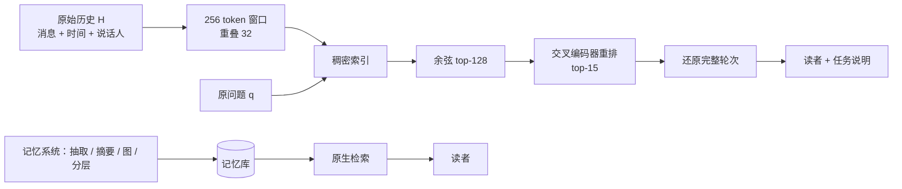

# Is Complex Agentic Memory Always Needed? Naive RAG Is Stronger Than We Thought

## Why

长期对话的助手要记住几十上百次会话里的事，而上下文窗口装不下全部历史，于是常见的做法是在模型外面挂一层记忆：把历史写进一个库，需要时再取出来。这里"跨会话"和外挂记忆的含义、为什么必须放在模型外面，见 [为什么记忆要挂在模型外面](concepts/agent-memory-basics.md)，本文不再重复。真正的问题是这层记忆长成了什么样：如今的记忆系统会在写入时抽事实、合并摘要、连成图、分层存放，甚至用强化学习训一个策略决定写什么、读什么。这五道工序各自在做什么、买到了什么、赔掉了什么，见 [记忆流水线](concepts/memory-pipeline.md)。

这些工序之所以越加越多，是因为大家对比较方式有一个默认设定：新记忆系统的对手是上一个记忆系统。于是每篇论文都能报告"我比之前的记忆系统高"，但没人回答"如果什么都不建，只把原始对话切成块、检索出来塞给模型，结果会怎样"。本仓库已有的 [Jev-Mem](jiang2026-jev-mem.md) 就是一个现成例子：它的对比表里是 Full Context、A-MEM、MemoryOS、Nemori、MAGMA，没有一行是直接检索原始历史。这不是个别作者的疏忽，本文复查了 14 项有影响力的工作，发现直接检索要么缺位，要么被配成一个很弱的版本：Mem0 的 RAG 基线只取 1 到 2 个块，Nemori 的块长是 4096 token，Memora 取前 3 块，Memobase 的公开配置只取 1 块且不重排（Appendix E，Table 34）。

这就让"记忆更好"这个前提建立在两个没有被检验的假设上。第一个是读者能力假设：模型自己没法从原始文本里理清状态变化，所以必须在写入阶段就把状态物化下来，也就是执行 UPDATE、DELETE 这些操作。第二个是检索覆盖假设：原始历史切块检索无法覆盖多跳问题和依赖链，所以必须抽事实或建图。这两个假设都能在机制层被拆开看：如果证据齐全时读者能自己按时间顺序解开更新链，那么物化就是一次有损压缩，压缩掉的东西检索阶段再也拿不回来；如果检索只是块太粗、取回的条数太少，那么缺的是检索配置，不是表示形式。

为什么现在必须回答这个问题，理由在成本账上。记忆流水线的开支按消息数增长，每条消息要调用若干次模型来抽取、合并、连边；建库时间以小时计，换一个主干模型就得重建。若它带来的净收益接近零甚至为负，付出的就不只是钱和延迟，还有删除与隐私能力：原文被改写成事实条目之后，很难证明某条信息到底删掉了没有。这笔账在 [Memory Tax](he2026-memory-tax.md) 里已经从"收益减损失"的角度量过一遍，本文换了一个方向逼近同一件事。

所以本文要问的不是"记忆有没有用"，而是：在这些对话问答基准上，复杂记忆相对一个配置正常的直接检索，究竟多买到了什么，这份增量又来自哪一步？要回答它，至少得满足两条验收条件。第一，参照系必须够强，而且两边拿到的证据量要能对照，不能一边塞 15 个块、另一边只给 2 个条目。第二，如果直接检索赢了，必须能把差距定位到构造、访问或阅读的某一环，而不是停在"总分更高"。

于是问题落在：把原始历史切块、稠密召回、交叉编码器重排之后直接交给读者，能不能在这几个基准上追平甚至超过这些记忆系统？如果能，赢的是证据覆盖，还是读者利用证据的能力？

## What

论文给出的答案是：在这四个基准上，复杂记忆不是必需的。一个不做任何 LLM 加工的原始历史检索基线（作者称 RAW-RAG）在 7 个基准-模型设置里 6 个排第一，比最强的记忆系统高 0.13 到 5.53 分；唯一输的一场是 MEME 配 DeepSeek-V4-Flash，落后 MemMachine 1.52 分。作者进一步用三组证据分析说明这不是"读者更聪明"，而是"证据送得更全"：RAW-RAG 更常把足够证据放进上下文，而有效证据除了答案值，还包括推出答案所需的时间顺序与依赖路径；即使把记忆库完整地摊开给选择器，改写过的存储仍比原始证据低 4 到 30 分。

先把任务说清楚：输入是一段跨会话的原始对话历史和一个问题，输出是答案；中间要先从历史里取出证据，再交给答题模型。RAW-RAG 做的是最朴素的那条路：不抽事实、不建图、写入阶段不调用模型，只把原始对话切块，用稠密召回加交叉编码器重排，把证据交给答题模型。论文不提出新的记忆架构，它用这条基线去对照已有的记忆系统。

### 新认识：问题在证据覆盖，不在记忆结构

第一个认识针对"必须物化状态"这个假设。作者审计了 Mem0 在 LoCoMo 全部对话和 500 条 LongMemEval 样本上的写入决策，UPDATE 与 DELETE 合计只占 4.39%（LoCoMo，33,902 次决策）和 2.46%（LongMemEval，428,858 次决策）；去掉重复与格式错误后，真正改变了持久化文本的有效变异只有 1.90% 和 1.34%（Fig. 2）。把 UPDATE 改成只追加、DELETE 改成不操作之后，Mem0 在 LoCoMo 上从 67.36 升到 69.42，四个题型都没有下降（Table 1）。`[已验证，单一系统]` 这组数字说明在这套配置里，变异既少见又没带来收益，但它只覆盖 Mem0 一个系统，结论的适用范围见 Ideas。

第二个认识改变了瓶颈的位置。作者把端到端准确率拆成两段：覆盖率，即检索到的证据足以回答问题的题目比例；以及利用率，即在证据充足的前提下答对的概率。在 MemoryAgentBench 上，七个系统的覆盖率从 19.07% 到 45.29%，跨度 26 个百分点；利用率只在 80.00% 到 89.71% 之间，跨度不到 10 个百分点（Table 7）。MEME 上也是同一形状：覆盖率跨度 40.66 个百分点，利用率 21.04 个百分点（Table 8）。`[已验证]` 换句话说，系统之间的差距主要来自"有没有把该给的证据给到"，而不是"拿到证据后会不会用"；RAW-RAG 的覆盖率最高，利用率并非最好，两者相乘仍然领先。

第三个认识关于"什么算有用证据"。作者在 MEME 的 tracking 与 cascade 题上把覆盖拆成结果覆盖与路径覆盖：结果覆盖要求答案值出现，路径覆盖还要求时间顺序或"上游变化触发下游变化"的依赖链完整。RAW-RAG 的结果覆盖是 90.53%，路径覆盖 56.44%，在结果已覆盖的题目里有 62.34% 同时给出了完整路径；MemMachine 是 56.70%，MemU 只有 9.62%（Table 9）。`[已验证]` 这条结论解释了为什么只抽事实会掉分：事实条目常常保留了值，却把"这个值是什么时候、因为什么变成现在的样子"丢掉了。

第四个认识是对以往评测的重新判断：直接检索被低估，很大一部分原因是基线配置不完整，而不是方法本身弱。作者逐篇核对了 14 项工作中的 RAG 配置，指出块过大、top-k 过小、缺重排三类具体问题（Appendix E）。`[宣称，属配置诊断而非受控实验]` 这一点很重要，因为它把"记忆更好"从一个方法结论降级成一个待验证的经验前提。

### 新方法：一条基线加两把尺子

第一样东西是那条基线本身。作者刻意把它做得最朴素：原始历史只切块、不加工，查询用原问题，靠稠密召回加交叉编码器重排把原始对话轮次送进上下文。它没有任何写入期的模型调用，因此可以当作"零记忆管理"的参照点；具体切多大、取多少、怎么还原，见 How。

第二样是覆盖与利用的分解。它把"证据够不够"和"读者会不会用"分成两个可分别估计的量，从而把系统差异归到证据侧或阅读侧。这个分解不新，但它把一句笼统的"检索更好"变成了可测的两个比例，后面关于路径覆盖和完备存储的分析都建立在它上面。

第三样是完备存储对照。作者设计了三个条件：各系统原生的检索与阅读（N）、在导出的全部持久化记忆上做 gold 引导的选择（C）、以及在同样的 gold 信号下直接选原始会话（R）。C 与 R 的差衡量"存储里剩下什么"，C 与 N 的差衡量"存了但取不出来的部分"。这把"记忆坏了"拆成"造坏了"和"取不出"，是全文最有信息量的实验设计。

### 新结论：数字、消融与边界

主结果按基准分开看。LoCoMo 上 RAW-RAG 是 89.07（GPT-4o-mini）与 93.70（GPT-4.1-mini），比最强基线 MemMachine 的 88.12 与 91.69 分别高 0.95 与 2.01；LongMemEval 是 87.53，比 Memora 的 87.40 高 0.13；MEME 配 GPT-4o-mini 是 39.30，比 MemMachine 的 37.06 高 2.24；MemoryAgentBench 是 48.32（GPT-4o-mini）与 53.41（DeepSeek-V4-Flash），比 Memora 的 43.84 与 47.88 高 4.48 与 5.53（Tables 3、4）。`[已验证，但主表未给置信区间]` 这些数字里，0.13 与 0.95 这种量级的领先需要谨慎对待，理由见 Ideas 第一条。

消融的结论比主表更锋利。去掉重排掉 3.92 分，只取 1 个块掉 11.73 分，取 120 个块反而掉 14.57 分；块长在 128 到 1024 token 之间变化，总分都在 1.3 分以内（Table 5、Table 19）。这说明重排和适量的检索深度是必要的，而具体的块长与 k 并不敏感。更关键的是三种"加记忆管理"的改动全部变差：原子事实抽取把 MemoryAgentBench 总分从 48.32 压到 28.70，摘要增强到 42.51，图扩展检索到 42.54（Table 5）。`[已验证；原子事实一项与演示格式耦合，见 How]`

成本上，RAW-RAG 在 10 个 MEME 会话、110 道题上的建库加检索是 305.91 秒，比次快的 EMem（1561.97 秒）快 5.1 倍，比 EverMemOS 快 30.4 倍（Table 6）；在 1,710 条消息、接近一百万 token 的 BEAM-1M 上，累计写入时间是 0.33 小时，次快的 MemOS 是 3.25 小时，Memora 是 26.95 小时（Fig. 1 右）。三种记忆管理改动则要花 21.6 到 109.3M token、2.9 到 8.8 小时，而 RAW-RAG 是 0 token、12 分钟（Table 32）。`[已验证，但不含答题生成]`

边界同样清楚。补测 PersonaMem-v2（5,000 道多选题、32k 历史）时，RAW-RAG 只排第三：49.62 分，低于 MemOS 的 50.72 与 EverMemOS 的 53.25，且没有在任何单个场景里领先（Table 18）。在 MEME 配 DeepSeek-V4-Flash 时它也输给 MemMachine，而 Full-context 在同一设置下比它高 19.98 分（Table 4）。此外把证据统一压到 5,000 token 后，LoCoMo 与 LongMemEval 反而各升 0.35 与 1.67 分，MEME 降 1.09 分（Table 23）。`[已验证]` 这些结果说明"朴素检索更强"不是一个与解读器、基准、预算都无关的定律，而是一个有条件的方向。

## How

判型：以**实证与基准类**为主，附少量**系统与算法类**。判型依据是全文重心在"怎么测、测出来怎么解释"：四个主基准加一个补测基准、十二个记忆系统加一个 Full-context 参照、四组诊断与一组消融，没有提出新的记忆架构；RAW-RAG 本身只是把标准检索组件拼在一起。因此下面先拆这条基线的机制，再拆四组诊断各自能证明什么、不能证明什么，最后交代统计与成本口径。

### 一、基线：把"不加工"做到位

把历史写成 $H=(m_1,\dots,m_T)$，每条消息带日期、说话人和内容，缺日期就标为未知，图片说明按文本拼进去。作者把每条消息序列化之后切成 256 token 的窗口，步长 224，也就是相邻窗口重叠 32 token；每个窗口记住自己覆盖了哪些原始消息，以便后面还原成完整轮次。索引是每个会话一个扁平向量库，窗口原文与向量一起存，不做摘要、不抽事实、不建图。

查询时直接用基准给的原问题，不改写、不扩写。这个选择是有意的：改写查询本身是一种查询侧控制，会把"证据访问"和"查询构造"混在一起，而本文想隔离的正是前者。给定问题 $q$，先按余弦相似度取回 128 个窗口：

$$
D_q=\operatorname{Top128}\{\cos(e(q),e(c)) : c\in \mathrm{chunks}(H)\},
$$

再用交叉编码器对每个"问题-窗口"对打分，取前 15：

$$
S_q=\operatorname{Top15}\{r(q,c) : c\in D_q\}.
$$

最后一步是还原。选中的 15 个窗口各自展开成与它重叠的完整对话轮次，重复的轮次默认保留，所以读者看到的 token 数会大于 15×256。MEME 上按时间顺序排列，以保留状态演进的先后；MemoryAgentBench 上关闭展开，两个事实整合类数据源按"一条事实一条消息"建索引，并保留序号线索用于冲突消解（Appendix B.1）。

读者收到的就是这些原文加基准任务说明。默认不设证据 token 上限，也不做头尾截断；只有显式标注的 5k 对照才加预算（Appendix B.3）。这一点决定了后文所有关于"证据量"的讨论：主实验里 RAW-RAG 平均送出 3,915.8 到 11,986.1 token 的证据，而各系统的原生长度差别很大（Table 20、Table 21）。在 MemoryAgentBench 上，EMem 与 Mem0 平均只有 2.6k 与 3.6k token，EverMemOS 与 MemMachine 则到 15.4k 与 26.3k，RAW-RAG 是 3.9k；也就是说，主表里没有按长度对齐预算。

### 二、诊断一：变异到底发生了多少次

这一组用的是 Mem0 的写入日志，而不是另建一个系统。作者把每次写入决策分成 ADD、UPDATE、DELETE、NONE 四类，再区分"提出了变异"与"变异真的落库并改变了文本"：提案率统计 UPDATE 与 DELETE 占全部决策的比例；有效率要求持久化记录里的新旧文本确实不同，删除则要求记录真的消失。这个区分很关键，因为模型经常提出一个 UPDATE，但内容与已有条目重复，或者格式坏掉没有写进去，从日志上看是变异，从效果上看不是。

干预实验把提议的 UPDATE 一律改成 ADD、DELETE 一律改成 NONE，其他流程不动，然后在 LoCoMo 上重跑。这相当于问"如果这个系统只会追加，会怎样"，答案是不会更差，反而高 2.06 分（Table 1）。要注意这是单系统、单基准、单主干的对照，没有置信区间，也没有在 MemOS、A-MEM 这些变异更激进的系统上重复。

### 三、诊断二：读者能不能自己解开状态

第二个诊断针对"读者能力假设"。MEME 的每道题都标了提问所处的阶段，作者把所有在该阶段可见的支撑会话按时间顺序全部交给读者，不做检索、不设上限，等于消除了检索错误，只留下"读者能否从原始证据里推出当前状态"这一个变量。Abs（失效/无替代值）题额外给一条不泄露答案的依赖有效性说明：如果上下文说某个事实依赖的上游变了，就不要把旧值当现值；如果之后没有给出新值，就回答"我没有这个信息"（Appendix G.11）。

结果分化很大：DeepSeek-V4-Flash 在 cascade 上到 82.32%、在 Abs 上到 91.54%，总体 85.48%；GPT-4o-mini 的 cascade 只有 1.83%，总体 50.50%；Qwen3.5-35B-A3B 居中，70.25%（Table 2）。`[已验证]` 这组数字支持"强读者能从足够证据里重建状态"，但也暴露一个限制：它证明的是"给全证据时能做到"，不是"检索能把这些证据找齐"。后一件事由覆盖率那一组回答，而覆盖率最高的 RAW-RAG 在 MEME 上也只有 76.35%。

### 四、诊断三：覆盖、利用与路径

覆盖率与利用率的定义很直接。对问题 $i$ 和系统 $s$，令 $C_{is}\in\{0,1\}$ 表示判定证据是否充分，$Y_{is}\in[0,1]$ 是答案得分，则

$$
\hat C_s=\frac{1}{N}\sum_i C_{is},\qquad
\hat U_s=\frac{\sum_i C_{is}Y_{is}}{\sum_i C_{is}}.
$$

利用率的分母是"该系统自己判为充分"的题目集合，所以它不是同一批题上的受控读者比较；作者在 §5.1 明确写了这一点。MemoryAgentBench 用 LLM 裁判判断证据是否充分，MEME 用任务特定的确定性检查：ER 要有目标值，Agg 要有全部待聚合值，Tr 还要有时间顺序，Del 要有显式删除事件，Cas 要有新值、依赖规则和上游触发，Abs 要有旧值、依赖和失效触发（Appendix C.1）。

路径覆盖是在结果覆盖之上再判一次：对 tracking 与 cascade 的 after 题，先看答案值是否出现，再看时间顺序或"上游变化→下游变化"的链条是否完整；$P(\text{path}\mid\text{result})$ 是结果已覆盖的题目里路径也完整的比例。RAW-RAG 的 62.34% 与 MemU 的 9.62% 差距，说明"检索到值"和"检索到能用的值"是两件事（Table 9）。

### 五、诊断四：完备存储能救回多少

这一组是全文最能说明问题、也最容易被误读的实验。三个条件的差别必须分清：

- **N（native）**：系统自己的检索加自己的阅读流程，就是主表里的成绩。
- **C（complete store）**：把系统导出的全部持久化记忆拿来，用 gold 信息做选择，再按统一的 5,000 token 预算打包。选择器不用向量相似度，只做词面匹配：对每个存储对象 $m$，把 gold 字段（目标实体的前值、后值、级联源、问题里的实体名、期望答案）归一化成短语集合，命中一个短语按 $4+\min(4,|h|/3)$ 计分，再加上与问题词集合的重叠比例：

$$
s(m)=\sum_{h\in H(m)}\left(4+\min\left(4,\frac{|h|}{3}\right)\right)+\frac{2\,|\mathrm{words}(m)\cap Q|}{\max(1,|Q|)}.
$$

- **R（raw control）**：用同样的 gold 信号直接选原始会话，同样 5,000 token 预算，同样任务策略。

C 减 N 是"存了但取不出来"的部分，R 减 C 是"存进去时就已经变形"的部分。结果 R 是 61.60%，C 最高的是 RAW-RAG 57.54% 与 MemMachine 57.46%，最低的 Mem0 32.26%、MemU 31.07%；也就是说，即使把库完整摊开，改写过的存储仍比原始证据低 4.06 到 30.54 分（Fig. 5、Table 29）。作者又把 5,000 token 上限去掉重跑，七个存储仍比原始证据低 7.58 到 29.38 分，说明差距不是打包预算造成的（Table 30）。

但这组对照的归因要小心。C 与 R 不只差在"存储内容"，还差在选择规则、打包顺序和读者指令；C 减 N 也同时包含了"访问变宽"和"任务信息变多"。作者在 Appendix C.5 自己列了这些限制：除 EMem 有阶段快照外，导出的是最终库，被覆盖或删除的对象已经看不到，幸存对象可能带着后来的修订；Mem0 尤其受这一点影响。所以 Finding 3 的措辞应该是"保留原始信息与下游可恢复性相关"，而不是"已经定量测出了写入期信息损失"。

### 六、实验设置与统计

基准方面，LoCoMo 用 10 段对话、1,540 道非对抗题；LongMemEval-S 用 500 题；MEME 用 100 个 episode、32k token 干扰内容、1,188 道分阶段题；MemoryAgentBench 用 14 个数据源的 2,071 题，按 Accurate Retrieval、Test-Time Learning、Long-Range Understanding、Conflict Resolution 四项能力取平均；PersonaMem-v2 是补测，5,000 道多选题、32k 历史。读者有四个：GPT-4o-mini、GPT-4.1-mini、DeepSeek-V4-Flash、Qwen3.5-35B-A3B。

检索骨干有两套：text-embedding-3-small 配 Cohere Rerank-v3.5，以及 Qwen3-Embedding-4B 配 Qwen3-Reranker-4B。前者用于与 Mem0、RecMem、Nemori 那一组设置对齐，后者用于与 EverMemOS 的设置对齐；作者保留了多数基线原论文发布的分数，只补测了 SimpleMem、MemMachine、部分 Memora 与 RAW-RAG（Appendix A）。这一点是理解主表的前提：表里的分数不是在同一次受控运行里产生的。

统计上，检索消融与最终 k 扫描用 20,000 次按数据源分层的配对 bootstrap，并对同一族内的比较做 Holm 校正；覆盖率用 Cochran's Q 加精确 McNemar，利用率用中心化极差 bootstrap 加双侧符号检验，MEME 按 episode 整簇重采样；完备存储的对比用 20,000 次 episode 配对 bootstrap，但不做多重校正（Appendix C.6）。主表的系统间比较没有给置信区间，这是后文要用的一个缺口。

### 七、证据强度与成本口径

端到端证据是七个基准-模型设置的主表，加上 5k 预算对照、PersonaMem-v2 补测与完备存储的无上限重跑。消融集中在 MemoryAgentBench 配 GPT-4o-mini，覆盖重排、块长、最终 k、三种记忆管理改动，每项都有配对区间。诊断有四组：写入日志审计、阶段可见 oracle、覆盖/利用/路径，以及完备存储的 N/C/R。

缺的环节也很明确。第一，主表没有置信区间，而 0.13 分这种差距无法与评分噪声区分。第二，消融只在一个基准、一个读者上做，原子事实那一项的 -19.62 分与演示格式耦合：MemoryAgentBench 的 Test-Time Learning 需要"输入-标签"成对、边界清楚的示例，抽成事实条目会破坏这个格式，作者在 Appendix F 承认这一点。第三，完备存储的 C 条件同时改了选择、打包和任务策略，R 与 C 的差不能纯粹归给写入损失。第四，没有把以往那些弱 RAG 基线用其原始记忆表示重跑一遍，Appendix E 末尾自己写了"quantifying their contribution requires controlled reruns"，这一步没做。

成本只算建库与检索，不算答题生成。MEME 那组是单外部并发、保留各系统内部并行；BEAM-1M 是单并发顺序灌入，累计写入时间从 0.33 到 26.95 小时。作者明确写了计时包含本地计算、存储、API 延迟、网络与重试，也写了各系统的"就绪"判定不同（MemMachine 要等语义抽取队列清空）。硬件是一台 i9-13900HX、16 GiB 内存、RTX 5070 Ti Laptop 12 GB 的 Windows 11 机器，模型推理走 API（Appendix D.7）。这意味着绝对秒数换一台机器就会变，但量级关系（零 LLM 调用 vs 数万次调用）不会变。

### 八、走一遍：一条删除请求

用 MEME 的删除题说明机制差异，例子是构造的，分数不是实测。用户先说"我对花生过敏，别给我推荐含花生的餐厅"，几轮之后说"我的过敏记录可以删掉了，我现在不过敏了"，最后问"我现在能吃什么"。RAW-RAG 会把这三段原文都检索出来（假设 top-15 覆盖到），读者看到时间顺序，能判断"过敏"已经失效，于是正常推荐。一个只存事实条目的系统可能只留下"用户对花生过敏"这一条，删除事件在抽取时没有被表示成条目，或者被合并进旧事实，读者看到的是一份干净但没有时间标记的档案，于是继续避开花生。这正是 Table 9 里路径覆盖差距的具体形态：值都在，缺的是"这个值什么时候失效"。

## Ideas

### 不足

1. **主表没有置信区间，而部分领先小于噪声**（评估问题）。LoCoMo 上证据完全没变的 1,499 道题在重跑后仍把总分抬高了 0.281 分（折合每题约 0.29 分，Table 23 的分解），说明读者与裁判的波动就在 0.3 分量级；LongMemEval 的 0.13 分领先贴着这个量级，LoCoMo 的 0.95 分领先也只有它的三倍多，两者都不足以称为稳定优势。
2. **证据预算不对齐**（方法与评估问题）。主实验里各系统用各自的原生预算，RAW-RAG 平均送出 3,915.8 到 11,986.1 token；在 MemoryAgentBench 上，基线的原生长度从 2.6k 到 26.3k 不等，5k 对照只是统一上限，不是按各自原生长度对齐，结果 EverMemOS 有 2,011/2,071 道题被截、MemMachine 有 2,030 道，RAW-RAG 一道都没被截（Table 21）。方向上是在对齐上限，实际效果却是自己不受影响、别人被截，公平性只完成了一半。
3. **补测基准与主结论口径不一致**（评估问题）。PersonaMem-v2 上 RAW-RAG 排第三，摘要与结论都没有提；这不是隐瞒，因为作者把范围写成"四个基准"，但"naive RAG 更强"的适用范围也因此应该严格限定在对话问答，而不是更一般的长期记忆任务。
4. **变异审计只覆盖 Mem0**（数据问题）。4.39% 与 2.46% 是 Mem0 的抽取策略与提示词的产物；MemOS、A-MEM 这类以图或条目为中心的系统变异率可能高一个量级。用它推出"显式变异不必要"属于从一个系统外推到一类方法。
5. **完备存储的对照不干净**（评估问题）。C 同时改变了候选集、选择规则、打包顺序与读者策略，R 与 C 的差里混着这四项；导出的又是最终库而不是阶段快照，被覆盖与删除的对象不可见。作者承认这些，但 Finding 3 的表述比证据强。
6. **消融的适用范围窄**（方法问题）。三种记忆管理改动只在一个基准、一个读者上测；原子事实的暴跌主要来自 TTL 演示格式被破坏，作者自己写了这是耦合的。因此不能从 28.70 推出"事实抽取普遍有害"，只能说"在这个读者与这个任务格式下有害"。
7. **成本口径偏向自己**（系统问题）。只比建库与检索，不比答题；RAW-RAG 把成本从写入挪到了查询（更长的证据、更多推理 token），按查询次数放大后，零写入的优势会被摊薄。论文没有给"总成本随查询数变化"的曲线。
8. **任务域只覆盖"从记录里答题"**（数据问题）。删除、隐私擦除、给工具暴露权威状态、更新后触发动作，这些都不在基准里；作者在 §6.1 与 Appendix F 承认，但这也正是记忆系统存在的运营理由。
9. **基线分数跨论文混用**（评估问题）。主表多数基线分数来自不同论文与环境，少数由本文补测，作者保留原值以求可比，代价是读者、裁判、提示词都不完全一致；表内还有一处原文自己标出的矛盾：Mem0 在 LoCoMo 的分类加权是 62.14，公布的总分是 66.88，两者都保留（Appendix A.1.3）。

### 创新点

**一、预算匹配的净值曲线**

- 主张：把"谁更强"改写成"在同等读者 token 预算下谁更强"，画一条准确率随预算变化的曲线，而不是在各自原生预算上比一个点。
- 与原文关系：扩展（原文只做了全局 5k 上限，没有按系统原生长度对齐）。
- 最小验证：在 MemoryAgentBench 与 LoCoMo 上，把 RAW-RAG 的证据裁到每个基线的原生中位数（Mem0 约 1,033、EMem 约 171），再以 0.5k、1k、2k、4k、8k 扫一遍；判据是曲线是否在某档交叉，以及交叉点落在哪个 token 量。
- 失败条件：若曲线在所有档位都平坦、系统排序也不变，说明预算不是解释变量，这个改写只增加工作量、不改变结论；若在低预算档 RAW-RAG 全面落后，则记忆的价值是"压缩"而非"组织"，原文结论需要改写而不是加强。

**二、把覆盖优势与 token 量解耦**

- 主张：RAW-RAG 的覆盖率优势有一部分是"给得多"的机械结果；把 token 量对齐后，剩余差距才是表示形式带来的。
- 与原文关系：反驳（针对 Finding 1 的归因）。
- 最小验证：三组对照同跑——RAW-RAG 原样、RAW-RAG 加等量随机干扰块把 token 补齐、各记忆系统加一路原始历史检索（即 Memory Tax 的 src-aug）。判据是第二组是否明显下降、第三组是否明显上升。
- 失败条件：若加干扰块不掉分、src-aug 也不涨，说明差距真的来自表示形式，原文的覆盖解释不成立。

**三、用"保留度"预测可恢复性**

- 主张：写入阶段保留了多少信息，可以用一个便宜的指标预测，不必每次跑完整 QA；这样"该选哪种记忆表示"就变成一个可计算的设计问题。
- 与原文关系：增量（把原文的诊断变成设计工具）。
- 最小验证：对七个系统在每个 MEME episode 上算值保留率与关系/顺序保留率，和逐题的可恢复性（同一题在 C 与 R 条件下的对错差）做相关，样本是 1,188 道题 × 7 个系统；判据是题目级 Spearman 大于 0.6。
- 失败条件：相关性弱于 0.3，说明下游损失主要由检索与打包决定，而不是写入保留度，那么"保留原始信息"这条建议就失去定量依据。

**四、查询次数决定盈亏平衡**

- 主张：RAW-RAG 的优势是零写入成本，劣势是每次查询都更贵；存在一个查询次数 $N^{*}$，超过它之后记忆系统的总成本更低。
- 与原文关系：正交（原文把成本截在答题之前）。
- 最小验证：用 BEAM-1M 的 token 日志，按每个系统实际证据长度估算单次查询的读者 token，画累计成本随 $N$ 变化的曲线，求与各记忆系统的交点；判据是 $N^{*}$ 是否落在真实部署的查询频次范围内（例如每段历史 10 到 100 次查询）。
- 失败条件：若 $N^{*}$ 在所有系统上都大到不现实，说明在这些工作负载上记忆的固定成本永远收不回来；若 $N^{*}$ 很小，则原文的效率结论只在低查询频次下成立，需要加限定。

**五、读者能力 × 变异策略的二维扫描**

- 主张：显式变异是否值得，取决于读者能力；弱读者可能确实需要预先物化状态，强读者不需要。作者在 §6.1 把这一点列为未来工作，但没有测。
- 与原文关系：增量（补作者自己指出的缺口）。
- 最小验证：三个能力档的读者（如 GPT-4o-mini、DeepSeek-V4-Flash、Qwen3.5-35B-A3B）× 三种记忆策略（全变异、ADD/NONE、纯原始检索），在 MEME 上跑 2×3 网格，看是否存在"读者越弱、变异收益越大"的交互。
- 失败条件：若交互项接近零，说明变异与读者能力无关，"状态维护是读者能力的替代品"这个直觉不成立，原文的单系统审计反而更有代表性。

## 相关工作

与 [Memory Tax](he2026-memory-tax.md) 的关系最直接，两篇论文问的是同一个问题，走的是两条路。Memory Tax 固定一个调好的 RAG（混合检索加重排、两轮查询），拿 11 个记忆系统在 3 个基准、3 个主干上做 99 格对照，把差距拆成 benefit 与 tax；本文则固定一组公开的记忆系统，造一条更强的单轮 RAG 基线，把差距拆成覆盖、路径与存储保留。两者的结论方向一致：多数记忆系统相对直接检索没有净收益。差别在证据结构：Memory Tax 有逐题配对与显著性，本文有更细的机制诊断（路径覆盖、完备存储、写入日志），但没有主表置信区间。两篇合起来看，本文的 Appendix E 正是 Memory Tax 想修的那个问题（RAG 基线太弱），而 Memory Tax 的 src-aug 正是本文 R−C 差距的一个可能补法。

与 [Jev-Mem](jiang2026-jev-mem.md) 的关系是"被批评的对象"与"批评"的关系。Jev-Mem 用多关系图加一个只打分的轻量控制器来组织记忆，对比表里没有 RAG；本文的主张是，缺了这一行就无法判断它的增益是来自图结构，还是来自"多检索了一些原文"。两者用的基准不同（Jev-Mem 主要在 LoCoMo，本文覆盖四个），所以不构成直接反驳，但本文的 RQ2 给出了一个可迁移的检验：把记忆操作加到同一条检索栈上，如果分数下降，说明操作本身在丢信息。

在更大的范围里，本文属于"记忆的实证审计"这一支：不提出新系统，而是重新规定参照系与归因方式。它与 [为什么记忆要挂在模型外面](concepts/agent-memory-basics.md)、[记忆流水线](concepts/memory-pipeline.md) 两篇概念笔记的关系是：概念笔记解释这条流水线为什么存在，本文测量它在什么条件下不划算。

## 可复现

- 代码：<https://github.com/Litmeb/RAW-RAG>。
- 数据：LoCoMo、LongMemEval-S、MEME、MemoryAgentBench、PersonaMem-v2、BEAM-1M 均为公开基准；MEME 使用 32k token 干扰内容的条件。
- 检索组件：text-embedding-3-small 与 Cohere Rerank-v3.5，或 Qwen3-Embedding-4B 与 Qwen3-Reranker-4B；窗口 256 token、重叠 32，召回 128，重排取 15，默认不设证据上限。
- 读者：GPT-4o-mini、GPT-4.1-mini、DeepSeek-V4-Flash、Qwen3.5-35B-A3B；LoCoMo 与 LongMemEval 的裁判是 GPT-4o-mini，每题三次二值判断。
- 统计：检索消融 20,000 次分层配对 bootstrap 加 Holm；覆盖率 50,000 次重采样；完备存储 20,000 次 episode 配对 bootstrap。
- 硬件：一台 i9-13900HX、16 GiB 内存、RTX 5070 Ti Laptop 12 GB 的 Windows 11 机器，模型推理走 API（Appendix D.7）。
- 无法复现的部分：主表多数基线的分数来自原论文，未把全部系统在同一次受控运行中重跑；完备存储的导出是最终库而非阶段快照，被覆盖与删除的对象不可见；R−C bootstrap 的原始随机种子已丢失，重跑只能得到近似区间；5k 对照里 Mem0 与 MemOS 用的是早前的托管服务配置，与主表的本地配置不同。
