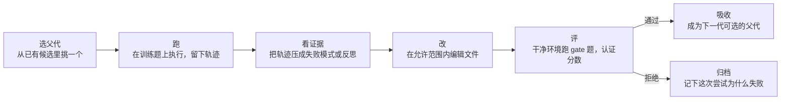

# 智能体进化：把执行反馈变成持久修改

这篇不是论文笔记，是一篇概念说明。它展开的是 [RSIHub 笔记](../wang2026-rsi-hub.md) `Why` 里被压紧的几件事：什么叫"让 agent 进化"、一轮进化要做哪些工序、四个代表方法各自改什么、以及为什么这类实验特别容易自己骗自己。那位笔记的 `Why` 用一道 Terminal Bench 的题做了开场，这里把它拆成完整的五步，并把"可变面与度量面重合"这个抽象说法落成具体的骗分路径。

## 一、"进化"不是让模型变强，是让仓库里的文件变好

先把三个层分开，它们经常被混成一句"模型自我改进了"。

**第一层是参数。** 微调改的是权重，需要训练数据与算力，改完之后所有用户共享同一套行为。

**第二层是上下文。** 推理时的反思、重试、让模型自己检查一遍，都属于这一层。Reflexion 把语言反馈写回提示、跨试验复用，Self-Refine 在测试时改输出——它们的效果很好，但会话结束就没了，下一次还要重新想一遍。

**第三层是仓库里的文件。** 提示词模板、技能说明、工具封装、重试策略、编排脚本，这些文件在磁盘上，可以 diff（比较前后差异）、可以回滚、可以被人审阅；它们通常合称 harness。改它们不需要梯度，只需要一次成功的编辑。agent 进化指的是这一层：用执行反馈去改这批文件，让改动留下来，供下一次运行使用。

第三层有一个第一层、第二层都没有的性质：**改动是可读的、可归因的。** 你可以打开 diff 看见"它把超时从 30 秒改成了 120 秒"，也可以看见"它在提示词里加了一句先读日志再重试"。这让"进化"从一句口号变成可以审计的对象，也正是 [RSIHub](../wang2026-rsi-hub.md) 那套档案要记录的东西。

## 二、一轮进化要走的五道工序

拿一道典型的题走一遍（场景是示意，不是某一篇论文里的原题）。给 agent 一个坏掉的代码仓库和一段说明，让它在命令行里改到检查通过；第 0 代是未改动的 agent，它失败了。下面按理解需要压成五步，[RSIHub](../wang2026-rsi-hub.md) 把同一条链拆得更细，是七个阶段。

**第一步是选父代。** 如果档案里已经有三个候选（第 0 代、第 2 代、第 5 代；候选指某一代被改出来、等待评分的那一份代码），要决定从哪一个继续改。贪心就是挑分数最高的；Pareto 会同时保留"分数高"与"改动小"两种候选，避免一条线走到黑；A-Evolve 则按目标函数选，允许偏离当前最好但更接近目标的那个。

**第二步是跑。** 在训练题上执行父代，拿到轨迹：每一步的观察、动作、工具返回。这一步往往最贵，因为要真的启动容器、真的跑命令。有些实现会复用父代已经记录过的评测（replay），省掉重复执行，代价是证据可能与被评测的条件错位。

**第三步是把轨迹压成证据。** 原始轨迹动辄几十步、几万 token，不能直接塞给改写 agent。所以要压缩：AHE（Agentic Harness Engineering）抽失败模式，GEPA（Reflective Prompt Evolution）写轨迹反思，有的方法直接给一段紧凑的执行记录（trace）。压缩方式决定了后面能改对什么——如果证据里只剩"测试失败了"，改写 agent 只能瞎猜；如果证据里写了"第 6 步读日志之前就重试了三次"，它就知道该改哪里。

**第四步是改。** 这是唯一产生持久变化的一步。它可以由固定规则完成（比如把超时乘二），也可以由一个 agent 多轮完成（读代码、写补丁、在训练题上小规模试跑、再改）。改动范围由可变面限定（配方声明候选能改哪些文件）：只改提示词是一种实验，改整个 harness 是另一种实验，连进化算子（每个阶段的一种实现）本身一起改是第三种。

**第五步是评与吸收。** 在一个干净的环境里跑评测题，拿到分数；再由准入策略决定这个候选能不能成为下一代的父代。这里有一个容易被忽略的分工：**"分数是多少"是测量，"能不能当父代"是策略。** 前者必须客观、可复现；后者可以激进也可以保守。把两者混在一起，就会出现"分数不好看就不记录"这种自欺。

走完一轮，档案里多一条记录；重复十轮，就得到一条候选链。所谓"进化"，就是这条链加上筛选规则。

## 三、四个代表方法各自改什么

这四个方法在 [RSIHub](../wang2026-rsi-hub.md) 里被写成同一套算子上的配方（只声明每个阶段用哪个实现、候选能改哪些文件的配置），所以它们的差别可以被压成一张表。

| 方法 | 改什么 | 搜索与准入行为 | 想解决什么 |
| --- | --- | --- | --- |
| AHE | harness 文件 | 按执行证据改写 harness | 把"工程调参"自动化 |
| GEPA | 提示词与任务技能 | Pareto 选择 + 小批量验证 | 用反思替代梯度 |
| A-Evolve | 提示词与目标技能 | 目标导向的持久适配 | 把部署期适配写成优化 |
| Hyperagents | 目标与选定的算子 | 任务与进化策略共同进化 | 连"怎么改"也一起改 |

前两列与第三列来自原文的方法对照表，第四列是我按各方法的问题背景补的一句话，不是原文表述。读法是：AHE 最保守，只动工程参数；GEPA 动文本，用反思当梯度；A-Evolve 把"目标"写进适配方向；Hyperagents 最激进，允许改进流程本身被改进——这也是它最难评估的原因，因为"策略在变"意味着"比较的基准也在变"。

还有两个不属于上表但常被并列提到的方向。Promptbreeder 进化的是提示词与变异提示词，ACE 进化的是上下文手册，CoEvoSkills 进化多文件技能并用一个独立的代理验证器评分；再往外，ADAS 用元 agent 生成 agent 程序，DGM 让编码 agent 改自己，AlphaEvolve 进化目标算法。它们的共同点是"用执行反馈改持久工件"，差别在工件是什么、反馈从哪来、谁来决定保留。

## 四、三个容易混的概念

**微调 vs 进化。** 微调改权重，进化改文件。前者需要梯度与数据，后者只需要一次成功的编辑；前者学到的东西难以逐条审计，后者的每一条改动都是一个 diff。两者可以叠：先微调一个更会写补丁的模型，再让它去改 harness。

**提示优化 vs 进化。** 提示优化只动提示词这一个工件，通常有明确的搜索空间（指令、示例、格式）。进化的工件集合更大，可以是提示词、技能文件、工具代码、编排脚本，甚至是"选择与改写的策略"本身；代价是搜索空间没有边界，需要"可变面"这样的显式约束。

**进化 vs 搜索。** 搜索是在固定的候选空间里找最好的一个；进化会生成新的候选，而且新候选会改变下一轮搜索的起点。这个区别听起来微妙，实际影响很大：如果所有候选都由同一个固定规则生成（比如"把超时乘二"），那它其实是搜索；只有当候选由执行反馈驱动的编辑产生时，"进化"这个词才站得住。判断办法是看"下一轮的候选空间是否依赖于上一轮的结果"。

## 五、为什么这类实验特别容易自欺

**第一，可变面与度量面可能重合。** 候选改的是 harness 文件，而"跑这道题"也由同一批文件决定。一个足够聪明的改写可以在不动测试用例的前提下让分数变好看：把超时调长、把异常吞掉、把日志里的失败信号改成成功、把重试次数调高到"总能撞对"。这些改动在 diff 里都合法，在分数上也确实更好。解决办法不是"让模型别这么干"，而是结构上把评测移出可变面——这是 [RSIHub](../wang2026-rsi-hub.md) 的受保护运行时想做的事。

**第二，选择偏差。** 每一代都只保留"更好"的候选，于是档案里只剩成功案例；如果失败的尝试被丢掉，外部看到的就是一条单调上升的曲线。真实的进化曲线通常有平台、有回退，甚至会在某一代之后变差。看不到负结果，就无法判断"这套方法是否只是运气好"。

**第三，单次运行的噪声。** 同一个 agent 在同一道题上跑两次，判决可能不一样；把这种噪声按题累计，几十道题就能翻出十几个百分点的差别。所以"提升 1 到 2 个点"在这种设置下几乎无法与噪声区分。判断办法是自己算一遍粒度：如果一道题值 1.1 点，那 +1.1 就是一道题；再看同一篇论文有没有报告"直接重跑两次的一致率"。

**第四，sealed 划分被污染。** 如果用来决定"哪一代更好"的题，与最后报分的题是同一批，那分数就是选择出来的，不是泛化出来的。所以需要三段划分：训练题产生证据，gate 题决定准入，sealed 题（只在最后报告、不进任何反馈的那一段）只用一次。三段的比例不必相同，但 sealed 必须真的没进过反馈——包括不能进改写 agent 的可见范围。

**第五，自修改的顺序问题。** 如果候选可以改"审自己的规则"，那么它就有动机把规则改松。这类改动不会污染分数（分数仍是认证过的），但会污染搜索：一个永远放行的 Gate 会让任何候选都成为父代，冠军（分数最高的已准入候选）就失去意义。处理办法有两种：把策略算子排除在可变面之外，或者规定"本代候选只能由上一代的策略审"。哪种更好没有定论，但必须先意识到这是一个需要显式回答的问题。

## 六、读这类论文时该看什么

一份清单，五问，按顺序问。

1. **改的工件是什么、可变面怎么划？** 只改提示词，还是整个 harness，还是连策略一起改。可变面越大，结论越难归因。
2. **评测在不在可变面之外？** 如果候选能改评测器、能写记录、能看到 sealed 题，那么分数就不能当作能力的证据。
3. **证据是怎么压缩的？** 从几十步轨迹到一段修改依据，压缩方式决定了能改对什么。压缩得太狠，后面的提升就只是随机搜索。
4. **增益有没有分母？** 进化消耗的算力、token、美元，与"不进化但同预算多试几次"相比如何。没有分母的提升，可能只是多采样。
5. **重复了几次、粒度多细？** 每题跑一次、总共几十道题时，1 到 2 点的差别基本不可信；看论文有没有给逐题翻转率或区间。

这五问不针对某一篇论文，而是这一整类方法的共同弱点。回答得越清楚，结论越值得引用。
