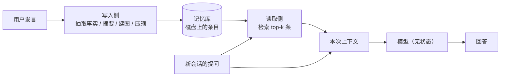

# 长期记忆：为什么要在模型外面挂一层

这篇不是论文笔记，是一篇概念说明。它解释的是 [Memory Tax 笔记](../he2026-memory-tax.md) 开头那句话——"长期运行的智能助手需要跨会话记住事情，于是外面挂一层记忆"——里被压缩掉的三层意思：模型为什么不记事、跨会话跨的到底是什么、以及"挂"这个字为什么重要。读那篇笔记之前或读到卡住时回来看都可以。

## 一、模型本身不记事

先把一个常见的误解拆掉。我们平时说"这个助手记得我"，听起来像是模型内部存了什么，其实没有。今天的大模型是**无状态**的：每次调用都是一次独立的推理，除了这一次请求里塞给它的文字，它不知道任何历史。上一次调用结束时，上下文就被丢掉了，模型参数也不会因为聊了几句而改变。

模型的参数里确实"有记忆"，但那是训练时从海量语料里学到的通用知识（花生是一种坚果、过敏要避开什么），不是你个人的历史（你上周说过自己对花生过敏）。两者不一样，这一点是后面所有讨论的前提。

所以"助手记得我"这件事，只能由模型之外的一个环节完成：某处把你说过的话存下来，下次调用时再把它塞回上下文。模型像一个每天上班都不记得昨天的临时工，公司得给他配一个档案室。

## 二、"跨会话"跨的是请求边界

"会话"（session）就是一次连续的对话。用户关掉窗口、隔一天再来、换一台设备、或者系统本身对每次请求都独立处理，这些都算开了新会话。跨会话记住，指的是第 1 天说过的话，在第 60 天提问时还能被用上。

举个具体的例子。第 1 天用户顺口说："我对花生过敏，上次吃了差点进医院。"第 60 天用户问："公司附近有什么适合聚餐的餐厅？"这两句话之间隔了 59 天、上百次请求，中间没有任何共享状态。如果要让第 60 天的回答避开花生，必须有人在第 1 天把"花生过敏"这件事留下，并在第 60 天主动把它找出来、塞进上下文。这两步是分开的：**存得住**（持久化）和**找得回**（检索），任何一步断了都不行。

顺带说一个容易忽略的细节：跨会话不只是"隔了几天"。同一次对话里如果轮次很多，前面的内容也可能被移出上下文窗口，效果和跨会话一样。所以"跨会话记忆"和"长对话记忆"在工程上是同一类问题。

## 三、为什么不能把全部历史都塞进去

既然模型需要历史，最直接的办法不就是把聊天记录全塞进上下文吗？四个原因让这件事行不通。

**装不下。** 假设用户每天聊 20 轮、每轮 200 字，三个月就是 90 天 × 20 轮 × 200 字 ≈ 36 万字。按中文大约 1.5 个字一个 token 粗算，这是二十多万 token，已经超过常见的 128k 窗口；如果用户用了两年，差得更多。

**付不起。** 上下文里的 token 是每次请求都要重新传、重新算的。上面那个规模的历史，每天问 20 次问题，光是把历史重传一遍就是几百万 token 的输入，而其中 99% 和这次的问题无关。

**效果反而会降。** 上下文越长，模型对中间部分的利用越不可靠，这是长上下文场景里的常见现象。把无关内容塞进去不只是浪费，还会稀释真正有用的那几条。

**延迟。** 输入越长，首字延迟和总耗时越高，而用户对等待很敏感。

所以现实做法不是"全带上"，而是"先挑几条相关的带上"。这一挑，就引出了下面这层东西。

## 四、"挂一层"具体挂的是什么

所谓"外面挂一层记忆"，是在模型之外单独跑一套存储加检索的系统，包含三个环节：

**写入侧**在对话发生时把历史加工成条目：可能是抽取出来的事实（"用户对花生过敏"），可能是整段会话的摘要，可能是图上的节点和边，也可能只是把原文切块后原样存下。**记忆库**是持久化的存储，可以是向量库、文档库、图数据库或者几层文件。**读取侧**在新问题到来时，从库里挑出若干条相关条目，和问题一起拼成这次的上下文，交给模型。写入侧具体包含哪几道工序、每道工序买到什么又赔掉什么，见 [记忆流水线](memory-pipeline.md)。

对照一下三种"记忆"存放的位置，差别就很清楚了：

|  | 存在哪 | 谁能改 | 容量 | 每次提问的代价 |
| --- | --- | --- | --- | --- |
| 模型参数 | 训练进权重 | 只能重新训练 | 固定 | 零 |
| 本次上下文 | 这次请求的输入 | 调用方随便写 | 窗口大小 | 随长度线性上涨 |
| 外挂记忆 | 独立存储 | 系统自己增删改 | 磁盘级 | 一次检索 + 几条 token |

## 五、"在外面"这三个字为什么重要

把记忆放在外面，不是一个实现细节，它决定了这套东西可以被怎样研究。

**它可以被替换。** 换一个大模型，记忆库还在，条目还是那些条目，只是换了个读者。这正是 [Memory Tax 笔记](../he2026-memory-tax.md) 里"鲁棒性"一节要测的事：用 A 模型写进去的记忆，让 B 模型来读，成绩会不会掉。如果记忆在参数里，这个实验根本做不了。

**它可以被计费。** 写入花了多少 token、建库花了多少小时、每次查询多花多少 token 和多少秒，都能单独记账。也正因为能记账，才能问出"这些花销值不值"这个问题。

**它可以被横向比较。** 换掉写入策略、换掉检索策略，其他部分保持不变，就能做对照实验。这是这篇论文能搭起 11 个系统 × 3 个基准 × 3 个主干那张表的前提。

代价是它同时引入了新的失败方式。写入的时候可能漏掉、改写、打散证据；读取的时候可能排不到前面；换模型的时候可能放大差异。这三类失败正好对应论文里构造、取用、鲁棒性三条分析线。

## 六、naive RAG 也是"外挂"

这里有个容易混淆的地方，值得单独说清楚。**naive RAG 同样是外面挂一层记忆**，它一样有存储、有检索、有"挑几条塞进上下文"的动作。它和那些复杂记忆系统的差别不在"有没有挂"，而在**挂的那一层加工了多少**：RAG 几乎不加工，原始对话切块后原样存；记忆系统会抽取、合并、改写、建图。

所以那篇论文的比较不是"有记忆"对"没记忆"，而是"加工程度不同的两套外挂系统"之间的比较。这个区分是整篇论文的支点：如果两边都外挂、都检索，那么成绩差异就只能来自"加工"这一步；加工让信息更好用，是 benefit；加工把证据弄丢或弄坏，就是 tax。[Memory Tax 笔记](../he2026-memory-tax.md) 的 Why 与 What 两节，讲的就是这笔账怎么记。

## 七、这套说法覆盖不到什么

最后补一句边界。"外面挂一层"描述的是**外挂式记忆**，也就是本文评测的那一类。还有两类东西不在这个框架里：一类是把记忆训进参数（持续学习、参数化记忆），它没有独立的库，也就没有"检索"这一步；另一类是直接扩大上下文窗口，让模型一次读更多，它不建库，也就不产生构造损失——但它的成本和长度成正比，本质上没有解决第三节里的问题。这两类在 [Memory Tax 笔记](../he2026-memory-tax.md) 的 Ideas 里被列为未覆盖的场景。

## 延伸阅读

- [memory-pipeline](memory-pipeline.md)：外挂层内部的五道工序——抽事实、摘要、连图、分层、学习式策略，各自买到什么、赔掉什么。
- [he2026-memory-tax](../he2026-memory-tax.md)：把"加工"的收益与损失拆开测量，本文正是以外挂式记忆为对象。
- [jiang2026-jev-mem](../jiang2026-jev-mem.md)：一个具体的记忆系统，它的写入与查找流程可以直接对照本文第四节的两侧。
