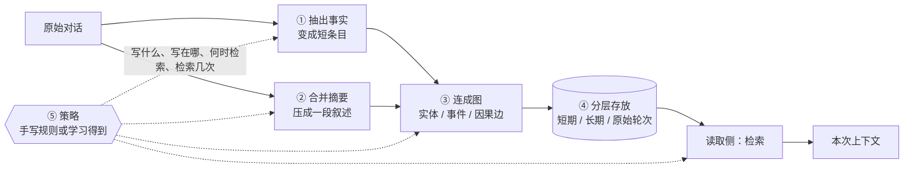

# 记忆流水线：五道工序与它们的代价

这篇也是概念说明，不对应单篇论文。它解释 [Memory Tax 笔记](../he2026-memory-tax.md) 里另一句被压缩的话："今天的记忆已经是一整条流水线：抽出事实、合并成摘要、连成图、分层存放、甚至用强化学习训一个策略决定怎么写怎么读。"

上一篇 [长期记忆：为什么要在模型外面挂一层](agent-memory-basics.md) 讲的是"为什么要在模型外挂一个东西"；这一篇讲"挂的那个东西里面有什么"。两篇合起来，才够读懂论文 Why 的前两段。

## 一、"流水线"这个词指什么

先说结论：这里的流水线不是某一种技术，而是一串**可以自由取舍的加工工序**。原始对话进流水线，出来的是一批"可以检索的条目"；检索的时候从这批条目里挑几条塞回上下文。

之所以要加工，是因为原始对话对检索很不友好。它太长（几十万字）、太散（一件事分十几轮说完）、太口语（同一个意思有好几种说法），直接切块存下来，检索时经常"词对上了但意思没对上"。加工就是为了把这种原料变成更适合检索的形态。

关键在于：工序之间是串起来的，前一道的产出是后一道的输入。不同系统并不是五道全做，而是各选一部分、按不同顺序组合——这就是为什么论文表里那些系统看起来差别那么大，其实都是在同一串工序上做不同的取舍。

还有一点很重要：**每一道工序都在改变信息**。改变是为了让它更好用，但改变本身就有风险。论文把这种改变叫"偏离"（deviation），把偏离带来的损失叫 memory tax。所以下面每讲一道工序，我都会同时说它买到了什么、又可能赔掉什么。

## 二、五道工序分别在做什么

### ① 抽出事实

做法是让模型读一段对话，把它压成若干条结构化的短句：谁、什么时候、发生了什么、结果是什么。比如原始对话里有一句"我上周三吃了花生酱，结果起了一身疹子，医生说以后别碰"，抽出来是两条——"用户对花生过敏（严重）"和"事件时间 2023-05-17"。

买到的：条目短、语义密度高。检索时同样给 5 条的预算，塞进去的是 5 条有效信息，而不是 5 段寒暄。论文把这类收益叫"聚焦的原子抽取"，是记忆能赢过 RAG 的六种情形之一（§D.1）。

赔掉的：抽取本身就是一次有损压缩。原句里的"医生说"（来源）、"起了一身疹子"（严重程度）、"以后别碰"（持续性要求）都可能被压掉；相对时间"上周三"要换算成绝对日期，算错一天就全错。更麻烦的是，一旦抽错，后面所有检索都建立在这个错误条目上，而原始对话里本来是对的。论文的忠实性分析就是在量这件事：抽样 500 条原始事实，看有多少完整保留、多少部分丢失、多少在库里根本没有对应单元（Table 2）。

### ② 合并成摘要

做法是把多轮对话或一批条目压成一段连贯的叙述，常见粒度是"一次会话一份摘要"。它和抽事实的区别是：抽事实产出的是离散的短条目，摘要是连续的一段话。

买到的：容量压缩，而且保留了一点叙事结构。二十轮关于搬家的对话压成五句话，之后问"我为什么搬家"时，这五句话比二十个碎片更容易被一次读进去。

赔掉的：细节被平均掉。上面那五句话里，"周三下午三点"这种具体信息大概率消失了，而问题可能恰好问的就是时间。另一层损失更隐蔽：摘要是一次改写，改写之后和用户原始问法的字面、语义都拉开了距离，检索时反而不容易命中。论文在可访问性一节里把这类现象归成"改写"（rephrasing）和"稀释"（diluting）两种模式（Fig. 24）。

### ③ 连成图

做法是把提取出来的内容变成节点（人、物、事件、话题），再用边把它们连起来。边可以有多种：时间先后、因果关系、指向同一个实体、属于同一话题。

买到的：多跳和聚合。问"我朋友 Rachel 结婚那年我多大"，需要把"Rachel 明年结婚"和"我今年 32 岁"两条本来分散在不同会话里的事实连起来算；问"我、父母、祖父母的平均年龄"，需要把四个人的年龄聚到一起。这些都是纯检索很难做对的，论文把它们列为记忆的典型收益（§D.1 的 multi-hop linking）。

赔掉的：建边本身是一次判断，会判断错；边连错了，检索沿边扩展时会把无关内容一并带进来。而且沿边扩展要多走一轮检索，多一轮就多一次延迟和 token，也更容易把噪声翻上来。论文里图结构那一组（HippoRAG2、PlugMem、MAGMA）的分数并不比平铺存储更高，一部分原因就在这里。

### ④ 分层存放

做法是按寿命或抽象程度把记忆分成几层。常见分法是"短期缓冲 / 中期 / 长期画像"，或者"原始轮次 / 摘要 / 结论"，也有直接拿文件系统目录当层级的。新信息先进短期层，被反复用到或足够重要才晋升到长期层，过期的降级或淘汰。

买到的：常用信息放在手边，旧信息压缩掉，容量可控。会话一结束就把原始轮次清掉、只留摘要，存储能降一个量级。

赔掉的：晋升和淘汰都是不可逆的删除。一条信息如果被判为"不重要"而降级，等真正需要时已经不在库里了——论文的忠实性统计里，"找不到对应单元"那一档（NU）就是这类损失的结果。另外层的边界是人定的，一条信息该放哪层往往在写入时并不知道，放错了以后就再也检索不到。

### ⑤ 学习式策略

这里的"策略"不是"写作策略"这种日常说法，而是强化学习里的 policy：给它当前状态（对话内容、已有记忆、检索结果），它输出一个动作——写入、更新、跳过、检索、继续检索、停止；训练信号是任务最终有没有做成。

论文说的"决定怎么写怎么读"，展开就是两组决策。写：这条新信息要不要存、存成什么形式、是覆盖旧条目还是并存。读：这次要不要检索、检索几次、哪几条进上下文、什么时候停。传统系统把这两组决策写成固定规则（比如"每 10 轮总结一次"），学习式策略则让模型自己学出来。

买到的：不用人写规则，能适配具体任务的分布，也可能学到人想不到的写法。论文里 Mem-T 用分层存储加学习策略，Memory-R2 用平铺存储加学习策略，两个都在部分列上拿到了正收益。

赔掉的：训练成本、样本效率、分布外脆弱、可解释性差，这四条是老问题。还有一个和本文直接相关的成本：策略模型本身要参与每一次写入和读取，调用次数会显著增加。Mem-T 在 PersonaMem-v2 上的在线回答阶段折算下来是 6807.9 分钟，而 RAG 只要 58.3 分钟（Table 20）——大约两个数量级的差距，主要就花在策略的反复调用上。

## 三、走一遍：一句话怎么穿过这五道工序

把上面五道工序串起来看一遍，比分开讲更容易理解它们为什么互相牵制。

第 1 天，用户说："我上周三吃了花生酱，结果起了一身疹子，医生说以后别碰。"

① 抽事实：得到"用户对花生过敏""严重程度：起疹子""时间：2023-05-17"三条。② 摘要：这段对话被并入当天会话摘要里的一句话"用户报告了一次食物过敏经历"。③ 连图：把"花生酱"连到"过敏"这个实体，"花生酱"再连到"食物"话题。④ 分层：三条事实进长期层，原始对话留在短期层。⑤ 策略：判断这条信息属于健康类、权重高，决定长期保留，并把"过敏"标成需要主动避让的属性。

第 60 天，用户问："公司附近有什么适合聚餐的餐厅？"

读取侧先检索，命中的可能是"过敏"这条事实，也可能是"聚餐"这个话题下的旧记录。策略在这里做第二次决定：要不要主动把"花生过敏"塞进上下文？塞几条？如果它决定塞，模型在回答时就会避开可能含花生的餐厅；如果它判断错了、没塞，这次回答听起来完全正常，只是用户可能踩坑。

这个例子说明两件事。第一，记忆的效果不取决于某一道工序做得多好，而取决于整条链是否把对的信息带到了对的时刻——链上任一环断了，结果都是"没记住"。第二，链越长，能出错的地方越多，而且每一环的错误都会往下传：抽错的事实会被摘要写成错的叙述，错的叙述会被连成错的边，错的边会被存进长期层，最后在回答时被当成真的。

## 四、为什么这五道工序会构成"代价"

把上面的"赔掉的"归拢一下，会看到损失其实分两类。

一类是**存的时候就不全了**：抽事实剥离了上下文、摘要平均掉了细节、分层的淘汰删掉了条目。这类损失发生在检索之前，检索再准也补不回来——论文把它归到"忠实性"（faithfulness），做法是把 gold 记忆单元直接喂给模型，看它还能不能答对（§4.2）。

另一类是**存下来了但找不回来**：改写之后与问法不匹配、条目被拆散、图上的边把信号稀释、层级放错。这类损失发生在检索环节，论文把它归到"可访问性"（accessibility），做法是反复检索看要几轮才能把证据全取出来（§4.3）。

还有一条不在单条工序上，而在整条链的稳定性上：每一步都调用模型，换一个模型，五个环节的产出可能全变。这是论文的第三条线"鲁棒性"（§4.4）。

下面这张表是我按论文的证据线做的对应，原文并没有逐工序拆开，所以它是我的整理，不是原文结论：

| 工序 | 主要损失形态 | 论文里对应的证据 |
| --- | --- | --- |
| 抽事实 | 上下文被剥离、抽取错误、时间换算错 | 忠实性四级标注（Table 2） |
| 合并摘要 | 细节被平均掉、改写后匹配变差 | 忠实性与可访问性（rephrasing） |
| 连成图 | 边判断错、扩展带回噪声、多一轮开销 | 可访问性与成本表（Table 19–21） |
| 分层存放 | 淘汰不可逆、放错层 | 忠实性的"无对应单元"（NU） |
| 学习式策略 | 分布外决策、调用次数与延迟激增 | 成本表、鲁棒性（Fig. 6） |

## 五、论文为什么按四个分组评测

论文没有逐道工序去评，而是按"以哪种组织方式为主"把系统分成四组：平铺存储（A-MEM、SimpleMem、MemOS）、分层与生命周期（MemoryOS、LightMem、OpenViking）、图结构（HippoRAG2、PlugMem、MAGMA）、学习式策略（Mem-T、Memory-R2）。

这个分组不是穷举工序，而是取每组里最主流的代表。要注意的是，**存储结构和控制方式是两件不同的事**：前者是①到④怎么组合，后者是⑤用规则还是用学习。所以两组会交叉——Mem-T 是分层存储加学习策略，Memory-R2 是平铺存储加学习策略（§A.2）。读表的时候如果把它们当成互斥的四类，就会误以为"学习策略"是第五种存储结构。

## 六、和前后两篇的关系

- 上一篇 [为什么记忆要挂在模型外面](agent-memory-basics.md)：讲外挂这一层的存在理由，以及它和模型参数、上下文的分工。
- 这一篇：讲外挂层内部的五道工序，以及每道工序各自买到什么、赔掉什么。
- [Memory Tax 笔记](../he2026-memory-tax.md)：讲这些工序合起来到底值不值，以及怎么把"赔掉的"量化出来。
- [Jev-Mem 笔记](../jiang2026-jev-mem.md)：一个把①③⑤都做了的系统实例——抽事实、建多关系图、用一个小模型当控制器做读写决策，可以拿来对照这一篇的五道工序。

## 延伸阅读

- [he2026-memory-tax](../he2026-memory-tax.md)：本文的评测对象正是这五道工序的不同组合。
- [jiang2026-jev-mem](../jiang2026-jev-mem.md)：流水线的一个具体实现。
