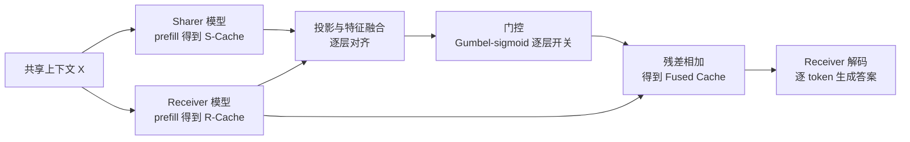

# Cache-to-Cache: Direct Semantic Communication Between Large Language Models

## Why

多模型系统（multi-LLM system）的出发点是：不同模型各有所长，代码模型懂代码结构，数学模型会推导，小模型便宜、大模型知识多。把它们的输出放在一起，理论上能得到任何单个模型都没有的能力。现在这类系统大多靠文本交流：一个模型把自己的理解写成一段话，另一个模型读这段话再作答。问题就出在这段话上。

文本是一个低带宽的中转站。说话模型内部保存的是高维表示，其中包含了它对上下文的理解；写成文本时，这些表示被压成一串离散的 token，听话模型再把这串 token 重新解码成自己的表示。压缩和解压各丢一次信息。论文给了具体的例子（Fig. 2）：代码模型知道 `
` 是段落分隔符，它让写作模型"把自我介绍放到 `<section>` 里"；写作模型不认识 `
` 的 HTML 语义，只能猜位置，于是把内容放错。代码模型并不是没解释，而是它的解释在文本里只剩下一句含糊的指令，真正让写作模型放对位置的那部分结构知识没有被传过去。

文本还会引入歧义和延迟。自然语言里的省略、指代、行业习惯让同一个句子可以有多种读法；即使双方都懂，说话模型也必须一个 token 一个 token 地写完，听话模型才能开始读。一次交接的延迟等于整段文本的生成时间。多模型系统里交接次数越多，这笔延迟越难忽略。

已有的缓存复用工作没有解决这个问题。层间缓存共享、前缀缓存复用、DroidSpeak 的跨模型缓存复用，目标都是让同一个模型或同源微调模型少算一点；它们复用的是"已经算过的缓存"，不是把缓存当作语义载体传给另一个模型。跨模型家族、跨参数规模的缓存传输，现有方法要么要求结构完全一致，要么直接放弃。路由式多模型系统则相反：它按查询难度把请求分给不同模型，被选中的模型继承上下文文本，但没有继承前一个模型算出来的内部表示；小模型即使拿到大模型写下的答案，也拿不到大模型在算这个答案时形成的中间判断。

于是问题可以写成三问。第一，不增加缓存长度，只改变缓存的内容，能不能让模型答得更准？第二，一个模型的缓存经过投影后，能不能被另一个模型直接使用？第三，如果两个模型对同一段上下文的理解确实不同，把两份缓存融合起来，能不能同时拿到两边的好处，而不是只得到其中较强的一边？这三问分别对应"缓存有没有语义"、"缓存能不能跨模型"、"融合有没有互补收益"。

## What

先交代任务。输入是一段共享上下文 $X$（例如一段代码、一篇文档或一道题）和一个问题；系统里有一个提供理解的 Sharer 模型和一个负责作答的 Receiver 模型。C2C 在 prefill 阶段把 Sharer 的 KV-Cache 投影、融合进 Receiver 的 KV-Cache，然后让 Receiver 用自己的缓存解码答案。输出是 Receiver 生成的文本答案。边界是：只做一对一的 Sharer-Receiver 通信；两个模型的权重都冻结，只训练中间的融合模块；不改变模型的 tokenizer、层数或注意力实现。

论文的答案是：可以。C2C 用一个带残差和逐层门控的融合网络，把 Sharer 的 KV-Cache 投影到 Receiver 的表示空间并叠加到 Receiver 自己的缓存上；在四个多选题基准上，Receiver 的准确率比单独作答平均高 9.64–11.88 个百分点，比"文本交接"高 3.06–5.36 个百分点，延迟是文本交接的 1/1.51 到 1/14.41（Abstract, Table 4）。`[已验证，Table 4]`

### 新认识：缓存里的语义可以单独增强，也可以跨模型搬运

第一个认识是，Few-shot 带来的提升并不全来自"多看了几个 token"。论文设计了一个 Oracle 实验：先把示例 $E$ 和问题 $X$ 一起 prefill，得到 $C(E \oplus X)$，然后把示例那一段缓存丢掉，只保留与问题对齐的 $C^{*}(X)$，再用这段与零样本等长的缓存解码（Eq. 2）。如果提升来自"多 attend 了示例 token"，这个 Oracle 应该退回零样本；实际结果是 Direct 58.42、Few-shot 63.39、Oracle 62.34（Table 1）。Oracle 用与 Direct 等长的缓存拿到了 Few-shot 大部分收益，说明示例改变的是问题在缓存里的嵌入质量，而不是缓存长度。`[已验证，Table 1]`

第二个认识是，不同模型的缓存可以互相转换，但转换后只覆盖目标空间的一部分。论文用三层 MLP 把 Qwen3-4B 最后一层的缓存映射到 Qwen3-0.6B 的最后一层，损失用 MSE 而不是下一 token 预测；t-SNE 上原始两份缓存分得很开，映射后源缓存落进目标模型的表示空间（Fig. 3）。但映射后的缓存只占目标空间的一个子集，说明源模型的语义并不能覆盖目标模型的全部语义。论文还给了一个旁证：两个模型的总准确率接近，但答对的题目集合重叠有限（Fig. 7）。这两点合起来说明，跨模型融合有互补的空间，但不能指望一个模型完全替代另一个。`[已验证，Fig. 3, Fig. 7]`

第三个认识是，缓存增强的效果按层分布极不均匀。论文逐层做单层增强，第 4 层从 58.42 升到 58.52，第 16 层升到 58.45，其余层大多下降（Table 10）；把最好的 $n$ 层一起增强，效果略高于全层增强，而增强最差的 $n$ 层会让准确率下降（Fig. 4）。这个现象直接决定了 C2C 的门控设计：不是所有层都值得接收 Sharer 的信息，融合必须能按层开关。`[已验证，Table 10, Fig. 4]`

### 新方法：一个带门控的跨模型缓存融合器

C2C 的核心是一个可训练的缓存融合器（cache fuser）。它有三部分：投影模块把 Receiver 与 Sharer 的缓存拼在一起，经过投影层和特征融合层；动态加权模块根据输入调整投影信息的权重；逐层可学习门控用一个 Gumbel-sigmoid 决定这一层要不要注入 Sharer 的信息。融合结果通过残差加回 Receiver 的缓存，所以即使 Sharer 的信息没用，Receiver 也不会被破坏。两个底座模型冻结，只训练融合器，损失是 Receiver 回答的下一 token 预测。`[已验证，§3.3]`

跨模型融合还要解决两个对齐问题。token 对齐：不同 tokenizer 对同一句话切出的 token 不同，论文把 Receiver 的每个 token 解码成字符串，再用 Sharer 的 tokenizer 重新编码；一个 token 对应多个时，选字符串覆盖最长的那个。层对齐：从最后一层开始往前配对，两个模型的最后一层对最后一层，倒数第二层对倒数第二层，直到较浅模型的第 0 层。论文比较过按深度比例对齐，终端对齐在实验里略好，但没有给数字。`[已验证，§3.3.3, §A.1]`

### 新结论：收益主要来自融合本身，跨模型互补只占一小部分

主结果在 Table 4。Receiver 固定为 Qwen3-0.6B，换三个 Sharer：Qwen2.5-0.5B、Llama3.2-1B、Qwen3-4B-Base。四个基准上 C2C 都高于 Receiver 单独作答，也高于 T2T。以 Qwen2.5-0.5B 为例，MMLU-Redux 35.53→42.92，OpenBookQA 39.20→52.60，ARC-C 41.04→54.52，C-Eval 32.04→41.77；三组 Sharer 的四基准平均提升分别是 11.00、9.64、11.88 个百分点（§4.2）。T2T 的对应提升更小，C2C 比 T2T 高 5.36、4.15、3.06 个百分点。`[已验证，Table 4]`

但把增益拆开看，结论要谨慎得多。Table 6 用同一套训练配置比较三种设置：Single 是只微调 Receiver，不加 Sharer；Identical 是两个角色都用 Qwen3-0.6B 的 C2C；C2C 才是跨模型。四列平均后，Single 41.52、Identical 46.41、C2C 47.95。也就是说，从"不融合"到"用同一份缓存融合"，涨了 4.89 分；从"同模型融合"到"跨模型融合"，只再涨 1.54 分。论文的结论是 C2C 的增益不只是可训练容量或过拟合，但按这组数，跨模型互补的净贡献远小于标题里的 11 分。`[已验证，Table 6；平均值为我按四列计算]`

融合器的消融也指向同一件事。直接把 Receiver 的缓存换成投影后的 Sharer 缓存（Project），平均只有 20.70；加上残差融合（+Fuse）升到 44.88；再加逐层门控（+Gate）升到 47.95（Table 8）。残差融合贡献 +24.18，门控贡献 +3.07。Project 的低分说明"换掉"不行，必须保留 Receiver 自己的缓存；门控的增益不大，但它让模型可以按层选择。`[已验证，Table 8]`

效率和规模的结果在 §4.2–§4.3。T2T 需要 Sharer 解码 80 个 token，耗时 1312 ms；C2C 用一次 90 ms 的缓存融合替代这段解码（Table 3）。三组 Sharer 的端到端加速分别是 3.46×、1.51×、14.41×。LongBenchV1 上按输入长度分箱，C2C 在 0–4k、4–8k、8k+ 三个区间都高于 T2T（37.31 对 33.46、34.01 对 29.70、30.72 对 25.64）；强 Sharer（Qwen3-4B）对弱 Receiver 的设置下，平均分从 36.18 升到 37.97，PGR 为 51.01%（Table 5, Table 11）。`[已验证，Table 3, Table 5, Table 11]`

## How

这篇论文以系统与算法类为主，附实证与基准类。系统与算法类：它定义了跨模型缓存的投影、融合、对齐和训练流程，给出了融合器的结构、门控和复杂度；实证与基准类：它在四个多选题基准、LongBench、GSM8K 上做了端到端对比、消融、规模分析和行为分析。判型依据是它既提出可复用的机制，又用多组实验验证；没有定理，没有新的训练目标函数，也不训练底座模型。

上图据原文 Fig. 1(b) 与 Fig. 5 重画。关键在于：Sharer 的缓存不是替换 Receiver 的缓存，而是经过投影和门控后加回去；Receiver 自己的缓存始终保留。

### 一、预备：缓存是怎么算出来的

自回归推理分两段。prefill 把整段输入 $X[0:n]$ 一次算完，得到每个 token 的键值缓存 $C(X) = [c_0, \ldots, c_{n-1}] \in \mathbb{R}^{n \times d}$；decode 用当前 token $y_i$ 和已有缓存预测下一个 token：

$$
y_{i+1} = P\left(y_i \mid C(X) \oplus C(Y[0:i])\right),
$$

其中 $\oplus$ 表示按序列拼接，$C(Y[0:i])$ 是已经生成的回答的缓存（Eq. 1）。C2C 要做的事，就是在 decode 之前把 $C(X)$ 换成融合后的 $C^F(X)$，其余解码过程不变。这个替换点很关键：它不需要改模型结构，也不需要改解码器，只需要在 prefill 和 decode 之间插一个模块。

### 二、Oracle 一：缓存增强，不增加长度

Oracle 实验比较三种设置。Direct 只在 $X$ 上 prefill，用 $C(X)$ 解码；Few-shot 在 $E \oplus X$ 上 prefill，用更长的 $C(E \oplus X)$ 解码；Oracle 也在 $E \oplus X$ 上 prefill，但把示例段丢掉，只留问题段：

$$
C^{*}(X) = C[\,|E| : |E| + |X|\,](E \oplus X).
$$

这样 Oracle 的缓存长度与 Direct 相同，唯一差别是问题段的缓存被示例增强过。Table 1 的结果是 Direct 58.42、Few-shot 63.39、Oracle 62.34：Oracle 用更短的缓存拿到了 Few-shot 约 80% 的增益。这个实验支撑的是"缓存内容本身携带语义"，而不是"缓存越长越好"。

单层增强的结果在 Table 10。第 4 层从 58.42 升到 58.52，第 16 层升到 58.45；第 6 层降到 54.56，第 14 层降到 54.24。Fig. 4 把"增强最好的 $n$ 层"和"增强最差的 $n$ 层"画在一起：增强最好的 $n$ 层随 $n$ 增加缓慢上升并略高于全层增强，增强最差的 $n$ 层随 $n$ 增加下降。这个实验说明层与层之间不是同质的，融合器必须能选择层，不能一律全加。

### 三、Oracle 二：缓存可以跨模型转换

第二个 Oracle 训练一个三层 MLP，把 Qwen3-4B 最后一层的 K/V 映射到 Qwen3-0.6B 最后一层，损失是映射后缓存与目标缓存的 MSE：

$$
\mathcal{L}_{\text{MSE}} = \left\| \text{MLP}(K_S) - K_R \right\|^2 + \left\| \text{MLP}(V_S) - V_R \right\|^2.
$$

论文把 K 和 V 在隐藏维上拼起来算损失（§A.3.2）。t-SNE 上，映射后的源缓存落进目标模型的表示空间（Fig. 3），说明"跨模型投影"在几何上可行；但映射后的点只覆盖目标空间的一个子集，说明源模型的语义不能完全替代目标模型。这个"部分覆盖"是后面融合而不是替换的依据。

### 四、融合器：投影、加权、门控、残差

C2C 对每一层 $n$ 计算：

$$
C^F_n = C_n(X) + F_n\left(C_n(X), C^S_{G(n)}(X)\right),
$$

其中 $C_n(X)$ 是 Receiver 第 $n$ 层缓存，$C^S_{G(n)}(X)$ 是 Sharer 第 $G(n)$ 层缓存，$F_n$ 是第 $n$ 层的融合器，$G$ 是层映射（Eq. 3）。解码时用 $C^F(X)$ 替代 $C(X)$：

$$
y_{i+1} = P\left(y_i \mid C^F(X) \oplus C(Y[0:i])\right).
$$

融合器内部有三步。第一步投影：把 Receiver 与 Sharer 的缓存按特征维拼接，过一层投影，再过一个特征融合层。第二步动态加权：用一个输入相关的头调制投影后的信息，相当于对每个 token 或每个通道重新分配权重。第三步门控：每层一个可学习标量，训练时用 Gumbel-sigmoid 加温度退火，温度从 1.0 线性降到 0.001，让门从"软"逐渐变"硬"，推理时变成 0/1 开关（§3.3.2, §A.3.5）。

门控的行为在 §A.4.2 有一个有意思的观察。用 OpenHermes-2.5 做通用训练时，门几乎全开，平均激活率超过 98.21%，真正起作用的是动态权重；用 MMLU 辅助训练集做任务特定训练时，门激活率降到 52.67%，被选中的层权重更大。这说明"门"和"动态权重"在不同训练数据下分工不同：通用数据偏向"全开、细调"，任务数据偏向"少开、重压"。

### 五、对齐：token 与层

token 对齐分两种情况。聊天模板里的结构 token（角色分隔符、格式符）没有语义，直接按长度补齐 `<pad>`；消息 token 才做语义对齐：把 Receiver 的每个 token 解码成字符串，用 Sharer 的 tokenizer 重新编码。如果重新编码得到一个 token，就一对一映射；如果得到多个，选字符串覆盖最长的那个（§A.1.2）。论文说两种选择策略（首次出现、最长覆盖）在 80% 以上的序列上给出相同结果，所以默认用最长覆盖。

层对齐采用终端对齐：两个模型的最后一层配对，倒数第二层配对，依此类推，直到较浅模型的第 0 层。论文也实现了按深度比例对齐（把层号归一化到 $[0,1]$，找最近的层），但实验里终端对齐略好，没有给具体数字（§A.1.1）。这两个对齐都是启发式，不是学出来的；论文没有报告对齐误差对最终准确率的影响。

### 六、训练：冻结底座，只训融合器

训练数据是 OpenHermes-2.5 的前 50 万条，最大序列长度 2048，macro batch 256，训练 1 个 epoch，共 1929 步。优化器用学习率 $1 \times 10^{-4}$、线性调度、10% warmup、权重衰减 0.01、梯度裁剪 1.0，随机种子 42（§A.3.5）。训练时两个底座模型都冻结，只有融合器更新；前向过程是：两个模型各自 prefill 得到缓存，融合器融合并替换 Receiver 的缓存，Receiver 在融合缓存上 prefill 回答，梯度只回传到融合器。

训练成本在 Table 12。1929 步用 44.72 GPU 小时；300 步只用 6.95 GPU 小时，MMLU-Redux 已经到 44.30，而最终检查点是 42.92。论文用这组数说明"300 步就接近最终结果"，但也暴露了一个问题：300 步的分数比最终检查点高 1.38 分，最终模型并不是训练过程中最好的那个。论文没有解释这个回落，也没有报告验证集选择策略。

### 七、实验设置

四个基准：OpenBookQA（事实推理）、MMLU-Redux（通用知识）、ARC-Challenge（科学推理）、C-Eval（中文综合）。所有实验零样本、贪心解码、最大生成长度 64，准确率按选项匹配计算（§A.3.4）。T2T 基线的做法是：Sharer 用一句提示"用一句话描述回答这个问题最需要的背景知识，不要直接给答案"，生成一段文本，拼在问题前面给 Receiver；最大通信长度 256（数学模型的实验放宽到 1024）。路由基线用矩阵分解给查询打难度分，难的上半部分给强模型，下半部分给弱模型（§A.3.3）。

这个设置有两个后果。第一，T2T 只允许一句背景知识，且没有训练；C2C 的融合器在 50 万条数据上训练过。第二，评测全是多选题，最大 64 token，不能反映开放式生成、长文推理或多轮工具调用。论文的 GSM8K agent 实验是对这两个后果的一个补丁，但补丁很小。

### 八、效率：省的是解码，不是全部

Table 3 把一次 MMLU 查询拆开。T2T 的 Sharer 要生成 80 个输出 token，decode 花 1312 ms；C2C 的 Sharer 输出 0 个 token，融合花 90 ms；Receiver 的 prefill 仍是 27 ms，融合的 90 ms 记在 Sharer 一侧。端到端从 1596 ms 降到 445 ms 左右。这个账算得通，但只算了 decode；融合器本身的参数、显存和 prefill 计算没有单独列账。Table 6 的 #Param 一列显示 C2C 的可训练参数约 478M，和 Receiver 的 596M 是同一量级；它在每次查询的 prefill 阶段都要跑一遍，长上下文时这部分开销会随序列长度增长。

### 九、扩展：多 Sharer、多 Receiver、Agent 流程

多 Sharer：Receiver 固定 Qwen3-0.6B，Sharer1 是 Qwen3-4B-Base，Sharer2 是 Qwen2.5-1.5B-Math。单独用 Sharer1 时 MMLU 60.71，单独用 Sharer2 时 46.13，两个一起 64.60（Table 13）。两个 Sharer 的融合器是分别训练的，推理时直接叠加，不需要额外训练。多 Receiver 多 Sharer：用共享隐空间把 $M \times N$ 条路径拆成 $M \times 1$ 和 $1 \times N$，投影器 $O(M)$、融合器 $O(N)$，总共 $O(M+N)$ 而不是 $O(MN)$（§A.5.2）。Table 14 里，Receiver Qwen3-0.6B 从 34.78 升到 51.23（只加 4B Sharer），再加 Coder 反而降到 51.08；Receiver Qwen2.5-0.5B 从 38.44 升到 59.17，再加 Coder 升到 59.81。多模型叠加的收益并不稳定。

Agent 流程：在 GSM8K 上，单模型 41.17，多 agent T2T 61.18，C2C 62.55，T-C2C（保留文本解释 + 缓存融合）78.01（Table 15）。这个结果说明两件事：纯 C2C 在 agent 流程里只比 T2T 高 1.37 分；把文本和缓存一起用，才有大幅提升。论文把 T-C2C 当作扩展，没有把它作为主方法。

### 十、边界与失败模式

论文承认两条限制：Sharer 太弱时，噪声会拖累 Receiver，T2T 和 C2C 都有这个问题；成对通信可行，但把通信模型数量扩到 $N$ 个，训练成本仍是 $O(N)$，还没有解决（§5 Limitations）。§A.4.6 给了一个失败例子：Qwen2.5-0.5B 在会计题上给出了错误的推理，C2C 把这个错误传给了 Qwen3-0.6B，导致本来能答对的题答错。这个例子说明融合不是"只会加分"，源模型的错误也会被放大。

## Ideas

### 不足

**评估与归因**

1. T2T 基线太弱。它只允许 Sharer 用一句提示生成一段背景知识，最多 256 token，没有训练，也没有多轮澄清；C2C 的融合器在 50 万条样本上训练过。把"文本 vs 缓存"的比较和"未训练 vs 训练"的比较混在一起，无法判断优势有多少来自通信介质、多少来自监督信号。`[评估问题]`
2. 增益分解显示跨模型互补的净贡献很小。按 Table 6 四列平均，Single 41.52、Identical 46.41、C2C 47.95：同模型自融合贡献 +4.89，跨模型只再贡献 +1.54。标题里的"比单模型高 11 分"主要来自融合器和自融合，不是"两个模型交换了不同知识"。`[评估问题]`
3. 融合器是一个 478M 参数的网络，和 596M 的 Receiver 同一量级；它在每次查询的 prefill 阶段都要跑，长上下文时开销随序列长度增长。论文只报了 90 ms 的融合时间，没有报显存、吞吐和长序列下的扩展。`[系统问题]`
4. 评测全是多选题、零样本、最大 64 token，没有开放式生成、长文推理、多轮工具调用。唯一的 agent 实验是 GSM8K，而且最好的结果是 T-C2C（文本 + 缓存），纯 C2C 只比 T2T 高 1.37 分。`[评估问题]`
5. 没有控制训练数据与评测集的污染。主实验用 OpenHermes-2.5 训练，这是一个大规模合成指令集，可能包含 MMLU/ARC 风格的问答；论文没有做去重或重叠检查。MMLU-Redux 的增益有多少来自记忆，无法排除。`[方法问题]`
6. "隐私感知协作"被列为未来方向，说缓存传输可以"不暴露显式文本，从而提升隐私"。这个判断没有实验支撑；已有研究表明 KV-Cache 可以被反演成输入文本，共享缓存可能比共享文本泄露更多。论文没有做任何攻击或防护实验。`[评估问题]`

**内部矛盾**

7. 摘要说"平均 2.5× 加速"，Table 4 的三组加速是 3.46×、1.51×、14.41×，算术平均 6.46×，几何平均约 4.2×；按 12 个设置的总时间算是 6.3×。2.5× 对不上任何一个口径。`[评估问题]`
8. 摘要说"比单模型高 6.4–14.2% 平均准确率"，§4.2 给的三组平均提升是 11.00、9.64、11.88；"比 T2T 高约 3.1–5.4%"，§4.2 给的是 5.36、4.15、3.06。两组区间都对不上，且"%"与"百分点"混用。`[评估问题]`
9. Table 12 里 300 步的 MMLU-Redux 是 44.30，1929 步的最终检查点是 42.92；论文用 300 步说明"训练很快"，但主表用的是更低的最终检查点，没有解释为什么不用最好的检查点。`[方法问题]`
10. §3.3.3 的 token 对齐说"80% 以上的序列两种策略结果相同"，也就是说最多 20% 的序列存在一对多映射差异；论文没有测这部分差异对准确率的影响。层对齐的"终端对齐略好"也没有数字。`[方法问题]`

**方法与覆盖**

11. 只测了小模型：Receiver 0.6B，Sharer 0.5B–4B。没有 7B、13B、70B 的 Receiver，也没有跨到完全不同 tokenizer 的模型（Gemma/Llama 只作为 Sharer 出现）。"跨模型"的结论在更大规模上是否成立，未知。`[方法问题]`
12. Oracle 实验的效应量很小：Direct 58.42→Oracle 62.34，只有 +3.92；主实验的增益是 +7 到 +14。Oracle 证明的是"同模型缓存增强有效"，不能直接支撑"跨模型融合有这么大收益"；两者之间隔着 478M 参数的融合器和 50 万条监督数据。`[方法问题]`
13. 动态加权模块没有单独消融。Table 8 只拆了 Project、+Fuse、+Gate 三步，动态加权和投影、融合层混在一起；门控的 +3.07 是"加门"相对于"不加门"，不是"门本身"相对于"动态加权"。`[方法问题]`
14. 多模型扩展只有两个 Sharer、两个 Receiver 的小实验，没有规模曲线。Table 14 里再加一个 Sharer 有时反而降分（51.23→51.08），说明"多模型互补"不是单调的；论文没有解释什么时候该加、什么时候不该加。`[方法问题]`
15. 没有和"同参数量的文本适配器"比较。一个公平的对照是：给 T2T 也训练一个 478M 的适配器，或者让 Sharer 生成完整推理链而不是一句话；如果文本基线也训练，差距可能缩小。论文没有做。`[评估问题]`

### 创新点

**一、同预算的文本基线：让 T2T 也训练**

- **主张**：C2C 相对 T2T 的优势，有一部分来自融合器的监督训练，而不是缓存介质本身；给文本交接同样的训练预算和参数预算，差距会显著缩小。
- **与原文关系**：反驳/修正。原文把 T2T 当作"文本通信"的代表，但 T2T 没有训练，也没有参数。
- **最小验证**：固定 Receiver 和 Sharer，训练一个与 C2C 融合器等参数量的文本适配器（输入 Sharer 生成的文本，输出一段可拼进 Receiver 上下文的表示或前缀），用同样的 50 万条 OpenHermes 样本、同样的步数和学习率；在四个基准上比较 C2C、训练后的 T2T、未训练 T2T。预期训练后的 T2T 把差距从 3–5 分缩小到 1–2 分。
- **失败条件**：训练后的 T2T 仍然落后 C2C 3 分以上，说明缓存介质本身带来了文本无法替代的信息。

**二、打乱缓存对照：验证"语义传输"还是"正则化"**

- **主张**：如果 C2C 的增益主要来自"给 Receiver 加了一个可训练的缓存扰动"，那么把 Sharer 的缓存换成与当前上下文无关的缓存，增益应该基本保留；如果增益来自语义传输，打乱后应该消失。
- **与原文关系**：增量，直接检验机制归因。
- **最小验证**：在同一批测试题上比较四种缓存来源：正确的 Sharer 缓存、同一 Sharer 在无关上下文上的缓存、随机噪声缓存、Receiver 自己的缓存（Identical）。每种都跑同样的融合器和训练配置，比较四个基准的准确率。预期无关缓存和噪声缓存接近 Receiver 基线，正确缓存显著更高。
- **失败条件**：无关缓存也能拿到大部分增益，说明 C2C 的收益不是"传输了这段上下文的语义"，而是"多加了一个可训练模块"。

**三、缓存反演攻击：隐私声明需要证据**

- **主张**：共享 KV-Cache 并不天然比共享文本更隐私；一个被训练过的反演模型可以从缓存里恢复出输入的关键片段。C2C 如果用于跨组织协作，需要先量化泄露。
- **与原文关系**：正交/反驳。原文把"隐私感知协作"列为未来方向，默认缓存比文本更安全。
- **最小验证**：用 C2C 的融合缓存训练一个序列到序列的反演模型，输入是融合后的 K/V，输出是原始上下文；在 1,000 条样本上测 token 级恢复率、实体恢复率和主题分类准确率，并与"只给文本摘要"的基线比较。预期缓存反演在实体和数字上的恢复率高于文本摘要。
- **失败条件**：反演模型只能恢复出与文本摘要相当的粗粒度主题，无法恢复实体和数字；这时"缓存更隐私"的说法才有依据。

**四、把 C2C 放进真实 agent 循环，测端到端任务成功率**

- **主张**：C2C 的价值不只在多选题上；在规划者-执行者、代码-测试、检索-写作这类真实 agent 流程里，缓存交接能减少一轮文本生成，但也可能把过时的理解传下去。需要测任务成功率、延迟和 token 成本三件事。
- **与原文关系**：扩展。原文的 GSM8K 实验只是一个小规模概念验证，且最好的结果是 T-C2C。
- **最小验证**：选一个真实的长流程任务（例如 SWE-bench 的一个子集，或 WebArena 的 100 个任务），把规划者与执行者之间的文本 handoff 替换成 C2C，比较任务成功率、端到端延迟、总 token 数；同时跑 T2T 和 T-C2C。预期 C2C 延迟下降 30% 以上，成功率不降或略升；T-C2C 成功率最高但延迟也最高。
- **失败条件**：C2C 的成功率明显低于 T2T，或缓存交接导致错误传播、需要额外回滚；这说明缓存不是越新越好，agent 流程需要"何时融合"的策略。

**五、按层、按 token 的自适应融合预算**

- **主张**：Oracle 实验显示只有少数层从增强中受益，主实验的门控也只在任务特定训练时稀疏激活；如果把"哪些层、哪些 token 需要融合"做成一个显式的预算分配问题，可以在保持准确率的同时降低融合开销。
- **与原文关系**：增量，针对 478M 融合器的成本。
- **最小验证**：在 C2C 的基础上加一个轻量路由器，根据当前层的激活统计和 token 类型决定是否调用融合器；比较全层融合、门控融合、路由融合三种设置的准确率与每次查询的融合 FLOPs。预期路由融合在准确率下降不超过 0.5 分的条件下，把融合计算减少 50% 以上。
- **失败条件**：路由后准确率下降超过 1 分，或路由器本身的开销抵消了节省；这说明层间差异不能在线预测，只能离线搜索。

**六、跨规模验证：7B 以上的 Receiver 还能不能赢**

- **主张**：C2C 的收益可能随 Receiver 变大而缩小，因为大模型自身的知识更全、对 Sharer 的依赖更低；如果 7B/13B 上仍有 3 分以上的稳定增益，C2C 才有工程价值。
- **与原文关系**：扩展，直接补原文的规模缺口。
- **最小验证**：固定 Sharer 为 Qwen3-4B 或更大，Receiver 取 0.6B、1.7B、4B、8B、14B 五个规模，在 MMLU-Redux 和 ARC-C 上测 C2C 相对 Receiver-only 的增益、融合器参数量、每次查询延迟。预期增益随 Receiver 增大递减，但在 8B 上仍有 2 分以上。
- **失败条件**：8B 以上增益降到 1 分以内，或融合器参数量随 Receiver 线性增长导致成本不可接受；这时 C2C 只适合小模型协作。

## 相关工作

仓库内与本文最接近的是 [ho2026-declarative-attention](ho2026-declarative-attention.md)：两篇都在推理时操作 KV-Cache，但目的相反。Declarative Attention 让模型在思维链里声明"这一轮只看哪些块"，用掩码减少 attended tokens；C2C 把另一个模型的缓存投影进来，增加 Receiver 能看到的信息。两篇可以组合：先用 DA 把注意力范围缩小，再用 C2C 把 Sharer 的关键缓存补进来。

[li2026-oo-harness](li2026-oo-harness.md) 与 [wang2026-rsi-hub](wang2026-rsi-hub.md) 都在改 agent 的"外围装置"，不是模型权重。C2C 改的是模型之间的通信层，属于同一个大方向：能力不全在权重里，也在系统结构里。区别是 OO-Harness 和 RSIHub 改的是 harness 的代码与组件，C2C 改的是推理时的缓存。

[he2026-memory-tax](he2026-memory-tax.md) 提供了"收益/税"的账本思路。C2C 报了延迟收益，但没有把融合器的参数、显存、训练成本和长上下文开销算进同一张账；用 Memory Tax 的口径，C2C 的净收益会比 Table 4 看起来小。

[jiang2026-jev-mem](jiang2026-jev-mem.md) 是记忆控制层，决定"要不要查、查多少"；C2C 是模型通信层，决定"怎么把已经算出来的理解传过去"。两者都在减少文本中转，但一个在检索侧，一个在生成侧。

## 可复现

- 代码：<https://github.com/thu-nics/C2C>（首页给出，含配置与检查点）。
- 模型：Qwen2.5-0.5B-Instruct、Qwen3-0.6B、Qwen3-4B-Base、Llama3.2-1B、Gemma3-1B、Qwen2.5-Math-1.5B、Qwen2.5-Coder-0.5B。
- 数据：OpenHermes-2.5 前 50 万条（主实验）；MMLU 辅助训练集（规模与行为分析）；LongBench-E（长度扩展）。
- 训练：学习率 $1 \times 10^{-4}$、线性调度、10% warmup、权重衰减 0.01、梯度裁剪 1.0、种子 42；最大序列 2048；macro batch 256；1929 步。
- 推理：单张 A100、batch size 1；贪心解码；多选题最大生成长度 64；T2T 最大通信长度 256（数学实验 1024）。
- 无法复现的部分：融合器的逐层参数量与显存占用、长上下文下的融合延迟、token 对齐误差对准确率的影响、层对齐的对比数字、多种子结果、训练数据与评测集的重叠检查、缓存反演/隐私实验。论文没有给这些，需要从代码仓库补。
