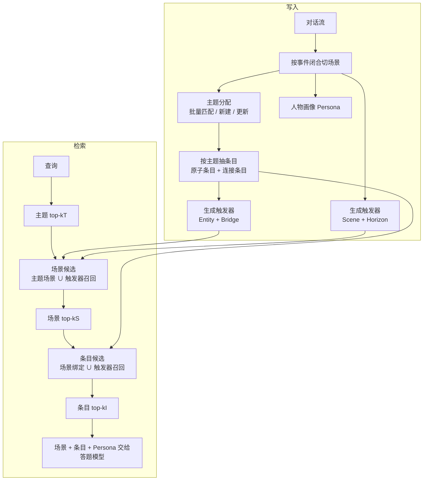

# T-Mem: Memory That Anticipates, Not Archives

## Why

长期对话记忆要解决的问题很具体：用户上周说过对海鲜过敏，今天问"晚上带团队去哪吃饭"，助手要能想起这句话。跨会话、跨周甚至跨月，用户不会重复同一句话，助手必须自己把新问题接回旧内容。现有系统大多把对话切成块或抽成事实，存进向量库或图结构，查询时把问题和存储内容映射到同一个相似度空间，取最近的 top-$K$。这类系统包括扁平 RAG、GraphRAG 这类图结构记忆、Mem0 这类分层事实记忆，以及 MemGPT 这类操作系统式记忆内核。

这套做法的适用条件很明确：问题和记忆之间要有表面重合，比如相同的词、相同的实体、相同的时间地点。论文把这种召回叫描述性召回（descriptive recall）。条件成立时，相似度检索很有效；条件不成立时，系统不是"答得差一点"，而是根本找不到那条记忆。论文举的例子是：一个月前用户说"团队里有一位同事对海鲜严重过敏"，今天用户问"今晚带团队去哪吃饭"。两句话没有一个共同的词，但前一句正是后一句必须用到的信息。论文把这种由隐含的语义弧线（因果关系、同一情境的延续）绑定的召回叫联想召回（associative recall）。

相似度检索在机制上就到不了这类目标。检索器只能沿着词面距离或语义距离收敛；如果目标的表面形式已经漂移到另一个邻域，它就不会出现在 top-$K$ 里。加图结构、加超边、加时间边能帮助多跳，但入口仍然是"查询与节点内容相似"；如果入口节点本身不在相似邻域，边再多也走不到。论文因此把问题从"检索器不够强"改写成"索引里根本没有为未来的查询准备入口"。

这个问题现在必须解决，原因有三个。第一，长对话记忆开始进入产品，用户对"助手记得我"的预期在提高；一次找不到，用户就会认为系统没有记忆。第二，评测大多围绕 LoCoMo 这类描述性问题设计，系统在 LoCoMo 上分数很高，但遇到没有词面重合的查询就集体失效；论文在 LoCoMo-Plus 上测到，Mem0、SeCom、A-Mem 的分数从 64–67 掉到 15–17，掉幅 49–50 个百分点。第三，现有方法的改进方向（更大的 top-$K$、更强的编码器、更复杂的图）都在同一个相似度范式里加码，无法覆盖另一个范式。

论文把召回空间拆成两个正交的轴：方向（描述性 / 联想性）和粒度（条目 / 场景）。条目是单个事实，场景是一段连贯的对话。两个轴交叉出四个象限：条目×描述性、条目×联想性、场景×联想性、场景×描述性。现有系统集中在条目×描述性和场景×描述性两个象限，联想性的两个象限是结构性空白。问题于是变成：能不能在写入时就把记忆改写成"未来可能被问到的样子"，让它在查询没有表面重合时仍然可达？这样做的代价是什么？

## What

先交代任务。输入是一段长期、多会话的对话流，以及一个当前查询；输出是给答题模型的证据（若干场景与条目）和一段人物画像（Persona）。记忆构建在离线阶段完成：系统先把对话切成场景，给场景打主题标签，从场景里抽条目，再为每个条目和场景生成"触发器"（trigger）。触发器是一段预先写好的短文本，描述"这条记忆在什么未来情境下会派上用场"。查询时，系统先按主题粗筛，再用节点索引和触发器索引一起召回，最后把场景、条目和人物画像交给答题模型。边界是：只在基准对话上评测，不做增量更新，不做强化学习式记忆管理，也不训练记忆模型。

论文的答案是：给每条记忆在写入时准备多个"未来入口"，让查询即使与原文没有表面重合，也能通过入口找到它。T-Mem 在条目和场景两个粒度上各准备一个描述性触发器和一个联想性触发器，四个触发器家族分别覆盖四个象限；在 LoCoMo 上总体 80.26%，在 LoCoMo-Plus 上 74.81%，两个基准之间的差距从现有系统的 28–50 个百分点缩到 5.45 个百分点（Table 2, Table 3）。`[已验证，Table 2, Table 3]`

### 新认识：联想召回是索引层的空白，不是检索器的参数问题

第一个认识是，现有系统虽然结构不同，但检索配方相同：把查询和存储内容映射到一个相似度空间，取最近邻。扁平 RAG、图记忆、分层事实记忆、操作系统式记忆都在这条线上；它们在图结构、摘要方式、写入策略上差异很大，但"从哪个入口进入记忆"仍然由相似度决定。论文用 2×2 的设计空间把这个共同点画了出来（Fig. 1）：横轴是方向，纵轴是粒度，现有系统挤在右半边，左半边没有系统。`[宣称，Fig. 1 是作者自己的分类]`

第二个认识是，触发器的价值可以在两个基准上被分开测量。LoCoMo 主要考描述性召回，LoCoMo-Plus 的 Cognitive 子集专门构造"线索与答案只有叙事或因果联系、没有词面或语义邻近"的查询。消融结果给出了一个很干净的对比：去掉场景级触发器（ST + HT），LoCoMo 只掉 0.40 分，LoCoMo-Plus 掉 22.19 分；单独去掉 Horizon 触发器，LoCoMo 掉 0.08 分，LoCoMo-Plus 掉 12.47 分（Table 4）。也就是说，同一个组件在描述性基准上几乎不可见，在联想性基准上是决定性的。这个对比本身就是论文最重要的方法论结论：只用 LoCoMo 调系统，等于默认系统只需要描述性召回。`[已验证，Table 4]`

第三个认识是，评测管线本身能把分数抬高或压低十几个点。论文在附录 E 里把 HyperMem 的 92.73 和自己复跑的 77.01 拆开：HyperMem 原设置用 GPT-4.1-mini 加 7 步 CoT 提示，论文复跑用官方 LoCoMo 的 GPT-4o-mini 加 5–6 词短答案提示；两个因素叠加，答案长度从 5.87 token 涨到 76.95 token，LLM-as-judge 分数涨了约 16 个百分点，token F1 反而掉了约 30 个百分点（§E）。这说明"记忆系统的分数"里有一部分是答题提示的分数，不是检索的分数。`[已验证，§E]`

### 新方法：四类触发器 + 主题→场景→条目的级联检索

T-Mem 的记忆是一个带类型的元组：

$$
\mathcal{M} = \left(\mathcal{V}^T \cup \mathcal{V}^S \cup \mathcal{V}^I,\ \mathcal{E}^{TS} \cup \mathcal{E}^{SI},\ T^{Ent} \cup T^{Brg} \cup T^{Scn} \cup T^{Hor},\ X\right),
$$

其中 $\mathcal{V}^T$ 是主题标签，$\mathcal{V}^S$ 是场景，$\mathcal{V}^I$ 是条目，$\mathcal{E}^{TS}$ 是主题到场景的边，$\mathcal{E}^{SI}$ 是场景到条目的边，$T^{Ent}$、$T^{Brg}$、$T^{Scn}$、$T^{Hor}$ 是四个触发器家族，$X$ 是人物画像（Eq. 1）。`[已验证，§3.1, Eq. 1]`

四个触发器家族的分工如下。Entity 触发器给条目一个上位概念，比如把"对海鲜过敏"命名成"饮食限制"，覆盖条目×描述性。Bridge 触发器把条目投影到一个"知道这条信息会有用"的未来情境，比如"为团队选餐厅"，覆盖条目×联想性。Scene 触发器用情境、对象、事件、情绪四个属性描述当前场景，覆盖场景×描述性。Horizon 触发器把场景投影到若干前瞻维度，比如"一次旅行承诺在半年后如何被提起"，覆盖场景×联想性。`[已验证，§3.2.3]`

检索是一条自顶向下的级联：主题 top-$k_T$ → 场景 top-$k_S$ → 条目 top-$k_I$，每一层用 BM25 与稠密检索的排名做 RRF 融合。关键设计是"触发器旁路"：通过任意触发器召回的场景和条目，不受主题预筛的限制。原因是主题预筛本身是相似度测试，如果用它去卡联想性触发器，就等于把论文要解决的相似度范式又装回去了（§3.4）。`[已验证，§3.4, Algorithm 1]`

### 新结论：联想轴补上了，但主要收益来自场景级触发器

主结果在 Table 2 与 Table 3。LoCoMo 上 T-Mem 总体 80.26，最强基线 HyperMem 77.01，高 3.25 个百分点；六个列里五个第一，Open Domain 以 55.21 对 MemOS 55.90 输 0.69 个百分点。LoCoMo-Plus 上 T-Mem 74.81，HyperMem 48.63，高 26.18 个百分点；两个基准的差距 5.45 个百分点，HyperMem 是 28.38，Mem0 是 49.14。`[已验证，Table 2, Table 3]`

但"补上联想轴"的功劳并不平均。消融显示，场景级的 Horizon 触发器贡献了 LoCoMo-Plus 的绝大部分增益（去掉掉 12.47 个百分点），条目级的 Bridge 触发器在 LoCoMo-Plus 上几乎测不出来（去掉 ET+BT 只掉 0.25 个百分点，§4.4）。论文自己解释了原因：LoCoMo-Plus 的线索本身是一小段对话，结构上更有利于场景粒度，条目级的单事实线索没有发挥空间（Limitations）。所以四个象限里，真正被端到端验证的是场景×联想性；条目×联想性只有架构上的实例化，没有独立的基准。`[已验证，Table 4；作者承认 Bridge 难以注册]`

构建成本在 Table 5。10 段 LoCoMo 对话共 9,689 次 GPT-4.1-mini 调用、15.60M token（13.58M 输入、2.02M 输出），平均每段对话约 969 次调用、1.56M token；Mem0 是 12.20M token，Mem0g 是 35.83M，StructMem 只有 1.94M。T-Mem 比 Mem0 多 28% 的构建 token，论文把这笔开销解释为"联想轴的代价"（§4.6）。`[已验证，Table 5]`

## How

这篇论文以系统与算法类为主，附实证与基准类。系统与算法类：它定义了带类型的记忆结构、四阶段构建流水线、两套索引和一条级联检索算法；实证与基准类：它在 LoCoMo 与 LoCoMo-Plus 上做端到端对比、八组消融、四个超参扫描、构建模型替换和评测管线拆解。判型依据是它既提出可复用的架构，又用多组实验验证；没有定理，没有新的训练目标，也不训练检索器或答题模型。

上图据原文 Fig. 2 重画。写入侧先把对话变成"主题—场景—条目"三层结构，再给条目和场景各挂两类触发器；检索侧自顶向下走，触发器召回的节点可以绕过主题预筛。

### 一、记忆结构：五种对象，三条读路径

T-Mem 的记忆里有五种对象。场景（scene）是一段连贯的对话，作为答题时的原始证据；条目（item）是从场景里抽出的事实，也作为证据；主题标签（topic）是场景的多标签分类，只用于限定条目抽取的范围和检索时的场景预筛，从不直接交给答题模型；四个触发器家族挂在条目或场景上，只参与检索，不参与答题；人物画像（Persona）是每个说话人的长期属性摘要，答题时作为环境上下文追加在检索证据之后，不占检索预算。`[已验证，§3.1]`

场景节点带四个字段，分别走三条读路径：标题和摘要进词面/稠密索引；原始对话轮次作为答题证据；第三人称叙述作为 Scene 与 Horizon 触发器的输入。这个拆分很重要：同一个场景，检索时看摘要，答题时看原文，生成触发器时看改写后的叙述，三者互不污染。`[已验证，§3.2.1]`

### 二、构建：四阶段流水线

第一阶段是场景切分。会话边界是数据采集的产物，不是事件的自然结束；一个会话可能混着几件事，一件事也可能跨几个会话。T-Mem 用一个轻量边界检测模型扫描滑动窗口，在当前事件闭合时吐出一个场景（§3.2.1, Algorithm 3）。论文没有给边界检测的准确率，也没有给场景数量的分布。

第二阶段是主题分配。场景按到达顺序处理；对每个新场景，主题模块把它和已有主题分批匹配，能归入多个主题就归入多个，一个都不匹配就新建主题。主题的摘要是"标题重复两次 + 关键词"，用于 BM25 索引（Algorithm 4）。主题标签既决定条目抽取的范围，也决定检索时的场景池；主题错了，后面的条目和召回都会跟着错。

第三阶段是条目抽取。对每个主题，抽取模型一次返回两类条目：原子条目（atomic item）只挂一个源场景，连接条目（connected item）挂多个源场景。这个区分的理由是：有些查询问单个事实，有些查询问两个事实之间的关系；问单个事实的查询需要把事实从场景里蒸馏出来，问关系的查询需要保留跨场景的逻辑链接。两类条目都通过 $\mathcal{E}^{SI}$ 挂到源场景上（§3.2.2）。

第四阶段是触发器生成。条目的 Entity 和 Bridge 在同一个提示里生成，每个条目生成 $N$ 个 2–6 词的短名词短语，外加一句"从条目到情境"的理由；场景的 Scene 和 Horizon 在同一个提示里生成，Scene 给四个属性各一句，Horizon 给若干前瞻句子，每个句子带置信度，没有信号的通道留空（§3.2.3, Fig. 7, Fig. 8）。人物画像按说话人单独生成，汇总身份、偏好、关系、时间线（Table 1）。

### 三、索引：节点索引 + 触发器多视图索引

节点索引有两套：所有节点进一个共享的 BM25 语料，每个类型再建一张稠密表，编码器是 bge-m3。触发器索引不是"给触发器建一个索引"这么简单：每个条目暴露三个视图，分别是概念（Entity）、桥接（Bridge）、联合（概念 ∥ 桥接 ∥ 理由），三个视图独立编码；查询时对三个视图各算余弦，取最大值，再把这个分数归到宿主条目上（§3.3, Algorithm 5）。场景触发器同理：对话原文、Scene 四属性、Horizon 各通道分别编码，取最大。

多视图的作用是让同一个条目可以从不同角度被命中。比如"对海鲜过敏"这条记忆，概念视图可能匹配"饮食限制"，桥接视图可能匹配"选餐厅"，联合视图保留两者的组合。取最大值而不是平均，是为了避免某个视图信号弱时把强信号拉低；空字段用 NaN 哨兵，计算时跳过。

### 四、检索：主题 → 场景 → 条目

检索算法的骨架在 Algorithm 1，展开版在 Algorithm 2。第一步，用 BM25 和稠密排名融合，取主题 top-$k_T$，默认 15。第二步，场景候选集是"主题下的所有场景"与"SceneCue(q) 召回的场景"的并集；SceneCue 对对话原文、Scene 属性、Horizon 通道三路排名做 RRF，取 top-$k_S$，默认 5。第三步，条目候选集是"已选场景绑定的条目"与"TrigRecall(q) 召回的条目"的并集；TrigRecall 对每个条目的三个视图算余弦，取最大值，超过硬门限 $\tau = 0.85$ 才收进候选；最后取 top-$k_I$，默认 15。第四步，取当前说话人的人物画像，和场景、条目一起交给答题模型。`[已验证，§3.4, Algorithm 2]`

RRF 的公式是：

$$
\mathrm{RRF}(d) = \sum_{m=1}^{M} \frac{1}{k_0 + \mathrm{rank}_m(d)},
$$

其中 $M$ 是参与融合的排名表数量，$k_0$ 是平滑常数，默认 60（Eq. 2）。这个公式只看排名，不看原始分数，所以 BM25 和稠密检索的分数尺度不需要对齐。

触发器旁路是这套检索的关键。主题预筛本身是相似度测试；如果触发器召回的节点还要先通过主题预筛，联想性触发器就会被同一套相似度逻辑卡住。T-Mem 的做法是让触发器召回的节点直接进入候选集，不受主题预筛限制（§3.4）。这个设计在消融里体现得很清楚：去掉场景级触发器，LoCoMo-Plus 掉 22.19 分，说明旁路确实是联想召回的主要通道。

### 五、实验设置：两个基准，两套答题协议

LoCoMo 有 1,540 道题（排除 adversarial 类别），分 Single-hop、Multi-hop、Temporal、Open Domain 四类；答题和评判都用 GPT-4o-mini，按官方协议，答案限制在 5–6 词，LoCoMo 的数字是三次独立运行的平均（§4.1）。LoCoMo-Plus 是 Li et al. (2026) 提出的扩展，Cognitive 子集专门测联想召回；答题用 GPT-4o，评判用 Gemini-2.5-Flash，按二值 memory-awareness 协议。`[已验证，§4.1]`

这个设置有一个直接后果：两个基准的答题模型、评判模型、答案长度约束都不同，所以 Table 3 里的"LoCoMo 减 LoCoMo-Plus"差距不是纯粹的能力差距，里面混着协议差异。论文在附录 E 里对 HyperMem 的管线差异做了很细的拆解，但没有对 T-Mem 自己的两列做同样的拆解。

基线分两类。LoCoMo 上比较 MIRIX、Mem0、Zep、Memobase、MemU、Supermemory、MemOS、HyperMem；其中 MIRIX 到 MemOS 的数字取自 Li et al. (2025)，HyperMem 是论文自己复跑的 77.01。LoCoMo-Plus 上比较 Mem0、SeCom、A-Mem、MemOS、HyperMem，外加 GPT-4o 和 Gemini-2.5-Pro 两个"全上下文、不做检索"的参照；Mem0、SeCom、A-Mem、GPT-4o、Gemini-2.5-Pro 的数字取自 Li et al. (2026)。`[已验证，Table 2, Table 3 注]`

### 六、消融：描述性组件和联想性组件在两个基准上的相反表现

Table 4 的八组消融可以分成两块。描述性一块包括场景层（SL）、条目通道（IC）、Entity + Bridge 触发器（ET+BT）、人物画像（PS）、主题预筛（TF）。这一块在 LoCoMo 上掉 1.43–4.74 分，在 LoCoMo-Plus 上只掉 0.25–2.99 分。联想性一块包括 Scene 触发器（ST）和 Horizon 触发器（HT）。这一块在 LoCoMo 上掉 0.08–0.40 分，在 LoCoMo-Plus 上掉 4.74–22.19 分。`[已验证，Table 4]`

这个不对称是论文论证的核心：一个只为 LoCoMo 调的系统，会把预算花在描述性组件上，因为联想性组件在 LoCoMo 上几乎不贡献分数；但到了 LoCoMo-Plus，联想性组件是决定性的。换句话说，基准的选择本身会引导系统走向"只会描述性召回"。

### 七、超参与成本：默认点落在饱和拐点上

四个预算的扫描在 Fig. 4。主题 top-$k_T$ 从 5 到 20，分数在 15 附近饱和（78.94→79.81→80.20→80.25）；场景 top-$k_S$ 在 5 处最高（78.74→80.13→79.70→78.53）；条目 top-$k_I$ 在 15 处饱和（79.71→80.23→80.20）；条目触发器并集 top-$K$ 在 10 处最高（79.62→80.26→79.88）。默认点 $(k_T, k_S, k_I, R) = (15, 5, 15, 10)$ 落在每个扫描的饱和拐点或最高点，说明系统不是靠精细调参撑起来的。`[已验证，Fig. 4]`

构建成本在 Table 5：9,689 次调用、15.60M token；其中输入 13.58M、输出 2.02M。答题时的 token 成本在 Fig. 5：T-Mem 的输入 token 低于 HyperMem，但准确率更高；Mem0、Zep、MemOS 在更低的 token 预算上，LoCoMo 分数更低，LoCoMo-Plus 崩得更厉害。论文没有报每次查询的检索延迟，只说所有检索组件都在 CPU 上、单机无 GPU 可复现（§E）。`[已验证，Table 5, Fig. 5；延迟未报]`

### 八、构建模型替换：架构的贡献大于模型的贡献

Table 6 把构建模型从 GPT-4.1-mini 换成 Qwen3-32B，答题与评判固定 GPT-4o-mini：总体从 80.26 降到 75.45（−4.81），Multi-hop 掉得最多（−8.39），Single-hop 只掉 2.66。Table 7 交叉构建模型与答题模型：固定答题模型，构建模型从 GPT-4.1 升到 GPT-5.1 只涨 3.05 分（78.31→81.36）；固定构建模型，答题模型升级涨 4.20 分（78.31→82.51）。论文的结论是，换更强的模型只抬高绝对分，不改变架构的相对贡献（§E）。`[已验证，Table 6, Table 7]`

### 九、评测管线拆解：92.73 与 77.01 的差距从哪来

附录 E 做了一个很细的对照。固定 HyperMem 的检索输出，只换答题阶段，得到三种配置：A 是 HyperMem 原设置（GPT-4.1-mini + 7 步 CoT），B 是官方 LoCoMo 设置（GPT-4o-mini + 官方短答案提示），C 是只换答题模型、保留 7 步 CoT（GPT-4o-mini + 7 步 CoT）。平均答案长度分别是 76.95、45.71、5.87 token；A 的 LLM-as-judge 是 92.73，B 是 77.01，C 介于两者之间。论文的结论是：7 步 CoT 提示与 5–6 词官方提示不可直接比较，7 步 CoT 会把答案写长，LLM-as-judge 会给长答案更多分，token F1 反而下降（§E）。`[已验证，§E；具体 C 的分数论文没有在正文给出]`

在这套拆解下，T-Mem 在两种管线下都领先：官方管线 80.26 对 HyperMem 77.01，HyperMem 管线 93.70 对 92.73。但领先幅度从 3.25 分缩到 0.97 分，说明论文标题里的"state-of-the-art"在匹配管线下只剩不到 1 分。`[已验证，Table 2 † 行]`

## Ideas

### 不足

**评估与基准**

1. LoCoMo-Plus 的作者与 T-Mem 的作者有重叠：LoCoMo-Plus 的作者列表里有 Weidong Guo、Hui Liu、Yu Xu，T-Mem 的作者列表里也有这三位。论文用这个基准来验证自己提出的"联想轴"，而"联想性"的分类标准、Cognitive 子集的构造方式都由同一组人定义。这不等于基准无效，但"在唯一公开的联想基准上 SOTA"这句话的证据强度要打折。`[评估问题]`
2. 两个基准的答题/评判协议不同。LoCoMo 用 GPT-4o-mini 答题与评判、5–6 词答案；LoCoMo-Plus 用 GPT-4o 答题、Gemini-2.5-Flash 评判、二值 memory-awareness。Table 3 的"gap 5.45"是两个不同协议下的分数相减，不能全部归因于联想能力。论文对 HyperMem 的管线差异做了拆解，却没有对 T-Mem 自己的两列做同样的拆解。`[评估问题]`
3. 匹配管线下优势只剩 0.97 分。Table 2 的 † 行用 HyperMem 的 7 步 CoT + GPT-4.1-mini 管线，T-Mem 93.70、HyperMem 92.73；论文的主表却用官方管线，T-Mem 80.26、HyperMem 77.01。两个管线都报是诚实的，但标题数字来自差距更大的那个，读者容易把 3.25 分当成架构的净收益。`[评估问题]`
4. 主表没有置信区间，也没有逐题配对。LoCoMo 是三次运行的平均，但只给了均值；LoCoMo-Plus 是否多次运行、方差多大，正文没有写。3.25 分和 0.97 分在什么噪声范围内，读者无法判断。`[评估问题]`
5. 部分基线数字直接取自其他论文（MIRIX、Mem0、Zep、Memobase、MemU、Supermemory、MemOS 取自 Li et al. 2025；Mem0、SeCom、A-Mem、GPT-4o、Gemini-2.5-Pro 取自 Li et al. 2026），不是在同一次受控运行里重跑。不同论文的答题模型、评判模型、提示词可能不同，主表的可比性没有保证。`[评估问题]`
6. LLM-as-judge 的脆弱性在论文自己的附录 E 里已经展示：同一个检索结果，换个 7 步 CoT 提示，分数能涨 15.72 分，token F1 掉约 30 分。主表仍然只用 LLM-as-judge 报分，token F1 只报了一个 51.96；没有人工校验、没有 judge 一致性统计。`[评估问题]`

**方法与归因**

7. 条目级联想触发器（Bridge）没有被端到端验证。去掉 ET+BT 在 LoCoMo 掉 1.43 分，在 LoCoMo-Plus 只掉 0.25 分；论文自己说 LoCoMo-Plus 的线索是短对话，结构上偏向场景粒度，Bridge 没有发挥空间。四个象限里，条目×联想性只有架构上的实例化，没有独立基准。`[方法问题]`
8. 触发器本质上是写入时的文档扩展（document expansion）：用 LLM 预先生成"这条记忆未来可能被怎么问"的文本，再拿查询去匹配这些文本。论文没有和更简单的扩展方法比较，比如生成未来问题（Doc2Query 式）、生成摘要、生成假设答案（HyDE 式）。如果"生成 10 个未来问题"能拿到同样的增益，T-Mem 的四类触发器就是过度设计。`[方法问题]`
9. 触发器的数量、长度、提示词、生成模型都没有消融。每个条目生成 $N$ 个触发器，$N$ 是多少、为什么是这个数、触发器写得好不好，正文没有给。构建模型换成 Qwen3-32B 会掉 4.81 分，说明触发器质量对结果影响很大；但论文没有测"触发器质量"这个中间变量。`[方法问题]`
10. 条目触发器的硬余弦门限 $\tau = 0.85$ 是固定值，没有敏感性分析。这个门限决定多少条目能通过触发器进入候选集；太高会漏掉联想条目，太低会引入噪声。论文只扫了 $k_T$、$k_S$、$k_I$、$R$ 四个预算，没有扫 $\tau$。`[方法问题]`
11. 主题标签由 LLM 生成，既决定条目抽取的范围，也决定检索时的场景池；主题错了，后面的条目和召回都会错。论文没有评估主题分配的质量（主题数量、每个场景的主题数、主题漂移），也没有做"去掉主题层、只保留触发器"的对照。`[方法问题]`
12. 人物画像（Persona）是答题时的环境上下文，不占检索预算，也不受检索证据约束。它由 LLM 从整段对话汇总而来，可能包含检索没有召回的答案；论文只做了 w/o PS 的消融（LoCoMo −1.54，LoCoMo-Plus −0.99），没有测"只给 Persona、不给检索证据"能答对多少。如果 Persona 单独就能答对相当一部分题，主表的增益会被高估。`[方法问题]`
13. 检索管线组件很多：BM25、bge-m3 稠密、三视图触发器、RRF、主题预筛、硬门限、bge-reranker-v2-m3（附录 E 提到，正文 §4.1 没写）。消融只做了组件级开关，没有做"同预算"对照；例如把触发器索引的 token 预算拿去扩大 top-$K$ 或换更强的稠密检索器，能不能拿到同样的增益，论文没有测。`[方法问题]`
14. "第一条覆盖四个象限的长期记忆架构"是按作者自己的 2×2 分类说的。HyperMem 的超图、A-Mem 的动态链接、Zep 的时间图都带有一些跨场景关联能力，把它们全部归到"描述性"半边，需要更系统的证据；论文的 Fig. 1 是概念图，不是对现有系统的实测分类。`[评估问题]`

**系统与成本**

15. 构建成本只报了 LoCoMo 的 10 段对话：9,689 次调用、15.60M token。真实产品的对话是持续增长的，语料更新时要重建多少、增量更新怎么做，论文留给未来工作。没有增量更新，T-Mem 只能离线批处理，不能在线服务。`[系统问题]`
16. 没有报每次查询的检索延迟、p50/p99、CPU/内存占用。论文说所有检索组件都在 CPU 上、单机可复现，但没有给"969 次构建调用"之外的运行时账本；一个需要 BM25 + 多张稠密表 + 多视图触发器 + RRF + 可选 reranker 的系统，查询延迟不会为零。`[系统问题]`
17. 没有美元成本。构建用 GPT-4.1-mini，答题用 GPT-4o-mini / GPT-4o，评判用 GPT-4o-mini / Gemini-2.5-Flash；15.60M token 的构建成本、每次查询的 token 成本，都能折算成钱，但论文只给 token 数。`[系统问题]`

**内部矛盾**

18. §4.1 说记忆构建模型是 GPT-4.1-mini、稠密编码器是 bge-m3；附录 E 又说"reranker 是 bge-reranker-v2-m3（§4.1）"，但 §4.1 没有提过 reranker。正文和附录的管线描述不一致，读者无法判断主结果是否用了 reranker。`[方法问题]`
19. 摘要说 T-Mem 是"first long-term conversational memory architecture that covers both descriptive and associative recall"，但正文承认 Bridge 触发器在 LoCoMo-Plus 上"hard to register"、没有独立基准。按论文自己的四象限标准，条目×联想性没有被端到端验证，"covers both"是一个比证据更强的说法。`[评估问题]`
20. 论文说 LoCoMo-Plus 的 Cognitive 子集是"唯一公开的直接探测联想轴的基准"，但同一段又说它的线索是短对话、偏向场景粒度。一个偏向场景粒度的基准，无法同时验证条目级联想；"唯一"和"偏向"放在一起，说明这个基准的覆盖范围比论文的四个象限窄。`[评估问题]`

### 创新点

**一、独立复跑：把所有基线放进同一个答题/评判管线**

- **主张**：T-Mem 相对 HyperMem 的 3.25 分领先，有相当一部分来自答题管线差异；把两套系统放进同一个 QA/judge 协议、同一批题目、同一组随机种子，领先会缩小到 1 分左右。
- **与原文关系**：反驳/修正。原文已经做了 HyperMem 的管线拆解，但没有把主表所有基线都放进同一管线。
- **最小验证**：在 LoCoMo 的 1,540 题上，统一用 GPT-4o-mini + 官方 5–6 词提示 + 同一 judge，重跑 T-Mem、HyperMem、MemOS、Mem0、Zep、A-Mem；每套系统跑 3 次，报均值与 95% 置信区间；在 LoCoMo-Plus 上同样统一用 GPT-4o + Gemini-2.5-Flash，重跑所有可得基线。预期 T-Mem 仍第一，但对 HyperMem 的领先从 3.25 分降到 1 分以内，且置信区间跨 0。
- **失败条件**：统一管线后 T-Mem 仍领先 3 分以上，且置信区间不跨 0；这说明管线差异不是主因，架构贡献成立。

**二、触发器 vs 通用文本扩展：控制"多出来的文本"**

- **主张**：T-Mem 的增益来自触发器的"前瞻内容"，而不是"给每条记忆多加了几个句子"。用同样长度、同样数量的通用摘要或随机句子替换 Bridge/Horizon，LoCoMo-Plus 的增益应该大幅下降。
- **与原文关系**：增量，直接检验机制归因。
- **最小验证**：做四组对照：(a) 原版 T-Mem；(b) 把 Bridge/Horizon 换成同长度的场景摘要；(c) 换成同长度的随机句子；(d) 换成 LLM 生成的 10 个未来问题。四组用同一个检索器、同一个 top-$K$、同一个答题协议，比较 LoCoMo-Plus 的分数和构建 token。预期 (a) 和 (d) 明显高于 (b)(c)，且 (d) 可能接近 (a)。
- **失败条件**：(b) 或 (c) 也能拿到大部分增益，说明"联想"不是内容属性，只是"多了一段可匹配的文本"；这时 T-Mem 的机制解释需要改写。

**三、条目级联想基准：补上 Bridge 没有测的那一半**

- **主张**：LoCoMo-Plus 偏向场景粒度，条目级的 Bridge 触发器没有被验证；构造一个"单事实线索 + 未来情境"的基准，可以测出 Bridge 的真实贡献。
- **与原文关系**：扩展，直接补论文承认的缺口。
- **最小验证**：构造 200 道题：每道题给一个单事实线索（例如"同事对海鲜过敏"）和一个未来情境查询（例如"今晚团队聚餐选哪家"），答案是一个实体或一个决策；线索与查询没有词面重合，但有一条因果或情境链。用 T-Mem（含 Bridge）、去掉 Bridge 的 T-Mem、以及 BM25/稠密 top-$K$ 三个系统比较。预期含 Bridge 的 T-Mem 比去掉 Bridge 高 5 分以上。
- **失败条件**：去掉 Bridge 后分数不掉，或三个系统都接近随机；这说明条目级联想要么不存在，要么当前触发器写法抓不住。

**四、增量构建：把 15.60M token 的离线成本摊到在线更新**

- **主张**：T-Mem 的构建成本可以在增量更新下大幅下降；新场景到达时，只更新受影响的主题、条目和触发器，不需要重建整段对话。
- **与原文关系**：正交。原文明确把增量更新留给未来工作。
- **最小验证**：把 LoCoMo 的 10 段对话按时间切成 5 个增量批次，模拟流式到达；比较"每批全量重建"与"只更新受影响主题/条目"的构建 token、查询准确率、重复条目率。预期增量构建节省 60% 以上 token，准确率下降不超过 1 分。
- **失败条件**：增量构建导致主题漂移、条目重复或触发器过时，准确率下降超过 3 分；这说明联想触发器必须依赖全局上下文，不能局部更新。

**五、触发器预算：用更小的模型生成更多入口**

- **主张**：触发器的质量主要由"覆盖多少未来情境"决定，而不是由生成模型的规模决定；用一个小模型生成更多触发器，可能比用 GPT-4.1-mini 生成少量触发器更划算。
- **与原文关系**：增量，针对 15.60M token 的构建成本。
- **最小验证**：固定触发器总 token 预算，比较三种配置：(a) GPT-4.1-mini 生成 $N$ 个触发器；(b) Qwen3-32B 生成 $2N$ 个；(c) Qwen3-8B 生成 $4N$ 个。在 LoCoMo 和 LoCoMo-Plus 上比较准确率、构建 token、构建时间。预期 (b) 或 (c) 在 LoCoMo-Plus 上接近 (a)，成本低 50% 以上。
- **失败条件**：小模型生成的触发器语义漂移，LoCoMo-Plus 掉 5 分以上；这说明触发器质量比数量更重要，不能靠堆量省钱。

**六、把 Persona 从"环境上下文"改成"可审计的证据"**

- **主张**：T-Mem 的 Persona 是整段对话的摘要，可能绕过检索把答案带进答题上下文；把 Persona 拆成可检索的条目，并记录每条画像的证据来源，可以消除这个潜在的泄漏，同时保持 Open Domain 的收益。
- **与原文关系**：反驳/修正。原文把 Persona 当作 ambient context，没有测它单独能答对多少。
- **最小验证**：在 LoCoMo 的 Open Domain 题上比较四种设置：完整 T-Mem、去掉 Persona、只给 Persona 不给检索证据、把 Persona 拆成条目后走检索。预期"只给 Persona"能答对一部分题，说明存在泄漏；拆分后准确率接近完整 T-Mem，但每条答案都能追溯到具体对话。
- **失败条件**："只给 Persona"几乎答不对，或拆分后 Open Domain 掉 3 分以上；这说明 Persona 的压缩是必要的，不能完全证据化。

## 相关工作

仓库内与本文最接近的是 [jiang2026-jev-mem](jiang2026-jev-mem.md)：两篇都在做长期记忆，但层次不同。Jev-Mem 改的是"控制层"，决定要不要查、查多深、什么时候停；T-Mem 改的是"索引层"，决定一条记忆在写入时被改写成什么样子、查询时从哪个入口进来。Jev-Mem 的评测也以 LoCoMo 为主，T-Mem 的 2×2 分析可以用来解释 Jev-Mem 为什么在 LoCoMo 上有效、在联想性查询上可能失效。

[he2026-memory-tax](he2026-memory-tax.md) 提供了"收益/税"的账本。T-Mem 报了构建 token（15.60M），但没有把每次查询的检索延迟、reranker 成本、增量重建成本算进同一张账；用 Memory Tax 的口径，T-Mem 的净收益会比 Table 2 看起来小。

[bao2026-raw-rag](bao2026-raw-rag.md) 的结论是"配好的原始历史检索比复杂记忆系统更强"。T-Mem 的基线里包含 GPT-4o 全上下文（LoCoMo 66.14、LoCoMo-Plus 21.05），但这不是 RAW-RAG 那种配好的原始检索；如果要检验"触发器是否真的必要"，应该把 RAW-RAG 的原始历史检索也放进 LoCoMo-Plus 的对比里。

[hu2026-sage](hu2026-sage.md) 与本文都关心"检索器/索引怎么适配查询"。SAGE 的结论是 agent 生成的查询是关键词式的，BM25 比稠密检索更强；T-Mem 同时用 BM25 和稠密，再用 RRF 融合，说明在记忆场景里两种信号都需要。SAGE 的"语料级增强"（给文档加关键词头）与 T-Mem 的"写入时触发器"是同一个思路的不同粒度：SAGE 给文档加关键词，T-Mem 给记忆加未来情境。

[du2026-a-rag](du2026-a-rag.md) 与 [li2026-dci](li2026-dci.md) 把检索做成工具接口，T-Mem 把检索做成记忆内部的索引；A-RAG 与 DCI 让 agent 自己决定查什么，T-Mem 让记忆在写入时就准备好被查。两者可以组合：T-Mem 负责记忆侧的入口，A-RAG/DCI 负责语料侧的工具。

[kumar2026-stair](kumar2026-stair.md) 用目录叶节点当检索单位，T-Mem 用场景/条目当检索单位；两篇都把"结构"当作索引的一部分。STAIR 的结构来自文档目录，T-Mem 的结构来自对话的事件闭合与主题，构造方式不同，但都在回答"检索单位应该多大"。

## 可复现

- 代码与数据：<https://github.com/Sherlockwz/T-Mem>（首页给出）。
- 数据集：LoCoMo（1,540 题，排除 adversarial）、LoCoMo-Plus（Cognitive 子集）。
- 模型：记忆构建 GPT-4.1-mini（主实验）、Qwen3-32B（替换实验）；稠密编码器 bge-m3；reranker bge-reranker-v2-m3（附录 E 提到，正文未写）；LoCoMo 答题/评判 GPT-4o-mini；LoCoMo-Plus 答题 GPT-4o、评判 Gemini-2.5-Flash。
- 超参：$(k_T, k_S, k_I, R) = (15, 5, 15, 10)$；条目触发器硬余弦门限 $\tau = 0.85$；RRF 平滑常数 $k_0 = 60$；答题温度 0；LoCoMo 三次运行平均。
- 成本：构建 9,689 次调用、15.60M token（13.58M 输入、2.02M 输出）；平均每段对话约 969 次调用、1.56M token。
- 无法复现的部分：LoCoMo-Plus 的题数、每题运行次数与方差；每次查询的检索延迟与内存占用；主题数量与主题分配质量；触发器数量 $N$、触发器长度与提示词全文（只给了模板）；reranker 的启用方式；构建与查询的美元成本；增量更新实验。论文没有给这些，需要从代码仓库补。
