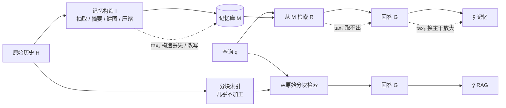

# Memory Tax: Dissecting the Net Value of Agent Memory

## Why

长期运行的智能助手需要跨会话记住事情，于是外面挂一层"记忆"。这句话里"跨会话"和"挂一层"分别指什么、为什么记忆必须放在模型外面，见 [为什么记忆要挂在模型外面](concepts/agent-memory-basics.md)，这里不再展开。这篇论文质疑的是"建记忆一定划算"这个默认假设。今天的记忆已经是一整条流水线：抽出事实、合并成摘要、连成图、分层存放、甚至用强化学习训一个策略决定怎么写怎么读；这五道工序各自在做什么、代价从哪里来，见 [记忆流水线](concepts/memory-pipeline.md)。每篇记忆论文都会报告"我比之前的记忆系统更高"，这句话在论文里通常是对的，因为它选定的对手是另一个记忆系统。

问题出在缺失的那个方向上：如果什么都不建，只把原始对话切成块、查出来塞给模型（也就是 naive RAG），结果会怎样？这个对照经常不在表里。作者复查了自己评测的基线和几篇有影响力的记忆论文，发现只有三篇报过 RAG 成绩（LightMem、PlugMem、Mem-T），而且都没写清分块方式和 top-k（§B.2）。本仓库已有的 [Jev-Mem](jiang2026-jev-mem.md) 就是一个现成例子：它的对比表里是 Full Context、A-MEM、MemoryOS、Nemori、MAGMA，没有 RAG。这不是疏忽，是这一整个子领域的默认写法——大家都假设"建记忆一定比不建好"，于是只验证"我的记忆比你的记忆好"。

这个缺失会在机制层上制造三个具体的失真。第一，参照系被削弱：只用 BM25 单路、top-5、不做重排的 RAG，本来就是个稻草人，赢了它说明不了什么。第二，检索粒度不可比：一个记忆单元可能是一句话，也可能是一整段摘要，同样的 top-5 暴露给模型的 token 量能差一到两个数量级，这时比的是"谁塞得多"而不是"谁组织得好"。第三，只报总分：平均值把"哪些题解决了、哪些题搞坏了"抹平，而这两件事对设计的含义完全相反。

为什么现在必须回答这个问题，理由在账单上。按本文的测量，A-Mem 在 LongMemEval-s 上建库要 117 小时（单并发折算）、建库加维护共 1.74 亿 token；MemoryOS 要 126.5 小时。这些是上线前的一次性支出，而且换模型就得重建。如果净值是负的，那么付出的这些钱、这些时间、这些工程复杂度，换来的是一个比不建更差的系统；这不是"效果不佳"，是选型错误。

于是问题落到这里：给直接检索配一个正常水平的对手（混合检索、重排、对等的 token 预算），这些记忆系统的净收益到底是多少？亏损的部分发生在构造、取用，还是模型换代的时候？要多付多少代价？

要回答它，得同时满足两条：参照系要强到结论不能被"是你调参调的"解释掉；亏损要能定位到记忆流程的某个具体环节，而不是停在一句"效果不佳"。

## What

论文的答案是：净值为负是常态，但"负"不是一个笼统的结论，它由两笔方向相反的量组成——记忆替 RAG 答对了本来答错的题（memory benefit），也搞坏了本来答对的题（memory tax），两者的差额才是净值。作者用 11 个记忆系统、3 个基准、3 个主干共 99 个格子做了端到端对照，再沿着"构造是否忠实、证据是否可访问、换主干是否稳、基准本身留了多少空间"四条线，把 tax 拆到可归因的环节上。

先把任务说清楚：它测的是一条完整链路——把跨会话对话历史写进某个记忆系统，来一个问题后从记忆里取证据，再由答题模型给出答案；输入是对话历史加问题，输出是这道题答对与否。论文不提出新的记忆系统；在同一个格子里，记忆系统与 naive RAG 用同一个答题模型，差别只在有没有记忆这一层。

### 新认识：记忆不是增益，是偏离

第一个认识改变了问题的表述方式。以前把记忆当成"对上下文的增强"，隐含假设是加工只会加信息、不会减信息。这篇论文的提法是：任何非平凡的记忆操作，都会让信息在结构、措辞、粒度、位置这几个维度上偏离原始历史，这种偏离是设计出来的（为了重组事实、蒸馏偏好、压缩长度），但副作用是可能删掉、打散、改写证据。偏离同时产生收益与损失，所以记忆是双刃的；同一个机制能在这一题上帮、在那一题上害（§4.1，Fig. 25、Fig. 26 给了逐条配对的反例）。`[宣称，附录 D 有正反实例支撑]`

第二个认识关于净值本身的性质。净值是相对量，参照系一换，符号就可能变；本文所有数字都是相对 naive RAG 定义的，作者自己反复强调这一点（§2、§4.1）。更进一步，基准也在参与决定净值：如果大多数题目靠直接检索就能答对，那么留给记忆的增量空间本来就很窄，而记忆引入的几个点的损失反而更容易被看见（§4.5）。`[已验证：Fig. 7、Table 16]`

第三个认识关于以往评测。作者主张 naive RAG 的强度被低估了，原因不在方法复杂，而在以往的 RAG 基线配置不完整，或者干脆没有（§B.2）。这条不是靠论证，是靠复现：用一套常规的混合检索加重排，RAG 就能超过表里大多数记忆系统。`[已验证：Table 7 的逐项消融]`

### 新方法：把净值拆成可测的两半

第一样方法是成对比较的账本。不再只看两边的总分，而是逐题记录"RAG 对、记忆错"和"记忆对、RAG 错"两个集合，画成 Venn 图（Fig. 2、Fig. 10–12）。这个做法本身不新，但它把一个模糊的"更好/更差"变成了两个可分别归因的量。

第二样方法是两个 oracle 的对照。给定一道题，把支撑答案的原始对话轮次（gold raw turns）和它们在记忆库里的对应单元（gold memory units）分别喂给模型，形成"只给原始证据"和"只给记忆证据"两条上界。两条上界的差就是构造阶段造成的损失，而记忆上界与它自己实际成绩的差，则是取用阶段的损失（§4.2、§4.3）。这一步把"记忆坏了"拆成了"造坏了"和"取不出"。

第三样方法是一个统一的预算口径。因为记忆单元粒度差别太大，固定 top-k 没有可比性，作者用"模型实际读到的记忆 token / 库内可检索的 token"定义一个检索比例（Retrieval Scope），再调各系统的 top-k 把比例拉到与 RAG 相当（§3.1、§A.4）。这是本文能声称公平比较的前提，也是它最容易被质疑的地方，具体问题见 Ideas。

第四样是两条不需要新架构的补救措施：检索时同时从原始历史取一份并联合重排（src-aug），以及把过去的查询与检索到的证据写回记忆库供后续复用（recursive）（§6.1、§6.2）。具体怎么接、代价多少，放在 How。

### 新结论：数字与成立条件

总体净值：在 99 个系统-基准-主干组合里，90 个低于 RAG（2 轮），只有 9 个高于，平均低 6.7 分（我按 Table 1 逐格统计）。按列取最好的记忆系统，9 列里仍有 4 列输给 RAG；赢的 5 列最多领先 3.9 分（Mem-T 在 MINT-Eval 的 GPT-5.6 Luna 上），输的最多落后 40.4 分（OpenViking 在 LongMemEval-s 的 Qwen3.5-4B 上）。`[已验证]`

tax 的量级：以 LongMemEval-s、Qwen3.6-27B 为例，SimpleMem 的税是 12.0、MemoryOS 11.4、Mem-T 10.8（Table 4）。按我在 How 里反推的口径（RAG 答对的题里被记忆搞坏的比例），大约是每 8 到 9 道 RAG 能答对的题，就有 1 道被记忆弄错。这个量级足以吃掉记忆通常能带来的几个点收益。`[已验证：Table 4]`

构造阶段的损失是真实存在的：抽样 500 条原始事实人工追踪，OpenViking 只有 39.4% 完整保留，38.0% 在库里根本找不到对应单元；SimpleMem 完整保留 65.6%，部分丢失 27.6%；MemoryOS 完整保留 98.4%，MAGMA 93.6%（Table 2）。`[已验证，人工标注]`

但损耗不只在构造。MAGMA 和 LightMem 在"只给 gold 记忆单元"时的分数接近"只给 gold 原始轮次"，却远高于它们自己实际检索拿到的分数——证据还在库里，只是取不出来（§4.2 末、Fig. 3、Fig. 13）。第一轮检索能找回全部证据的题目数，记忆系统普遍少于 RAG（Fig. 4）。`[已验证]`

鲁棒性上，固定构造、只换答题模型，多数记忆系统的掉分大于 RAG 的掉分（Fig. 6）。以 PersonaMem-v2 为例，RAG 在弱化答题模型时掉 9.6 分，而九个记忆系统与答题模型的组合里有六个掉得更多，落在 10.6 到 12.6 分之间。记忆把主干的差异放大了，而这个放大在只看单点分数时看不出来。`[已验证]`

基准的留白也确实很大：只用 IDF 挑关键词、不做任何嵌入检索，在若干基准上就能超过 50 分；常规混合检索在 EverMemBench-MCQ 上到 82.7、HaluMem-Medium 79.9、LongMemEval-s 77.6（Fig. 7、Table 16）。这意味着在这些基准上，"建记忆"最多只能抢剩下的一小段。`[已验证]`

两条补救措施里，src-aug 有效：SimpleMem 在 LongMemEval-s 上从 73.6 升到 82.8，税从 12.0 降到 5.2；MemoryOS 从 73.4 到 76.4；Mem-T 从 75.0 到 80.0（Table 4）。recursive 的效果则弱得多：三个系统在 PersonaMem-v2 上分别只变 +0.1、+0.9、+3.6，其中 SimpleMem 的税反而从 11.2 升到 12.1。作者写"Table 4 also validate its effectiveness"，这个措辞与它自己的数字并不完全吻合。`[已验证的数字，与原文结论句冲突]`

## How

判型：以**实证与基准类**为主（大规模评测加归因分析），附带一点**系统与算法类**（两条 proof-of-concept 的改法）。判型依据是全文的重心在"测什么、怎么测、测出来怎么解释"，两条改法只跑了一张表，没有做架构级的贡献；后面的证据强度与缺失也按这个判型来评。

### 一、先把"记忆"写成可对照的形式

形式上只有四步：给定交互历史 $H=\{h_1,\dots,h_T\}$，记忆系统先做一次加工 $M=I(H)$，把历史变成持久化的记忆库；查询 $q$ 到来时检索出 $C=R(q,M)$；最后由模型生成 $\hat y=G(q,C)$（§2）。不同的系统只是把 $M$ 实例化成摘要、抽取的事实、结构化记录或情节条目。

naive RAG 在这套写法里是 $I$ 取恒等映射的特例：不做加工，把原始历史切块后直接检索。正因为它是同一个形式化里的一个点，它才适合当参照系；本文所有 benefit、tax 都是相对这个点定义的，换一个参照系，数值和符号都会变。

RAG 的具体配置决定了这个参照系有多硬。按对话轮次切块，不跨会话边界，短轮次贪心合并到约 1024 字符，超长轮次按 8192 字符开窗、1024 重叠，每块加会话时间戳；检索时 BM25 与稠密向量（Qwen3-Embedding-0.6B）各取 top-k，去重并集后由 Qwen3-Reranker-0.6B 重排，取约一半候选进上下文（§A.2）。两轮版本多一步：模型先判断第一轮够不够，不够就再发一个查询（§A.2）。

这套配置不是挑出来的。作者把分块方式、检索方式、嵌入模型、重排模型逐项替换（Table 7），大多数变体都落在默认配置的几个点之内；掉得最多的是"固定窗口强行切断轮次"和"只用 BM25"，而这两个较弱的版本在 Table 1 里仍能打赢若干记忆系统。top-k 的调整也做了单独检查：把 top-k 调到与本文对齐，多数记忆系统的分数是上升的（Table 8、Table 9）。这两步是为了堵住"你把基线调强了"这个反驳。

### 二、预算口径：Retrieval Scope

记忆单元粒度不同，固定 top-k 会得到完全不同的信息量，所以本文定义

$$
\mathrm{RS}=\frac{\text{检索到回答过程中模型实际读到的记忆单元 token}}{\text{系统可检索范围内的全部记忆单元 token}}
$$

分子要算上"中间读取"：如果模型读过检索回来的单元来决定要不要继续查、或者判断某单元有没有用，这些 token 也算（§A.4 把模型参与检索分成三级，只有第三级会把单元读进上下文）。分母只算参与检索的内容，附在单元上的元数据（话题、人物、日期）不计。

然后调各系统的 top-k，把 RS 调到不低于 RAG（单轮），并尽量让系统之间接近。例外是那种整个库只有几个大单元的系统（OpenViking），强行对齐会让 top-k 变成个位数，于是固定 top-k。

这里有个没做干净的地方，后面 Ideas 会用到：在 MINT-Eval 上，RAG 的 RS 是 6.73%，而 MemoryOS 到了 31.87%、Memory-R2 30.01%，差了近五倍，"大致可比"并没有实现（Table 21）。这些系统在 MINT 上的分数也因此不能直接与 RAG 比。

### 三、判分与成本的口径

答案由 Qwen3.6-27B 当裁判，不用 F1/BLEU 这类字面重合指标，因为改写过的正确答案会被它们罚分；多选题按选项字母精确匹配，解析不出来的再交给裁判。裁判与人工的一致率在三个基准上是 95.1%、100%、97.3%（Table 6）。

成本记四个口径，这一点值得单独说，因为它决定了结论能不能被复用：token 消耗拆成建库、维护、推理三段；端到端时间折算成单并发等价小时；LLM 调用次数（不受服务端负载影响）；以及建库后的记忆库 token 规模（§A.3）。混在一起报总 token 会掩盖"建库贵还是查询贵"这个关键区别。

举个量级：LongMemEval-s 上，RAG 的推理只花 0.27M token、建索引 0.11 小时、在线 3.4 分钟；A-Mem 建库 29.3M、维护 145.0M token，离线 117.0 小时，在线 3.2 分钟；MemoryOS 离线 126.5 小时（Table 19）。也就是说，这类系统的钱几乎全花在"把历史变成记忆"上，查询阶段的时延反而不是瓶颈。另一个方向上的极端是 Mem-T：PersonaMem-v2 上它的在线回答要 6807.9 分钟（单并发折算），RAG 只要 58.3 分钟（Table 20）。

### 四、tax 怎么算：原文没写公式

这是全文最关键、也最含糊的一处。作者在 §4.1 用文字和 Venn 图定义了 benefit 与 tax，但正文与附录都没有给出可复现的公式。我按 Table 4 的数字反推：若 tax 是"RAG 答对的题里被记忆答错的比例"，即

$$
\mathrm{tax}=\frac{\#\{y_{\text{mem}}\ne y^*,\ y_{\text{rag}}=y^*\}}{\#\{y_{\text{rag}}=y^*\}}
$$

那么用 SimpleMem 在 LongMemEval-s（Qwen3.6-27B）验算：记忆 73.6、RAG 77.6、tax 12.0%，代入得被搞坏 9.3 分、救回 5.3 分，净差 $-4.0$，与 73.6 减 77.6 完全吻合；MemoryOS（73.4、11.4%）净差 $-4.2$ 吻合；Mem-T（75.0、10.8%）净差 $-2.6$ 吻合。三个系统全部自洽，可以认为这就是本文的口径。

但这不是原文给的，而是一个需要验算才能得到的推断，并且两处表格互相不一致：同一系统、同一基准、同一主干下，SimpleMem 的 tax 在 Table 4 是 12.0，在 Fig. 13 是 15.0；MemoryOS 分别是 11.4 和 12.8。可能是统计口径不同（全量查询 vs 有 gold 证据的子集），但论文没有说明。这属于可复现缺口，在 Ideas 里单独列。

### 五、忠实性：造的时候丢了多少

宏观做法是"只喂 gold 记忆单元"跑一遍 QA。gold raw turns 由基准给出，要映射到记忆库里的对应单元，分三种情形：一个原始轮次对应一个确定单元（A-Mem、MemoryOS、HippoRAG2、MAGMA 可以确定性一对一）、对应多个候选单元、或者根本没有对应单元。后两种由 GPT-5.6 Terra 与 Claude Sonnet 5 各自选择，分歧交人工裁决（§C.2）。映射覆盖率本身就是信号：MAGMA 与 A-Mem 是 100%，OpenViking 在 PersonaMem-v2 上只有 52.8%（Table 13）。

把 gold 原始轮次和 gold 记忆单元分别喂进去，两者的差就是"构造阶段已经丢掉的东西"；因为这一路绕开了检索，剩下的差异不能再归给"没检索到"（Fig. 3 的红框）。这一步的对照是干净：同一个问题、同一批证据、只换承载形式。

微观做法更直接：抽 500 条原始事实，人工比对其在库里的全部对应单元，标成四级——完整保留、部分丢失、大部分丢失、找不到对应单元（Table 2）。标注时不预先用模型筛单元，允许冗余，只要信息完整就算完整（§C.2）。代价是样本小、只覆盖长对话类基准，而且单元映射仍然依赖前面那一步 LLM 预选（人工抽查正确率 83.3%–92.2%，Table 14）。

### 六、可访问性：留住了但取不出

宏观用"迭代重放"：对一道题，反复检索并把已经取出的单元从库里移除，看要几轮才能把全部 gold 单元取齐；构造阶段就丢掉的记为不可检索。图结构类系统和带 LLM 改写查询的系统无法离线重放，必须在线重跑（§C.3）。结果是记忆系统在第一轮能取齐的题目普遍少于 RAG（Fig. 4）。

微观看相似度漂移：对每条 gold 原始轮次与它的 gold 记忆单元，分别算与查询的相似度，比较两者的差；一个原始轮次对应多个单元时取中位数。作者自己声明这个量只能看系统内部的漂移，跨系统的绝对值不可比，因为每个系统只在自己的库里检索，且不都按嵌入相似度排序（Fig. 5、Fig. 14）。

漂移归成三种反复出现的模式：证据被拆到多个单元里，其中携带关键片段的那条排在很后面（碎片化）；证据被塞进一段无关的长文本里，与查询的匹配被稀释（稀释）；证据被改写，语义有轻微偏移，不再匹配原始问法（改写）（Fig. 24）。

### 七、鲁棒性：换模型会不会塌

用三个主干分别建库，再用三个主干分别答题，共九种组合；检索过程如果不调用 LLM，就固定检索结果只换答题模型，否则用新的答题模型重放（§C.4）。RAG 没有建库步骤，只随答题模型变化，因此它的掉分被当作基准线（Fig. 6 的灰条）。

两个结论：换建库模型会明显改变分数（因为大量中间步骤依赖模型，同样的历史会产出不同的记忆条目）；固定建库、只换答题模型时，多数记忆系统的掉分大于 RAG。第二个更值得注意，它说明记忆机制本身放大了对主干的依赖，而这个放大并不体现在单点分数里。

### 八、基准留白：换 14 个基准看检索能走多远

为了让"基准太检索友好"这个判断不只依赖三个基准，作者在 14 个长期记忆基准上只跑四个朴素基线：不给记忆、IDF 关键词匹配、纯嵌入检索、混合检索（§C.5、Table 16）。IDF 关键词的做法是每道题挑语料里 IDF 最高的两个词，优先取同时含两词的块，再取含一个的，同层内随机取满 top-k。

结果按混合检索的分数排序，从 82.7 到 28.6 分不等。高的那几个（EverMemBench-MCQ 82.7、HaluMem-Medium 79.9、LongMemEval-s 77.6）意味着大部分题直接检索就能答对；低的那几个（MINT-Eval 28.6、RealMem 32.9）才留出了记忆发挥作用的空间。这个排序本身就是一个可用的选基准依据。

### 九、泛化：经验记忆与视频世界模型

经验记忆（§5.1、§C.6.1）：在 6 个 agent 基准上，让 agent 先在训练集积累经验、在测试集冻结记忆后作答，对照是 ReAct 无记忆与"按任务描述检索最相似的 2 条历史轨迹"。Web 类任务上，把长轨迹蒸馏成工作流的做法能超过 RAG（τ2-Bench 上 G-Memory 78.0 对 RAG 69.0）；工具调用类上多数落后，SkillPro 在 τ2-Bench 上只有 55.0，还花了 1334.3K token（RAG 是 394.5K）（Table 17）。同一种记忆在不同任务域上的符号不同，这本身就是"净值依任务而定"的又一个证据。

世界模型记忆（§5.2、§C.6.2）：两个设定，Context-as-Memory 用 60 个样本做"转四次回到原点"的画面一致性，MemoBench 用 90 个样本测物体经历物理变化后能否正确重现；指标是 PSNR、SSIM、1−LPIPS。结果很干脆：直接检索并重投过去帧的 I3DM 在两项上都最好（SSIM 0.560 / 0.430），KV 缓存、学习到的 KV、视觉 latent、记忆 token 都不如它（Table 3、Table 18）。换句话说，在这个场景里"压缩成 latent"这种看似更高级的记忆，反而不如"把原帧找回来"。

### 十、两条补救措施与一条分析性建议

src-aug（§6.1）：正常从记忆库检索的同时，也从原始历史检索一份，两者合并后统一重排再进上下文。它不改变记忆结构，只是保留一条回到源头的通路，所以能同时补上"构造时丢的"和"检索时没取到的"。代价是多一次检索与重排。

recursive（§6.2）：把过去的查询、当时用到的证据、以及检索路径本身写回记忆库，让下次相似需求可以一步命中。作者把它类比成"记住自己是怎么记的"，并指出这提供了一种查询侧、跨查询的测试时扩展。实现上只是往库里追加条目，但库会随时间膨胀，且只在"一库多查询"的设定下成立——LongMemEval-s 是一个语料一道题，所以这一列在表里是 N/A。

第三条不是方法而是分析（§6.3）：提前建库（AoT）要在不知道未来问什么的情况下决定怎么偏离，为了覆盖更多可能就得处理更多信息、更贵；查询时再建（JiT）知道问题是什么，可以精准偏离，但把计算挪到在线、增加用户能感知的延迟。作者提出中间路线：用过去的兴趣、习惯、访问模式去预测未来需要什么，把记忆看成"对过去信息未来相关性的隐式推荐系统"。

### 十一、证据强度与开销

端到端有：11 个系统 × 3 个基准 × 3 个主干，99 个格子。消融有三处：RAG 自身的配置（Table 7）、top-k 对齐（Table 8、Table 9）、以及各记忆系统偏离官方配置的影响（§B.3，例如给 MEMOS 关掉过严的后处理并打开退化的重排，对 MEMOS 有利；LightMem 用 user+assistant 轮次比官方只用 user 高 8.2 分）。

缺的也很明确：PersonaMem-v2 只跑 20%、MINT-Eval 只跑 10%、GPT-5.6 Luna 下的 LongMemEval-s 只跑 100/500，全部没有方差或显著性检验；裁判模型与被测主干之一同族；tax 与 benefit 没有公式；Fig. 13 与 Table 4 的 tax 数值不一致。

图里给出的结构关系可以简化成这样：

## Ideas

### 不足

1. **tax 与 benefit 没有公式**（评估问题）。全文只有文字定义与 Venn 图，公式是我从 Table 4 反推的；benefit 甚至连一张对应的表都没有，导致"净值"无法被独立复现，也无法跨论文比较。
2. **同一口径下两处数字不一致**（评估问题）。SimpleMem 的 tax 在 Table 4 是 12.0、Fig. 13 是 15.0；MemoryOS 是 11.4 对 12.8。可能是分母或子集不同，但原文没有交代，读者无法判断哪一个是"本文口径"。
3. **参照系在正文里悄悄换了**（评估问题）。主表比较的是 RAG（2 轮），tax 与 Venn 图的比较对象是 RAG（1 轮）。两者的分差在 LongMemEval-s 的 Luna 上高达 8 分（82.0 对 90.0），足以改变"某系统是赢是输"的判断，而正文没有在每次比较时提醒读者。
4. **检索预算没有真正对齐**（方法/评估问题）。MINT-Eval 上 RS 从 5.93% 到 31.87%，RAG 是 6.73%，差近五倍。暴露 token 多的系统既可能因为信息全而占便宜，也可能因为噪声多而吃亏，这些列的结论不该与其他列同等看待。
5. **裁判与被测主干同族**（评估问题）。裁判是 Qwen3.6-27B，而它同时是被评测的三个主干之一。虽有人工一致率背书，但同族模型的自偏好（对自己的输出更宽容）无法从一致率里排除。
6. **子采样且无方差**（评估问题）。20%/10% 的子采样、无置信区间，表 1 里大量 1 到 3 分的差异落在抽样噪声内；"某系统在某列高 0.1 分"这类结论没有意义，而作者在个别地方确实这样用了。
7. **recursive 的结论超过证据**（方法与评估错配）。三个系统里两个小幅改善、一个 tax 变差，最高提升 3.6 分，却写成"validate its effectiveness"。
8. **src-aug 的隐含结论没有说透**（概念问题）。这条改法的实质是"把原始历史也检索一遍"，做了之后系统就退回成 RAG 加重排。它有效恰恰说明：在本文的设定下，记忆相对 RAG 的边际价值可能主要来自"多召回了源文本"，而不是"组织得更好"。作者没有做这一步的归因实验。
9. **世界模型部分只有重建指标**（评估问题）。SSIM 与 LPIPS 衡量画面相似度，不等于"世界模型记住了状态"；物体被正确重现但物理规律错的情况，这两个指标看不出来。
10. **场景覆盖与一处自相矛盾**（数据/系统问题）。作者承认的局限包括静态离线、纯英文、只用 GPT-5.6 Luna (low) 这一个前沿模型；Limitations 还把 omni-modal、latent、参数化记忆的扩展列为未来工作，但 §5.2 的 Table 3 里已经测了基于视觉 latent 与 KV 缓存的世界模型记忆，两处说法对不上。此外"建库与查询交错"的真实在线设定完全没有测，而这正是记忆系统最容易出问题的地方（写到一半被查询、旧结论被新事实推翻）。

### 创新点

**一、把 tax 写成公式并做成可加分解**

- 主张：给 tax 一个显式定义与可加的分解 $\mathrm{tax}=\mathrm{tax}_{\text{construct}}+\mathrm{tax}_{\text{access}}+\mathrm{tax}_{\text{backbone}}$，让不同系统的亏损可以在同一坐标系里比较。
- 与原文关系：增量（补公式）+ 反驳（指出原文口径缺失且两处不一致）。
- 最小验证：在 LongMemEval-s、Qwen3.6-27B 上对 8 个系统复算三项，检查三者之和与端到端 tax 的残差。判据是残差小于 3 分。
- 失败条件：残差超过 5 分，说明三个环节并不独立（例如构造损失会改变检索难度），加性分解不成立，需要换成带交互项的模型。

**二、净值曲线而不是净值点**

- 主张：把"记忆是否值得"报成一条随参照系强度变化的曲线，横轴是 RAG 的配置档位，纵轴是净值，而不是一个孤立的分数差。
- 与原文关系：扩展（原文只在固定 RAG 上报一个点）。
- 最小验证：同一批系统在四档参照系（BM25、纯嵌入、混合重排单轮、混合重排两轮）上重算净值，看曲线是否在所有档位都为负。Table 7 的消融已经给了每一档的 RAG 分数，改造成本很低。
- 失败条件：曲线在某档由负转正，说明"净值为负"这个主结论依赖弱参照系，那将是本文结论的反例，也是更有价值的发现。

**三、把 src-aug 的增益拆开：是"多召回"还是"组织得好"**

- 主张：记忆的边际价值可以分解为"多召回源文本"与"更好的组织/重排"两部分；若前者占绝大部分，则复杂记忆结构的经济性不成立。
- 与原文关系：反驳（原文把 src-aug 当作补救，没有追问增益来源）。
- 最小验证：三组对照同跑——只加源历史检索（等于增强版 RAG）、只加记忆检索（原系统）、两者联合；再把记忆侧替换成同规模随机子集，看 src-aug 的增益是否保留。
- 失败条件：随机子集也能带来同样增益，说明增益来自上下文变长而非记忆内容，那么"记忆有效"的解释就站不住。

**四、按查询类型路由，只在净收益为正时启用记忆**

- 主张：benefit 与 tax 在查询类型上分布不均（§D.1 已经列出六类受益情形），可以用一个轻量分类器预测"这道题该不该走记忆"，把净值从负拉到正。
- 与原文关系：增量（把原文的分层观察变成机制）。
- 最小验证：在 LongMemEval-s 上按题型分层统计 benefit/tax，用问题文本训一个小分类器（逻辑回归或小模型），只在预测净收益为正时启用记忆；对照是"永远用记忆"与"永远用 RAG"。
- 失败条件：分层后每类的净值仍然接近零且不可预测（AUC 低于 0.6），说明收益并非由可观测的查询特征决定，路由没有依据。

**五、把成本并入净值：每分准确率的价格**

- 主张：净值应该是一个带价格的双目标量——在同等 token/时延预算下比较准确率，或者报告"每提升 1 分需要多少额外 token 与多少秒"。
- 与原文关系：正交（原文把成本和准确率并排画成 Pareto 图，但没有合成一个可检验的指标）。
- 最小验证：用附录 E 的成本表算增量成本比 $\Delta\text{token}/\Delta\text{acc}$，检查是否存在被 RAG 完全支配的系统（更贵且更差）；这类系统的数量就是"负净值"的强形式。
- 失败条件：若没有系统被严格支配，说明"贵但略好"是常态，那么讨论应转向性价比而不是"记忆是否值得"，本文的批判力度需要下调。

## 相关工作

与仓库里已有的 [Jev-Mem](jiang2026-jev-mem.md) 的关系最直接。本文评测的 MAGMA（Jiang et al., 2026a）正是 Jev-Mem 的同组前作，也是它论文里的主基线；本文在 LongMemEval-s 上测出 MAGMA 比 RAG（2 轮）低 11.4、13.2、14.0 分（三个主干）。这不与 Jev-Mem 的结论矛盾——两者用的基准不同（LoCoMo 对 LongMemEval-s）、RAG 配置也不同——但它恰好构成一个对照：Jev-Mem 的比较对象是 Full Context 与四个记忆系统，没有 RAG；本文的立场是，缺了 RAG 这一行，就分不清"我的记忆更好"和"检索本身就够好"。（Jev-Mem 与 MAGMA 是否为同一系统的不同命名，本仓库未确认，此处只按作者与参考文献对应。）

在更大的范围里，本文属于"记忆的实证研究"这一支：一类工作做分类学与系统刻画（如 Hu et al., 2026b 的记忆综述、Jiang et al., 2026b 的解剖式分析），回答"有哪些记忆、都长什么样"；另一类做成本与部署刻画（Omri et al., 2026、Wolff and Bennati, 2026），回答"跑起来要多少钱"。本文的差异在于把"相对直接检索的净收益"当作被测量对象，并且要求把亏损定位到构造、取用、主干三个环节，而不只是描述现象。

它同时给"轻量记忆"这一支提供了定量支持：既然很多基准上直接检索已经能到 70 分以上，那么引入很少加工、因而 tax 也很小的设计（Wu et al., 2026b、Xiao et al., 2026 等）在有限 headroom 下就是理性的选择，而不是"偷懒"。

## 可复现

- 数据：LongMemEval-s（500 语料 / 500 题）、PersonaMem-v2（200 语料，取 40 个，934 题）、MINT-Eval（595 语料，取 60 个，1557 题），均为公开基准；子采样的随机种子未给。
- 代码与结果：论文首页给出项目页 <https://hexuan21.github.io/MemoryTax/>、代码 <https://github.com/hexuan21/MemoryTax>、结果集 <https://huggingface.co/datasets/hexuan21/MemoryTax-Res>。
- 主干与硬件：Qwen3.5-4B、Qwen3.6-27B 在 NVIDIA H20 上本地部署，temperature 0.0、top-p 1.0、关闭 reasoning；GPT-5.6 Luna (low) 走 API，默认采样、reasoning effort 为 low；世界模型实验在 H100 上跑 50 步（§A.4、§C.6.2）。
- 统一组件：嵌入 Qwen3-Embedding-0.6B、重排 Qwen3-Reranker-0.6B、裁判 Qwen3.6-27B；裁判与 QA 提示词在 §F.1、§F.2。
- 无法复现的部分：gold raw turn 到 gold memory unit 的映射（用了 GPT-5.6 Terra 与 Claude Sonnet 5 加人工裁决，提示词未给）；500 条事实的人工标注样本未放出；端到端时间"折算单并发"的具体公式未给；PersonaMem-v2 与 MINT-Eval 的子采样清单未给。
