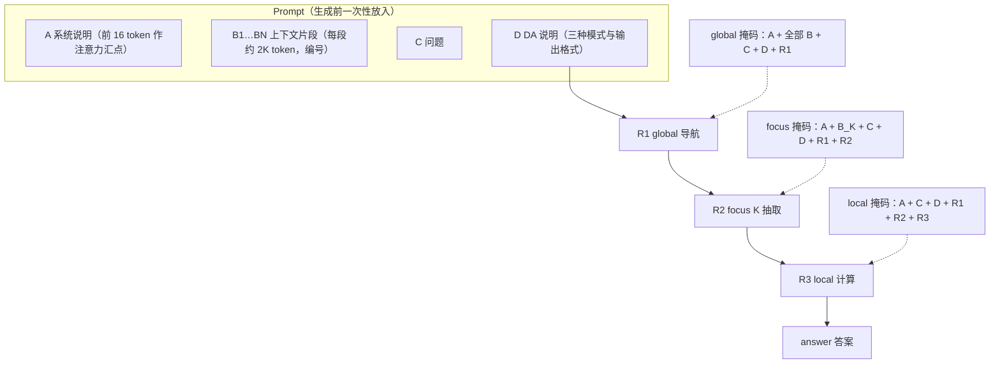
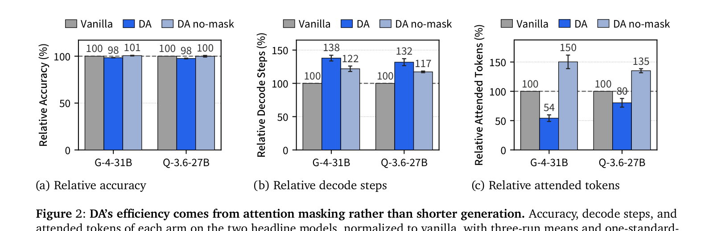
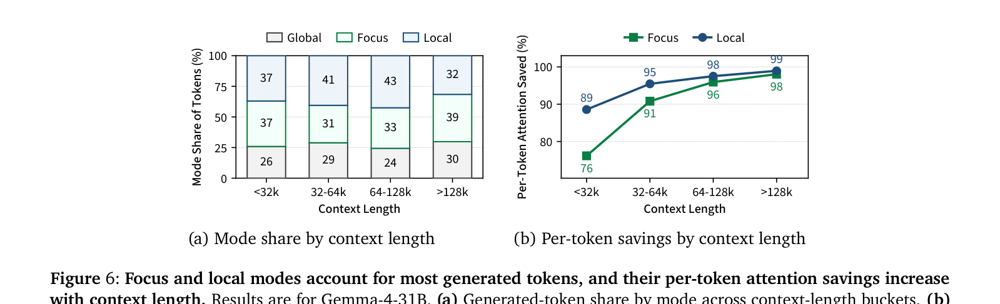
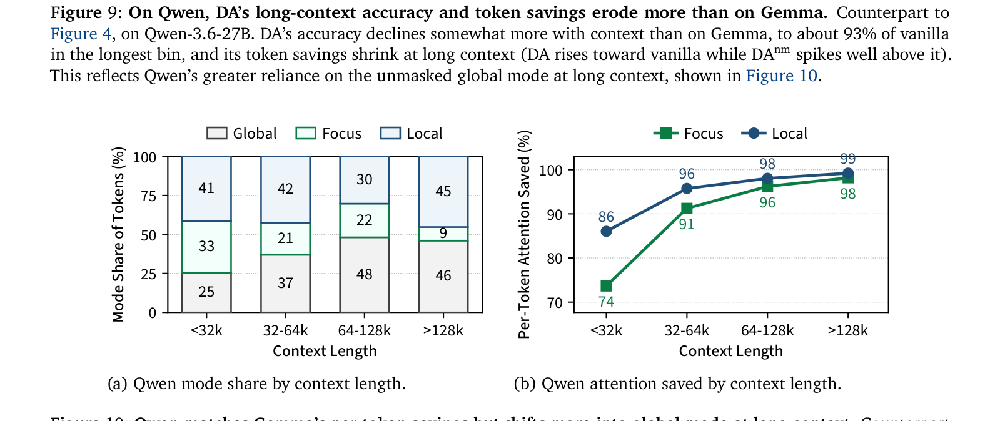

# Language Models Can Control Their Own Attention

## Why

设想一个 100 万 token 的对话：用户在前面某一段提到过一个日期，现在问"那次发布比公司成立晚几年"。模型每生成一个 token，都要在全局注意力层里把整段历史的 key/value 向量从显存里读一遍。为了不重算，模型会把每个 token 在每层注意力里的 key/value 向量存下来，这份存储叫 KV 缓存（KV cache）；生成分两个阶段，prefill 把整段提示一次读完，decode 一个 token 一个 token 地生成，decode 的每一步都要重读 KV 缓存。Qwen-3.5-397B-A17B（397B 总参数、17B 激活）在 1M token 上下文下，每条序列的 FP8（8 位浮点）KV 缓存是 15 GB；每个解码步都要把这 15 GB 读一次，量级相当于把模型 17B 的激活参数重新加载一遍（§1）。模型权重在一个 batch 内是共享的，读一次可以摊到很多条序列上；KV 缓存是每条序列私有的，摊不掉。所以 batch 一大，矩阵乘法变成计算瓶颈，注意力的 KV 读仍然是显存带宽瓶颈，而且随上下文长度线性增长。

人不是这样读文档的。人读一份长报告，不会每写一个字都把前面所有字重读一遍；眼睛会停在当前相关的段落上。经验研究也支持这一点：模型的注意力分数天然集中在一小部分 token 上（Child et al., 2019; Zhang et al., 2023; Tang et al., 2024）。也就是说，绝大部分 KV 读是浪费的。问题在于，模型在生成下一个 token 之前，并不知道下一个 token 需要哪一段；它只能先读，再算。

现有做法可以分成两代。第一代用固定启发式：StreamingLLM 保留最近的窗口加一个注意力汇点（attention sink，模型会把大量注意力分配给开头几个 token 的现象），H2O 保留历史注意力质量高的 token（Xiao et al., 2024b; Zhang et al., 2023）。这类规则的机制缺陷是"用过去预测未来"：一个 token 在过去的 100 步里都不重要，不代表用户下一步问的问题不需要它。问题一变，重要性排序就变了，固定规则跟不上，长上下文性能下降。

第二代把选择做成 query-dependent：Quest 用每页 key 的边界给 KV 页打分，SparQ 和 Double Sparsity 读低秩或标签缓存代理，InfLLM 和 ClusterKV 扫块/簇摘要，DeepSeek 的稀疏注意力（DeepSeek Sparse Attention, DSA）用一个轻量 indexer 每步取 top-k（Tang et al., 2024; Ribar et al., 2024; Yang et al., 2024; Xiao et al., 2024a; Liu et al., 2025; DeepSeek-AI, 2025b）。这些方法把常数变小了，但每一步仍然要扫一遍整个上下文的代理，复杂度还是 O(N)。上下文到 1M 时，这次扫描本身就要读几百 MB 到约 1 GB 的索引或摘要（Table 7 的 352–768 B/token 乘以 1M）；省下的读有一部分又被扫描吃掉。

还有一条更省的路：让模型自己说要看哪里。论文把这叫内在（intrinsic）路线：选择来自模型自己写出的文本，而不是来自一个外部评分器对 KV 的扫描；前两代方法都是外在（extrinsic）的。这个想法不是凭空的。已有研究表明，模型的隐藏状态里编码了未来 token 的信息（Pal et al., 2023; Wu et al., 2024），而思维链（chain-of-thought, CoT）能把这种潜在计算摊成可读的文本（Wei et al., 2022; Korbak et al., 2025）。模型在推理时本来就会写下"我需要看第 2 块，因为公司历史在那里"这样的句子；这句话里已经包含了选择。此前的 SSAS（Self-Selected Attention Span）已经把这件事训练进模型：让模型在输出里点名要看的片段，再用自定义 kernel 把这些点名变成硬块稀疏掩码（Jin et al., 2024; §A.4）。但 SSAS 是按任务分别微调的，上下文分区和标注语法是手工设计的，只在两个任务、2K token 上下文、7B 模型上验证。它证明"模型能学会声明"，没有回答"现成模型能不能零样本声明"。

为什么现在必须回答这个问题？因为上下文窗口已经到 1M，而注意力的占比没有随架构进步消失。论文按屋顶线模型（roofline，把每个操作的时间估成工作量除以峰值速率与利用率的乘积）估算，在 1M token 下，全注意力模型的全局 KV 读占一个解码步的 94% 到 99.37%；即使换成带 indexer 的稀疏架构（DeepSeek-V4、GLM-5.3、MiniMax-M3 等），这个比例仍有 56% 到 97.5%（Table 8）。另一方面，上下文越长，每 token 的成本越低，可用的窗口就越大，总的注意力开销不一定下降。Agent 场景又让上下文只增不减：每次工具调用的结果都留在历史里，后面的每一步都要带着它（§8.1）。所以"每步少读一点"不是一个只对全注意力模型有意义的优化，而是一个结构性的成本问题。

现有方法在机制层面差在哪？它们都把"该读哪里"当成一个需要外部预测的量：要么用固定规则，要么用一个小模型或索引器从激活或 KV 里估。估出来的掩码和模型真正想读的东西之间隔着一次预测，预测本身又要 O(N)。模型自己的推理文本里其实已经有了这个信号，但没有人把它接出来、变成可执行的掩码，并在零样本、长上下文、多任务的设定下量清楚它的收益和代价。

于是问题可以写成四问：一个固定提示词，能不能让现成模型稳定地在思维链里声明"这一步需要看哪一段"？如果能，跳过这些读以后，准确率损失多少？省下的时间落在哪一层——是每一步的读，还是整次回答的读；是 prefill 还是 decode；是全局层还是局部层？当模型声明错了、或者根本不遵守协议时，代价是什么？

## What

先把任务说清楚。输入是一段长上下文（被切成 N 个带编号的片段，每段约 2K token）、一个问题、一段固定说明；输出是一段带模式标签的推理过程，最后用 `<answer>` 包住答案。推理引擎在解码时读取这些标签，决定当前这一步能读哪些片段；模型权重、token 序列、KV 内容都不改。它不决定哪些文档进入上下文（那是检索），不丢弃 KV（那是驱逐或压缩），也不减少 prefill；它只改 decode 阶段每一步的 KV 读集合。评测的任务是长上下文问答与检索，包括多选题、填空、代码仓库问答和对话历史问答，共 15 个数据源，每个源最多 128 道题。

论文的答案是能，而且不需要训练。它把这套协议叫声明式注意力（Declarative Attention, DA）：给模型一段固定说明，要求它在思维链里用三种标签声明注意力范围。三种标签是：`<global>` 看全部片段，用于导航和定位；`<focus magic_chunks="K">` 只看第 K 个片段，用于逐字抽取；`<local>` 不看任何片段，只用自己的推理和已经抽出的值，用于计算和收束。标签由推理引擎像解析工具调用一样解析，引擎在每一步改 KV 块的可见表，只读被声明的块。模型可以自由决定用哪种模式、用多少次、按什么顺序用；协议不限制这些。

在这个设定下，Gemma-4-31B 每条回答的平均被注意力 token 数（attended tokens）从 13.84M 降到 7.49M（-45.8 ± 5.6%），15 源宏平均准确率从 86.49% 降到 85.09%（-1.40 ± 0.17pp）；Qwen-3.6-27B 从 22.34M 降到 17.88M（-19.6 ± 7.4%），准确率从 84.92% 降到 82.83%（-2.10 ± 0.33pp）（Table 2）。同一套提示词但保持全注意力的对照（DA-no-mask, DAnm）准确率与 vanilla（原始全注意力基线）基本持平（87.01/84.88），token 数反而比 vanilla 高 50.2%/35.2%；掩码把 DAnm 的 token 削减了 62.9%/40.7%，也就是说，省下来的读来自掩码，不是来自更短的生成。掩码还解释了几乎全部准确率损失：DA 相对 DAnm 低约 1.9pp（Gemma）和 2.05pp（Qwen），而提示格式本身没有可测的准确率代价。`[已验证，Table 2；仅限选定的 15 个源]`

### 新认识：注意力选择可以从激活搬到文本

第一条认识是，"看哪里"不必由一个外部评分器从激活里猜，可以直接读模型自己写出来的话。既有稀疏注意力方法（包括固定启发式和轻量 indexer）都是 system-1 式的：快速、隐式，每一步从隐藏状态或 KV 统计里直接推断一个保留/丢弃掩码（Zhang et al., 2023; Tang et al., 2024）。DA 把这件事变成 system-2 式的：慢一点、显式，模型在思维链里推理自己要看的范围，引擎按文本执行。这个转换的机制后果是，解析一个 `<focus>` 标签是 O(1) 的（查一次片段编号到 token 区间的表），不需要在每一步扫一遍上下文；O(N) 的读只留在模型自己声明"我要看全部"的那些步上。`[宣称，复杂度论证；实测见 §5.2]`

第二条认识是，现成模型已经具备这种分解能力，只是没有被要求写出来。定性例子里，模型会先在 global 模式里定位，再切到某个片段抽取，再回到 global 模式找下一个片段；它还会做提示词没有教过的事：一次 focus 多个片段来排除选项、用目录和章节号定位、把跨块边界的一场戏合并成一次访问、在 focus 里逐条打标签再在 local 里计数、用第三块交叉验证年龄（Fig. 12–18）。这些行为说明，模型内部本来就在做"先定位、再精读、再计算"的分工；DA 只是把这个分工变成了可解析的输出。`[宣称，定性证据，未做系统统计]`

第三条认识是，掩码限制的是"读哪些 KV"，不是"信息是否进入表示"。这一点论文没有作为标题写，但机制上很重要：prefill 仍然用全注意力读完整段上下文，所以每个 prompt token 的 KV 条目在生成之前就已经被全上下文上下文化了；Gemma 的 SWA 层仍然看最近 512/1024 个 token，Qwen 的 GDN 状态仍然是对整个前缀的压缩摘要（§B.3）；local 模式还会读"已经生成的回复"，而那些回复 token 是在前面的 global/focus 步里带着上下文生成的。所以 local 模式不是信息隔离，它只是不直接读上下文片段的 KV。这既解释了为什么准确率只掉 1.4–2.1pp（比真正截断上下文温和得多），也解释了 Fig. 19 里模型在 local 模式凭记忆编标签的现象。`[已验证，§B.3；解释是我的]`

### 新方法：一套协议、一个引擎实现、一个评测装置

第一件可复用的东西是协议本身：把长上下文切成带编号的"魔法块"（magic chunk），用模拟工具调用的形式逐块呈现；要求模型在思维链里用三种标签声明注意力范围；用一个有限状态机解析标签并改掩码。协议的关键不是标签语法，而是它把"选择"变成了模型输出的一部分，因此可以被审计、被检索、被训练。具体怎么切块、怎么解析，见 How 一、二、三；非法标签的处理原文没写清，见 How 三。

第二件是引擎实现：不改 attention kernel，只改 vLLM 分页 KV 缓存（paged KV cache）的块表（block table）。被掩掉的块从块表里去掉，FlashAttention 这类 kernel 自然少读；保留的区间向外对齐到 16–32 token 的块边界，保证不丢 token。掩码只作用于全局注意力层；SWA（sliding window attention，滑动窗口注意力）和 GDN（Gated DeltaNet，一种线性注意力）这些局部层本来每步只读固定窗口或固定状态，不去动它们。这让 DA 可以套在现有 serving 栈上，而不需要重写 kernel。

第三件是评测装置：DAnm 对照、attended tokens 指标、屋顶线（roofline）估算加实测墙钟时间。DAnm 用同一套提示词但全注意力，把"提示格式"和"掩码"分开；attended tokens 把每次回答的所有解码步里被读到的 KV 位置加起来，直接对应论文要优化的量；屋顶线把矩阵乘法、全局读、局部读三项拆开，实测则在真实 prompt 和输出上按掩码比例分箱配对计时。三者合起来，才能回答"省的是不是读、省了多少时间、代价在哪"。

### 新结论：数字、成立条件与失效处

主结果就是前面那组数：Gemma 45.8% / -1.40pp，Qwen 19.6% / -2.10pp；掩码贡献全部节省和几乎全部损失；DAnm 的 token 反而比 vanilla 高 50.2%/35.2%。按任务类别拆，单片段检索和推理的准确率几乎不掉（Gemma -0.85pp，Qwen -0.73pp），多片段推理掉得多（-2.48pp / -4.84pp）；token 节省在两类上都成立（Gemma 43.5%/48.4%，Qwen 17.6%/20.7%）。`[已验证，Table 2]`

规模方向：准确率缺口随模型变大单调收窄，Gemma 从 E4B 的 29% 相对准确率升到 31B 的 98%，Qwen 从 4B 的 64% 升到 27B 的 98%（Fig. 3）。但 token 节省不随规模单调：Table 10 报的是 DA 的 attended tokens 相对 vanilla 的百分比，Gemma 是 46.0% / 183% / 54.2%（E4B/12B/31B），Qwen 是 50.3% / 67.7% / 80.4%（4B/9B/27B），换算成节省就是 54.0% / -83% / 45.8% 和 49.7% / 32.3% / 19.6%。Gemma-4-12B 的 183% 里有 6% 的回答跑满 8K 预算没有终止，去掉这些回答后是 98%，也就是几乎不省（Table 10）。`[已验证，Table 10；作者的"positive scaling"只指准确率]`

上下文方向：Gemma 的相对准确率在 64K 以内与 vanilla 差约 2pp 以内，最长一档（64–256K）降到约 95%；绝对节省从短上下文的约 1M token 升到最长档的约 19M；被注意力的比例在各档大致稳定在 49–63%（Fig. 4）。Qwen 在长上下文掉得更多（约 93%），节省也缩小，因为它在长上下文更依赖 global 模式（64–128K 占 48%，>128K 占 46%；Fig. 10）。`[已验证]`

效率方向：屋顶线估算把每次回答的解码时间降到 vanilla 的 0.76×（Gemma）和 0.87×（Qwen）；全局读的绝对时间从 202.5/261.4 ms 降到 109.6/209.2 ms，占解码时间的比例从 73%/86% 降到 52%/79%，但多出的 38%/32% 解码步抬高了矩阵乘法和局部读（Table 3）。实测每步墙钟时间在掩码比例大于 90% 的箱里省 55%/31%，在 0–10% 的箱里反而慢 3.5%/3.9%（Fig. 5, Table 11）。这两个数不矛盾：前者是"掩掉大部分块时"的单步收益，后者是"几乎没掩"时的解析和块表开销；整次回答的平均收益要看屋顶线的 0.76/0.87。`[已验证]`

失效处：15 个源是按"DA 有效"选出来的，另外 6 个源上 DA 掉准确率或不省 token（§8.2, §E.3）；DSA 上每步扫描降到 0.46×，但总扫描因为步数 2.78× 升到 1.28×（§6.5）；thinking 模式下模型不遵守协议，所以全部结果都是 non-thinking（§4, §8.2）；最小的 Gemma-4-E4B focus 成功率只有 58%，相对准确率 29%（Fig. 7）。这些边界决定了 DA 现在能用在哪儿，见 How 七与 Ideas。`[已验证，Table 12, §6.5, Fig. 7]`

## How

这篇论文跨两类。系统与算法类：它提出一套协议、一个状态机、一个基于 vLLM 块表的实现，以及一个屋顶线成本模型。实证与基准类：它用 15 个长上下文源、6 个模型、三个实验组和一个 LLM judge 来量收益和代价。判型依据是它既给出了可复用的机制，又用自建的评测装置验证；没有定理，没有新的训练目标，也不训练基座模型。下面的顺序按"机制—实现—成本—实验—结果—证据"展开。

### 一、把"看哪里"写成可解析的输出

形式化地说，给定上下文 $C$，切成 $N$ 个片段 $C_1,\dots,C_N$；给定问题 $q$ 和说明 $I$。解码到第 $t$ 步时，模型已经生成了 $y_{<t}$，状态 $s_t$ 由 $y_{<t}$ 里的标签决定，$s_t\in\{\text{global},\text{focus}(K),\text{local}\}$。掩码 $M(s_t)$ 决定这一步能读哪些 KV 位置；下一个 token 的概率是

$$
p(y_t\mid y_{<t},C,q,I)=\operatorname{softmax}\big(f_\theta(y_{<t},C,q,I;M(s_t))\big).
$$

其中 $f_\theta$ 是模型在第 $t$ 步的前向计算，$M(s_t)$ 作为注意力掩码传入；softmax 把输出 logits 变成词表上的概率。模型自由选择 $s_1,s_2,\dots$；引擎只负责把标签翻译成掩码。这个定义有两个边界：第一，掩码不改变 token 序列，也不改变 KV 的内容，只改变读哪些位置；第二，$s_t$ 是模型自己写的，不是外部控制器给的，所以协议的上限取决于模型的指令遵循能力。

三种模式的语义如下表。所有模式都始终能看到三个区域：开头的注意力汇点（前 16 个 token）、问题加说明（到 prompt 末尾）、以及已经生成的回复。区别只在上下文片段。

| 模式 | 能看到的上下文 | 典型用途 |
| --- | --- | --- |
| `<global>`（默认） | 全部 $C_1,\dots,C_N$ | 导航：判断下一步该看哪一块、缺什么信息 |
| `<focus magic_chunks="K">` | 只有 $C_K$，也可以写多个，如 `"5,6,11,20"` | 精读：逐字抽取一个名字、数字、日期或短句 |
| `<local>` | 不看任何片段 | 计算、比较、把已抽出的值收束成答案 |

用论文里的 Acme 例子走一遍。问题是"公司成立后多久上市"。模型先在 `<global>` 里写"我需要成立年份和 IPO 年份，Magic Chunk 2 讲公司历史"，然后 `<focus magic_chunks="2">` 抽出 "Acme Corp was founded in 2003 in San Jose."；它接着回到 `<global>` 写"还缺 IPO 年份，Magic Chunk 7 讲财务里程碑"，再 `<focus magic_chunks="7">` 抽出 "went public on the NYSE in 2011"；最后 `<local>` 算 2011-2003=8，`<answer>8 years</answer>`。这个例子里，global 负责"找哪块"，focus 负责"从块里取什么"，local 负责"拿已取到的值算什么"；三种模式的分工与任务的认知步骤对应。

有三个实现细节值得记住。第一，`<global>` 不产生状态切换，因为 global 本来就是默认状态；它存在的意义是让推理被切成"有明确范围的连续段"，而不是让引擎做什么。第二，`<answer>` 被当作 local 处理，所以最终答案是在不看上下文片段的条件下写的；这是有意的设计，逼模型在写答案前把要用的值抽到回复里。第三，协议不限制模式的使用次数和顺序；提示词只给三条软要求：至少用一次 focus、最后用一个 local 块点名要写进答案的值、不要在 local 里凭记忆回想片段内容。第三条直接针对 Fig. 19 的失败模式，但并没有完全阻止它。

图 1 的结构可以重画成下面这样。prompt 由系统说明（A）、上下文片段（B1…BN）、问题（C）、DA 说明（D）四段组成；回复（R1…R3）逐段生成。每一行是一次解码步的掩码：global 行读 A、所有 B、C、D、R；focus 行只读 A、被点名的 B、C、D、R；local 行只读 A、C、D、R。

这张图对应论文 Fig. 1 的掩码部分。原文图里还有 12 个片段和一次 86.5%/95.6% 的缩减示例；这里只保留理解机制必需的元素。

### 二、上下文怎么切、怎么送

切块用一个 tokenizer-aware 的语义分段器。目标段长 2048 token，硬上限 2560；切分按从粗到细的分隔符层级下降：段落空行、单个换行、句末标点、逗号/分号/冒号、任意空白。只有当一个小单元本身超过上限时才切它，并且切在它包含的最粗边界上。没有空白的连续串（比如一段很长的 base64）是原子的，不切，宁可让它成为一个超长段。这样切出来的段精确划分上下文，不重不漏，编号 1 到 N（§B.1）。

送进模型时，每个片段被包装成一次模拟的工具调用：先一个引导用的用户轮（bootstrap turn），要求助手"一块一块地取文档"；然后对每个片段，一个 assistant 的 `get_magic_chunk` 调用，跟一个 tool 回复，标题是 `Magic Chunk N`，内容是片段正文。工具本身从不执行；所有片段在生成开始前就已经在 prompt 里。之所以用工具轮而不是普通文本分隔，是因为模型在 post-training 里见过大量 user/assistant/tool 的轮边界，对这些边界比对新奇的 XML 分隔符更敏感（§2.2）。这个选择有消融支持：五种呈现格式里，Gemma 的准确率跨度 2.6pp，Qwen 3.7pp；工具轮在 Qwen 上最好，在 Gemma 上离最好差 1.4pp（Table 4）。

prompt 开销分两部分：片段脚手架（工具调用的头、编号）约占 vanilla prompt token 的 2.3%；DA 说明本身再加 2.3–2.4%。合计约 4.6–4.7%。这个开销在 100K 上下文里很小，但它是每步都要读的，所以在短上下文里会显得更重。

始终可读的三个区域是掩码设计的一部分。第一个是开头 16 个 token 的注意力汇点；为了让这 16 个 token 落在"无内容的脚手架"上，prompt 开头放一句固定的 "You are a helpful assistant."，这样上下文永远不会进入汇点（§B.2）。第二个是从问题到 DA 说明末尾的整段，保证模型在任何模式都不会忘记问的是什么、输出格式是什么。第三个是整个已经生成的回复，保证 local 模式能拿到前面抽出的值。focus 模式保留这三个区域加被点名的片段；local 只保留这三个区域。

### 三、掩码怎么落地

解析用一个有限状态机。初始状态是 global；当输出流里一个开标签（opening tag）的最后一个 `>` 生成完时，切到 focus 或 local；当匹配的闭标签（closing tag）生成完时，回到 global。`<global>` 不产生切换；`<answer>` 按 local 处理。引擎按标签语法解析输出流，查片段编号到 token 区间的表，然后把掩码翻译成块表的改写（§2.3, §B.2）。这个过程是流式的：不需要等整段回复生成完，标签一出现就能改下一步的掩码。

vLLM 的分页 KV 缓存把每条序列的逻辑位置映射到物理块；注意力 kernel 通过块表找 KV。DA 在 vLLM 的 attention metadata builder 上挂一个 hook，把不在掩码里的块从块表去掉，kernel 自然少读；不需要改 kernel、不需要改 scheduler。保留的区间向外对齐到 16–32 token 的块边界，所以不会丢掉被声明的 token；代价是每个区间的两端各多读最多一个块，相对 2K 的段长只有几十个 token（§B.3）。这个实现的聪明之处是复用了分页注意力已有的间接层：稀疏化不是新写一个 kernel，而是让已有的 kernel 看到更少的块。

掩码只作用于全局注意力层。Gemma 的其余层是滑动窗口注意力（SWA），窗口 512（E4B）或 1024（12B/31B）；Qwen 的其余层是 Gated DeltaNet（GDN），一种线性注意力，每步的状态是固定大小的循环表示。这两类层每步的成本本来就不随上下文增长，掩它们省不了多少；所以 DA 不动它们。但这也意味着，掩码不是"把上下文从模型眼前拿走"：GDN 的状态是在整个前缀上算的，仍然概括了被掩掉的片段；SWA 仍然看最近一个窗口。DA 限制的是全局层的 KV 读，不是模型对上下文的所有访问（§B.3）。

还有两个边界。第一，prefill 不做掩码：整段 prompt 仍然用全注意力读一遍，掩码只在 decode 阶段生效。第二，非法 focus 的处理没有写清楚：focus 成功率是 58%–98.8%，也就是说有 1.2%–42% 的 focus 调用没有解析到合法片段；论文没有说这些调用是回退到 global、回退到空掩码，还是被忽略。这会影响成本和准确率，是一个复现缺口。

### 四、成本模型：为什么是"每步读"

先分清两个阶段。Prefill 把整段 prompt 并行读一遍，计算量大但可以并行；decode 一个 token 一个 token 地生成，每生成一个 token 都要把整个模型跑一遍。为了避免重算，模型把每个 token 在每层注意力里的 key/value 存进 KV 缓存；decode 的第 t 步要读前 t-1 个位置的 KV。权重在一个 batch 内共享，读一次摊到所有序列；KV 是每条序列私有的，摊不掉。所以 batch 一大，矩阵乘法变成 compute-bound（算力瓶颈），注意力的 KV 读仍然是 memory-bound（带宽瓶颈），而且随上下文线性增长（§C.1）。

屋顶线模型把每个操作的时间估成"工作量除以（峰值速率乘以利用率）"：

$$
T_{\text{roofline}}=\frac{\text{work}}{R\times u},
$$

其中 work 对 compute-bound 操作是 FLOPs、对 memory-bound 操作是字节数；$R$ 是对应的峰值（算力或带宽）；$u$ 是利用率（MFU 或 MBU，模型 FLOPs 利用率或模型带宽利用率）。论文取 B200 的 bf16（16 位浮点）峰值 2.25 PFLOPS、HBM（高带宽显存）带宽 8 TB/s，decode 的 MFU 40%、MBU 70%（§C.2, §C.3）。这两个利用率略高于已报道的最好值（decode MFU 33–40%、MBU 55–66%），是偏乐观的设定；论文在 Table 9 里展示了利用率在 MFU 40–60%、MBU 60–85% 之间变化时，1M 上下文的注意力占比最多动 5 个百分点。

一次回答的解码成本拆成三项。矩阵乘法是 compute-bound：一个 token 约 $2P$ FLOPs（$P$ 是激活参数），$D$ 步（$D$ 是解码步数）就是 $2PD$，时间 $2PD/(2.25\text{ PFLOPS}\times0.40)$。全局注意力是 memory-bound：一个 token 位置在所有全局层里的 KV 字节数是 $b_{\text{kv}}=2\times L_{\text{global}}\times n_{\text{kv}}\times d_{\text{head}}\times 2$，其中 $L_{\text{global}}$ 是全局注意力层数，$n_{\text{kv}}$ 是 KV 头数，$d_{\text{head}}$ 是每个头的维度，前一个 2 是 key 和 value，后一个 2 是 bf16 每个数占 2 字节；一次回答总共读 $A$ 个 token 位置（就是 attended tokens），时间 $A b_{\text{kv}}/(8\text{ TB/s}\times0.70)$。局部注意力也是 memory-bound，但每步读固定量 $s_{\text{local}}$（Gemma 的 SWA 缓存 838.9 MB，Qwen 的 GDN 状态 78.45 MB），$D$ 步时间 $D s_{\text{local}}/(8\text{ TB/s}\times0.70)$。DA 不动这一项。

拿 Gemma-4-31B 的 vanilla 走一遍：$P=31$B，$D=336.8$，$A=13.84$M，$b_{\text{kv}}=81{,}920$ B，$s_{\text{local}}=838.9$ MB。矩阵乘法 $2\times31\text{e}9\times336.8=2.09\text{e}13$ FLOPs，除以 $2.25\text{e}15\times0.40=0.9\text{e}15$，得 23.2 ms；全局读 $13.84\text{e}6\times81{,}920=1.13$ TB，除以 $8\text{e}12\times0.70=5.6\text{e}12$ B/s，得 202.5 ms；局部读 $336.8\times838.9$ MB $=283$ GB，除以 5.6 TB/s，得 50.5 ms；合计 276.2 ms。DA 的 $D=464.4$、$A=7.49$M，同样算得 32.0 + 109.6 + 69.6 = 211.2 ms，比值 0.76。Qwen 的 vanilla 是 303.9 ms，DA 是 265.2 ms，比值 0.87（Table 3, §C.5）。

这个比值是"在饱和的单卡上、按每条回答自己的工作量计费"的解码成本，不是 batch 为 1 的实际延迟，也不含 prefill、归一化、旋转位置编码、残差、GDN 的短卷积等零碎项；块对齐还会让全局读多几个百分点。论文自己说它是上限估计（ceiling estimate），不是实测（§C.5）。它回答的是"如果硬件跑在峰值利用率附近，DA 把解码的计算和带宽账改成什么样"，不是"线上 p99 延迟降多少"。

实测补上了另一半。实验在同一台 B200 上，对 15 个任务的真实 prompt 和输出，按约 80% 的 KV 池取 5 个 batch，Gemma 并发 9–54、Qwen 10–111；每个 batch 每个实验组解码 8 次，实验组顺序交替；两个组最多生成 512 token，vanilla 忽略结束符、裁到 DA 的长度；每一步 DA 与同 batch、同重复、同 step index 的 vanilla 配对。然后按掩码比例（mask ratio，被掩掉的全局 KV 块比例）分箱，报 $1-\bar t_{\text{DA}}/\bar t_{\text{vanilla}}$（§E.1）。结果是：0–10% 箱里 DA 慢 3.5%/3.9%（解析和块表改写的开销）；60–70% 箱省 10%/14%；90–100% 箱省 55%/31%（Table 11）。这个实验的设计是干净的——配对同一步、同一 batch，排除了并发和长度的干扰——但它测的是每步，不是整次回答；整次回答的账要回到屋顶线的 0.76/0.87。

成本形状可以总结成一句话：DA 让每一步读得更少，但让模型多走了几步。Gemma 多 38% 步、Qwen 多 32% 步；每步的全局读降到 48.6%/52.7%；两者叠加，再算上矩阵乘法和局部读随步数增加的部分，得到 0.76/0.87 的净比值。Gemma 的局部读（SWA）在 DA 的注意力时间里占 39%，Qwen 只占 5%，所以 Gemma 的全局节省被局部读稀释得更多；这也是为什么 Gemma 的 token 节省更大（45.8% 对 19.6%），但时间比值没有拉开同样大的差距（0.76 对 0.87）。

### 五、实验怎么搭

模型有六个：Gemma-4-E4B、12B、31B；Qwen-3.5-4B、9B；Qwen-3.6-27B。除 E4B 是 128K 外，其余原生支持 256K；留 8K 给生成、4K 给 DA 模板，有效输入是 244K（E4B 是 116K）（§D）。这两个家族代表两种混合架构：Gemma 用 SWA 做局部层，Qwen 用 GDN 做局部层；两者的全局层占比不同，正好检验掩码在不同架构上的效果。

数据有 15 个源，分两类。第一类是单片段检索和推理：RULER 的五个 NIAH（needle-in-a-haystack，大海捞针）变体（passkey、vanilla NIAH、UUID、多 key 行检索、key-value 检索）、LBv1/qmsum（会议记录问答）、LBv2/multidoc_qa（多文档问答）、LooGLE/summarization（arXiv 论文问答，源名虽叫 summarization）、LBv2/code_repo（代码仓库问答）、ZS/quality（多选题）。第二类是多片段推理：LBv2/singledoc_qa、LBv2/dialogue_history、LooGLE/longdep_qa、LooGLE/shortdep_cloze、ZS/space_digest（Table 1）。每个源最多抽 128 道题，固定随机种子；四个标为 synthetic 的源用 Gemini-3-Flash 生成问答，目的是修原标注的质量问题或补上下文类型；超过有效输入长度的样本剔除（§D）。这个"最多 128 道"很重要：它让 15 个源的权重相等，但也让每源的统计分辨率只有约 0.78pp。

三个实验组共享同一套最终答案格式（`<answer>`），所以 judge 对三者的打分口径一致。Vanilla 把原始上下文直接放在问题前，加一句"用 `<answer>` 包住答案"的简短说明，全注意力。DAnm 用完整的 DA 提示词（魔法块、三模式说明、输出格式），但保持全因果注意力；它隔离的是"提示格式"的影响。DA 在 DAnm 的基础上加掩码；它隔离的是"掩码"的影响。`[已验证，§4]`

评测用 LLM 当裁判（LLM judge）：Qwen-3.5-4B 在 thinking 模式下，按 Gemini-3-Flash 为每道题生成的评分细则（rubric）打分；格式错误算错。为了验证 judge，作者用 Gemini-3.1-Pro 在同样 rubric 和 prompt 下重判了 2,993 条回复（按 15 个源、两个主干模型、三个实验组分层）：两个 judge 的判决一致率 98.5%，Cohen's $\kappa=0.94$（扣除偶然一致后的净一致率），逐格准确率的 Pearson $r=0.99$；不一致的方向大致平衡，24 个假阳性、20 个假阴性（§D, Fig. 8）。这组验证比很多 LLM-judge 论文扎实，但它也给出一个尺度：judge 自身的分歧率约 1.5%，和主结果的 1.40pp 准确率差在同一量级。

指标有两个。Accuracy 是 judge 判对的题的比例，按源平均后再对 15 个源等权平均；attended tokens 是一次回答的所有解码步里被读到的 KV 位置总数，同样按源平均再等权。两个数都相对 vanilla 报百分比变化。对 Gemma-4-31B 和 Qwen-3.6-27B，每个实验组在同一批题上跑三次；每个宏平均和相对比例先在单次运行内算，再对三次平均；标准误是三次运行的样本标准差除以 $\sqrt{3}$（§D）。这个平均次序解释了一个小差异：摘要里的 45.8% 和 19.6% 是三次运行内先算比例再平均，直接用 Table 2 的总量算是 45.9% 和 19.96%。其他模型只跑一次。解码参数按各家族官方推荐：Qwen 温度 0.7、top-p 0.80、top-k 20、presence penalty 1.5；Gemma 温度 1.0、top-p 0.95、top-k 64；最大生成 8K；B200 + vLLM 0.29；thinking 关闭（§4, §D）。

这里有几个设计判断值得说清。第一，三次运行只重采样生成，不重采样题目；所以标准误 0.17pp 和 0.33pp 只覆盖"同一批题上的生成随机性"，不覆盖"换一批 128 道题"的波动。第二，15 个源是等权的，不是按题量加权的；这让一个只有 128 道题的源和一个更大的源有同样的影响力。第三，attended tokens 的"总平均"是各源绝对值的平均，不是各源相对比例的平均；长上下文源（code_repo 65.49M、dialogue_history 41.40M、multidoc_qa 27.27M、singledoc_qa 20.48M）在总平均里占了大头。这一点在读 45.8% 时要记住：它不是"每个任务都省 46%"，而是"按绝对量加权的平均省了 46%"。

### 六、结果怎么读

Table 2 的总体数字前面已经给过。按类别拆，Gemma 的单片段平均从 92.64 降到 91.79（-0.85pp），多片段从 74.17 降到 71.69（-2.48pp）；Qwen 的单片段从 91.91 降到 91.18（-0.73pp），多片段从 70.95 降到 66.11（-4.84pp）。token 方面，Gemma 单片段 11.74M 降到 6.58M、多片段 18.04M 降到 9.30M；Qwen 单片段 16.61M 降到 13.39M、多片段 33.80M 降到 26.86M。也就是说，DA 在"找一段、抽一个值"的任务上几乎不掉，在"跨多段推理"的任务上掉得明显；这符合"focus 擅长逐字抽取、global 负责导航、local 负责计算"的分工，也说明损失主要来自需要在多段之间保持和比较信息的任务。

逐源看，有几个极端值值得记住。Qwen 的 code_repo 从 63.0 升到 81.5（+18.5pp），DAnm 也有 72.2，说明这个源的提升主要来自提示格式，掩码又额外加了 9.3pp；Gemma 的 code_repo 反而从 74.1 降到 68.5（-5.6pp），同一个任务在两个模型上方向相反。RULER/cwe 从 100.0 降到 70.3（-29.7pp），LBv2/structured_data 从 68.4 降到 47.4（-21.0pp），这两个是 Table 12 里的"切块破坏证据"失败。Qwen 的 qmsum 准确率从 96.6 降到 92.2，但 attended tokens 从 1.77M 升到 2.38M（+34%），multidoc_qa 从 16.08M 升到 21.59M（+34%），singledoc_qa 从 11.85M 升到 15.00M（+27%）；这三个源上 DA 的生成变长，掩码省下的读抵不过多出的步。`[已验证，Table 2]`

Fig. 2 把三个实验组的准确率、解码步数、attended tokens 画在一起，能直观看到"省的不是生成长度"：Gemma 的 DA 准确率 98%、步数 138%、token 54%；DAnm 准确率 101%、步数 122%、token 150%。DAnm 的 token 之所以高到 150%，不是每个源都多 50%，而是绝对平均被 code_repo 拉高：code_repo 的 vanilla 65.49M、DAnm 135.27M，一个源就贡献了 +69.78M，而 15 个源的 total average 只差 +6.95M（乘以 15 是 104M，code_repo 一项占约 67%）。换句话说，DAnm 的"50.2%"是长上下文源主导的绝对量效应；读这个数时要和逐源表一起看。

*Fig. 2：两个主模型上三个实验组的相对准确率、解码步数、attended tokens（都以 vanilla 为 100，三次运行均值，误差棒为一个标准误）。DA 的准确率接近 vanilla，步数多 32–38%，token 少 20–46%；DAnm 的 token 反而高于 vanilla，说明提示格式本身会让生成变长。*

Fig. 3 的规模趋势是准确率单调收敛：Gemma 的相对准确率从 E4B 的 29% 升到 31B 的 98%；Qwen 从 4B 的 64% 升到 27B 的 98%。论文只给了这两个端点，中间尺寸的相对值在图上，正文没有逐点报。作者的解释是 DA 有两个能力要求——遵循协议、在受限信息下作答——两者都随模型规模变好；最小的模型主要败在协议遵循（focus 成功率 58%），不是掩码本身。这个解释有相关性支持，但没有做"同一模型、只改协议遵循能力"的对照。

上下文方向前面说的 95% 和 19M，在 Fig. 4 里按长度分档给出：Gemma 的相对准确率在 64K 以内与 vanilla 差约 2pp 以内，最长档（64–256K）约 95%；绝对节省从约 1M 升到约 19M；被注意力的比例在各档大致 49–63%，所以"绝对节省随上下文增长"来自"总量变大、比例不变"。Qwen 的对应图（Fig. 9）掉得更多，最长档约 93%，节省也缩小；Fig. 10 给出原因：Qwen 在 64–128K 有 48%、大于 128K 有 46% 的 token 花在 global 模式，focus 只剩 22% 和 9%，global 步不省读，所以总节省被吃掉。

Table 10 是规模与 token 节省的对照，值得单独看。表里报的是 DA 的 attended tokens 占 vanilla 的百分比：Gemma-4-E4B 46.0%、12B 183%（去掉非终止回答 98%）、31B 54.2%；Qwen-3.5-4B 50.3%、9B 67.7%、3.6-27B 80.4%。换算成节省就是 54.0%、-83%、45.8% 和 49.7%、32.3%、19.6%。也就是说，token 节省不随规模单调上升；Qwen 越大反而越省得少（因为更依赖 global），Gemma-4-12B 几乎不省（因为 6% 的回答跑满 8K）。论文的"positive scaling"说的是准确率缺口，不是 token 节省；这两条要分开读。

模式分析（Fig. 6, Fig. 10）给出机制：Gemma 的 global 份额在各上下文分档是 26%/29%/24%/30%，focus 37%/31%/33%/39%，local 37%/41%/43%/32%；Qwen 的 global 是 25%/37%/48%/46%，focus 33%/21%/22%/9%，local 41%/42%/30%/45%。Gemma 的 global 基本稳定，所以总节省的上限由它锁住；Qwen 在长上下文把更多 token 放进 global，节省自然缩小。单步节省方面，focus 步只读 vanilla 一步的约 11%，local 步约 6%；按上下文分档，focus 每 token 省 76–98%，local 省 89–99%（Gemma），Qwen 是 74–99%。这些数说明：只要模型愿意用 focus 和 local，单步的节省非常大；总节省的大小取决于它用多少。

*Fig. 6：Gemma-4-31B 的模式份额与单 token 节省随上下文长度的变化。(a) global 份额稳定在 24–30%，focus 31–41%，local 32–43%。(b) focus 每 token 省 76–98%，local 省 89–99%。*

*Fig. 10：Qwen-3.6-27B 的对应图。长上下文下 global 份额升到 46–48%，focus 降到 9–22%，单 token 节省仍有 74–99%，但总节省被 global 步拖住。*

协议遵循（Fig. 7）：focus 成功率从 Gemma-4-E4B 的 58% 升到 12B 的 90%、31B 的 99%；Qwen 从 4B 的 89% 升到 9B 的 95%、27B 的 99%。每个回答的 focus 尝试次数在 1.4–1.9 之间，与规模没有明显趋势。这个指标只测"标签能不能解析到合法片段"，不测"解析到的片段是否真的包含答案"；后者才是语义上的选择正确率，论文没有报。这意味着 99% 的成功率不等于 99% 的 focus 都选对了块。

格式与切块（Table 4）：五种呈现格式在 Gemma 上的准确率跨度 2.6pp，三种在 vanilla 的 0.6pp 以内；Qwen 的跨度 3.7pp，每一种都至少比 vanilla 低 2.1pp。工具轮在 Qwen 上最好（82.83），在 Gemma 上 85.09，离最好的 repeated user turns（86.51）差 1.4pp；作者选工具轮是因为 Qwen 的收益更大。切块方法上，等长切（固定 token 长度、切点任意）相对结构感知切，Gemma 准确率 +0.4pp、Qwen -1.7pp，步数 +34%/+45%，token -48%/-31%；变化方向相反，且都在运行波动附近，说明在这个段长下，"切在语义边界"不是限制 DA 的主要因素。但这两个实验都是单次运行，差异小于约 1pp 时不能当真。

失效的六个源（Table 12）分两类。第一类是"切块破坏证据"：RULER/cwe 要数全文里某个模式出现多少次，切块后没有一个块能看到全局计数；LBv2/structured_data 的表格被切块切开，行列关系断了。第二类是"输出长度随文档增长"：RULER/fwe 要枚举词频、ZS/summ_screen_fd 要逐屏摘要、ZS/book_sum_sort 要给整本书排序、LBv2/in_context_learning 要逐例输出；这些任务的输出本身随文档变长，即使每步省读，整次回答的 attended tokens 仍然上升。六个源上 DA 的准确率从 63.28 降到 54.26（-9.0pp），attended tokens 从 38.62M 升到 45.97M（+19%）；但每步的注意力仍然下降 39–67%。这个分解很清楚：机制在每一步是有效的，失效来自任务结构，不是掩码没生效。

DSA 的组合实验（§6.5, §G）是另一个边界。DeepSeek-V4-Flash 的 41 个全局层里，21 个用 lightning indexer 做 top-512 选择，20 个读 128:1 压缩的 latent cache（压缩后的 KV 缓存）。DA 的掩码放在 top-k 选择之前，所以 indexer 只在当前模式允许的条目里打分。结果是：vanilla DSA 79.1%、DA 82.1%（+3.1pp）、DAnm 84.9%；每步扫描降到 0.46×，但 DA 的解码步是 2.78×，总扫描升到 1.28×；DAnm 的步数是 2.62×，总扫描 3.30×。这个实验证明掩码能在 indexer 架构上工作，但没有证明它在总成本上划算——在零样本、提示词没调过的条件下，多出的步数把每步的节省吃掉了。

定性例子（§6.1, Fig. 12–19）展示了五种提示词没有教过的策略：一次 focus 四个块来排除选项、用目录和章节号定位、把跨块边界的一场戏合并、在 focus 里逐条打标签再在 local 里计数、用第三块交叉验证年龄。这些例子说明模型能把三种模式用出超出说明的灵活性；但它们是挑选出来的正确例子，不是系统统计。Fig. 19 是反例：模型在 local 里凭记忆给 50 条评论打标签，46 条标成 "Positive (general)"，然后回到 global/focus 重标，最终答案仍被判错。作者的解释是 prefill 时这些 token 已经被全上下文上下文化，KV 里带有间接信息；这个解释与 §B.3 的机制一致，但论文只给了一个轨迹，没有做受控实验。

### 七、这些证据能证明什么

能证明的：掩码本身带来了 token 节省（DAnm 对照）；在选定的 15 个源上，零样本协议能把准确率损失控制在 1.4–2.1pp；准确率缺口随模型变大收窄；单步节省随掩码比例上升；在 DSA 上掩码能减少每步扫描；在有代表性的例子里，模型会自发使用三种模式并从中恢复错误。这些是实打实的机制证据。

不能证明的：端到端延迟和吞吐下降（只算 decode，不含 prefill）；对强稀疏注意力基线的优势（没有同预算对比）；"local 模式看不到上下文"（prefill 和局部层仍然提供信息）；thinking 模式下的可用性（全部关闭）；训练后的潜力（只讨论，未实验）；agent 场景的收益（只论证，未评测）；提示词开发过程没有过拟合（没有开发集划分）；全 21 源的无条件收益（15 源是选出来的）。这些缺口在 Ideas 里逐条展开。

开销方面，论文没有报 GPU 小时、美元、能量，也没有报 judge 的调用成本。能算出来的是实验规模：两个主模型乘以 3 个实验组乘以 15 个源乘以最多 128 题乘以 3 次运行，约 3.5 万条生成（不含另外四个模型和 DSA），每条最多 8K token；这只是数量级，不是成本账。对于一个主打推理效率的论文，这个账本缺席是明显的。

## Ideas

### 不足

1. **15 个源是按"DA 有效"选出来的，主结果不是全量**（评估问题）。§8.2 说 "it works on 15 of the 21 sources we report"，§E.3 说得更直白："The 15-source suite is selected: it contains the sources on which zero-shot DA ... preserves accuracy and reduces attended tokens." 这不是隐藏的，但它决定了 45.8%/1.40pp 是一个条件数，不是无条件数。我按论文自己的每源等权口径，把 15 源和 Table 12 的 6 源合起来算 Gemma-4-31B 的全 21 源：准确率从 $(15\times86.49+6\times63.28)/21=79.86$ 降到 $(15\times85.09+6\times54.26)/21=76.28$，掉 3.58pp；attended tokens 从 $(15\times13.84+6\times38.62)/21=20.92$M 降到 $(15\times7.49+6\times45.97)/21=18.48$M，只省 11.6%。这个换算有两个前提：6 源只有 Gemma-4-31B、单次运行，且每源等权；所以它是估计，不是论文的数。但方向和量级足够说明问题：在主结果之外，DA 的收益会大幅缩水，准确率损失会翻倍。

2. **统计精度与 judge 噪声同量级**（评估问题）。每源最多 128 题，准确率的分辨率约 0.78pp；三次运行只重采样生成，不重采样题目，所以 1.40±0.17pp 和 2.10±0.33pp 只覆盖生成噪声，不覆盖"换一批题"的波动。judge 自身在 2,993 条上与 Gemini-3.1-Pro 的分歧率约 1.5%（24 个假阳性加 20 个假阴性），和 1.40pp 的主结果同一量级。再加上 15 源里有 5 个 RULER 任务接近 100%、把宏平均抬高，真正难的多片段任务掉 2.48pp 和 4.84pp。结论"准确率只掉一点点"在平均意义上成立，但在难任务上不成立；没有逐源置信区间，也没有题目级自助法（bootstrap，反复重采样题目来估计区间），读者无法判断哪些源的下降是真实的。

3. **只算 decode，不算 prefill 与端到端**（系统/评估问题）。屋顶线的 0.76/0.87 只含解码的矩阵乘法、全局读、局部读；prefill 被明确排除，而 DA 不减少 prefill。论文的评测是单轮长上下文问答：一次 100K token 的 prefill 在 31B 模型上是数秒级的计算，而每条回答的解码屋顶线只有 200–300 ms；在单条请求的端到端时间里，prefill 很可能占大头。论文的辩护是"大 batch、长上下文、分离式 serving 下 decode 占主导"（§3, §C.4），这个辩护对高吞吐在线服务成立，但论文没有测吞吐、首 token 延迟（TTFT）、每 token 延迟（TPOT）或端到端延迟，也没有测 agent 多轮场景。实测的 55%/31% 是"掩码比例大于 90% 的步"，不是平均步；把它读成"端到端快 55%"是错的。

4. **没有和稀疏注意力基线同预算对比**（评估问题）。论文只和 vanilla、DAnm 比，另外在 DSA 上做了一次组合实验；没有和 Quest、H2O、InfLLM、SparQ 这些方法在同等每步字节或同等准确率下对比。§A.1 解释说"拿一个 kernel 和一个协议比不公平"，这个说法有道理，但读者真正想知道的是"在我已有的 DSA 或 Quest 上，加 DA 是否比把 top-k 调小更划算"。DSA 实验给出的答案是"每步 0.46×，总扫描 1.28×"——在零样本条件下不划算；论文把这归因于步数，但没有证明调过提示或训练后就能翻盘。缺一条成本-准确率前沿曲线，DA 的"新轴"就只是机制上的新，不是实践上的优。

5. **掩码不是信息隔离，local 模式的语义被高估**（方法/概念问题）。prefill 用全注意力读完整段上下文，prompt token 的 KV 条目已经被全上下文上下文化；Gemma 的 SWA 仍然看最近 1024 token，Qwen 的 GDN 状态是对整个前缀的压缩；local 还读已经生成的回复，而那些回复是在前面带上下文的步里生成的。所以 local 模式不是"看不到上下文"，而是"这一步不直接读上下文片段的 KV"。这解释了为什么准确率只掉 1.4–2.1pp（真正的截断会更疼），也解释了 Fig. 19 的 local 幻觉。但论文只给了一个轨迹和一个假设，没有做"把 prefill 换成打乱上下文"或"把局部层也掩掉"的对照。没有这个对照，"local 模式让模型依赖记忆"就只是一个合理的猜测。

6. **token 节省不随规模或任务稳定，部署需要能力门槛**（方法/评估问题）。Qwen 的 attended tokens 从 4B 的 50.3% 升到 27B 的 80.4%，也就是节省从 49.7% 降到 19.6%；Gemma-4-12B 是 183%，去掉 6% 非终止回答才是 98%；E4B 的 focus 成功率只有 58%，相对准确率 29%。这说明 DA 不是"插上就省"：模型要够强，能遵循三模式协议、能在受限信息下作答；模型不够强时，收益会被协议失败和非终止吃掉。论文把这一点归因于零样本提示，提出按模型调提示和 post-training，但两者都没有实验。对部署者来说，这意味着要先做一轮模型筛选和提示调优，成本没有计入。

7. **global 模式仍是 O(N)，且占 80% 以上的读**（方法问题）。DA 只在 focus 和 local 步去掉读；global 步仍然读全部上下文。Gemma 的 global 份额 24–30%，Qwen 长上下文 46–48%；§8.2 说 global 步占 DA 的 attended tokens 的 80% 以上。所以 DA 把 O(N) 的读从"每一步"降到"一部分步"，没有改变复杂度类别；上下文越长，global 步的绝对成本越大。论文提出的"用 in-context index 代替全上下文导航"是一个可能的下一步，但没有实验。把 DA 说成"unlocks a new axis of sparse attention"是准确的（它确实是新轴），但说成"解决长上下文注意力成本"就过了。

8. **失效模式是结构性的，补救未验证**（方法/评估问题）。切块会破坏全局计数和表格结构（cwe、structured_data），输出长度会随文档增长（fwe、summ_screen_fd、book_sum_sort、in_context_learning）；这两类失效不是调提示能解决的，而是"2K 块加逐段生成"的设计与任务形状不匹配。论文提出的补救——保持表格完整、用 map-reduce 扫 focus、把长输出路由到 focus、用 in-context index——都合理，但都没有实验。对部署者来说，需要一个任务路由器：先判断任务是"单点抽取或多段推理"还是"全局聚合或逐段输出"，后者不要用 DA。

9. **口径与复现细节有缺口**（评估/系统问题）。DAnm 的 +50.2% token 与 +22%/+17% 步数看似矛盾，主要是 code_repo 一个源把绝对平均拉高（65.49M 到 135.27M），读的时候要回到逐源表；DSA 的 +3.1pp 与 82.1 减 79.1 等于 3.0 的舍入差、15/21 的选择口径、Table 2 的 2.09 对 2.10，都是小问题，但说明数字经过多层平均。复现方面：没有 GPU 小时、美元、能量；没有固定种子的具体值；没有每源过滤后的题数；DSA 的扫描数是从生成结果重建的，不是插桩 kernel；DSA 用 FP8、131K 窗口、1,592 题，和主实验的 bf16、244K、每源 128 题不同；非法 focus 的回退没有写；提示词的开发过程和开发集划分没有报。代码链接在，prompt 在附录，这些缺口不致命，但会让"复现 45.8%"变成一个需要多次试错的工程。

### 创新点

**一、把 21 个源全部报出来，并按任务结构分层**

- 主张：如果全 21 源的宏平均仍然显示 30% 以上的 token 节省和 2pp 以内的准确率损失，那么"选源"不是主要问题；如果像我估算的那样掉到约 12% 和约 3.6pp，那么论文的主结果应该改成"在适合 DA 的任务上"，并给部署者一个任务筛选器。
- 与原文关系：反驳（针对摘要与 §1 的无条件表述），也是扩展（补 §E.3 的选择口径）；对应不足 1。
- 最小验证：在 Gemma-4-31B 和 Qwen-3.6-27B 上跑全 21 源，三次运行，按"单点抽取、多段推理、全局聚合、逐段输出"四类分层报宏平均准确率、attended tokens、每源自助法（bootstrap）95% 区间；再报一个按题量加权的版本，看结论是否翻转。
- 失败条件：如果全 21 源的 token 节省仍高于 30%、准确率损失低于 2pp，说明选源只影响边际，本文的无条件表述可以保留；如果节省低于 10% 或损失高于 5pp，则 DA 的定位必须收窄到"可分解为定位、抽取、计算"的任务。

**二、和稀疏注意力基线做同预算对比**

- 主张：在同样的每步 KV 字节和同样的准确率下，DA 应该比 Quest、H2O、DSA 更省或更准；否则"从文本读掩码"只是一个更贵的控制器。
- 与原文关系：反驳（针对 §A.1 的"不可比"辩护）；对应不足 4。
- 最小验证：同一个模型、同一套 15 源，扫 Quest 的页大小、DSA 的 top-k，使每步读的字节数与 DA 的某个掩码比例匹配；在匹配字节、匹配墙钟时间、匹配准确率三个切面上各画一条曲线；再加一条"DA 的声明加 Quest 扫描 global 步"的组合。指标是准确率、每步字节、每回答时间。
- 失败条件：如果 DA 在三个切面上都被某条基线支配，说明"文本声明"没有实践优势；如果只在低字节区占优、在高字节区被追平，则 DA 的定位是"低预算下的补充"，不是替代。

**三、把 local 模式做成真正的信息隔离**

- 主张：如果 local 幻觉来自 prefill 上下文化和局部层泄漏，那么把这两条通道关掉，local 模式的"凭记忆编"应该减少，但准确率也会下降；这两个方向一起测，才能区分"读掩码"和"信息掩码"。
- 与原文关系：扩展或反驳（针对 §6.1 的假设与 §B.3 的机制）；对应不足 5。
- 最小验证：三个条件在同一批题上比较：(a) 原版 DA；(b) 把 SWA 和 GDN 也掩掉，或在 local 步重置 GDN 状态；(c) prefill 时用打乱的上下文，再在 local 步问原问题。指标是 local 步的编造率（人工或强 judge 标"答案是否只能从被掩片段得到"）、最终准确率、attended tokens。
- 失败条件：如果 (b)(c) 不改变 local 的编造率，说明泄漏假设错了，local 幻觉只是普通的语言模型先验；如果准确率崩塌而编造率不降，说明掩码已经在做信息隔离，DA 的 local 语义没有问题。

**四、用少量训练把"声明策略"学出来**

- 主张：零样本的 32–38% 额外步数、6% 非终止、58% 的 focus 成功率都是提示词的问题，不是机制的问题；用监督微调或强化学习在协议上训练一个小模型，可以在保持准确率的同时把步数和无效 focus 降下来，让净节省大于零样本。
- 与原文关系：增量或扩展（补 §8.2 的 future work）；对应不足 6。
- 最小验证：在 Gemma-4-12B 或 Qwen-3.5-9B 上做 LoRA（低秩适配，只训练一小块附加参数）监督微调（用强模型生成的合规轨迹）或强化学习（奖励等于准确率减去 $\lambda$ 乘 attended tokens 再减去 $\mu$ 乘步数）；对照零样本 DA、DAnm、vanilla；指标是准确率、attended tokens、步数、focus 语义正确率（不只是解析成功率）。
- 失败条件：如果训练后步数降了但准确率也降，或模型学会"永远 global"来刷准确率，说明奖励设计没有解决权衡；如果净节省仍小于零样本，说明 DA 的瓶颈不在策略，而在机制。

**五、把 DA 接到 KV 卸载和可逆压缩上**

- 主张：DA 的 attended set 只在区间边界变化，而且变化在文本里提前声明；这正是 KV 卸载需要的访问模式。把不在 focus 的段落换出到主机内存，声明时预取回来，可以把"少读"变成"少占显存"，并让上下文压缩（context compaction）变成可逆的。
- 与原文关系：正交（§8.4 提出的方向，但没有实验）；对应不足 3 和 7。
- 最小验证：在 vLLM 上做一个原型：按 DA 状态把 out-of-focus 段的 KV 块换出到主机内存，声明 focus 时预取；测 PCIe 流量、首 token 延迟、每 token 延迟、1M 上下文下的最大 batch；和"全量驻留""每步流式卸载""请求边界卸载"三条基线比。
- 失败条件：如果预取延迟超过省下的读时间，或换入换出的流量抵消收益，说明 DA 的访问模式还不足以支撑卸载；如果只在极长上下文（超过 500K）有收益，则它的定位是超大窗口的专用优化。

**六、在 agent 多轮场景里做端到端评测**

- 主张：agent 的上下文是增量到达的，工具结果会一直留在历史里，decode 占比高，DA 的绝对节省应该比单轮问答更大；但 DA 的标签可能干扰工具调用和 thinking，净收益未必为正。
- 与原文关系：扩展（补 §8.1 的论证，但没有实验）；对应不足 3 和 6。
- 最小验证：选一个工具使用基准（如 τ-bench 或 Terminal-Bench 风格），在同一个智能体运行框架（agent harness）里跑 vanilla、DA、检索或压缩基线；测任务成功率、总 token（prefill 加 decode）、墙钟时间、美元成本；再做一组"DA 加交错思考（interleaved thinking，在工具调用之间继续推理）"的消融，看协议能否在 thinking 里工作。
- 失败条件：如果 DA 破坏工具调用格式，或额外步数抵消节省，或 thinking 模式下协议遵循率太低，说明它现在还不适合 agent；如果任务成功率不掉且总成本下降，则 DA 的落地场景应该从"长文档问答"改成"长会话 agent"。

## 相关工作

最接近的工作是 SSAS（Jin et al., 2024）。两者都让模型在输出里点名自己要看的片段，都用硬掩码，都保留被掩的 KV 以便再次选择。差别在三个维度：SSAS 按任务微调，DA 零样本；SSAS 用手工设计的上下文分区和标注语法，DA 用一套固定的魔法块切分和标签；SSAS 在 2K 上下文、两个任务、7B 模型上验证，DA 在 244K、15 个源、两个家族、4B 到 31B 上验证。DA 的贡献不是"第一个让模型自己选"，而是"证明现成模型零样本就能做，并把成本和准确率的账算清楚"。

GazeVLM（Ebouky et al., 2026）把同样的想法搬到视觉语言模型：模型在推理里写 `<LOOK>` 加 bounding box，训练时用这个标签压住框外的图像 token 的注意力 logits，部署时去掉 bias，模型仍然会朝自己点名的区域看。DA 与它的差别是零样本、文本、硬掩码；GazeVLM 是训练时引导、部署时软引导，不减少 KV 读。两者可以组合：用 GazeVLM 式的训练让模型学会写标签，用 DA 式的引擎执行硬掩码。

动态稀疏注意力这条线（Quest、SparQ、Double Sparsity、InfLLM、ClusterKV、DSA）与 DA 是互补的：它们让每次全读更便宜，DA 让一部分步不读。DA 的 global 步仍然需要它们；DA 的声明可以限制它们的扫描范围。论文在 DSA 上做了这个组合（§6.5），每步扫描 0.46×，但总扫描 1.28×，说明组合的收益取决于步数控制。这个结果对两条线都是有用的：稀疏注意力方法应该报告"每步"和"每回答"两个口径，DA 也应该报告这两个口径；只报一个都会误导。

KV 驱逐和压缩这条线（StreamingLLM、H2O、SnapKV、FastGen、MemGPT、上下文压缩）与 DA 的区别是"可逆性"。驱逐和压缩会把 KV 丢掉，后面的步想再读也读不到；DA 只掩不丢，global 步可以重新读到任何被 focus 跳过的片段。这个差别在需要回看的任务上很重要：论文的 Fig. 12 和 Fig. 13 就是"focus 抽错了，回 global 重新找"的例子。代价是 DA 不释放显存，只省带宽；如果显存是瓶颈，DA 需要和卸载或压缩组合（§8.4）。

仓库里的三篇笔记可以对照着读。[DecisionRAG](wan2026-decision-rag.md) 也是"在候选里选一支"：它用决策模型在层级树上选下一个展开的节点，DA 用模型自己在思维链里选下一个要读的片段。两者都把"选择"从稠密打分变成稀疏决策，区别是 DecisionRAG 的选择发生在生成之前、候选是外部文档树；DA 的选择发生在生成过程中、候选是上下文片段。[STAIR](kumar2026-stair.md) 把文档结构（目录）当作检索单位，DA 把结构切成的片段当作注意力单位；两者都依赖"结构可见"，但 STAIR 的输出是一个叶标题，DA 的输出是一个掩码。[Memory Tax](he2026-memory-tax.md) 的"收益和税"框架正好可以用来读 DA：掩码省下的读是收益，多出的解码步、块表改写、提示开销是税；论文报了收益和部分税，但没有把它们折成同一张账单。

## 可复现

代码在 <https://github.com/itsnamgyu/declarative-attention>。这篇是 v2，摘要脚注说 v2 的数字与 v1 不同，因为改成了三次运行均值；引用旧版数字时要先对齐版本。主实验用 vLLM 0.29、NVIDIA B200、bf16；模型是 Gemma-4-E4B/12B/31B、Qwen-3.5-4B/9B、Qwen-3.6-27B；数据来自 RULER、LongBench v1/v2、LooGLE、ZeroSCROLLS，每源最多 128 题，合成源用 Gemini-3-Flash 生成；judge 是 Qwen-3.5-4B（thinking），rubric 由 Gemini-3-Flash 生成；采样参数、prompt、judge prompt 在 §D 与 §H。三次运行、标准误、宏平均口径在 §D。

无法直接复现的部分：没有 GPU 小时、美元、能量；没有固定种子的具体值；没有每源过滤后的题数；没有逐源置信区间；DSA 的 indexer 扫描数是从生成结果重建的，不是插桩 kernel 得到的；DSA 用 FP8、131K 窗口、1,592 题，和主实验的 bf16、244K、每源 128 题不同；非法 focus 的回退策略没有写；提示词的开发过程（在哪些源上迭代、有没有开发集划分）没有报。代码仓库是否包含这些脚本，需要核对后才能把"可复现"从"有链接"升级为"能跑通"。
