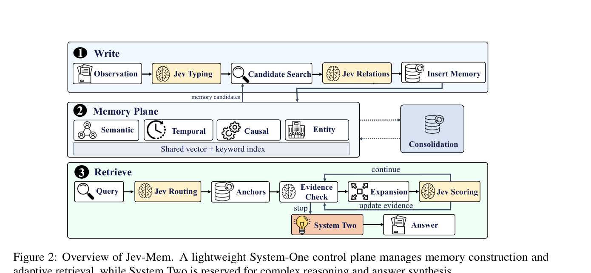
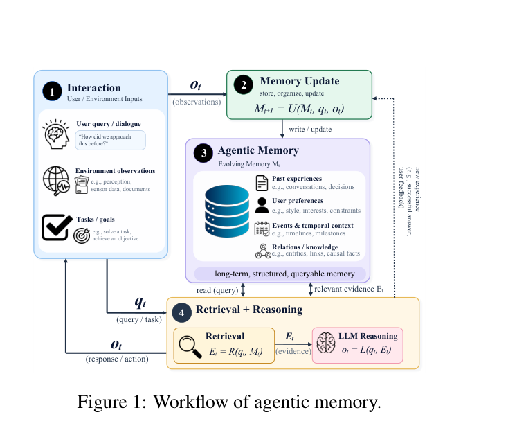

# Jev-Mem: System-One-Controlled Agentic Memory for Efficient AI Agents

## Why

**一句话**：一个长期陪你的助手，得反复判断它记下的东西——这条算什么、该和哪条放在一起、这次该翻哪一页、翻够了没有。今天的系统让"会写文章的模型"来做这些判断，所以慢在这儿，不是慢在存储。

**场景**：用户连续用了三个月的助手，积累几千条记忆。某天他问"上次那个方案为什么放弃了？"

- 写入时，每条新记忆都要回答："这是事件、事实、流程还是偏好？""它和已有哪几条有关？""是因果关系，还是只是同一天发生？"
- 读取时，每一轮都要回答："这个问题该查时间线还是因果链？""这个候选有没有用？""证据够不够，还要不要继续翻？"

这些问题的答案都只是**一个标签或一个分数**（是/否、相关性 0.7、继续/停止、多跳需求 0.8），但现有系统让 LLM 先写一段话，再从中解析出这个标签。

**成本账**：判断次数 ≈ 记忆条数 × 每条的候选关系数 + 查询轮次 × 每轮评估数，随规模增长。论文的基线就是这个后果：建库 A-MEM 3636 s、MemoryOS 3276 s；查询 MemoryOS 32.68 s，而"不做记忆、直接把全文喂给模型"只要 1.74 s（Table 2）——也就是说，**管理记忆比干脆不管理慢约 19 倍**，且这 19 倍里没有一次是在回答用户。

**现有两条路为什么都不行**：

1. **固定启发式**：阈值和规则写死，换一种问题（比如需要多跳）不会自己加深遍历（§2.1）。
2. **LLM 做控制**：够灵活，但每次判断都要生成、格式化、解析，判错了还要重试；判断越频繁，浪费越多（§2.2）。
3. **加长上下文不是替代**：模型利用不全长输入（§1），而且 agent 的记忆是持续写入、持续重组的，不是一份读一次就完的静态文档。

**作者的赌注**：这类判断"有语义、但不生成"——输入是状态 + 一个明确问题，输出是概率或标签。既然如此，就不该用生成模型来做，可以换成一个类型化预测器，一次批量回答一批问题（§2.2、§3.1）。Jev-Mem 的全部设计都建立在这个判断上。

**怎么算这个 Why 站住了**：若成立，换掉控制层应能在准确率不降的前提下显著降低建库时间与查询延迟——这正是 Table 1/2 要验证的；反之，若收益其实来自多关系图本身而非控制层，这个 Why 就没被证明。原文没做这个对照，所以目前只有相关性证据，见 Ideas 的 I1。

## What

### TL;DR

一句话：慢的地方不是存记忆，而是反复用"会写文章的模型"去回答那些"是/不是"的小问题。这篇论文把这些小问题改成直接出选择题、一次问一批，只在最后写答案时才让大模型动笔。在 LoCoMo 测试里，它准确率最高（0.777，比最强基线高 11%），建库快 6.6 倍（158 秒），每次提问快 36.7%（0.93 秒）。

### 结论清单

**新认识**

- 记忆控制属于 *semantic but not generative* 的一类计算：输出是 label / 概率 / 分数，可以整体移出生成循环（§2.2）。`[宣称，论证充分]`
- 快慢分工应落在**记忆子系统**这一层，而不是只做请求级模型路由：同一控制面同时管写入与检索，才谈得上"架构分离"（§3.1、§1 贡献列表）。`[宣称，部分由实验支撑]`

**新方法**

- 统一类型化控制接口 $J(S,Q)$：状态 + 一批显式判定问题，批量调用；write 侧做分型与关系，read 侧做路由、打分、停止（§3.1）。`[已验证：附录 B 给出实现与提示词]`
- 多关系视图共享 canonical 节点：semantic / temporal / causal / entity 是同一批节点上的多重边，而非四份副本（§3, Eq. 5–6）。`[已验证]`
- 预算化闭环检索：按视图需求分预算（Eq. 13–14）、按 multi-hop 预测定深度（Eq. 15）、每轮用四个信号决定继续或停止（Eq. 21–22）。`[已验证：阈值与上限见附录 B.5]`
- 写入不做准入过滤，保留原始观测；选择性推迟到建边与检索（§3.2、附录 B.2）。`[已验证]`

**新结论**

- LoCoMo overall 0.777 vs MAGMA 0.700（+11.0%）；Adversarial 0.962 vs 0.742；Open-Domain 0.618 vs 0.517（Table 1）。`[已验证]`
- 构建 158 s（相对 Nemori 1044 s 为 6.6×）、延迟 0.93 s（相对 MAGMA 1.47 s 为 −36.7%）（Table 2）。`[已验证]`
- **Temporal 不是最优**：Jev-Mem 0.637 低于 MAGMA 0.650，而 §4.2 正文写成"matches the best Temporal score of 0.650"，与表格矛盾。`[已验证的冲突]`
- 效率提升不以准确率下降为代价（§4.3）。`[宣称：同表内可比，但未做同参数的控制层消融，故只能说明"端到端不亏"]`

## How

一句话：它把上面那些"是/不是"的判断整理成固定问题，写成两条流程——记的时候怎么连、找的时候怎么翻——再把连好的记忆存成一张可以反复走的关系网。

### 判型

系统与算法类（CS）：核心是架构与流程设计，实验是端到端基准对比 + 系统计时，不含理论证明，也没有组件级消融。

### 核心机制

**记忆表示**：一条记忆只存一份，语义、时间、因果、实体四种关系都指向同一批记忆，不复制四份副本；另外配向量索引和关键词索引，作为"从哪进去找"的两条路。写成公式是 $M_t=(V_t,\{E_t^g\}_{g\in G},I_t^{vec},I_t^{lex})$，$G=\{$semantic, temporal, causal, entity$\}$；每条记忆记为 $o_t=(x_t,\tau_t,\mu_t)$，即内容、可选时间戳、来源（Eq. 4–6）。

**写入四步**（Eq. 10，$o_t\rightarrow$ type $\rightarrow$ candidates $\rightarrow$ relations $\rightarrow M_t$）：

1. 分型：四道判断题（论文把每道只答"是/不是"、返回 0–1 分的题叫 Noul）分别问：这是发生过的事吗、是一般事实吗、是一套流程吗、是某个人的偏好吗？四个分数同时保留，不逼它选一个（Eq. 7）。
2. 候选发现：确定性召回（向量相似度、词法重叠、共享实体、时间邻近），取 $K_w$ 个候选，控制器只看这些对（Eq. 8；附录 $K_w=10$）。
3. 关系判定：semantic 关联、双向 causal（`caused_by` / `causes`）、同 episode、entity 等价；$P(g\mid v,u)\ge\theta_{rel}$ 才建边（Eq. 9，附录 0.60）。有结构化信息就不问模型：时间戳排序直接建 temporal 边，精确共享标识符直接建 entity 边。
4. 周期维护：每 20 次成功写入，用四个 Noul（redundancy / contradiction / obsolescence / link usefulness）+ 一个 Choice（keep_separate / merge / promote / uncertain）决定表示方式；仅当 merge 或 promote ≥ 0.85 且 contradiction < 0.85 时才可能升级到 System-Two 生成摘要，常规路径只记录决策与连边，**不替换原始观测**（附录 B.3）。

**检索闭环**（Eq. 26，route → retrieve → assess → expand → reassess）：

1. 路由：$p(q)=\{p_g(q)\}$，加 multi-hop 需求 $h(q)$ 与 recency 重要性 $r(q)$；$p_g\ge\theta_{act}$ 即激活，可多视图并发（Eq. 11–12）。
2. 预算：$w_g=p_g^{\gamma}/\sum_{j\in A}p_j^{\gamma}$，先保底 $m$，余量按最大余数法取整（Eq. 13–14；附录 $B=80$、$m=1$、$\gamma=1.0$）。
3. 深度：$D(q)=\min\{D_{max},\max(1,\lceil D_{max}h(q)\rceil)\}$（Eq. 15）。
4. 锚点：把向量检索和关键词检索的两份排名合起来（倒数排名融合，RRF），$\kappa=60$（Eq. 16），排在最前的几条作为起点。
5. 每轮评估：$s_d$ 充分性、$u_d$ 继续收益、$m_d$ 缺失证据、$c_d$ 未解决矛盾；$s_d\ge\theta_{suff}\wedge m_d<\theta_{cont}\wedge c_d<\theta_{cont}$ 正常停止（Eq. 21），$u_d<\theta_{cont}$ 提前停止（Eq. 22；附录 0.95 / 0.15）。
6. 候选打分（Eq. 23）与 recency 修正（Eq. 24–25），top-$W$ 进下一代 beam（附录 $W=10$）。
7. 兜底：深度 8、节点 60、边 2400、控制器调用 16 次、时间 15 s；作者承认时间预算只在操作间检查，不是严格抢占（附录 B.5）。

最终 top-$K$ 证据交给 System-Two：$y=\text{SystemTwo}(q,E)$（Eq. 27），System-Two 不参与路由、扩张与停止。

Fig. 1 的一般闭环 $E_t=R(q_t,M_t)$、$o_t=L(q_t,E_t)$、$M_{t+1}=U(M_t,q_t,o_t)$ 说明本文的改动位置：$R$ 与 $U$ 内部的高频决策被统一换成 System-One 调用。

### 关键公式

候选打分（Eq. 23）：

$$
s(v\mid q,E_d)=\frac{1}{\sum_{i=1}^{5}\lambda_i}\Big[\lambda_1 z_v+\lambda_2 a_v+\lambda_3 p_g(q)\ell_v+\lambda_4 n_v+\lambda_5(\pi_e+c_v)/2\Big]
$$

$z_v$ embedding 相似度、$a_v$ 相关性、$\ell_v$ 关系有用性、$n_v$ 新颖性、$c_v$ 对现有证据的支撑、$\pi_e$ 存储边权。

recency 修正（Eq. 24–25）：

$$
\rho_v=\frac{1}{1+\max(0,\tau^*-\tau_v)/\text{day}},\qquad
es(v)=\frac{s(v)+0.1\,r(q)\,\rho_v}{1+0.1\,r(q)}
$$

### 证据强度

**设置**：LoCoMo 多会话对话；答案模型 gpt-4o-mini（Table 1 标题）；基线 Full Context、A-MEM、MemoryOS、Nemori、MAGMA；指标 LLM-as-a-Judge、构建时间、平均查询延迟。

Table 1（LoCoMo）：

| 方法 | Multi-Hop | Temporal | Open-Domain | Single-Hop | Adversarial | Overall |
| --- | --- | --- | --- | --- | --- | --- |
| Full Context | 0.468 | 0.562 | 0.486 | 0.630 | 0.205 | 0.481 |
| A-MEM | 0.495 | 0.474 | 0.385 | 0.653 | 0.616 | 0.580 |
| MemoryOS | 0.552 | 0.422 | 0.504 | 0.674 | 0.428 | 0.553 |
| Nemori | 0.569 | 0.649 | 0.485 | 0.764 | 0.325 | 0.590 |
| MAGMA | 0.528 | **0.650** | 0.517 | 0.776 | 0.742 | 0.700 |
| Jev-Mem | **0.623** | 0.637 | **0.618** | **0.802** | **0.962** | **0.777** |

Table 2（系统效率）：

| 方法 | 构建时间 (s) | 查询延迟 (s) |
| --- | --- | --- |
| Full Context | N/A | 1.74 |
| A-MEM | 3636 | 2.26 |
| MemoryOS | 3276 | 32.68 |
| Nemori | 1044 | 2.59 |
| MAGMA | 1404 | 1.47 |
| Jev-Mem | **158** | **0.93** |

证据强度评估：**只有端到端对比 + 系统计时，没有消融、没有重复运行与方差、没有第二个数据集**。准确率与效率是两套独立表格，未给出"准确率—延迟"曲线，因而无法判断 0.777 是在多大检索预算下取得的。

### 开销与边界

- 一次写入 = 1 次批量分型 +（有候选时）1 次批量关系判定，候选数上限 $K_w$；一次查询 = 1 次路由 + 每轮 ≤1 次证据评估 + 1 次批量候选打分（§3.3 末）。
- 显式上限把控制成本钉住：深度、访问节点、检查边、控制器调用次数、时间预算。
- 代价转移：保留全部观测 + 多重边，存储与图维护成本随写入线性增长；论文未报告存储开销。
- 边界条件：时间预算非严格抢占；返回分数未被假定为校准概率（附录 B.1），但正文按概率阈值使用——见 Ideas 的 D 类不足。

## Ideas

一句话：论文证明了"这样做更快"，但没有证明"快是因为不再让模型写文章"——它没做这个对照，也只在一个数据集上试过。下面的问题都从这两处缺口长出来。

### 不足

**A. 作者承认的**

1. 时间预算只在操作之间检查，不是严格抢占（附录 B.5）。
2. Noul 返回的 $[0,1]$ 值"不假定为校准概率"，独立性只指标问题表述，不指统计独立（附录 B.1）。
3. 只做了对话记忆，未涉及 agentic 任务（由标题 "AI Agents" 与实验范围的落差推出，作者未明说）。

**B. 我发现的内部矛盾**

4. 正文数字与 Table 1 不一致：Multi-Hop 0.625 vs 0.623、Open-Domain 0.610 vs 0.618、Single-Hop 0.797 vs 0.802。
5. "matches the best Temporal score of 0.650"——自身 0.637 低于 0.650（MAGMA），结论句与证据相反。
6. "best in five of the six categories"，但表中只有 5 个类别 + Overall。
7. §4.1 写 "two widely used benchmarks"，全文只报告 LoCoMo。

**C. 未覆盖的**

8. 无消融：没有"固定图结构 + 换控制器"的对照，也没有路由 / 预算 / 停止 / 多关系视图各自拆解。
9. 单 backbone（gpt-4o-mini）、单 judge、单种子；无方差与显著性。
10. 效率口径不透明：158 s 与 0.93 s 包含哪些环节（embedding、Jev 服务、图维护、System-Two 生成）未拆分；Jev 的部署方式未交代；无 token / FLOPs / 成本。
11. 超参全部手调且无敏感度：$\theta_{rel}$、$\theta_{act}$、$\theta_{suff}$、$\theta_{cont}$、$\gamma$、$\lambda_{1..5}$、$W$、$B$、$K_w$ 与五类上限。
12. 存储与图维护成本未报；矛盾/过期证据在答案阶段如何处理未说明。

**D. 方法与评估的错配**

13. 附录声明分数不保证校准，正文却把 0.60 / 0.95 / 0.15 当概率阈值解释并使用——同一套数字承担了两种语义，跨数据集迁移时阈值含义不明。
14. Eq. 23 外层再除 $\sum\lambda_i$：若 $\lambda$ 已归一化则重复归一化，正文未给 $\lambda$ 取值与归一方式。
15. $D(q)$ 用 $\lceil D_{max}h(q)\rceil$，$h(q)$ 很小时深度被压到 1，"multi-hop 预测"与"允许深度"耦合过紧，未做分析。
16. 矛盾（contradiction）只作为停止信号与合并门槛，合并又会保留原始观测，等于把冲突留给答案阶段，却没有答案阶段的冲突处理机制。

**归因**：4–7 属于**评估与写作**问题；8–11 属于**评估**问题；12、16 属于**方法**问题；13–15 属于**方法与表述**问题。真正的方法级缺口只有 12 与 16 两处，其余都是"证据不足"，这决定了下面的创新点分成两类：补证据（低成本、高确定性）与补机制（高风险、可能真出新东西）。

### 创新点

**I1 控制层的归因实验（Diagnostic benchmark）**

- 主张：在固定图结构、固定证据预算的前提下，"控制层从生成式换成类型化预测"对准确率与延迟的净贡献可以被单独测出来；若贡献主要来自图结构，Jev-Mem 的架构主张就需要降级。
- 与原文关系：正交（评估方法），直接补第 8 条缺口。
- 最小验证：LoCoMo + LongMemEval，三档检索预算 × 三种控制器（Jev / 小 LLM 控制器 / 固定启发式），画准确率—延迟曲线；图结构与 embedding 全冻结。
- 失败条件：三条曲线在预算内重合，说明收益来自图与证据选择，控制层只是实现细节。

**I2 阈值校准与跨数据集迁移（Calibration）**

- 主张：Noul 输出是"未校准打分"，把它当概率用是当前阈值不可迁移的根因；加一层轻量校准（isotonic / conformal）后，停止规则可以在不改阈值的情况下跨数据集复用。
- 与原文关系：增量 + 补表述缺口（D13）。
- 最小验证：LoCoMo 上拟合校准映射，冻结后直接在 LongMemEval / MemBench 运行，对比"原始阈值直接迁移"的掉点；报告校准前后的停止轮次分布。
- 失败条件：校准后仍显著掉点，说明信号依赖数据集的语言分布，而非尺度问题。

**I3 冲突感知的证据合成（Conflict-aware synthesis）**

- 主张：把 $c_d$（矛盾）从"停止信号"升级为"答案阶段的约束"——按事件时间而非观测时间排序、显式输出冲突与置信度，使记忆保留原始观测的代价不再转嫁给答案正确率。
- 与原文关系：补机制缺口（D16、A1）。
- 最小验证：从 LoCoMo 构造"事实被后续会话更新/否定"的子集，指标加两项：正确版本命中率、错误引用率；对照为原 System-Two 提示词。
- 失败条件：该子集上检索本身已召回不了更新后的记忆，则需先改检索，合成层无收益。

**I4 学习式控制策略（Learned control policy）**

- 主张：手调阈值可被一个轻量上下文策略替代：把路由权重、预算分配、停止决策参数化为小模型或 bandit，用答案正确率作延迟奖励训练。
- 与原文关系：替代控制策略（对照 HAGE 的 RL 路线，与 Jev 的零样本预测正交）。
- 最小验证：离线日志上训练 + LoCoMo 在线评估，比较样本效率与最终准确率—延迟点；必须与 I1 的冻结图结构设置一致，否则归因不清。
- 失败条件：训练与调参成本超过其节省的推理成本，或策略退化为常数阈值（说明信号不足）。

**I5 统一成本口径（Measurement）**

- 主张：记忆系统的效率比较需要统一口径（墙钟 / token / FLOPs / 存储 / 每查询成本），否则 6.6× 这类数字无法跨机器复核。
- 与原文关系：正交（评测基础设施），补第 10 条缺口。
- 最小验证：同机同 backbone 复现 6 个系统，报告各环节耗时占比与归一化成本；对 Jev 单独报告其服务开销。
- 失败条件：计时差异主要来自硬件与网络，归一化后排序反转——这本身就是有价值的结论。

**I6 从对话记忆到轨迹记忆（Scope extension）**

- 主张：分型（episodic / procedural / preference）与闭环停止准则可以迁移到 agent 轨迹（tool call 序列、失败—修复对），但"关系"的主类型会从 causal 转向 procedural，验证方式也应从 QA 改为任务成功率。
- 与原文关系：扩展。
- 最小验证：coding agent 的跨 session 复用任务，比较"有轨迹记忆 / 无记忆 / 纯 RAG"的成功率与步数；记忆写入用同一控制面。
- 失败条件：轨迹检索主要靠精确符号匹配（文件路径、函数名），图关系与语义路由无增益。

**优先级判断**：I1 与 I5 是"先把原文缺的证据补上"，成本最低、结论最确定，适合作为复现起点；I3 与 I2 有明确机制缺口、可独立成文；I4 与 I6 风险高，但一旦成立就是与原文正交的贡献。

## 相关工作

仓库目前只有这一篇笔记，暂无可互引笔记。按论文自身定位：

- **A-MEM / MemoryOS / Nemori**：改进"存什么、怎么组织"，仍让 LLM 参与记忆操作；Jev-Mem 认为瓶颈在控制层，因此换控制器而非换存储结构。
- **MAGMA**（Jiang et al., 2026a，同组前作）：同样使用 semantic / temporal / causal / entity 四类关系，Jev-Mem 的图结构基本继承自它，差别是把关系判定与遍历决策从 LLM 换成 System-One。它既是最近的祖先，也是唯一全面接近的基线。
- **HAGE**（Jiang et al., 2026b）：加权多关系图 + 查询条件路由 + RL 优化遍历；与 Jev-Mem 是同一问题的两种控制策略（学习式 vs 零样本类型化）。
- **SimpleMem / LightMem / Zero-Mem**：都在压记忆流水线成本；Zero-Mem 最接近"彻底去掉中间生成"，Jev-Mem 的差别是保留 System-Two 做最终合成，并把控制抽象成统一类型化接口。
- **IRCoT / FLARE / Self-RAG / Adaptive-RAG**：把检索变成查询相关决策，但作用于不可修改的外部语料、控制仍在生成循环内；Jev-Mem 把同一原则扩展到"控制器自己写入并维护"的记忆生命周期。
- **System 2 Attention / Tree of Thoughts / Graph of Thoughts**：在单次推理内分配 deliberative 计算；Jev-Mem 把快慢分工落到记忆子系统这一层。

## 可复现

一句话：附录 B 把每道判断题的问法和阈值都写出来了，照着能抄；但有几样关键信息原文没给，严格复现有障碍。

- 代码：<https://github.com/libingzheren/Jev-Mem>（论文首页脚注）。
- 数据：LoCoMo（Maharana et al., 2024），公开；答案模型 gpt-4o-mini。
- 关键超参（附录 B）：关系阈值 0.60；$K_w=10$；视图激活阈值 0.10；图扩张预算 80、保底 1、$\gamma=1.0$；beam 宽度 10；停止 $\theta_{suff}=0.95$、$\theta_{cont}=0.15$；上限：深度 8、节点 60、边 2400、控制器调用 16、时间 15 s；每 20 次写入触发 consolidation，merge/promote 阈值 0.85。
- 提示词：附录 B.2–B.5 给出分型、关系、路由、候选打分、停止判断的 instruction 与 true/false 判据，可直接照抄。
- 未交代：embedding 模型、System-Two 的 prompt 与 top-$K$、Jev 的部署方式、第二数据集、计时硬件。这些会阻碍严格复现。
