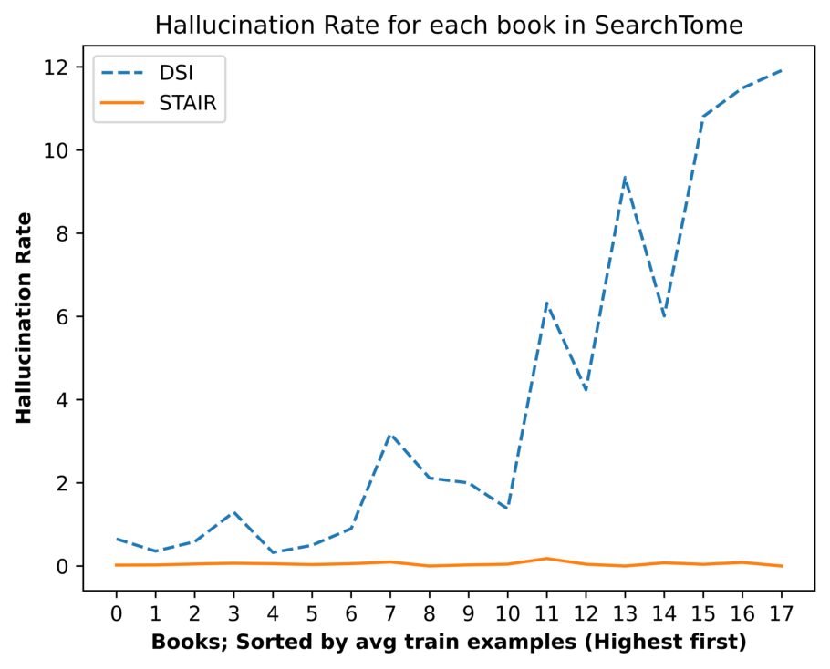
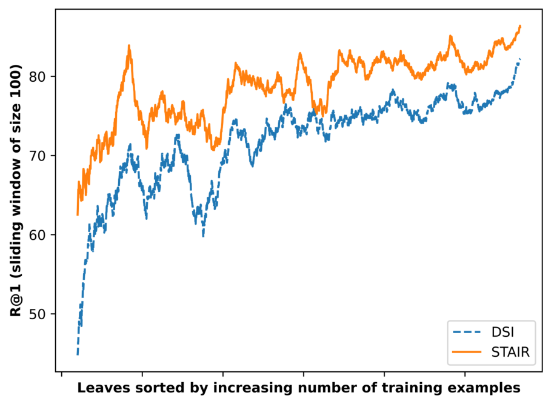

# STAIR (STructure Aware Information Retriever): A novel dataset and LLM based retriever for document structure augmentation

## Why

先看一个人怎么查书。有人问"plurality voting system 是什么"，他翻开一本讲比较政府的教科书，不会从第一页读起；他先看目录，判断答案大概在"Democracies and Democratization"这一章，再往下看到 4.2.3 节"Electoral Systems & Political Parties"，翻过去就找到了（Fig. 1）。目录在这里承担了两件事：把书切成语义完整的小块，并告诉读者每块讲什么。

现在的检索增强生成（RAG，先检索资料再把资料交给大模型作答）不这么做。它按固定长度把书切成 chunk（按 token 数切出来的文本块），切点落在一句话或一个论证中间是常态。这带来两个机制层面的后果。第一，相邻 chunk 的内容高度重叠，检索时彼此竞争，真正相关的那一块的排序分数被摊薄。第二，交给模型的窗口可能从半句话开始，缺了主语和前提，模型即使拿到也读不懂。这两条与模型大小无关，是切法本身造成的。

有人会说，现在的上下文窗口已经很长，把整本书塞进去就行。但书的规模摆在那里：这份基准里最长的一本是 1,297 页（Table 1），而且长上下文模型存在"lost in the middle"现象，放在中间的内容更容易被忽略。所以"全塞进去"既放不下，也不可靠，精确检索仍然必要。

另一条路不建外部索引，而是把语料"写进"模型参数。训练时给它大量"问题 → 文档编号"的配对，模型学的是从问题直接映射到编号；查询时它不查任何表，而是像写作文一样，一个 token 一个 token 地把编号写出来，再拿这个编号去取原文。标识符就是这串用来指代某一段的符号，检索系统返回它，再凭它去取正文。这条路线的代表叫 DSI（Differentiable Search Index，可微分搜索索引），它省掉了索引这一层，代价是"取哪一段"完全落在模型的记忆上。

难的地方在于编号是人为规定的符号，和内容没有语义关系。它可以是整数 4821，也可以是一长串标题，比如 `2.2.3 Initiative vs. Guilt (Preschool Years)`。模型要答对，必须把这串符号一字不差地从参数里回忆出来。某个小节在训练集里只出现几次时，模型见到的"问题 → 这串符号"的配对也只有几次，它很可能记成一个"看起来很像"的版本。

论文里有一个现成的例子（Table 3 例 1）。真实目录里同时有 `2.2.2 Autonomy vs. Shame/Doubt (Toddlerhood)` 和 `2.2.3 Initiative vs. Guilt (Preschool Years)`，DSI 输出的是 `2.2.2 Autonomy vs. Shame/Doubt (Preschool Years)`：编号和标题主体取自前一条，括号里的年龄段取自后一条。它不是随便乱写，而是把两条真实条目拼成了一个不存在的条目（§6.2 把这类输出算作幻觉）。这说明它当时在做的事是"回忆字符串"，不是在"从一组条目里选一个"。

按作者的判断，DSI 的瓶颈不在模型大小，而在它必须从训练样本里间接学出书的结构（§1）。它没有见过整份目录，因此"哪一节属于哪一章、这本书一共分了哪些节"这些信息，只能从"问题 → 编号"的配对里反推。反推出来的是一张模糊的关联表，不是一个可以逐条查看的清单。模型变大能让这张表记得更全，但改变不了它必须凭表作答、中间没有东西可核对这一点。

人做这道题时会分步对照：题目里的 "preschoolers" 对上 "Preschool Years"，"belittle their autonomous actions" 对上 "Initiative vs. Guilt"，所以选 2.2.3。目录里最末一级、没有子小节的条目（论文叫叶节点）就是这份可以逐条对照的清单；把它整份放进输入，模型的任务就从"回忆一个符号"变成"在候选行里比一比"。作者认为，这一步把"逐字记标题"这个难点绕开了。剩下的问题是：真实语料里这种清单常见吗，现有基准又能不能衡量"照着清单挑"的效果？

为什么现在值得做？因为大量语料本身已经带有层级：教科书、技术报告、企业帮助中心、监管文件都有目录。而现有的长文档基准要么只给答案、不给可检索的 gold 段落，要么给了段落却没有结构视图，没有一个能直接衡量"用目录检索"这件事的效果（§3.1）。

问题于是可以写成三问：能不能把文档自带的目录同时当作检索单位和候选标签集合，让"找到能回答问题的内容"变成"从目录里挑一个叶节点"？这样做能不能同时减轻冷门章节的记忆负担、减少编造标识符？代价落在哪里，是每次查询都要读完整份目录，还是每本书都要单独训练一个模型？

## What

论文的答案是能，而且增益集中在训练样本很少的章节上。它做的事可以用一句话说清：**给一个问题、一本指定的书和这本书的完整目录，让模型指出答案在哪一节。**输入里只有各级标题，没有正文；输出是一个叶节点标题，系统再按它去取那一节的正文。它不判断该查哪本书，也不生成答案——书的身份和答案的生成都在系统之外。

在这个任务上，作者自建的 SearchTome 基准给出平均 Recall@1 82.6%，比同样微调过的 DSI 高 5.7 个百分点（76.9%），比零样本 DPR 高 13.9 点，比 BM25 高 23.1 点，比未微调的 Mistral 高 68.8 点（Table 4）。做法是把那本书的完整目录放进提示，微调一个 70 亿参数的模型，让它直接续写叶节点标题；叶节点既是检索单位，也是文档标识符，推理时把输出限制在合法叶标题上。

### 新认识：结构可以同时充当索引和候选集

第一条，目录是一份人已经写好的标签体系。把每个叶节点当成一个候选类别，检索就从"在整本书里找一段"变成"在 70 到 429 个候选里选一个"（Table 1）。这个基准平均每本 160 个候选（我按 2,880 个叶、18 本书算出），随机猜中的概率约 0.6%。这个转换把开放域检索压成了封闭集分类，也解释了为什么一个 70 亿参数的模型能在这项任务上做得不错。`[已验证，Table 1、Table 4]`

第二条，标题既是文档标识符，又是输入里可以直接复制的字符串。DSI 要从参数里回忆标识符，STAIR 的标识符就写在提示里，模型只需要判断"问题更像哪个标题"，不需要逐字记忆。作者把这一点解释为"结构帮助知识入库"，但这个解释同时也能解释两个消融的结果：编造标题的比例低、冷门叶上的优势大。两种解释在现有实验里分不开，见 Ideas 第一条。`[宣称，机制未隔离]`

第三条，"幻觉"在这套设定里可以被操作化成"输出了目录里不存在的标题"。这把一个开放问题变成了一个可以计数的比例，代价是把"编造内容"缩小成了"编造标识符"。论文用它来支撑"低幻觉生成式检索系统"的说法，但两者不是同一件事，见 Ideas 第四条。`[宣称]`

### 新方法：一条三阶段流水线、一个基准、一份可复用的构造配方

流水线本身不复杂：从 PDF 里提目录和正文，用大模型按段落合成"问题 → 叶标题"的训练样本，微调模型，推理时约束解码（Fig. 2）。真正可以复用的是这套把"文档结构"变成"监督信号"的构造方式：任何带目录的语料都能照这个流程生成训练数据，不需要人工标注检索标签。

SearchTome 是配套的基准：18 本开放教科书，覆盖教育、金融、法律、医学、自然科学、社会科学 6 个领域，每本都给出目录与正文的对应关系，并按书划分训练、开发、测试三部分（Table 1）。按我的加总，共 2,880 个叶节点、12,475 页、190,209 道题。

还有一个可以直接搬走的细节：训练样本的提示里同时给出书名、整份目录和查询，输出只要叶标题，并明确要求"不要生成解释"（Table 2）。这个格式把任务限制成"复制目录里的某一项"，避免了模型自由发挥。

### 新结论：数字、成立条件与失效处

主结果是 Table 4。STAIR 的 Recall@1 是 82.6%、Recall@3 是 90.8%、nDCG@3 是 87.5%；DSI 是 76.9 / 85.3 / 81.9，DPR 是 68.7 / 85.4 / 78.6，BM25 是 59.5 / 77.6 / 70.1，Claude Haiku 4.5 是 45.6 / 64.1 / 56.4，未微调的 Mistral 是 13.8 / 16.4 / 15.4。按领域拆开，STAIR 在 6 个领域全部领先 DSI，差距从 4.0 点（自然科学）到 7.5 点（法律）。`[已验证]`

作者对 DSI 与 STAIR 的 Recall@1 差做了随机化检验（把两个系统在同一批题上的输出随机互换，看重跑出来的差距有多常见），在 6 个领域上分别做，p 值都低于 0.05（§6）。论文没有给具体 p 值，也没有做多重比较校正。`[宣称，统计口径不完整]`

幻觉方面，STAIR 只有 0.05% 的预测是非叶节点，DSI 是 3.25%，未微调的 Mistral 错误率 86.20%，其中 26.81% 的错是预测了非叶节点、23.86% 是预测了目录里不存在的标题（§6.2）。Fig. 3 进一步显示，DSI 的幻觉率随每本书平均训练样本减少而上升，在样本最少的那本书上接近 12%，STAIR 一条线基本贴在 0 附近。`[宣称，与约束解码冲突，见 How 与 Ideas]`

最稳的一条是低样本表现。Fig. 4 把叶节点按训练样本数从少到多排序，再以 100 个叶为窗口做滑动平均：训练样本最少的叶上，DSI 的 Recall@1 大约 45%，STAIR 大约 63%；随着样本增加，两条线收敛到 82% 与 86%，差距缩到 4 点左右。换句话说，结构带来的好处不是均匀的，它主要买的是"这个叶节点我没见过几次也能选对"。`[已验证，但横轴同时与测试题量相关]`

## How

### 一、先看这道题被写成了什么

给定一本书 $D$ 和它的目录 $\mathrm{ToC}_D=\{T_1,T_2,\dots,T_n\}$。如果 $T_p$ 对应的章节被进一步分成若干小节，其中包含 $T_c$，就记 $T_p=\mathrm{parent}(T_c)$，于是目录成为一棵树。叶节点集合记作 $\mathrm{LN}_D$，检索目标是从中选出一个叶节点 $T_l$，它的正文能回答查询 $q$：

$$
T_l^{*}=\arg\max_{T_l\in \mathrm{LN}_D} P(T_l\mid q,\mathrm{ToC}_D).
$$

这个定义有三个边界，读后面的数字时要一直记住。第一，书 $D$ 是输入，不是待检索的对象，系统不负责判断该查哪本书。第二，候选只到叶节点，检索粒度是节，不是段落。第三，输出是节标题，不是答案；把选中那一节的正文变成回答是系统之外的事。

论文写的叶节点定义是 $\mathrm{LN}_D=\{T_l\in \mathrm{ToC}_D\mid \exists! T_c\in \mathrm{ToC}_D,\ T_l=\mathrm{parentOf}(T_c)\}$，也就是"$T_l$ 是 $T_c$ 的父节点"。按字面读，这是在挑"恰好有一个子节点"的节点，与"叶"正好相反；叶应该是没有子节点的节点，也就是 $\lnot\exists T_c$。公式里大概漏了否定号。这不影响实验实现，但形式化本身是错的（§4.1）。

这个目标函数值得多看一眼。它不像 BM25 或 DPR 那样给每个文档打分再排序，而是直接在一个封闭的候选集合上做条件概率最大的选择。候选集合由目录给定，因此"检索"和"分类"在这里是同一件事。

### 二、19 万道题是怎么造出来的

选书来自 open.umn.edu 的开放教科书，6 个领域各 3 本，覆盖音乐理论、护理、会计、侵权法、遗传学、比较政治等差别很大的主题。每本书用 pymupdf 解析 PDF，提取目录，再把每个叶节点与它下面的正文对齐。

题目生成的做法是：对每个段落，让 Mixtral 8x7B 生成多个问题，要求覆盖段落里的重要主题。这样每道题的 gold 就是该段落所在的叶节点，不需要人工标注。训练、开发、测试的划分在每本书内部做，测试题来自训练时见过的书，只是问题本身没在训练里出现过。

我按 Table 1 加总了规模：18 本书、2,880 个叶节点、12,475 页、190,209 道题。其中训练 62,458 道（32.8%）、开发 24,502 道（12.9%）、测试 103,249 道（54.3%）。平均每个叶节点有 21.7 道训练题、35.9 道测试题。测试集比训练集还大，作者的说法是要"更彻底地测试系统对内容的覆盖"；代价是每本书只有约三分之一的问题参与训练，冷门叶拿到的样本更少，而这正好是 Fig. 4 的横轴。

### 三、训练与推理

训练输入是提示、查询和整份目录。目录里叶节点写成 `leaf 12.9 Step seven: design course structure and learning` 这样的形式，带 `leaf` 前缀和编号；非叶节点只写编号和标题。提示末尾写 `### Section: leaf`，模型续写叶标题（Table 2）。

目录在书里是一棵树，喂给模型时压平成一串行。以 Table 3 例 1 为例：

```text
2 Chapter Two: Theorists and Theories of Development
leaf 2.1 Theories of Development
2.2 Psychosocial Theory
leaf 2.2.1 Trust vs. Mistrust (Infancy)
leaf 2.2.2 Autonomy vs. Shame/Doubt (Toddlerhood)
leaf 2.2.3 Initiative vs. Guilt (Preschool Years)
```

`2.2.3` 是叶节点，因为它下面没有再分小节；`2.2` 不是，因为它还有 2.2.1 到 2.2.8。输入里只有这些标题，没有各节的正文；正文只在两处用到：造训练题时确定 gold 是哪一节，检索完成后再把选中那一节的文字取出来。

训练和检索用的是同一个模板：`### Book`、`### Table of Contents`、`### Query`、`### Section: leaf`。训练时把查询和它的 gold 叶标题配成一对，让模型学会续写；检索时换一个查询，目录不变，让模型续写它认为最匹配的叶标题。目录在两个阶段都要输入，而且同一本书的所有查询共用一份目录（§4.2）。


微调用 Mistral Instruct v0.2（70 亿参数）做监督微调，挂 LoRA（冻结原模型，只在旁边加一小块可训练参数），秩 $r=16$、$\alpha=32$，最多 200 个 epoch，按开发集 Recall@1 早停、耐心 20 个 epoch。STAIR 的最大输入长度是 14k token，DSI 是 512 token，输出都限制在 64 token 以内（§5.2）。

推理时做约束解码：每一步只允许模型输出候选集合里的字符串，其他 token 的概率置零，因此理论上不可能生成目录外的标题（Fig. 2 Stage 3）。这一点和后面的 0.05% 直接冲突，见 Ideas 第四条。

训练范围有一处没写清。DSI 明确是"每本书用自己的训练集微调"（§5.1）；STAIR 只写"用 SearchTome 的训练集训练"，没有说是一套模型覆盖 18 本书，还是每本书一套。两种都可行，但成本、语料更新时的做法、以及"知识入库"的含义完全不同。

### 四、基线、指标与显著性

指标是 Recall@1、Recall@3 和 nDCG@3，用 BEIR 的脚本计算。这里每道题只有一个 gold 叶节点，所以 Recall@1 就是"第一名是不是 gold"；Recall@3 是"前三名里有没有 gold"；nDCG@3 在命中的基础上再看 gold 排第几，越靠前分越高。

基线有五个。Mistral Instruct v0.2 零样本，用 beam search 取前 K 个预测；BM25 用 Elasticsearch 8.11.2 建索引，每个叶节点的正文当一个文档，叶编号当文档标识符；DPR（Dense Passage Retrieval）用 NV-Embed-v2 零样本，段落截到 512 token、查询截到 256 token；DSI 用同一底座微调，输入只有查询；Table 4 里还有一个 Claude Haiku 4.5，但正文没有描述它的提示和输入。

显著性检验针对 DSI 与 STAIR 的 Recall@1 差，按领域把同领域的书合并成一个样本，做 Smucker 等人为检索系统设计的随机化检验，零假设是两个系统的输出来自同一分布、差距由抽样波动造成，阈值 $p<0.05$。6 个领域都拒绝了零假设。没有报具体 p 值，也没有对 6 次检验做校正。

### 五、消融其实是在看"样本量"

两个消融都不是常见的"去掉某个组件再测"，而是把结果按叶节点的训练样本数分层，观察两条曲线。

第一个是幻觉率（Fig. 3）。横轴是书，按平均训练样本数从多到少排；纵轴是幻觉率。DSI 从接近 0 一路升到约 12%，STAIR 基本贴在 0。第二个是 Recall@1（Fig. 4）。横轴是叶节点，按训练样本数从少到多排；纵轴是 100 个叶的滑动窗口内平均 Recall@1。DSI 从约 45% 升到约 82%，STAIR 从约 63% 升到约 86%，两条线的差距在最左端最大，向右收敛。



*Fig. 3：按每本书平均训练样本数从多到少排列的幻觉率。DSI 在最右侧（样本最少）的书上接近 12%，STAIR 全程接近 0，只有很小的波动。*



*Fig. 4：叶节点按训练样本数从少到多排列，纵轴是 100 个叶的滑动窗口平均 Recall@1。最左端 DSI 约 45%、STAIR 约 63%，右端收敛到 82% 与 86%。*

这两条曲线本身是真实的观察，但它们无法区分两种解释。第一种是作者的解释：没有目录时，模型必须把章节结构记进参数，样本少的章节记不住。第二种更简单：STAIR 的候选标题就写在输入里，模型不需要"记住"标题长什么样；DSI 必须从参数里逐字生成那个标题，样本少就生成不出来。第二种解释也能容纳"STAIR 自己同样随样本从 63% 升到 86%"这个事实：它仍然需要样本学会把问题匹配到标题，只是不需要样本去记住标题的字面。两个消融的结果在第二种解释下同样成立，而论文没有做能区分两者的对照。这一点会在 Ideas 第一条展开。

### 六、钱和时间花在哪

论文完全没有报开销，既没有延迟、吞吐，也没有显存、GPU 小时或美元。能确定的是结构上的成本差：每次查询都要把整份目录送进模型，最长 14k token；BM25 是一次倒排查找，DPR 是一次编码加一次内积，两者都不需要在查询时读完整份目录。STAIR 的一次查询至少包含 14k token 的预填和最多 64 token 的解码，这是数量级的差别，不是常数差别。

训练侧的成本也没有账本。DSI 是每本书一个模型，18 本书就是 18 次微调；STAIR 的训练范围没写清，如果也是一本书一个模型，同样是 18 次，如果是一套模型覆盖 18 本书，就要在 18 份不同目录之间切换。两种做法在语料更新时的维护成本也不同。

规模边界由 14k token 决定。基准里最大的目录是 429 个叶节点，塞得进；换成企业语料，目录本身就要分层（几百万个 URL），"整表塞进提示"的做法不成立。论文在 Limitations 里承认了"只在有全局结构的语料上评测"，但没有讨论目录大到装不下时的降级方案。

### 七、这些证据能证明什么

能证明的是：在"目录可见、候选封闭"这个设定里，微调过的 70 亿模型明显强于 BM25、零样本 DPR、同底座微调的 DSI 和零样本大模型；冷门叶节点上的优势最大；在 6 个领域上方向一致。

不能证明的有四件事。第一，不能证明这些知识"写进了参数"，因为目录就在输入里，模型完全可以只做标题匹配。第二，不能证明这套检索在端到端 RAG 上更好，因为论文只测了检索指标，没有让任何模型拿着检索结果去回答。第三，不能证明能迁移到没见过的书，因为所有测试题都来自训练时见过的 18 本书。第四，不能证明成本可接受，因为没有任何开销数字。

## Ideas

### 不足

1. **答案字符串就在输入里，"知识入库"没有被隔离**（评估问题）。训练和推理的输入都包含完整目录，模型要输出的叶标题是输入里的一行，任务因此更接近"带候选列表的阅读理解"，而不是"从参数里检索"。作者用来支撑"入库"的证据只有"DSI 不如 STAIR"和"冷门叶上差距大"，但这两条在"标题可见"的解释下同样成立。真正能分离两者的对照是：同一个模型、同样看到目录、但不做语料训练（或只在别的书上训练），看它能不能达到接近 82.6% 的水平。这个对照没有做。

2. **缺三个能定性的基线**（评估问题）。第一，同模型 + 目录 + 约束解码、但零样本，用来量"微调"本身的贡献；Table 4 里 Mistral 和 Haiku 的输入没有写清，无法判断它们是不是这个基线。第二，只嵌入叶标题的稠密检索（把查询和 160 个标题各编码一次，算点积取最大），这是最便宜也最直接的对照；如果它就能到 80%，整套微调和 14k token 的预填都不必要。第三，用数字 docid 加约束解码的标准 DSI，用来区分"标题作为标识符太难"和"结构没有入库"；现在的 DSI 必须从参数里生成整条标题字符串，字符串本身就成了瓶颈。

3. **gold 标签由段落位置决定，没有人工校验；题目按段落聚集**（数据问题）。每道题的 gold 是"生成这道题的段落所在的叶"，这只说明段落来自那里，不说明"一个人只看目录也会选到那里"，也不说明"这个叶是唯一能回答该题的叶"。论文没有抽样人工核对，没有报告标注一致性，也没有检查同一段落生成的多个问题是否高度重复。更麻烦的是统计：随机化检验把每道题当独立样本，但同一段落生成的题共享 gold、措辞相近，真正的独立单元是段落，p 值会偏乐观。

4. **幻觉指标与约束解码冲突，而且与 RAG 的幻觉不是一回事**（评估问题）。如果 Stage 3 真的把输出词表限制在合法叶标题上，非叶输出的比例应该是 0，而 §6.2 报的是 0.05%；这说明约束没有完全生效，或者这项统计是在不约束的解码下做的，原文没有交代。Fig. 3 里 STAIR 的曲线也不是严格为 0，第 7、11 本书上有肉眼可见的小峰（约 0.1%–0.2%），与摘要的"低于 0.05%"对不上。更重要的是口径：这里数的只是"输出是不是目录里的合法字符串"，与生成答案时编造事实的幻觉是两件事，用它来支撑"低幻觉生成式检索"属于以 A 的指标证明 B 的能力。

5. **多处口径不一致，读者需要自己对齐**（评估问题）。摘要与 §1 说"高 7.4%"，实际是 82.6 对 76.9 的 5.7 个百分点，7.4% 是相对增益，而同一段里其他数字都是绝对点数。错误率与 Recall@1 的补数也对不上：STAIR 报 18.67%、按平均 Recall@1 算是 17.4；DSI 报 24.31%、补数是 23.1，说明错误率是按题池化而主表是按领域宏平均。Table 4 有 Haiku 但 §5.1 没有它的设置；Mistral 的输入是否包含目录没有写；STAIR 是一套模型还是每本书一套没有写。§6.2 的标题是 Error Analysis，Table 3 的三个例子却都是 STAIR 答对，正文只分析了第一个。

6. **"泛化"只到同一本书里的新问题**（评估问题）。摘要说"在训练样本很少的情况下也能泛化"，Fig. 4 支持的只是"同书内冷门叶节点"；没有留出书，没有零样本迁移，也没有跨领域测试。作者在 Limitations 和 Conclusion 里把动态目录、未见语料、零样本迭代检索都列为 future work，这说明当前版本确实没有做。

7. **成本与规模完全缺席**（系统问题）。每查询 14k token 的目录预填、每本书一次微调、语料更新后的重建，这三项都没有进入任何表格。对于一个主打 RAG 的系统，这等于没有回答"值不值得用"。14k 的输入上限也直接决定了它无法用于目录本身很大的语料，而论文只把这一点写成"未来想试企业语料"。

### 创新点

**一、把"结构可见"与"结构入库"拆开**

- 主张：如果同一底座模型在只看目录、不做语料微调时就能达到 70% 以上的 Recall@1，那么本文 82.6% 的增益主要来自"候选集在输入里"，而不是"语料知识写进了参数"；STAIR 的定位应该从"模型式索引"改成"带结构先验的候选重排"。
- 与原文关系：反驳（针对 §4.2 "Corpus knowledge ingestion" 与摘要的核心主张）。
- 最小验证：三个条件在同一测试集上比较。(a) Mistral Instruct v0.2 零样本 + 完整目录 + 约束解码；(b) 同一模型只在 12 本书上微调、在 6 本未见过的书上测（留出书，而不是留出题）；(c) 完整 STAIR。指标用 Recall@1，按领域报告并给 bootstrap 区间。
- 失败条件：若 (a) 低于 55%、(b) 低于 70%，说明微调与语料训练确实带来了不能由"看到目录"解释的增益，本文的归因成立；若 (a) 已接近 82.6%，则"入库"的说法要撤回。

**二、标题向量检索与 listwise 重排，作为两条便宜的上界**

- 主张：把 160 个叶标题编码成向量、与查询算相似度取最大，或者把整份目录交给一个强模型做一次 listwise 重排，这两条路的成本都比 14k token 预填加微调低得多；如果它们的 Recall@1 与 STAIR 相差不到 3 点，本文的方法就不值得部署。
- 与原文关系：反驳（针对"必须微调才能学会用目录"的论断）。
- 最小验证：在同一测试集上跑三条基线：(a) NV-Embed-v2 只编码标题；(b) BM25 只在标题上匹配；(c) 一个强模型（如 Haiku 或 GPT 级）读目录做一次排序，输出前 3。三者都不训练，报 Recall@1 与每次查询的 token 数、延迟。
- 失败条件：三条都低于 75%，说明标题层面的语义匹配不足以解决这道题，微调确有价值；只要有一条超过 80% 且成本低一个量级，本文的工程结论就要改写。

**三、给 gold 做人工校验，并测"只看目录能不能答"**

- 主张：这套基准的上限取决于"人只看目录能不能选对叶节点"。如果两个人只看题目和目录、一致率只有 70%，那么 82.6% 已经接近人类水平，继续刷点的意义有限；如果一致率是 95%，则说明模型还有空间，同时也说明合成标签可信。
- 与原文关系：扩展（补 §3.2 缺失的标签质量证据）。
- 最小验证：从 18 本书分层抽 500 道题，给两名标注者只看题目和完整目录（不给原文段落），让他们各选一个叶；计算 Cohen's $\kappa$、两人一致时与来源叶的吻合率，以及"来源叶是否被至少一人选中"的比例。另抽 100 道题，让标注者判断"这道题是否只能由该叶回答"。
- 失败条件：$\kappa>0.85$ 且与来源叶吻合率 >90%，说明标签可靠，本文结论不受影响；若 $\kappa<0.6$ 或吻合率 <80%，则 82.6% 的天花板本身存疑，主表数字需要重新解释。

**四、把评测从"标识符合法"换成"答案是否正确"**

- 主张：检索指标提升 5.7 点，不等于 RAG 的答案更好。用同一个读者模型读 STAIR 选中的叶正文与 BM25 的前 3 个叶正文，比较答案准确率和"答案是否有原文支持"，才能回答这篇论文对 RAG 到底有什么用。
- 与原文关系：扩展（补端到端缺口，也修正幻觉口径）。
- 最小验证：抽 1,000 道题，固定一个读者模型和一套提示，只换检索结果（STAIR 的 top-1、STAIR 的 top-3、BM25 的 top-3、DPR 的 top-3），比较 exact match 或 rubric 判分，并用另一个模型判定答案中的每个 claim 是否能在给定正文里找到依据；配对检验。
- 失败条件：四组答案质量差小于 2 点且区间含零，说明检索层的 5.7 点没有传导到答案层，本文的 RAG 卖点不成立；若传导明显，则本文的贡献应改写成"用结构提升 RAG 答案质量"，而不是"低幻觉检索"。

**五、用逐层约束解码替代整表输入**

- 主张：把"一次读完整份目录"换成"沿目录树逐层选择"（先选章，再选节，再选叶），每层候选不超过 20 个，输入可以压到 1k token 以内，从而支持目录大到 14k 放不下的语料；代价是上层选错会沿着树传下去。
- 与原文关系：正交（针对 §8 Limitations 的规模边界，但给出的是可测的机制而不是"未来工作"）。
- 最小验证：在同一批书上实现三层约束解码，每层用同一个微调模型给候选打分，beam 宽度取 3，并在叶层置信度低于阈值时回退到父层；比较 Recall@1、每次查询的 token 数与延迟，再在一本人工拼出 2,000 个叶节点的书上重复。
- 失败条件：Recall@1 下降超过 3 点，而 token 只降到一半，说明整表输入是必要的，逐层方案不划算；若下降小于 1 点且 token 降一个数量级，则本文的规模限制可以解除。

**六、把训练与查询成本做成一张可比的账本**

- 主张：如果 STAIR 确实是一本书一个模型，那么它真正的比较对象不是 BM25 的单次查询，而是"BM25 建索引 + 查询"的全生命周期。把 18 次 LoRA 训练、每次查询 14k token 的预填、语料更新后的重训都折成美元和小时，才能判断它在什么查询量下划算。
- 与原文关系：正交（补成本口径）。
- 最小验证：选 3 本规模不同的书（70、160、429 个叶），测每本书的微调 GPU 小时、每次查询的 p50/p95 延迟与 token 数、以及更新一章后重训的代价；与 BM25、DPR 的建索引和查询成本画在同一张图上，横轴是每月查询量。
- 失败条件：在合理的月查询量下（例如 10 万次），STAIR 的总成本始终高于 DPR 加一次重排，说明它只适合离线、低频、高价值的场景，摘要里的通用性主张要加限定。

## 相关工作

与 [DecisionRAG](wan2026-decision-rag.md) 最接近：两篇都把检索写成"在候选里选一支"，都用封闭候选集换准确率。差别在树的来源和判断器。DecisionRAG 的树由聚类和摘要生成，STAIR 的树是文档自带的目录；DecisionRAG 每一层用决策模型打分、不生成文字，STAIR 用微调后的生成模型直接输出叶标题。两篇的候选集都放在输入里，因此"判断力来自模型还是来自候选集"都需要额外对照；DecisionRAG 至少做了同判断器、同候选集的对照（§6.5），STAIR 没有。

与 [RAW-RAG](bao2026-raw-rag.md) 的关系在基线强度。RAW-RAG 的结论是"把检索基线配置正常，复杂系统常常不如朴素 RAG"；这篇论文的 BM25 用默认配置、DPR 是零样本，两者都没有针对标题调过，还缺一条"只检索标题"的稠密基线，因此 23.1 点和 13.9 点的领先里，有多少来自方法、有多少来自基线没配好，目前分不清。RAW-RAG 提出的"先重设参照系再谈增益"正好适用于这里。

与 [Memory Tax](he2026-memory-tax.md) 的关系在账本。Memory Tax 把记忆系统的收益和成本分开算，发现多数系统相对 RAG 是净亏；这篇论文只报收益，没有报税，而它的税恰好很重：每查询 14k token，如果每本书一个模型，还要加上每本书一次微调。把两者放在一起看，STAIR 更适合被当作"离线高价值语料"的方案，而不是通用检索器。

按论文自身的定位，它与 RAPTOR 的差别是"用不用结构"和"索引放在哪"：RAPTOR 递归聚类、摘要建树，检索仍走稠密向量；STAIR 用现成的目录，检索走生成式模型。它也与 DSI 同属模型式索引，区别是把标识符（在这一实现里是叶标题）同时放回了输入，让模型可以复制而不必从参数里回忆。

## 可复现

- 代码：<https://github.com/meghanadhpulivarthi/stair-clean.git>（PDF 链接注释；正文只写"已在 GitHub 公开"，未给地址）。
- 数据：<https://huggingface.co/datasets/meghanadh/SearchTome>；18 本书的原始链接在 Table 1，均指向 open.umn.edu。
- 底座：Mistral Instruct v0.2（70 亿参数），LoRA $r=16$、$\alpha=32$，最多 200 个 epoch，按开发集 Recall@1 早停、patience 20；STAIR 最大输入 14k token、DSI 512 token，输出上限 64 token。
- 指标：Recall@1、Recall@3、nDCG@3，用 BEIR 脚本计算。
- 显著性：Smucker 等人的随机化检验，按领域合并，$p<0.05$，未报具体 p 值。
- 无法复现的部分：微调后的权重与 LoRA adapter 是否放出未说明；随机种子、学习率、批大小未给；生成的标题如何与 gold 叶节点匹配（精确串匹配还是归一化后匹配）未写；Mistral 与 Haiku 两个基线是否看到目录、是否用约束解码未写；逐本书的结果未给，只有领域聚合；训练与推理的算力、延迟、费用全部缺失。
