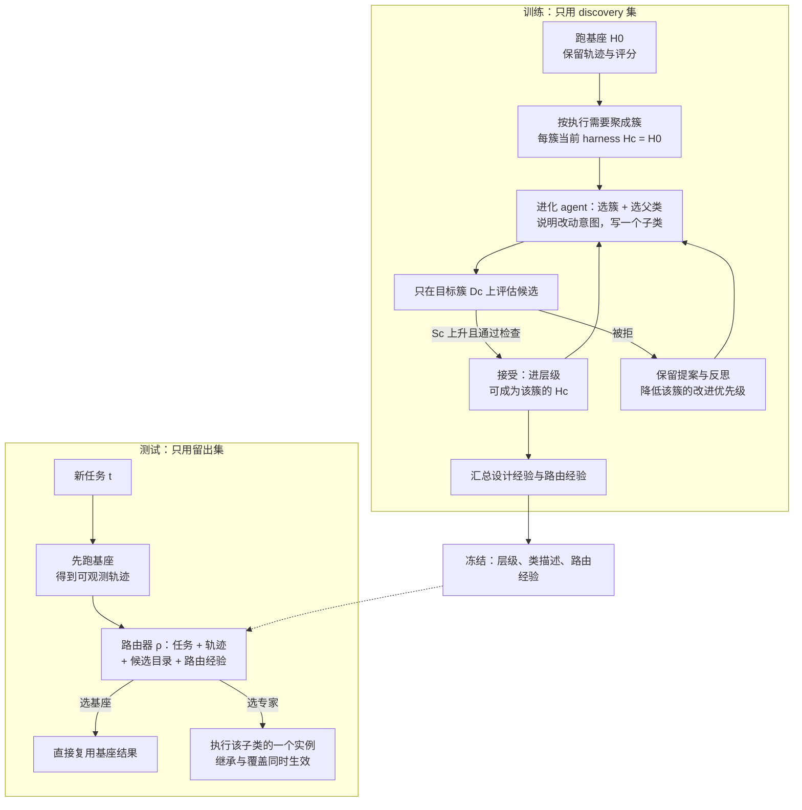

# Object-Oriented Harness: Evolving Agent Harnesses through Object-Oriented Design

## Why

一个语言模型在长程任务上跑得好不好，除了模型本身，还取决于模型外面那一圈代码：系统提示怎么写、给哪些工具、工具返回的文本要不要裁剪、什么时候要求它再检查一遍、什么时候允许结束。论文把这圈代码叫 **harness**，并给了它一个可以操作的定义：harness 是可执行代码，不是配置文件。这个定义重要，因为有了它，改进 harness 就变成了一件可以试错的事：以前只能改提示词、靠人拍脑袋判断；现在候选就是一段代码，改完跑一遍真实任务，看分数涨没涨，涨了留下，跌了重改。现实里同一套模型换一圈 harness，任务完成率能差出十几个百分点，而这只花了改代码的成本，不动模型权重。

通用的单一 harness 之所以不够用，不在于它写得差，而在于它不可能同时对所有的任务都好。论文引了两条已有的证据。第一条来自 AHE（Agentic Harness Engineering）的组件消融（把某个组件单独加上或拿掉，看分数怎么变）：AHE 会让一个负责改代码的模型反复读执行记录、改 harness。论文把这套反复改、按分数留优的流程叫"进化"，把这个模型叫"进化 agent"。其中，进化过程给 harness 加了一个"记忆"组件，不是人写的。结果是难题的完成率上升，简单题反而下降。

AHE 原文没有展开这个组件具体记什么；按这类系统的常见做法，它让 agent 把执行中的中间结果或之前的尝试留下来，后面接着用——比如记住上一步查到的文件路径，或者记住哪条命令已经失败过，不必每一步从零开始（`TODO:` 查 AHE 原文确认）。第二条来自 EvoHarnessBench：增加工具、技能和专家 agent，反而会破坏原本有效的执行行为。这两条证据指向同一件事：改动都落在同一份代码上，而不同任务需要的执行策略彼此冲突——有的任务需要多轮自检，有的任务需要在工具调用预算耗尽前主动收尾，有的任务需要逐字复制原文而不许改写。一份全局代码只能在这些需求之间取折中，折中的结果就是在每一类任务上都不够好。

那么"给每类任务配一个专家 harness"是不是就够了？已有的做法是让一个路由器在若干份**独立实现**之间挑一份（Fig. 1b）。这条路有两个机制代价。第一个代价是代码不共享：原始 harness 里修好的一个缺陷，如果对三个专家都适用，就要抄三遍，之后每次修都要改三处。专家越多，重复越多，几份代码就越容易长成不同的样子：同一个缺陷在 A 里修了，B、C 可能还留着；后来改的逻辑也只进了一份，时间一长，三份代码的行为就对不上了。

第二个代价是路由器只能看任务描述。任务描述写的是"要做什么"，比如"把仓库改到测试通过"；它不写"上一次跑到第 7 步时工具返回 403，agent 一直在重试同一个请求"。而专家是按失败模式分的：一个专家擅长处理"工具调用一直失败"，另一个擅长处理"该收尾时没有收尾"。这一次会栽在哪个模式上，只有跑起来才看得见；只读描述，路由器只能按任务类型猜，猜不中，就会派错专家。（harness 有描述，但描述匹配的是任务类型，不是失败模式；见 How 第四节。）

为什么现在必须解决，是因为两件事同时发生了变化。一是评测对象变了：长程任务基准开始覆盖业务流程、文件与应用操作、多工具编排（本文用的 AutomationBench、Workspace-Bench、Toolathlon-GYM 分别对应这三类），任务之间的差异从"领域不同"变成了"执行策略不同"。二是造 harness 的手段变了：Meta-Harness、AHE、HarnessEvolve 一类工作已经证明，可以让进化 agent 反复读执行记录、改代码、用评分反馈筛选。于是"人写 harness"变成了"让模型自己改 harness"。这条路线的五道工序与它容易自欺的地方，见 [智能体进化](concepts/agent-evolution.md)；既然可以反复改，新的问题就变成每次改动的粒度：是继续优化一份全局代码，还是允许长出一族共享代码的代码。

现有方法在机制上的短板可以逐条说清。Meta-Harness 用 discovery 集（一组带评分、用来改进 harness 的任务）反馈进化一份全局 harness，并在同一个集合上挑最终版本；论文特意点出它 TerminalBench-2 的实验是"用来筛选候选的集合与评测集相同"，因此"选中的改动在分布外是否仍然有益"没有被回答。AHE 维护一个可编辑的工作区，允许保留有用改动、回滚失败的改动，但改的仍然是全局 harness。AAH 是并发工作，它按任务描述与元数据分组，给每组单独训一个专家，部署时也按描述选组；它没有继承，专家之间不共享代码，路由器也看不到执行过程。三者共同的问题是：要么把所有任务压到一份代码上，要么把代码复制成互不相干的若干份。

于是问题可以写成这样：能不能让专家 harness 以子类的形式长在同一棵代码树上，复用父类的方法，只覆盖需要变的那几个方法？如果能，路由器能不能不只看任务描述，而是先看一遍基座 harness（还没改过的那份原始 harness）的执行轨迹再决定用谁？这两件事合起来，能不能在留出集（held-out，改进时看不到、只用于最终评测的那批任务）上稳定超过"一份全局 harness"和"一族独立专家"？以及最实际的一问：这套流程要花多少时间，测试期多跑一遍又值不值？

## What

论文给出的答案是：能，而且它把"专家"落成了面向对象意义上的子类（论文的方法简称 OO，即 Object-Oriented Harness）。具体做法是：先在 discovery 集上跑一遍基座 harness（记作 $H_0$）。然后按执行记录把任务聚成若干簇（簇按"共同需要修的执行问题"分，不按领域分），再让进化 agent 反复做同一件事——选一个簇、选一个父类、写一个子类，只在目标簇的任务上评估候选，分数超过该簇当前 harness 就接受。被接受的子类进入层级（一棵按继承关系组织的 harness 树），可以继续被别的子类继承；测试时路由器看任务、看基座执行轨迹、看冻结的路由经验（从过去执行里总结出的、什么情况该配哪个 harness），决定是用基座还是用某个簇的专家。

先把任务说清楚：输入是一组任务、一个基座 harness 和一份 discovery 集；输出是一棵 harness 树（每个专家是基座或已有专家的子类），以及测试时每个任务的路由决定。执行时只跑被选中的那一个 harness，祖先不是额外 rollout；候选只在目标簇的任务上评估，训练不更新底座模型。

三个长程基准上主指标都是第一：AutomationBench 的 Mean 77.41 对基座 61.62（摘要里 "up to 15.79%" 就是这个差，单位是百分点），对最强的专家基线 AAH 75.40 高 2.01；Workspace-Bench 的 Mean 39.48（AAH 38.62、AHE 38.43）；Toolathlon-GYM 的 PASS 37.45（AHE 36.23、AAH 34.32，Table 1）。同一组实验里，跑完一轮进化要 29.0 小时，Meta-Harness 要 109.1 小时（Fig. 4b）。下面把结论分成"对问题的重新理解""可复用的方法"和"可检验的数字"三组。

### 新认识：三条关于"该不该长专家、该信什么证据"的判断

**第一条：专家必须和基座并存，"不改"本身就是一个有价值的选项。**

论文在 AutomationBench 的 300 道题上统计了路由去向：134 道（44.7%）留在基座，166 道送进专家；这两组在**任何专家执行之前**的基座成绩差别很大，留下的平均 77.15，送走的平均只有 44.40（Table 3）。这说明路由器在做一件很具体的事——把基座已经做得好的题挑出来不动，把基座明显做砸的题交给专家。更直接的证据来自 §5.3 的分布外实验：在一个应用族完全不重叠的 Toolathlon 划分上，Meta-Harness 学到的全局 harness 把 PASS 从 59.18 压到 44.90，而"所有题都走基座"保持 59.18（Fig. 7）。也就是说，全局改写在新分布上可能是负资产，而保留"什么都不改"这个选项本身就有收益。`[已验证；但 Fig. 7 里 OO 那一行按构造等于基座，见 Ideas 第五条]`

**第二条：执行证据值不值钱，取决于簇是按什么分的。**

把路由输入从"任务描述 + 元数据"换成"任务描述 + 元数据 + 基座轨迹"，AutomationBench 的 Mean 涨 12.64 点、Toolathlon 的 PASS 涨 4.37 点，而 Workspace-Bench 只涨 0.53 点（Table 2）。前两个数远超该方法自身的执行器（真正跑任务、调用工具的模型）标准差（1.37 与 0.98），第三个落在噪声里，所以"执行证据有没有用"取决于基准，而不是普适成立。论文给的机制解释是：Workspace 学到的六个簇与 AAH 的任务类型组一一对应（文档写作、表格编辑等，Fig. 6b），而"要什么格式的输出"本来就写在任务描述里，描述已经够用；Automation 的簇是 commit-gate、compute-verify 这类跨五个业务域的失败模式，Toolathlon 的簇跨应用（completeness-finalize 同时覆盖 Canvas、Notion、Snowflake、WooCommerce），只有轨迹才能看出"该写的没写""预算快用完还没收尾""同一个查询反复解析失败"。换句话说，轨迹证据的价值成立于"簇按失败模式分、而不是按任务类型分"的场合。`[已验证的对比；解释为作者宣称]`

**第三条：代码怎么复用，本身就是学习效果的一部分。**

论文在 Workspace-Bench 上做了继承消融：同一 discovery 集、同一路由流程、同一预算，只换"新代码如何建立在旧代码上"，三种方式得到三种设置下按评分细则（rubric）逐项算的通过率（micro rubric pass）——每次从基座重写是 29.39，允许把旧代码抄进新文件是 35.60，用继承是 40.56（Fig. 5）。三种方式都能拿到簇划分与路由带来的收益，差别在代码复用：抄写会漏方法，后续修改也不会自动同步，几份代码会慢慢长成不同的样子；继承则保证父类行为原样保留，还能用 super() 把父类结果和新逻辑组合起来。这个对照把"共享代码"从工程便利提升成了学习信号——同样的改进预算，复用方式不同，学到的 harness 质量就不同。`[已验证；但三种方式各只跑了一次完整进化，见 Ideas 第二条]`

### 新方法：四样可以拆开复用的东西

第一样是**可进化的类层级**。每个专家是一个完整可执行的类，继承父类的方法，可以覆盖已有方法，也可以新增方法；覆盖时可以调 super() 保留父类行为。关键细节是执行语义：一个任务只实例化一个类，祖先不是额外的 agent 运行，所以继承买到的是代码复用，不是运行时的多次调用。这让"多层继承"不会像多 agent 流水线那样按层数放大开销。

第二样是**以簇为单位的候选评估**。候选 harness 只在它目标簇的任务上评估，不重跑整个 discovery 集；接受条件是簇分数超过该簇当前 harness，并通过基准特定的检查。这一条同时解释了两个现象：整套流程的时间能从 109.1 小时降到 29.0 小时，以及簇的划分质量会直接决定改进效率——簇分得越准，每次候选评估的信息量越大，被拒的候选也越少。

第三样是**两本冻结的经验库**（论文叫 lesson store）。设计经验记录"哪些改动有用、哪些思路失败过"，喂给进化 agent 决定下一次改什么；路由经验记录"什么样的执行问题该配哪个 harness"，喂给路由器决定这一次用谁。两者都在部署前冻结，模型权重全程不动——训练改变的是"用来做决定的证据"，不是模型的参数。

第四样是**保留弃权选项的路由器**。它的输入是任务、基座轨迹的可观测摘要、冻结的候选目录（可以路由到的那些 harness，基座加每簇一个专家）与路由经验；输出是"用哪个专家"或"留在基座"。若选基座，直接复用基座那次执行的结果，不重跑；若选专家，则用一个实例执行该子类，继承来的行为与覆盖后的行为同时生效。这条"可以什么都不做"的分支，是它和"必须选一个专家"的路由方案最实质的区别。

### 新结论：数字、成立条件与口径

先看主表比什么。Table 1 在三个基准上各报三个数：Mean（AutomationBench 是部分分，Workspace-Bench 是 rubric 的平均通过率，Toolathlon-GYM 是平均奖励）、PASS（严格完成，前两者要求奖励不低于 0.999，Workspace 要求所有 rubric 都满足）、Steps（最终选中轨迹的平均步数）。主指标在 Automation 与 Workspace 是 Mean，在 Toolathlon 是 PASS，所以"三个基准都第一"指的是这三格。`[已验证]`

领先的幅度差别很大，必须分开读。AutomationBench 上 OO 的 Mean 77.41±1.37 对 AAH 75.40±1.26、AHE 64.18±0.91，PASS 37.22±2.14 对 AAH 34.31±1.19；Toolathlon 上 PASS 37.45±0.98 对 AHE 36.23±1.19、AAH 34.32±1.47；Workspace 上 Mean 39.48±3.21 对 AAH 38.62±2.98、AHE 38.43±4.32，只差 0.86，小于该方法自身的执行器标准差。换句话说，三个基准都第一是事实，但"稳赢"只在 AutomationBench 站得住。`[已验证；无置信区间、无配对检验]`

有一个容易忽略的结构性事实：从全局 harness（AHE 64.18）到专家 harness（AAH 75.40），AutomationBench 上涨了 11.2 点；OO 在这之上再加 2.0 点。所以摘要里 15.79 这个数，主要买的是"分专家"这件事本身，而不是"用继承分专家"。论文的消融能支持"继承优于复制"（Fig. 5，+4.96），但那个消融只在 Workspace 上做，而 Workspace 恰好是 OO 对 AAH 领先最小的基准。`[我的计算与观察，原文未这样表述]`

Fig. 4c 的 39.4 / 42.3 / 51.4 容易被当成"综合分"，其实是三个主指标的等权算术平均：以 OO 为例，(77.41 + 39.48 + 37.45) / 3 = 51.45。把量纲不同的 Mean 与 PASS 直接平均，只能当示意。论文图注没有说明这一点。`[按 Table 1 反推，原文未给定义]`

另外两个口径要一起读。一是 Steps 只统计"最终选中的那条轨迹"，明确排除其它执行与辅助选择调用，所以 OO 的 27.99（Automation）、32.78（Workspace）、37.25（Toolathlon）看起来最低，但它实际每题的调用是"基座一遍 + 可能再跑一遍专家 + 一到两次路由"，比单跑基座多。二是三次重复只重跑了执行器，整轮进化每个方法只跑了一次，所以表里的标准差只覆盖"执行器采样"这一半方差。

## How

判型：以**系统与算法类**为主，附**实证与基准类**。判型依据是全文重心在"提出一种 harness 的代码表示，以及在这套表示上做迭代与选择"：有形式化（层级、簇、路由函数、接受条件）、有算法（Algorithm 1）、有实现细节（工作区、提示、超时、截断长度）；实验部分是三个公开基准的端到端对比、两组消融、三组案例与一个分布外实验。没有定理，没有新数据集，也没有训练任何模型。因此下面按"整体形状 → 表示 → 训练 → 测试 → 基准配置 → 统计 → 证据强度 → 开销 → 走一遍 → 失效条件"展开。

### 一、整体形状：两个阶段，中间冻结

上图按 Fig. 1、Fig. 3 与 §3 重画。两个阶段的分界线是"冻结"：层级、类描述、两本经验库都在部署前定稿，测试期不再改代码、不再更新经验、不动模型权重。这条约束让"测试期看到的分数"是干净的，但也意味着一个新领域要重新付一次改进成本。

### 二、harness 层级怎么表示

harness 的操作对象是"可执行类定义 + 支撑源文件"。进化 agent 能改的范围包括提示词、工具集合、上下文管理、执行控制，也可以新增方法；如果 scaffold（承载 harness 的运行时框架）支持，还能配 middleware、文件后端与子 agent。唯一的硬约束是结果必须兼容 scaffold 的执行接口——否则代码加载不进来。这一点决定了"能改什么"由每个基准的接口决定，而不是由方法本身决定。

继承的语义是标准的面向对象语义：子类复用父类方法，可以覆盖已有方法，也可以新增方法；覆盖的方法里可以用 super() 调父类实现，把父类结果和新逻辑组合起来。论文强调的实现细节是"一个任务只实例化一个类"：路由器选中的是一个完整的类，它的方法在同一个实例里执行，祖先不是独立的 agent 运行。这条设计让"多层专家"不会变成"多层 agent 调用"，也让父类可以继续作为独立选项被路由选中——只要它还是某个簇的当前 harness。

层级 $\mathcal{T}_H$ 存的是完整 harness 类，从基座 $H_0$ 开始。簇集合 $\mathcal{C}$ 存的是"有共同执行需要"的 discovery 任务，每个簇记住自己当前选的 $H_c$。这里有两个容易混淆的结构：簇组织的是**任务证据**，层级组织的是**可复用代码**，二者不是一一对应的树——一次簇的拆分可能只对应层级上新增一个兄弟节点，一次继承可能横跨两个原先不相干的簇。论文用一句话区分它们："clusters organize task evidence; the hierarchy organizes reusable harness code."（§3.1）

### 三、训练：初始化、迭代与验收

初始化很简单：把基座 $H_0$ 在 discovery 集 $D_{tr}$ 上跑一遍，留下轨迹与评分反馈。然后按"base 执行记录显示它们可能受益于同一个 harness 改动"把任务聚成簇 $D_c$；每个簇的当前 harness 初始化为 $H_0$，层级初始化为 $\{H_0\}$。这一步的额外开销就是跑完整个 discovery 集的那一遍执行与随后的聚类，但聚类质量会一路影响后面的改进效率与最终候选目录。

每一轮迭代（Algorithm 1）是一个完整的"看证据—写代码—跑测试—决定留不留"循环。进化 agent 本身就是一个会写代码、能跑命令的 agent，能访问 harness 源码、簇信息、执行记录与既往反思，可以派子 agent 去读证据；它先选一个目标簇和一个父类（父类不必是该簇当前的 $H_c$），用一句话说明打算改什么，然后写一个可执行的子类。候选写好后在目标簇 $D_c$ 上执行，得到簇分数 $S_c(H')$；与"该簇当前分配下的分数" $S_c^{\text{current}}$ 比较，严格更高且通过基准特定的检查才接受：$S_c(H') > S_c^{\text{current}}$。不接受就拒绝，但提案与反思都保留下来，供后续轮次参考。

拒绝和接受都会改变后续的方向。连续被拒会降低该簇的优先级，让改进转向别的任务组；每轮还会重新审视簇划分，执行反馈可以触发任务重分配、簇的拆分或合并，也包括"反复改也改不动"这种情况。被接受的类进入 $\mathcal{T}_H$，并可能成为该簇的当前 harness；父类本身仍然可以被单独路由选中，所以层级既是"专家谱系"，也是一组可单独启用的中间版本。

验收规则是全文最不透明的一处。正文只写"benchmark-specific acceptance checks pass"，检查"考虑任务级结果与执行反馈"，模糊情况可以交给一个专门判定的模型（judging agent）——但三类检查具体是什么、judging agent 在什么条件下启用，都没有写。这个缺口不是措辞问题：接受率直接决定 40 轮里长出多少节点，也决定最终候选目录的规模。

经验库是可选项。§3.1 的措辞是 "Where lesson stores are enabled, we summarize these records into design lessons $L_\pi$ ... and routing lessons $L_\rho$"，说明它并非所有配置都开；但正文没有逐一交代三个基准各自的启用情况，只在附录提到 AutomationBench 的第一段路由提示会"检索相关的冻结路由规则"、Toolathlon 会收到冻结的路由经验。这类"哪些开关打开了"的信息，属于复现时必须知道、但论文没系统给的部分。

### 四、测试期：路由与执行

路由函数写成

$$
H^{\star} = \rho\left(t,\ \omega(t),\ \{H_0\}\cup\{H_c\}_{c\in\mathcal{C}},\ L_\rho\right),
$$

其中 $t$ 是新任务，$\omega(t)$ 是基座在该任务上的可观测轨迹。$\{H_0\}\cup\{H_c\}$ 是冻结的候选目录，$L_\rho$ 是路由经验。值得注意的是候选集不是"所有被接受的节点"，而是"基座 + 每簇一个当前专家"：40 轮里长出的中间版本并不都参与路由，只有仍是某簇当前选择的那些才在目录里。

前面说"路由器只能看任务描述"，容易被读成"harness 没有描述"。不是。论文的只按描述路由的基线（task-only router）就是拿任务描述、元数据和每个专家的 routing signature（路由特征，说明它擅长处理哪种失败）来选，置信度低于 0.7 才留在基座。它的问题是：描述匹配的是任务类型，不是失败模式。

Workspace 上几乎没差，因为簇与任务类型一一对应；Automation 与 Toolathlon 的簇跨业务域、跨应用族，按失败模式分，描述路由就差得多（前面那组 12.64 / 4.37 / 0.53）。差别不在 harness 有没有描述，而在任务描述里有没有"这次会怎么坏"的信号。子 agent 通常按能力或领域分工，任务描述能说出"需要查数据库"；这里的专家按执行故障分工，故障只有跑起来才暴露。路由器先跑一遍基座，就是在做一次低成本诊断。

选择过程的输入是经过压缩的。AutomationBench 上分两次调用：第一次用检索提示从冻结规则里取相关条目，第二次用任务、基座轨迹摘要与候选目录做选择；输出是一个 JSON，字段是 choice、rule 与一句 why。摘要有硬上限：query 600 字符、digest（轨迹摘要）最多处理 60 条可观测消息、最终摘要 5000 字符、每条经验 180 字符、每个候选 harness 的描述 120 字符、检索综合最多十行。Toolathlon 按 25 题一批，最多十二条冻结规则、总长 4000 字符；Workspace 一次给整批任务的特征表。这些数字决定了"路由器实际能看到多少执行细节"，也决定了轨迹证据在什么粒度上起作用。

路由调用时工具被禁用，模型只拿到准备好的任务记录与冻结上下文；拿不到留出集的评分、判定与参考答案。若选基座，直接复用基座那次执行的结果；若选专家，执行该子类的一个实例。整个测试期，层级与全部证据保持不变。

这里有一处口径冲突，读主表时要知道。§4.1 说"OO-Harness 的 harness router 用 Claude Sonnet 5"；A.4.2 说默认 retrieval 用 Sonnet 5、selection 用 Opus 4.8，而且"Both allow router-model overrides, otherwise using the proposer model (default Opus 4.8)"；Table 3 的案例又写"两个都用 Opus 4.8"。三处说法无法同时成立，主表到底用了哪个模型没有定论。这件事会影响结论的解释力：路由选得准不准，本身就取决于路由器有多强，而它是整条流水线里唯一没有消融的强模型组件。

### 五、三个基准的配置

这张表比的是三个基准各自在测什么、怎么判分，不是分数。

| 基准 | 任务数（discovery / 留出集） | 执行环境 | 判定方式 | 指标 |
| --- | --- | --- | --- | --- |
| AutomationBench | 300 / 300 | 模拟应用环境，用 API 检索与请求工具读写世界状态 | 确定性断言，看最终状态 | Mean（部分分）、PASS（奖励 ≥ 0.999） |
| Workspace-Bench | 288 / 100（Lite-100） | DeepAgents scaffold + 本地 shell 与文件系统后端 | 由一个模型按评分细则判分（agent-as-a-judge） | Mean（micro 平均 rubric 通过率）、PASS（全部 rubric 满足） |
| Toolathlon-GYM | 251 / 252 | MCP（把外部工具接给模型的协议）服务器暴露的工具与应用服务，容器化执行 | 任务自带 grader | Mean（平均奖励）、PASS（奖励 ≥ 0.999） |

三者的差别不只是领域：AutomationBench 的判定是确定的断言，Workspace 的判定是一个模型按 rubric 打分，Toolathlon 的判定是任务自带 grader 在容器里跑。判定方式不同，同一个 harness 改动的收益就会以不同方式体现。论文保留每个基准的原生执行协议（scaffold、工具环境、执行上限、评测流程），所以三个基座 harness 本身就不是同一份代码。

模型配置是统一的：执行器固定为 `gemini-3.5-flash`，所有方法、所有基准一样。进化 agent 固定为 Claude Opus 4.8，每个方法在每个基准上最多 40 轮。路由器按上一节说的 Sonnet 5 / Opus 4.8 口径，主对比写 Sonnet 5。执行器权重全程冻结，训练只改代码，不改模型。

### 六、实验设置与统计

对照分四组。第一组是未进化的基座 harness。第二组是全局优化：Meta-Harness 与 AHE（后者从"只有框架源码的初始包"起步，迭代编辑全局 harness，保留有用改动、回滚无效改动）。第三组是专家族：AAH，按任务描述与元数据分组，给每组训一个独立实现；在本文设定下，AutomationBench 的组对应业务域，Workspace 的组按输出类型与工作区要求，Toolathlon 的组按应用族。第四组是测试期扩算力：基座并行采样 $K\in\{2,5\}$ 后用 Opus 4.8 选一条，以及顺序自改进 $K=2$（先跑一遍，让 Opus 4.8 总结过程错误，再跑一遍）。第四组的作用是回答"OO 的收益是不是只是多花了推理"，但它多花的是执行器调用，而 OO 多花的是用强模型做一次路由，再加一次专家执行，两者并不等价。

统计口径要单独说。主表是每个方法三次独立执行器运行，报均值 ± 标准差；消融表（Table 2）与继承消融（Fig. 5）是单次运行，论文自己在表注里注明"distinct from the repeated runs in Table 1"。没有置信区间，没有配对检验，没有报告随机种子。更关键的是方差来源：三次重复只重采样执行器，整轮进化（哪个候选被提出、被接受）每个方法只跑了一次，所以表里的标准差完全没有覆盖"不同轮次的进化会学到不同 harness"这一层不确定性。对 Workspace 上 0.86 点这样的差距，这一层方差恰恰是决定性的。

### 七、证据强度：能证明什么、不能证明什么

能支撑的结论有三条。第一，端到端上，这套流程在三个基准的主指标都排第一，其中 AutomationBench 的领先幅度（对最强专家基线 +2.01 Mean、+2.91 PASS）超过了执行器标准差。第二，路由证据的价值随工作负载变化，这个结论由 Table 2 的 12.64 / 4.37 / 0.53 三个差值与 Fig. 6 的簇—任务类型对齐矩阵共同支撑，机制解释也一致：描述里有的信息，轨迹不必再看。第三，代码复用方式影响学习结果，Fig. 5 的 29.39 / 35.60 / 40.56 是一个干净的对照，三种方式共用同一套流程与预算。案例层面也能说明机制确实跑通了：s9→s12→s29 的补丁式继承、s7→s30 的上下文规则加完成检查、docx 后端重写，都是可读的代码级证据。

不能支撑的有四条。第一，"OO 相对 AAH 的增益来自继承"没有被证明——两者差三件事（继承、聚类依据、路由依据），只拆了后两件。第二，"专家能处理分布外任务"没有被证明——分布外（OOD，改进时没见过的任务分布）实验里路由器一次都没选专家，OO 的分数按构造等于基座。第三，"收益不是多花推理买来的"没有被证明——测试期扩算力的对照用的是执行器重复采样，与"多一次强模型路由 + 一次专家执行"不是同一种成本。第四，"改进流程是高效的"只在墙钟时间上有证据（29.0 对 109.1 小时），没有任何 token、美元或 API 调用次数的账本。

### 八、开销

训练侧的开销论文给了一个数：整轮进化 29.0 小时，对 Meta-Harness 的 109.1 小时（Fig. 4b）。这个差距的机制解释是"候选只在目标簇上评估，不重跑整个 discovery 集"——簇越小，单次候选评估越便宜。但要注意两个混淆：不同方法评估的候选数可能不同，簇的粒度也不同，所以这不是受控的加速比；论文也没有给进化期间的 token 消耗，而进化 agent 是 Opus 4.8，读的是成批的执行轨迹，这一项不会便宜。

测试侧的开销论文没有给账。按机制推算，每道题至少有一次基座执行（路由必须看轨迹），其中 55%（166/300，AutomationBench 的案例运行）还要再执行一次专家，外加一到两次强模型路由调用。论文报的 Steps 只算最后选中的那条轨迹，把这些都排除了，所以"OO 步数最少"不能读成"OO 更省"。

部署侧的隐性成本是"每换一个任务分布就要重新进化一次"。三个基准各自跑了一次 40 轮的进化，各用各的 discovery 集与各自的基座 scaffold。论文没有讨论跨基准迁移，也没有讨论模型升级后已进化的 harness 是否还成立（实验里执行器是冻结的，现实中模型会被替换）。

### 九、走一遍：一次真实的继承

用 Listing 1 的 Toolathlon 谱系走一遍。父类 `FormulaLiteralHarness` 覆盖了 `manage_context`：先调 `super().manage_context(...)` 保留基座行为，再调用 `pin_literals_if_needed`，把写入 `.xlsx` 的公式字面量固定住，提醒执行器保存计算值而不是未求值的公式字符串。子类 `PercentCheckHarness` 继承它，**没有**重定义 `manage_context`，所以父类那条上下文规则自动生效；它只覆盖 `verify_before_finish`：先 `super().verify_before_finish(...)` 拿父类的完成检查，若父类已经判定"没完成"就直接返回，否则再调 `check_saved_percent_values`，去已保存的工作簿里找"带百分比标签、值严格落在 0 与 1 之间"的单元格。

这个例子把继承买到的两件事说清楚了。一是行为叠加：父类的"写计算值"规则和子类的"检查百分比单元格"是两层不同的检查，子类不复制父类代码就能同时生效；换成 Flat 的做法，子类要把 `manage_context` 整段抄过来，抄漏一行就退化，而抄过来的副本之后不会跟着父类更新。二是执行语义：任务跑的是一个 `PercentCheckHarness` 实例，父类不是一次额外的 agent 运行，所以"两层专家"没有带来两倍的模型调用。

它也暴露了这类改动的边界。`check_saved_percent_values` 内含一个任务假设：任务要的是百分点（20 而不是 0.2），所以它会把 0.2 改成 20，并且只改列出的单元格、保留工作簿其余部分。换一个"要 0.2"的任务，这条规则就会主动改错。这类"从数据里学出来的硬假设"正是专家 harness 难以跨分布复用的原因，也解释了为什么作者要把"留在基座"做成一个默认选项。

### 十、失效条件

作者承认的失效条件集中在宿主环境：依赖宿主提供的 API 与执行环境。服务中断与限流会影响稳定性；接口变化可能要求已进化的 harness 跟着改；接入私有或需认证的服务还要处理凭证与权限。这些都属于"部署摩擦"，不是方法本身的问题。

按机制还能补四条。第一，簇不稳时会放大噪声：小簇上"分数严格上升"这个接受准则没有显著性控制，40 轮里很容易接受一个只是碰巧变好的改动，而 discovery 集与留出集分开只能保证最终分数诚实，不能保证学到的节点不是拟合噪声。第二，基座轨迹本身崩得太厉害时，路由看到的证据没有区分度——轨迹摘要只说"错了很多次"，说不清错在哪，选专家就退化成猜。第三，路由成本随候选目录增长：每个候选要一段 120 字符的描述进上下文，簇越多，选择越难，调用也越贵。第四，专家是代码，模型换代后可能需要重新进化：实验中执行器与路由模型都是固定快照，真实部署里模型会被替换，而 harness 里的提示与检查是按旧模型行为调的。

## Ideas

### 不足

1. **三条差异混在一次对比里，归因落到了没被拆的那一维**（方法问题 + 评估问题）。OO 与 AAH 差三件事：用继承而不是复制、按执行记录而不是任务元数据聚类、按轨迹而不是描述路由。Table 2 只拆了路由（同一个候选目录换路由器），Fig. 5 只拆了继承（同一流程换代码复用方式），"按执行失败聚类 vs 按任务元数据聚类"从未单独对照。而 Table 1 里对 AAH 的最大领先（Automation +2.01 Mean、+2.91 PASS）恰好落在这个没被拆的维度上。于是"面向对象设计让 harness 更好"这个标题主张，实际证据只支撑"继承比复制好 4.96 点，且只在 Workspace 上测过"。

2. **领先幅度与方差的关系没有讨论，而且方差只测了一半**（评估问题）。Workspace 的 OO 39.48±3.21 对 AAH 38.62±2.98，差 0.86；Toolathlon 的 PASS 37.45±0.98 对 AHE 36.23±1.19，差 1.22。三次重跑只覆盖执行器采样，不覆盖"这一次进化搜到了什么"，而后者才是主表差异的主要来源。Table 2 里基座单跑 61.30、主表三次 61.62±0.15（Workspace 是 24.57 对 25.45±2.98），说明执行器重跑本身的波动有限，这反而证明"没测的那部分方差"占比更高。没有配对检验，也没有区间，所以"三个基准都第一"这句话在统计上只有 AutomationBench 站得住。

3. **Steps 口径把测试期的额外开销藏起来了**（系统问题 + 评估问题）。OO 必须先跑基座才能路由，AutomationBench 上 166/300 的题还要再跑一次专家，外加一到两次强模型路由调用；而 Steps 只统计"最终选中的那条轨迹"，明确排除其它执行与选择调用。于是 OO 的步数（27.99 / 32.78 / 37.25）在三个基准上都是最低，看起来最省，实际每题的调用链最长。论文没有任何 token、美元或端到端延迟的账本，所以"效率"这条卖点目前只在训练侧（29.0 对 109.1 小时）有证据。

4. **路由模型的口径自相矛盾**（评估问题 + 复现问题）。§4.1 说主对比的路由器用 Sonnet 5；A.4.2 说默认 retrieval 用 Sonnet 5、selection 用 Opus 4.8，且"otherwise using the proposer model (default Opus 4.8)"；Table 3 的案例写两个都用 Opus 4.8。三处无法同时成立。这不是可以忽略的实现细节：路由是整条流水线里唯一没有被消融的强模型组件，选得准不准直接决定"用不用专家"，而它的强度与成本都没有被单独测量。

5. **分布外实验是同义反复**（评估问题）。在 49 道分布外任务上，OO 的路由器全部选基座，所以 OO 的 59.18 按构造等于基座的 59.18；这个实验只说明"什么都不改就不会坏"，没有测专家能否迁移，也没有测路由器在陌生族上会不会误选（它一次都没选，等于没有检验路由）。单次运行、n=49、无区间，Meta-Harness 的 44.90 同样只跑了一次。更准确的结论是"全局改写在新分布上可能有害"，而不是"OO 能处理分布外任务"。

6. **迭代规模与验收规则都没有报告**（复现问题）。40 轮里接受了多少节点、每个簇多大、多少提案被拒、簇如何拆分合并、两本经验库在三个基准上是否启用（原文只说 "Where lesson stores are enabled"），全都没有数字；"benchmark-specific acceptance checks" 也没定义，只说"考虑任务级结果与执行反馈"，模糊情况可以交给 judging agent。没有这些，就无法判断 Table 1 的增益来自"搜到了好代码"还是"40 次里挑出了最好的一次噪声"。

7. **每个基准一套 harness，跨基准不迁移**（系统问题）。三次实验各跑一次进化，各用各的 discovery 集（300 / 288 / 251 题）与各自的基座 scaffold，进化时长的报告均值是 29.0 小时（Fig. 4b，对 Meta-Harness 的 109.1 小时）。所以 OO-Harness 是一个"造 harness 的流程"，不是一个"更好的 harness"；摘要里的 15.79 个百分点需要读者自己补上限定："在 AutomationBench 上、花一次完整进化、需要 300 条带评分的 discovery 任务"。真实团队往往没有这个规模的有标注任务，这条前提比方法本身更容易卡住落地。

8. **基线与数据的重实现没有交代投入**（评估问题）。三个基线都是按各自仓库适配到本文的三个基准；原文说"AHE 从 framework-only bundle 起步，迭代编辑全局 harness"，AAH 的分组被改写成按基准设定（业务域、输出类型、应用族）。适配是否等量投入、是否调过提示、是否跑过同样的 40 轮，都没有说明。对 AAH 尤其敏感，因为它是唯一与 OO 同类的专家方案，也是主表最直接的对手。

### 创新点

**一、把"聚类依据"单独拆出来**

- 主张：如果 OO 相对 AAH 的增益主要来自"按执行失败聚类"而不是"继承"，那么在固定继承与轨迹路由、固定候选目录大小与轮数的条件下，只把聚类换成任务元数据分组，分数应大幅下降；反之则说明标题主张（面向对象）被高估，真正起作用的是"聚类看执行记录"。
- 与原文关系：反驳（针对标题与摘要的归因）。
- 最小验证：在 AutomationBench 与 Workspace 上各跑四种组合（继承 × 聚类依据），每组同样的 40 轮、同样的 router 与候选数、三次执行器重跑；指标用 Mean，配对数 bootstrap 区间。判据是"执行聚类 − 元数据聚类"的差值在两种继承设定下是否都显著为正。
- 失败条件：两种聚类依据的差落在区间内（如 Workspace 上小于 1 点），说明增益来自继承与"有专家可选"这件事，摘要应改写；若只在 Automation 上成立，则应把结论限定为"失败模式跨领域时，执行证据才值钱"。

**二、给测试期算一本端到端账，并与等成本的 best-of-K 比**

- 主张：OO 的收益要成立，必须在"同样的钱"下成立。把基座执行、专家执行、路由调用、进化成本的摊销折算成每道题的成本，画"分数—成本"的帕累托前沿（Pareto frontier，在不增加成本的前提下无法再提分的那些点），才能回答"学 harness"是否优于"多采样几次"。
- 与原文关系：扩展（补 §8 缺的成本口径，并替换掉现有不等价的扩算力对照）。
- 最小验证：在 AutomationBench 上固定 300 题，测四条曲线：基座单跑、best-of-K（K=2,4,8，同一个执行器）、OO（含路由与二次执行）、OO 但不路由（随机分派专家）。横轴用美元与 token 两种口径，纵轴用 Mean 与 PASS；同时记录每题的墙钟延迟分布，而不只是均值。
- 失败条件：在等美元成本下 best-of-K 的 Mean 不低于 OO，说明"学一个专家"相对"多跑几次"没有优势；若 OO 只在低预算端占优、高预算端被追平，则应把结论写成"在预算受限时有效"，而不是普适的效率主张。

**三、给接受准则加噪声控制**

- 主张：小簇上的"分数严格上升即接受"会在 40 轮里累积赢家诅咒。把接受准则换成带多重比较控制的序贯检验，能在留出集分数不变的情况下显著减少被接受的节点数——这既降低改进成本，也让候选目录更可解释。
- 与原文关系：扩展（补 §3.4 未定义的 acceptance checks）。
- 最小验证：取 AutomationBench 的 8 个簇（每簇几十题），用同一批候选提案跑两条接受策略：原文的"严格上升"与"配对 bootstrap 下界大于 0（每轮按簇做 Bonferroni 或 alpha-spending）"；比较接受节点数、进化时长、最终留出集上的 Mean，并对两个候选目录做逐题配对比较。
- 失败条件：加入检验后被接受的节点数几乎不变且留出集不降，说明簇足够大、噪声不是主要问题，原文的简化是合理的；若留出集明显下降，则说明原来的宽松接受其实在起正则化作用，需要另找解释。

**四、测路由的"弃权"能力，而不是只看最终分数**

- 主张：OO 的收益可能主要来自"敢于留在基座"，而不是"选专家选得准"。把路由当成一个二分类决策来评估（该不该换），分别测换对的收益、换错的代价、该换没换的损失，才能说清它的贡献。
- 与原文关系：扩展（补 §5.1.1 只报总分、不报决策质量的缺口）。
- 最小验证：在 AutomationBench 的 300 题上，用固定候选目录，把 OO 的路由决策与"事后最优选择"（用专家与基座各自的实际得分构造 oracle）对齐，报换对的题数、换错的题数、净收益；再与"随机换 55%"和"只在基座 PASS 为 0 时换"两个启发式比。
- 失败条件：OO 的路由在"换对/换错"上与"基座 PASS 为 0 就换"这个零成本启发式无差别，说明路由学到的规则没有超过一条简单阈值；此时应把方法简化为"失败即换"，并重新评估继承是否仍是必要的。

**五、让专家跨应用族迁移：把分布外实验改成有信息量的实验**

- 主张：继承的价值若只在同族内成立，那它就只是"代码复用"；若能让"同失败模式、不同应用族"的专家迁移，它才是"知识复用"。现有分布外实验没有测这一点，因为路由器一次都没选专家。
- 与原文关系：扩展（把 §5.3 的零结果改成有对照的迁移实验）。
- 最小验证：构造一个按失败模式对齐、按应用族分离的划分（原文的训练族是 Google Workspace、Notion、Snowflake、WooCommerce 等，测试族是 Canvas、MySQL、GitHub、Kubernetes 等；改造成两边都含"该写没写""预算内未收尾"两类失败）；固定候选目录，强制路由器在测试集上必须选专家（或给出 50% 的强制选专家比例），比较"迁移专家""同族专家""从头进化"三种条件在 49–100 题上的 PASS。
- 失败条件：强制选专家的分数低于基座，且与"随机选专家"无差别，说明专家携带的是应用族特定的假设而不是失败模式的修复，标题里的 "generalize" 必须收窄为"同分布内的任务类型泛化"。

## 相关工作

与 [DecisionRAG](wan2026-decision-rag.md) 的关系是"同一个控制器思想，换了被控制的对象"。DecisionRAG 让一个决策模型在语料树上逐层判断"这一支要不要展开"，本文让一个 LLM 路由器在 harness 层级上判断"这个任务该用哪个专家"；两者都是"先给一个可枚举的候选集，再根据证据挑一个"，主结果也都不训练被挑的东西（一个不训执行器，一个不训判断器）。差别在证据来源与代价结构：前者看查询与候选描述，判断成本在一次前向里；后者必须先跑一遍基座才能拿到轨迹，判断成本是一次强模型调用加一次执行。这也解释了为什么本文的效率结论只在训练侧成立。

与 [失败归因](yeh2026-oat.md) 的关系是"同一类信号的两种用法"。OAT 用成功轨迹建单类模型，逐步骤判断 agent 在哪一步开始跑偏，回答的是"这次执行哪里坏了"；本文的路由经验回答的是"这种坏法该配哪个 harness"，粒度粗得多——它不需要定位到步，只需要判断"反复解析失败""该写没写""预算内没收尾"这类可观测症状。两篇合起来看，本文其实给失败归因提供了一个下游用途：归因结果不必给人看，可以直接变成路由特征。但本文没有测量归因的准确率，只测了最终分数，所以"路由经验是否真的对应失败原因"仍是黑箱。

与 [Memory Tax](he2026-memory-tax.md) 的关系在成本口径。Memory Tax 把记忆系统的收益与税分开算，指出多数系统相对 RAG 是净亏；本文也有"收益 vs 税"的结构，只是税被拆成了改进时间与测试期额外调用，而后者没有进账本。可以借用它的做法：把"基座执行 + 专家执行 + 路由调用 + 进化成本的摊销"逐项计入，再看净收益是否还为正。按本文现在的报告，这项计算做不出来。

与 [RAW-RAG](bao2026-raw-rag.md) 的关系是"强基线决定结论强度"。RAW-RAG 的教训是"把基线配好，很多复杂系统的优势就消失了"；本文的 AAH 就是那条被配好的基线——它同样有专家、同样有路由，只差继承与执行证据。按三个主指标算，Table 1 里 OO 对 AAH 的领先只有 0.86–3.13 点，正是这条教训的又一次应验：真正大的跳跃发生在"全局 → 专家"（Automation +11.2），而不是"专家 → 面向对象的专家"。

与 [RSIHub](wang2026-rsi-hub.md) 的关系是"装置与策略"。RSIHub 把进化拆成七个阶段、九个算子，把候选、评测条件与来源记录在可变面之外，回答的是"怎么让不同进化方法在同一套基础设施上可比"；本文回答的是"其中一个策略该怎么写"——选簇与父类对应 Select，在簇上评估对应 Rollout 与 Gate，写子类对应 Mutate，保留提案与经验对应 Record。按 RSIHub 强调的那几项判据看，本文缺的恰好是装置侧的纪律：整轮进化只跑一次、没有成本分母、验收规则未定义、没有可审计的候选谱系。反过来，本文的继承给出了一个有用的可变面约束——只允许子类改父类的方法，相当于在写代码前就把候选空间限死，这一点对 RSIHub 那类框架是可移植的。

与 [Jev-Mem](jiang2026-jev-mem.md) 的关系是"控制层的两种对象"。Jev-Mem 把记忆的分型、连边、路由与停止判断换成只返回分数的问题，管的是模型自己写入并维护的状态；本文把"用哪份代码执行"变成一次带证据的选择，管的是模型外面的可执行结构。两者都主张"把决策从生成式推理里拿出来，换成一次有明确候选的判断"，但都没有测"判断本身错了会怎样"——本文的路由没有校准曲线，Jev-Mem 的分型也没有。

按论文自身的定位，它站在三条线的交叉口：自动 harness 进化（Meta-Harness、AHE、HarnessEvolve）提供改进流程，专家路由（AAH、EvolveNet）提供任务分组，面向对象 agent（NOOA）提供代码表示。本文的新颖性不在任何单独一条线上，而在"把继承当成约束候选空间的归纳偏置"这个组合：继承既约束了候选空间（子类只能改父类允许改的部分），又提供了免费的行为保留（不用复制代码）。这也意味着它的收益高度依赖"父类选得对不对"，而论文没有报告父类选择的策略与命中率。

## 可复现

- 代码：论文没有给出 OO-Harness 本体的代码仓库或可执行产物，也没有说明是否放出（`TODO:` 需向作者确认）。基线仓库在附录给了链接：Meta-Harness、AHE、AAH 各自的 GitHub 地址，但本文对它们的适配代码未提供。
- 数据：三个基准都是公开的——AutomationBench（Zapier 的 MIT 许可）、Workspace-Bench（MIT，Lite 划分的许可单独标注）、Toolathlon-GYM（Apache-2.0）；工具与外部服务的许可另算。
- 模型：执行器 `gemini-3.5-flash`，进化 agent Claude Opus 4.8，路由器 Sonnet 5（附录默认 selection 为 Opus 4.8，与主文冲突），全部通过 Google Cloud Vertex AI 的托管 API 调用。模型快照会变，这是复现的最大不确定性。
- 关键超参：每个基准每个方法最多 40 轮进化；单次提案超时 2400 秒（与执行器的执行预算分开）；设计经验文本上限 6000 字符；AutomationBench 路由 query 600 字符、digest 最多 60 条消息 / 5000 字符、每条经验 180 字符、每个候选描述 120 字符、检索综合最多十行、超时 400 与 1200 秒；Toolathlon 每批 25 题、最多 12 条规则 / 4000 字符、超时 1800 秒；Workspace 一次给整批、超时 1200 秒。
- 统计：主表三次执行器运行取均值 ± 标准差；消融与继承消融为单次运行；没有置信区间、配对检验或种子说明。
- 无法复现的部分：discovery 集与留出集的划分方式与种子（正文只说 disjoint）；40 轮中接受的节点数、每簇任务数、拒绝率与簇的拆分合并历史；"benchmark-specific acceptance checks" 的具体内容；两本经验库在三个基准上的启用情况；路由模型的最终口径；全部 token / 美元 / 延迟数字；以及 OO-Harness 自身的代码。
