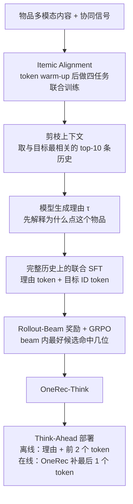

# OneRec-Think: In-Text Reasoning for Generative Recommendation

## Why

生成式推荐（generative recommendation）把推荐从"给候选打分"改成"直接生成目标物品的标识符"。TIGER 用 RQ-VAE 把物品量化成几个 token，HSTU 把用户行为序列当成 Transformer 的输入，OneRec 把召回与排序压成一个 encoder-decoder，直接生成视频的语义 ID。这条路解决了级联结构的目标不一致与算力碎片化，但模型仍然是一个隐式预测器：它输出一串 ID，不解释为什么是这串 ID。

隐式预测器有三个机制层面的缺口。第一，不可解释：用户看到推荐，平台说不出理由；模型内部也没有一个可检查的中间状态。第二，不可控：用户说"我心情不好，想看点轻松的"，模型只能在历史行为上做一次前向，无法把这条指令和推荐结果连接起来。第三，不可优化：RL 需要一个可评价的中间过程，纯 ID 生成只有一个最终答案，奖励信号稀疏到几乎无法学习。

这三条缺口指向同一个前提：模型要能"说出"物品是什么。生成式推荐把物品压成 itemic token（物品 token），一个 token 序列对应一个物品，但 token 本身没有语义。如果模型只见过 token 与 token 的共现，没有见过 token 与自然语言的对应，它就无法把"这个用户最近在看三角洲行动"翻译成一个可推理的命题。OneRec-Think 的作者把这个前提叫 itemic alignment：把物品 token 映射进 LLM 的文本语义空间，让 token 成为可指称、可组合的单位。

对齐之后还有第二个问题：公开数据里没有推荐推理链。用户行为序列短、稀疏，物品空间小，直接用模型自己生成的理由去监督，得到的往往是"用户喜欢这个，所以推荐这个"的空话。工业数据长、噪声大，直接在上面学生成的理由，模型会学会复述行为而不是推理。于是需要一个从"干净上下文"到"噪声上下文"的蒸馏过程：先在剪枝过的历史上生成理由，再让模型在完整历史上学会复述这个理由。

第三个问题是奖励稀疏。推荐的正确答案不止一个，用户可能点 A 也可能点 B；用"是否命中 ground truth"当奖励，大多数采样都得 0，GRPO 的组内优势被清零。如果奖励只看最终 ID，模型无法区分"理由对了但 ID 差一位"与"理由完全错"。

把这三个问题放在一起，可以得到本文要回答的问题：把物品变成 LLM 词表里的 token，让它先写一段理由、再输出 ID，能不能同时提升排序准确率与可解释性？如果可行，在线系统怎么承受多步推理带来的延迟？

## What

先交代任务。输入是用户的历史交互序列（每个物品用若干个 itemic token 表示）加一条指令；指令可以是"推荐下一个视频"，也可以是"描述这个物品"或"根据我的心情推荐"。输出是一段 `<think>` 理由，后面跟目标物品的 itemic token 序列。边界是单轮生成：模型一次只产出一个目标物品的 ID，不做多轮工具调用；公开数据的历史长度截到 50 条，工业场景截到 256 条；对话能力只在推理格式里体现，不接外部工具。

论文给出的答案是：用三阶段把"会生成 ID"变成"会先想再生成 ID"。第一阶段做物品 token 与文本的多任务对齐；第二阶段用剪枝上下文生成理由，再让模型在完整历史上学会这条理由；第三阶段用 beam 奖励做 RL，把"理由是否指向正确物品"变成可优化的信号。工业上再加一个 Think-Ahead 架构：离线生成理由与前两个 token，在线只补最后一个 token，以此换回延迟。`[宣称，Abstract、§1、§4]`

作者报告的结果是：在 Amazon Beauty、Sports、Toys 三个公开数据集上，R@5、R@10、N@5、N@10 十二个格子全部第一；Beauty 上 R@5 从最强基线 ReaRec 的 0.0450 升到 0.0563，相对提升 25.1%；线上 1.29% 流量的 A/B 里 App Stay Time 提升 0.159%。`[已验证，Table 1、Table 3；线上口径见 Ideas]`

### 新认识：对齐是推理的前提，多解性让奖励变稀疏

第一个认识是，物品 token 必须先"可指称"，模型才可能推理。作者用一组对照说明这一点：只做 next-item 预测的 Base 模型，在 Beauty 上 R@5 是 0.0460；加上 itemic alignment 后升到 0.0532；再加上推理机制后升到 0.0563（Table 2）。对齐贡献了大部分增益，推理只贡献了剩下的部分。这个顺序说明：不是"加了 CoT 就变强"，而是"先让 token 有意义，CoT 才有东西可想"。`[已验证，Table 2；拆分见 Ideas]`

第二个认识是，推荐的多解性让"命中/未命中"式的奖励失效。同一个用户在同一时刻可能对多个物品感兴趣，模型采样 16 条理由，可能只有 1 条命中 ground truth，其余 15 条都得 0；组内标准化后，这 15 条的优势是负的，梯度把模型推离它们，但其中可能包含合理的兴趣方向。作者的解法是把奖励定义在"一条理由能覆盖的 beam 里"：只要 beam 里有一条命中，这条理由就得分。这样奖励从"点命中"变成"集合命中"，稀疏性下降。`[宣称，§4.3、式 6–7；机制解释是我的]`

第三个认识是，对齐的收益在物品侧与用户侧不对称。内部 BertScore 显示，只做 token warm-up 时，用户理解从 0.6588 降到 0.6492，短视频理解从 0.6031 升到 0.6443；做完多任务集成后，用户理解升到 0.7053，短视频理解升到 0.7300（Table 4）。作者的解读是：用户理解的文本信息本来就足够，光把物品 token 塞进画像并不能增加信息；物品侧则必须先学会 token 与内容的对应，才能产生增益。这个不对称说明 itemic alignment 不是"越多模态越好"，而是"缺哪一侧补哪一侧"。`[已验证，Table 4；解读是作者的]`

### 新方法：三阶段对齐、激活与增强

第一件可复用的东西是多任务对齐。作者把物品 token 与文本的对应拆成四个任务：交错的用户画像 grounding（把 token 嵌进用户画像文本）、序列偏好建模（给定历史预测下一个物品）、物品 dense captioning（给定 token 生成描述）、通用语言建模（防止灾难性遗忘）。前两个任务让 token 与"谁在看"、"接下来看什么"绑定，第三个任务让 token 与"这个物品是什么"绑定，第四个任务保住基座的语言能力。训练分两段：先冻结 LLM 只训新 token 的 embedding（token warm-up），再全参数或多任务联合训练。`[已验证，§4.1、§A.3.1]`

第二件是推理激活。直接在完整历史上让模型写理由，理由会变成行为复述；作者的解法是先在剪枝历史上生成高质量理由，再用这条理由去监督完整历史。剪枝的做法是用物品 embedding 的余弦相似度取与目标最相关的 top-$k$（$k=10$）条历史。损失同时覆盖理由 token 与目标 ID token：

$$
\mathcal{L}_{\text{RA}}=-\left(\sum_{i=1}^{M}\log P(r_i\mid P(s_{v_1},\dots,s_{v_n}),r_{<i})+\sum_{j=1}^{L}\log P(s_{v_{n+1}}^j\mid P(s_{v_1},\dots,s_{v_n}),\tau,s_{v_{n+1}}^{<j})\right).
$$

第一项让模型学会在完整历史上写出理由，第二项让理由真的能帮助预测目标。`[已验证，§4.2、式 3–5]`

第三件是推理增强。奖励定义为"在这条理由生成的 beam 里，最好的那个候选命中了几位"：

$$
R_{\text{Rollout-Beam}}=\max_{\hat{s}_{v_{n+1}}\in\mathcal{B}}\sum_{l=1}^{L}\mathbb{I}\left(\hat{s}_{v_{n+1}}^l=s_{v_{n+1}}^l\right),
$$

其中 $\mathcal{B}=\operatorname{BeamSearch}(P(s_{v_{n+1}}\mid H,\tau;\theta),K)$ 是给定理由后的 top-$K$ 候选。然后用 GRPO 优化。这个设计把"理由好不好"与"最终 ID 对不对"解耦：理由不必直接生成正确 ID，只要它能把正确 ID 带进 beam 即可。`[已验证，§4.3、式 6–7；$K=32$ 见 §A.3.3]`

第四件是部署架构。Think-Ahead 把推理拆成离线与在线两段：离线用完整模型采样 $T$ 条理由，每条理由下用 beam search 生成前两个 itemic token，所有前缀并成候选集 $C_u$；在线用一个实时更新的 OneRec，只生成最后一个 token，并约束前两个 token 必须落在 $C_u$ 里。这样多步推理的算力留在近线，在线只做一次短解码。`[已验证，§4.4、§A.3.4、式 8–11]`

### 新结论：公开数据全胜，线上小幅提升

公开数据的结果在 Table 1。Beauty 上 R@5 是 0.0563，最强基线 ReaRec 是 0.0450，HSTU 是 0.0424；R@10 是 0.0791，ReaRec 是 0.0704；N@5 是 0.0398，HSTU 是 0.0280；N@10 是 0.0471，HSTU 是 0.0353。Sports 与 Toys 也是十二个格子全第一，但领先幅度更小：Sports 的 R@5 是 0.0288 对 HSTU 0.0268，Toys 的 R@5 是 0.0579 对 ReaRec 0.0523。`[已验证，Table 1]`

消融在 Beauty 上。Base 的 R@5、R@10、N@5、N@10 是 0.0460、0.0654、0.0314、0.0377；加对齐后是 0.0532、0.0735、0.0342、0.0402；加推理后是 0.0563、0.0791、0.0398、0.0471。对齐带来 R@5 +15.7% 的相对提升，推理再加 +5.8%。`[已验证，Table 2]`

线上在快手做，实验组 1.29% 流量，跑一周。App Stay Time +0.159%，Watch Time +0.169%，Video View +0.150%，Follow +0.431%，Forward +0.758%，Like +0.019%，Collect +0.098%（Table 3）。作者说工业场景里 0.1% 的提升就算显著。`[宣称，Table 3；没有置信区间]`

对齐质量的内部评估用 BertScore。用户理解任务上，Qwen3 基座是 0.6588，加 token warm-up 后是 0.6492（略降），再加多任务集成后是 0.7053；短视频理解任务上是 0.6031、0.6443、0.7300。用户理解任务在只做 warm-up 时下降，作者的解释是文本信息本来就足够，warm-up 没有带来新信息；多任务集成才把对齐后的表示转成可用的理解。`[已验证，Table 4；ground truth 来自自家 MLLM]`

## How

这篇论文以系统与算法类为主，附实证与基准类。系统与算法类：它给出三阶段训练流程、奖励设计与部署架构。实证与基准类：三个公开数据集、七个基线、一组消融、一组线上 A/B。判型依据是它的核心贡献是"把 CoT 接进生成式推荐"的机制与工程，而不是新的学习理论；它没有定理，也没有新数据集。下面按"任务形式化—对齐—激活—增强—部署—实验—成本"展开。

### 一、任务形式化：把推荐写成"理由 + ID"

设用户 $u$ 的历史为 $V_u=(v_1,\dots,v_n)$，每个物品 $v$ 用 $L$ 个 itemic token 表示，$s_v=(s_v^1,\dots,s_v^L)$。传统生成式推荐直接建模

$$
s_{v_{n+1}}\sim P(\cdot\mid s_{v_1},\dots,s_{v_n};\theta).
$$

OneRec-Think 把它改成两段：

$$
\tau\sim P(\cdot\mid P(s_{v_1},\dots,s_{v_n});\theta),\qquad
s_{v_{n+1}}\sim P(\cdot\mid P(s_{v_1},\dots,s_{v_n}),\tau;\theta),
$$

其中 $\tau=(r_1,\dots,r_M)$ 是理由，$P(\cdot)$ 表示构造好的提示。这个改动看起来只是多生成一段文本，但它改变了训练信号的形态：模型不再只有一个监督目标（下一个 ID），而是有两个（理由与 ID），并且理由可以被人类检查。`[已验证，§3、式 1–2]`

### 二、对齐：四个任务、两段训练

四个任务的数据形态不同，但都用 next-token prediction：

- 交错用户画像 grounding：把用户静态属性、搜索、互动序列、兴趣摘要写成叙事，物品 token 嵌在叙事里。模型要学会在 token 与文本之间来回翻译。
- 序列偏好建模：输入最多 256 条交互，损失只算在目标物品的 token 上。
- 物品 dense captioning：输入物品 token，输出描述；损失算在描述 token 上。
- 通用语言建模：用通用语料继续训练，防止基座能力退化。

训练分两段。Token warm-up 只训新加入的 itemic token embedding，冻结 LLM 主干，学习率 $5\times10^{-4}$；这一段的目的不是教会推荐，而是让随机初始化的 token 向量在基座语义空间里找到位置。多任务集成阶段解冻全部参数（公开数据）或用 LoRA（工业），学习率 $3\times10^{-4}$，四个任务按比例混合；工业侧的比例是用户画像 24.30%、序列偏好 65.73%、物品描述 4.94%、通用语言 5.03%（Table 5）。`[已验证，§A.3.1、Table 5]`

工业侧的 token 词表是 24,576 个新 token（三层，每层 8192）加两个边界 token；公开数据侧是 1,024 个新 token（四层，每层 256）。这个差异很重要：公开数据的码本小得多，物品空间也小，所以同一个方法在两边的难度不同，Ideas 第三条展开。`[已验证，§5.4.1、§A.1]`

### 三、激活：先剪枝生成理由，再在完整历史上学习

剪枝的目的不是减少计算，而是让理由有据可依。对于目标物品 $s_{v_{n+1}}$，用物品 embedding 的余弦相似度从历史里选 top-$k$（$k=10$）条最相关的交互，构成 $(s_{w_1},\dots,s_{w_k})$；然后用对齐后的模型生成理由

$$
\tau\sim P\big(\cdot\mid P_r((s_{w_1},\dots,s_{w_k}),s_{v_{n+1}});\theta\big),
$$

其中 $P_r$ 是"解释为什么这个用户会点这个物品"的提示。因为上下文里只有相关历史，模型无法靠复述无关行为蒙混，理由必须落在目标与证据之间。`[已验证，§4.2、式 3–4；$k=10$ 见 §A.3.2]`

得到理由后，第二阶段在完整历史上做联合训练。输入是完整历史，监督是"理由 + 目标 ID"，损失是式 5。这里的关键是：理由由剪枝上下文生成，但训练时模型看到的是完整历史，所以它必须学会从噪声里挑出支持这条理由的证据。作者把这叫 contextual distillation：把剪枝上下文里的推理能力蒸馏到完整上下文里。`[宣称，§4.2；"必须学会"是机制解释]`

### 四、增强：beam 奖励与 GRPO

标准 GRPO 的奖励是"生成的 ID 是否等于 ground truth"，在推荐里大部分采样都是 0。Rollout-Beam 把奖励改成"给定理由后，beam 里最好的候选命中了几位"：

$$
R_{\text{Rollout-Beam}}=\max_{\hat{s}\in\mathcal{B}}\sum_{l=1}^{L}\mathbb{I}(\hat{s}^l=s_{v_{n+1}}^l),\qquad
\mathcal{B}=\operatorname{BeamSearch}\big(P(s_{v_{n+1}}\mid H,\tau;\theta),K\big).
$$

$K=32$，每条理由采样一次 beam，得到 0 到 $L$ 的分数。这个分数比 0/1 稠密，因为它奖励"部分正确"：即使 ID 不是完全一致，只要前缀对得多，也能得到梯度。作者说这带来训练—推理一致性：推理时用 beam search，训练时奖励也按 beam 算。`[已验证，§4.3、式 6–7；一致性是作者的说法]`

GRPO 的超参在 §A.3.3：每条 prompt 采样 $|G|=16$ 条理由，每条理由 beam width $K=32$，训练 2 个 epoch，学习率 $1\times10^{-5}$，KL 系数 $\beta=0.001$，裁剪比 $\epsilon=0.2$。注意这里的 $G$ 是理由数，$K$ 是每条理由的 beam 宽度，两者相乘才是有效候选数。`[已验证，§A.3.3]`

### 五、部署：Think-Ahead 把推理挪到近线

在线系统承受不了"先写 200 字理由、再解码 3 个 token"的延迟，所以 Think-Ahead 把推理拆成两段。

离线段：对用户 $u$，采样 $T$ 条理由 $\tau^{(i)}$；对每条理由，用 beam search 只解码前两个 itemic token，得到候选前缀集合 $A_u^{(i)}$；所有理由的前缀并成 $C_u=\bigcup_{i=1}^{T}A_u^{(i)}$，写入分布式存储。$C_u$ 的大小是 $T\times m$，其中 $m$ 是每条理由保留的前缀数。`[已验证，§A.3.4、式 8–10；$T$ 与 $m$ 未给]`

在线段：用户请求到达时，取出 $C_u$，用一个实时更新的 OneRec 生成最后一个 token，并约束前两个 token 必须落在 $C_u$ 里：

$$
\hat{s}_{v_{n+1}}=\arg\max_{s} P_{h_{\text{online}}}(s\mid s_{v_1},\dots,s_{v_n})\quad\text{s.t.}\quad(\hat{s}^1,\hat{s}^2)\in C_u.
$$

这样在线只做一次短解码，推理的算力留在近线。代价是：在线模型与离线模型不是同一个，离线理由只影响前两个 token 的候选集，第三个 token 由在线模型决定；候选集之外的物品永远不会被展示。`[已验证，§4.4、式 11；代价是我的分析]`

### 六、实验设置：公开与工业是两套系统

公开实验用 Qwen3-1.7B 当基座，词表加 1,024 个 token（四层，每层 256）加两个边界 token；数据是 Amazon Beauty、Sports、Toys，按 leave-one-out 划分，丢弃交互少于 5 的用户与物品，历史截到 50 条；评测用 beam width 10 生成 top-$K$，指标是 R@5、R@10、N@5、N@10。基线分两类：传统序列模型（BERT4Rec、HGN、GRU4Rec、SASRec）与生成式模型（TIGER、HSTU、ReaRec）。`[已验证，§5.1、§A.1]`

工业实验用 Qwen-8B 当基座，词表加 24,576 个 token（三层，每层 8192）加两个边界 token；每天在 80 张旗舰 GPU 上增量训练约 200 亿 token；SFT 阶段用 LoRA，RL 用 16 条理由 × 32 beam。线上 A/B 用 1.29% 流量，跑一周。`[已验证，§5.4.1、§A.3.3]`

公开数据上有一个关键设置：作者没有用模型自己生成的理由做激活，而是"manually constructed category-based CoT as the pruned content"（§A.1）。原因是公开数据的物品序列太短、太稀疏，模型自己生成的理由质量不稳定。这意味着 Table 1 测的不是完整的"剪枝生成理由"流程，而是"人工类别理由 + 对齐 + 推理 SFT"，Ideas 第一条展开。`[已验证，§A.1；与 §4.2 的流程不一致]`

### 七、证据强度：公开全胜，但基线旧；线上为正，但幅度小

公开数据的证据强度中等。三个数据集、七个基线、四个指标，OneRec-Think 全部第一；但基线里没有同规模、同数据的 LLM-based 生成式推荐，TIGER 与 HSTU 的参数量、训练预算都没有给，ReaRec 是推理时迭代的隐式方法，不是显式 CoT。Table 2 的消融只做了 Beauty 一个数据集，且三档之间同时改了数据与训练方式（Base 用原始 itemic 序列，Base+IA 换成对齐数据，Base+IA+R 再加理由），不是单变量。`[已验证，Table 1、Table 2；单变量问题见 Ideas]`

线上证据是单点。1.29% 流量、一周、7 个指标全为正，App Stay Time +0.159%；作者说"在工业推荐系统里 0.1% 就算显著"，但没有给置信区间、没有给多周复现、没有给对照组的模型版本。Think-Ahead 的延迟、吞吐、GPU 成本都没有报。`[宣称，Table 3；缺口见 Ideas]`

### 八、成本与边界

成本方面，公开实验的算力没有报；工业侧只给了"80 张 GPU、每天 200 亿 token"，没有给美元成本、每条请求的推理延迟、离线缓存的存储与更新成本。Think-Ahead 的离线段要为用户维护 $T\times m$ 个前缀，$T$ 与 $m$ 都没给，无法估算缓存规模。`[缺口，§5.4.1、§A.3.4]`

边界方面，作者在 Limitations 里承认：公开数据的序列短、物品空间小，Reasoning Activation 与 Reasoning Enhancement 在公开数据上只能学到"简化版推理"，不能代表工业规模。作者正在构建更大的基准。这个边界与 Ideas 第一条相互印证。`[已验证，Limitations]`

## Ideas

### 不足

**方法—评估错配：公开基准的"推理"不是论文的推理流程。** §4.2 描述的是"剪枝上下文生成理由 → 完整上下文学习"，但 §A.1 说公开数据用"人工构造的类别 CoT"当剪枝内容。也就是说，Table 1 与 Table 2 测的是"人工模板 + SFT"，不是论文主打的"自生成理由 + 蒸馏"。归因：评估问题。这个替换没有在正文里说明，读者会把公开结果当成完整方法的证据。`[§A.1 vs §4.2]`

**阶段归属不清：Table 1 到底含不含 RL。** 摘要把方法分成 Itemic Alignment、Reasoning Activation、Reasoning Enhancement 三段；§5.3 的消融标记是 Base、Base+IA、Base+IA+R，其中 R 被称为"enhanced reasoning mechanism"。R 是 SFT 的理由监督，还是 RL 的 Rollout-Beam？正文没有说；RL 的超参只出现在工业部署的附录里。如果 R 只是 SFT，那么 Table 1 没有验证第三阶段；如果 R 含 RL，那么公开数据的 RL 设置没有交代。归因：写作与核对问题。`[§5.3、§A.3.3]`

**消融不是单变量。** Base 用原始 itemic 序列训练，Base+IA 换成对齐后的多任务数据，Base+IA+R 再加理由；三档之间同时改了数据、任务与损失，无法把 +15.7% 与 +5.8% 分别归给"对齐"与"推理"。要拆开，需要固定数据与参数量，只切换是否有理由监督。归因：方法问题。`[Table 2]`

**基线旧且预算不明。** TIGER、HSTU、SASRec 的参数量、训练 token 数、是否预训练都没有给；ReaRec 是推理时迭代的隐式方法，与显式 CoT 不是同一类。缺少的对照是"同基座、同数据、同参数量的 unCoT 模型"；只有这个对照能把"推理"的增益从"更大的模型/更多数据"里分离出来。归因：评估问题。`[§5.1；Table 1]`

**线上幅度与显著性。** +0.159% 的 App Stay Time 是在 1.29% 流量、一周的实验里得到的；作者用"0.1% 就算显著"当判据，但这不是统计检验，也没有给置信区间。考虑到推荐 A/B 的噪声，0.159% 与 0.1% 的距离很近。归因：评估问题。`[Table 3]`

**Think-Ahead 的归因不清。** 离线只生成前两个 token，在线用另一个模型补第三个；线上增益可能来自三件事：候选集扩大（$C_u$ 包含离线模型认为可能的前缀）、前缀约束（缩小了搜索空间）、推理本身（理由带来的兴趣理解）。论文没有做"随机前缀"或"无前缀"的对照，也没有报 $T$、$m$、缓存命中率、延迟。归因：系统问题。`[§4.4、§A.3.4]`

**对齐评估是循环的。** Table 4 的 BertScore 用"自家在线多模态大模型"的输出当 ground truth（§A.3.2），评估的是"学生模型像不像老师"，不是"描述对不对"。用户理解任务的 warm-up 版本还比基座低（0.6588→0.6492），说明这个指标对"对齐"并不敏感。归因：评估问题。`[Table 4、§A.3.2]`

**公开与工业是两套系统。** 公开用 Qwen3-1.7B、四层 256 码本、历史 50 条；工业用 Qwen-8B、三层 8192 码本、历史 256 条。两边的词表、序列长度、数据分布都不同，公开结论不能直接迁移到工业；论文也没有做"同一设置下 1.7B 与 8B"的缩放对照。归因：方法问题。`[§5.4.1、§A.1]`

**合法率没有报。** 生成式推荐会生成不存在的 ID，OneRec 专门用 format reward 处理这个问题；OneRec-Think 的公开与工业结果都没有报合法率。如果 RL 提高了命中率但降低了合法率，线上的净收益会被回退成本吃掉。归因：系统问题。`[全文未报]`

**理由语言与格式不一致。** 工业案例的理由是中文，公开实验的提示词与理由是英文，类别 CoT 是人工模板；跨语言的推理能力是否等价，论文没有分析。归因：方法问题。`[Fig. 3、Fig. 4、§A.1]`

### 创新点

下面五条依次对应上面的五个缺口：第一条对应公开基准的方法错配与消融非单变量，第二条对应 Think-Ahead 归因，第三条对应合法率未报，第四条对应理由质量，第五条对应语言不一致。

**一、用同预算的 unCoT 对照，把"推理"的增益从"对齐/参数/数据"里分离出来。**

- 主张：现有消融把对齐、推理、RL 混在一起，无法回答"到底是哪一步让指标变好"。只有固定基座、参数量、训练 token 与数据分布，只切换"是否有理由监督"，才能量化推理的净收益。
- 与原文关系：反驳/扩展。原文的 Base+IA 与 Base+IA+R 同时改了数据与任务；同预算对照是它缺的那一格。
- 最小验证：Qwen3-1.7B，三组：只用 unCoT 数据、只用 CoT 数据、按 token 预算混合（如 40K CoT + 50K unCoT 对 100K unCoT）；在 Beauty/Sports/Toys 上跑 R@5、N@5，并报告训练 token 数与墙钟时间。
- 失败条件：同预算下 CoT 组不优于 unCoT 组，或优势小于随机种子方差；这说明 Table 2 的增益主要来自对齐与数据量。

**二、给 Think-Ahead 做归因消融：随机前缀、无前缀、推理前缀。**

- 主张：线上增益可能来自候选集扩大或前缀约束，而不是推理。把前缀换成随机采样、或去掉前缀约束，就能把"推理"的贡献单独量出来。
- 与原文关系：增量。原文只报了完整系统的 A/B，没有拆组件。
- 最小验证：同一在线流量分四组：现有系统、Think-Ahead（推理前缀）、Think-Ahead（随机前缀）、纯 OneRec（无前缀）；跑两周，报告 Stay Time、延迟、缓存命中率、候选集覆盖率。
- 失败条件：随机前缀组与推理前缀组的 Stay Time 差异小于 0.05%，说明推理没有带来可测收益。

**三、把"合法性"纳入推理推荐的评价。**

- 主张：生成式推荐的第一道税是非法 ID；如果推理提高了命中率却降低了合法率，线上的净收益会被回退吃掉。合法性应该与准确率、延迟一起报。
- 与原文关系：正交。OneRec 用 format reward 处理合法性，OneRec-Think 没有报这个指标。
- 最小验证：在公开数据与工业日志上统计非法 ID 比例、回退率、回退带来的延迟与体验损失；比较有/无合法性约束的模型在 R@K 与合法率上的 Pareto 前沿。
- 失败条件：非法率低于 1% 且回退成本可忽略；或合法性约束显著损害 R@K，说明当前码本设计无法同时满足两者。

**四、把理由质量做成可验证的指标，而不是只看最终命中。**

- 主张：理由的用处是"把正确 ID 带进 beam"，但理由本身可能 hallucinate 用户没看过的行为。需要一组可自动检查的指标：理由引用的历史物品是否真实存在、理由是否泄漏目标、理由是否支持最终 ID。
- 与原文关系：扩展。OneReason 有 R0–R3 与四个 CoT 指标，本文只有最终命中；可以把 OneReason 的诊断框架借过来。
- 最小验证：在 Beauty 上人工标注 500 条理由，计算历史引用准确率、目标泄漏率、理由—ID 一致性；再用这些指标筛训练数据，看 R@5 是否提升。
- 失败条件：理由指标与 R@5 不相关，或筛数据后指标下降；这说明理由只是"事后解释"，不参与决策。

**五、跨语言与跨域的推理一致性。**

- 主张：工业用中文、公开用英文，若推理能力依赖语言先验，跨语言迁移会掉点；需要同一套物品 token 在中英文理由下的对照。
- 与原文关系：增量。原文没有分析语言因素。
- 最小验证：同一批用户历史，分别用中文与英文提示生成理由，比较 R@K、理由长度、历史引用准确率；再做中英混合训练，看是否互益。
- 失败条件：两种语言的结果在噪声范围内一致，说明语言不是变量；此时这条创新点降级为工程细节。

## 相关工作

与 [zhou2025-onerec](zhou2025-onerec.md) 是父子关系。OneRec 证明"单阶段生成 + RL"能在工业规模跑通，但它是一个隐式预测器，作者在结论里明确说"推理阶段的 step scaling 不明显"。OneRec-Think 把 CoT 接进来，试图补上这块；代价是延迟，于是有了 Think-Ahead。

与 [wan2026-decision-rag](wan2026-decision-rag.md) 都是"先判断再输出"，但判断的形态不同。DecisionRAG 用一个决策模型对每个候选打分，判断是可比较的分数；OneRec-Think 用一段自然语言理由，判断是不可直接比较的文本。决策模型的分数容易做校准，自然语言理由容易做人机交互。

与 [ho2026-declarative-attention](ho2026-declarative-attention.md) 共享"把隐式过程外化"的思路。DA 让模型用标签声明注意力的范围，引擎按标签裁剪 KV；OneRec-Think 让模型用文字声明推荐理由，训练按理由算奖励。两者都把"模型内部发生了什么"变成可检查的中间产物，区别是一个作用于注意力，一个作用于决策。

与 [kumar2026-stair](kumar2026-stair.md) 都用"受限词表生成"替代"向量匹配"。STAIR 把输出限制在合法叶标题上，OneRec-Think 把输出限制在 itemic token 词表上；STAIR 的约束在解码层，OneRec-Think 的约束在词表层，两者可以叠加。

与 [hu2026-sage](hu2026-sage.md) 的对照在基准强度。SAGE 用固定语料与统一 baseline 重设参照系；OneRec-Think 的公开基准是 Amazon 三个子集，基线多为 2016–2024 年的模型，缺少同规模 LLM 基线。SAGE 的结论更稳，OneRec-Think 的结论更接近工业。

## 可复现

代码与数据在 <https://github.com/wangshy31/OneRec-Think>（论文 §5.1 脚注给出的链接；本次未核对该仓库是否包含全部训练脚本）。公开实验的关键设置：Qwen3-1.7B、四层 256 码本、加 1,024 个 token、历史 50 条、beam width 10、leave-one-out、丢弃交互少于 5 的用户与物品。工业实验的关键设置：Qwen-8B、三层 8192 码本、加 24,576 个 token、历史 256 条、每天 200 亿 token、80 张 GPU、LoRA、RL 用 16 条理由 × 32 beam、2 epoch、学习率 $1\times10^{-5}$、KL 系数 0.001、裁剪 0.2。

无法复现的部分：

- 公开数据的"人工类别 CoT"：论文没有给模板、类别体系与构造脚本。
- 工业数据：用户行为、物品库、奖励与 A/B 流量都是内部资源。
- Think-Ahead 的 $T$、$m$、缓存更新频率、延迟与吞吐。
- Table 3 的置信区间与多周复现。
- Table 4 的 ground truth 生成模型与人工校验记录。

如果要复现公开结果，最小路径是：下载 Amazon 三个子集，按 leave-one-out 划分，用 Qwen3-1.7B 加 1,024 个 token，先做 token warm-up，再做多任务 SFT，最后用人工类别 CoT 做理由监督；这套流程能复现 Table 2 的 Base+IA+R，但不能复现"自生成理由"的完整方法。
