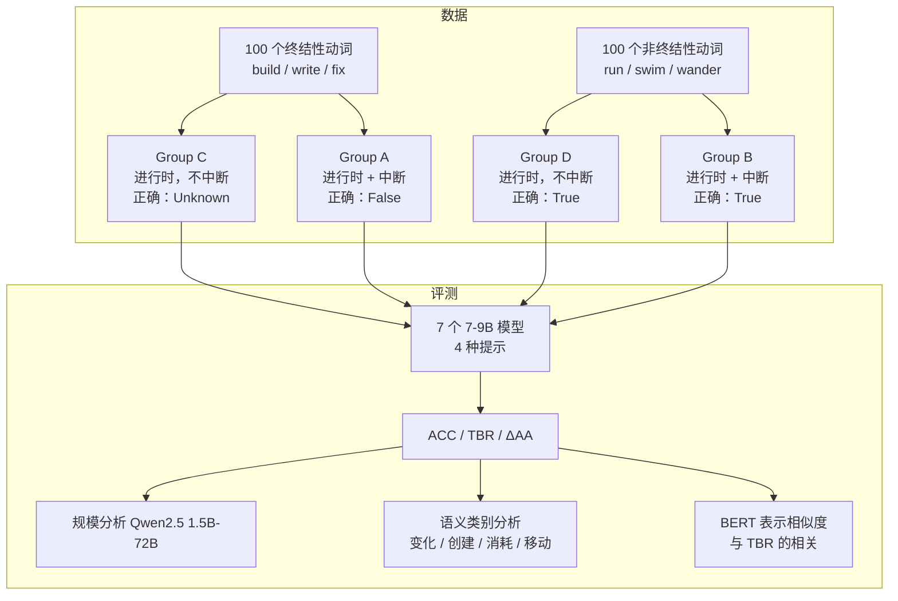

# The Imperfective Paradox in Large Language Models

## Why

先看两组句子。第一组是 "The carpenter was building a gazebo"（木匠当时在建一个凉亭），能不能推出 "The carpenter built a gazebo"（木匠建好了凉亭）？第二组是 "The boy was running in the park"（男孩当时在公园跑），能不能推出 "The boy ran in the park"（男孩在公园跑了）？多数人会认为：第一组推不出来，因为凉亭可能没建完；第二组推得出来，因为"跑"这个动作只要发生过，就构成了"跑了"。

这两组的区别在动词的**终结性**（telicity）。`build a gazebo` 是**终结性动词**（telic accomplishment）：它有一个明确的终点，过程结束不等于终点到达。`run` 是**非终结性动词**（atelic activity）：它没有独立于过程之外的终点，过程本身就是事件。英语的过去进行时（was V-ing）把事件呈现为"正在进行"，过去简单时（V-ed）把事件呈现为"已经发生"。对于非终结性动词，进行时蕴含简单时；对于终结性动词，进行时不蕴含简单时。这个逻辑现象在形式语义学里叫 **Imperfective Paradox**（未完成体悖论），Dowty 在 1977 年和 1979 年用可能世界语义给过形式化。`[§1, §2.2]`

这个问题值得单独测，因为它不是"知不知道 build 是什么意思"，而是"能不能把过程与结果分开"。一个忠实的推理系统必须能区分"打算做 / 正在做"和"已经做成"。如果模型把目标导向的动作一律当成会完成，它在规划、法律、医疗、日程这些需要区分"计划"与"事实"的场景里就会给出错误结论。可是，普通的自然语言推断（natural language inference, NLI）基准很难暴露这一点：模型可以靠词面重叠、时态线索或"动作发生了"这种浅层启发式答对大部分题，却从未真正处理终结性。`[§1]`

已有的计算语义工作主要做**aspect classification**：训练模型把动词标成状态、活动、终结、达成等类别（Siegel & McKeown 2000；Friedrich et al. 2023）。分类准确率高，不代表模型会在推理时使用这个类别。更接近本文的两项工作（Pruš et al. 2024, 2025）研究人类对进行时与简单时的判断，把 LLM 行为当作次要比较，没有系统诊断 LLM 的体貌推理。本文要补的就是这个缺口：构造一个受控的诊断集，直接问模型"前提是否蕴含结论"，看它会不会把"正在建"当成"建好了"。`[§2.3]`

于是问题可以写成四问。第一，当前的开源模型在"进行时 → 简单时"的推理上，是否表现出系统性的**目的论偏置**（Teleological Bias），也就是假定目标导向的动作一定会完成？第二，如果存在，提示词干预（给出体貌定义、思维链、反事实提示）能不能减少偏置，代价是什么？第三，这个偏置是"模型编码不了过程与结果的区别"，还是"编码了但在推理时被先验压过去"？第四，模型规模变大、动词的语义类别不同，偏置会不会变化？

## What

先交代任务。输入是一个前提（一个过去进行时的句子，可能带明确的中断从句）和一个假设（同一个动词的过去简单时句子）；输出是三选一：True（蕴含）、False（矛盾）、Unknown（既不蕴含也不矛盾）。数据集叫 **IMPERFECTIVENLI**，共 400 个例子：100 个终结性动词、100 个非终结性动词，交叉"中断 / 不中断"两种上下文，形成四个组。模型是 7 个 7–9B 的开源指令微调模型；不训练，只做零样本和提示词干预。边界是英语、模板化句子、小模型；不含人类对逻辑标签的判断，也不含微调或激活干预。`[§3, §4]`

论文的答案是：这些模型普遍存在目的论偏置，而且在明确的文本取消（中断从句）面前仍然坚持"完成了"。在"不中断的终结性动词"这一组（Group C，正确答案是 Unknown），多数模型把"完成了"判成 True 的比例是 0.94–1.00，只有 Qwen2.5-7B 例外（0.53）；而在"不中断的非终结性动词"这一组（Group D，正确答案是 True），它们的准确率是 0.97–1.00。两组放在一起，**Aspectual Awareness Gap**（ΔAA，定义为 Group D 准确率减去 Group C 的 True 率）大多只有 0.00–0.06，说明模型并没有按动词类别调整判断，而是套了一条"提到动作就算完成"的浅层规则。`[已验证，Table 3]`

### 新认识：偏置强到能压过显式中断，提示词只能把它换成另一种错误

第一个认识是，模型对"中断"不敏感。Group A 是"终结性动词 + 明确中断"（例如 "The carpenter was building a gazebo, but a storm destroyed the frame before the roof was on"），正确答案是 False（矛盾）。七个模型的准确率只有 0.03–0.47，而它们把假设判成 True 的比例（TBRA）是 0.46–0.75。也就是说，文本已经说了"屋顶还没装上框架就被风暴毁了"，模型仍然倾向于说"木匠建好了凉亭"。论文把这个现象叫 **contextual neglect via semantic priming**：主语（carpenter）和终结性动词（building）一起出现，激活了"完成"的表示，压过了后面的取消从句。`[已验证，Table 3；机制解释是作者的假设]`

第二个认识是，提示词干预存在**校准危机**（calibration crisis）。给出体貌定义（DAP）能让部分模型的 Group C 准确率上升，例如 Llama-3.1 从 0.02 到 0.36，Qwen2.5 从 0.47 到 0.89；但对 Mistral、DeepSeek 几乎无效。思维链（CoT）能把 Group C 的 TBR 压下去，却让 Group D 的准确率大幅下降：Llama-3.1 从 0.98 降到 0.65，Qwen2.5 从 0.97 降到 0.37，Gemma-2 从 1.00 降到 0.15。反事实提示（要求模型先想三个"事件被打断、目标没达成"的场景）几乎把 Group C 的 TBR 压到 0，但也把 Group D 的准确率压到接近 0：Llama-3.1 的 Group C 是 0.97、Group D 是 0.00；Qwen2.5 是 1.00 和 0.02；Gemma-2 是 1.00 和 0.00。模型从"天真乐观"直接甩到"偏执怀疑"，没有按动词类别调节怀疑程度。`[已验证，Table 3, Fig. 1]`

第三个认识是，规模和体貌推理不是线性关系。Qwen2.5 从 1.5B 到 72B：1.5B 的 TBRC 是 1.00、ΔAA 是 0.00，7B 是 0.53 / 0.44，14B 是 0.61 / 0.37，32B 是 0.09 / 0.83，72B 是 0.16 / 0.81。14B 到 32B 之间出现一个明显的相变：ΔAA 从 0.37 跳到 0.83，涨幅 124%；72B 没有再涨，反而略降。论文把体貌区分称为一种**涌现能力**（emergent ability），并给出规模与 TBR 的负相关（r = −0.93, p = 0.02）和与 ΔAA 的正相关（r = 0.95, p = 0.01）。`[已验证，Table 5, Fig. 2；只有 Qwen2.5 一个家族]`

第四个认识是，偏置不是"编码不了"，而是"编码了但推理时被先验压过去"。论文用 bert-base-uncased 取"was V-ing"和"V-ed"两个动词短语的上下文嵌入，做均值池化，算余弦相似度。结果出现一个反直觉的负相关：相似度越高的类别（Motion to Goal，中位数约 0.78），TBRC 反而越低；相似度略低的类别（Creation，中位数约 0.75），TBRC 反而越高（r = −0.93, p = 0.07）。如果偏置来自"表示混淆"，应该看到"越相似、越容易错"；实际方向相反。论文的结论是：编码层面能区分过程与结果，推理层面被"创建类事件会达成目标"的先验盖住了。`[已验证，Fig. 4；p = 0.07，且用的是 BERT 而不是被评测的 LLM，见 Ideas]`

### 新方法：一个 2×2 的诊断集与四个提示词条件

IMPERFECTIVENLI 的核心是一个 2×2 的最小对设计：动词终结性（终结 / 非终结）× 上下文（中断 / 不中断），得到四个组。`[已验证，§3, Table 2]`

| 组 | 动词 | 上下文 | 前提例子 | 假设 | 正确标签 |
| --- | --- | --- | --- | --- | --- |
| A | 终结 | 中断 | The carpenter was building a gazebo, but a storm destroyed the frame before the roof was on. | The carpenter built a gazebo. | False（矛盾） |
| B | 非终结 | 中断 | The athletes were running on the track, but it started to hail. | The athletes ran on the track. | True（蕴含） |
| C | 终结 | 不中断 | The carpenter was building a gazebo. | The carpenter built a gazebo. | Unknown（中性） |
| D | 非终结 | 不中断 | The athletes were running on the track. | The athletes ran on the track. | True（蕴含） |

四个提示词条件是：严格逻辑提示（要求模型只依据文本、不许用常识）、定义感知提示（DAP，把体貌定义写进系统提示）、思维链提示（CoT）、反事实提示（要求先列出三个事件被中断、目标未达成的场景）。指标有三个：分组准确率（ACC）、目的论偏置率（TBR，Group C 或 Group A 中判 True 的比例）、体貌意识差距（ΔAA = ACC_D − TBR_C）。`[已验证，§4.2, §4.3]`

### 新结论：目的论偏置在类别上不均匀，创建类动词最严重

论文把 100 个终结性动词再分成四类：变化状态（44 个）、创建（39 个）、消耗（9 个）、朝向目标的移动（8 个）。在零样本的 Group A（中断的终结性动词）上，平均准确率是：变化状态 0.21、消耗 0.30、创建 0.18、朝向目标的移动 0.46。朝向目标的移动比创建高约 28 个百分点；在 Group C 上，朝向目标的移动是 0.16，创建是 0.09，差距约 7 个百分点。论文的解释是：创建类动词的结果是"一个对象开始存在"，这种"从无到有"在语言模型的预测分布里是一个更强的吸引子，所以模型更难接受"没建成"。`[已验证，Fig. 3, Table 7–9；消耗和移动的样本只有 9 和 8 个动词，见 Ideas]`

数据质量方面，论文用 Gemini 辅助改写生成句子，再请三位英语母语者按语法、流利度、充分性三个维度打分；平均分是 4.63、4.53、4.46（5 分制），评分者相邻一致率 98.2%。但这次人工评估只检查句子是否自然、语法是否正确、信息是否充分，**没有让标注者判断前提是否蕴含假设**。`[已验证，§3, Table 4；这是本文最大的证据缺口，见 Ideas]`

## How

这篇论文以实证与基准类为主，附系统与算法类（诊断集构造、提示词与指标）和一点理论背景（形式语义）。实证与基准类：它构造 400 个受控例子，在 7 个模型、4 种提示、5 个规模上做端到端评测；系统与算法类：它定义了 2×2 条件、三个指标和四个提示模板。判型依据是它没有提出新的模型或训练目标，核心贡献是诊断数据与行为分析；理论部分只借用 Vendler/Dowty 的体貌分类，不证明新定理。

上图据原文 Fig. 1 与 §3–§5 重画。四组构成一个 2×2：横轴是上下文是否中断，纵轴是动词是否终结；Group C 是核心探针，Group D 是对照。

### 一、数据构造：模板 + 人工校验

作者先按 Vendler 分类挑 100 个终结性动词（build、write、fix、paint、bake 等）和 100 个非终结性动词（run、swim、wander、play、vibrate 等）。每个动词用 Gemini 辅助改写成四个组的前提-假设对，句式尽量统一，只改动词和上下文。终结性动词再按 Levin (1993) 的思路分成变化状态、创建、消耗、朝向目标的移动四类。`[已验证，§3]`

构造过程中做了几件事来保证受控：所有句子是英语；前提和假设的动词时态固定（was V-ing 对 V-ed）；Group C 是 Group A 去掉中断从句，Group D 是 Group B 去掉中断从句，这样可以把"上下文"和"动词类别"两个因素分开。数据量是 100 × 4 = 400；每个动词在每个相关组里出现一次。`[已验证，§3]`

人工校验只覆盖语言质量。三位母语者按 Grammar、Fluency、Adequacy 打分，平均 4.63 / 4.53 / 4.46；因为分数集中在 5 分附近，作者没有报 Fleiss κ，而是报"相邻一致率"（两位评分者差距不超过 1 分的比例），平均 98.2%。这个做法在统计上可以理解，但它回答的是"句子写得好不好"，不是"标签对不对"。`[已验证，§C, Table 4]`

### 二、模型与提示：四个条件

七个模型是 Llama-3.1-8B-Instruct、Mistral-7B-Instruct-v0.3、Qwen2.5-7B-Instruct、Yi-1.5-9B-Chat、deepseek-llm-7b-chat、gemma-2-9b-it、glm-4-9b-chat-hf。规模分析只用 Qwen2.5 家族（1.5B、7B、14B、32B、72B），因为它在零样本里表现最好。所有模型用贪心解码（`do_sample=False`），最大生成 512 token，单张 A100 80GB。`[已验证，§4.1, §D]`

四个提示条件的设计意图不同。严格逻辑提示是主设置，明确要求"不要用常识、只依据文本"，并把输出限制在 True/False/Unknown。DAP 把活动类和成就类的体貌定义写进系统提示，用来区分"不知道规则"和"知道规则但不用"。CoT 让模型先写出事件的时间状态，再判断，用来区分"快速启发式"和"慢推理"。反事实提示援引 Dowty 的"惯性世界"概念，要求模型先列出三个事件被中断、目标未达成的场景，再判断，用来强行打破"目标一定达成"的先验。`[已验证，§4.2]`

这三个干预都有一个共同问题：它们只改变提示，不改变模型；而且提示的长度、内容、指令强度都不同。DAP 是"给知识"，CoT 是"给步骤"，反事实是"给立场"。所以后面看到的差异，不能全部归因于"模型能不能推理"，也混着"模型听不听话"和"提示把模型往哪个方向推"。`[方法问题，见 Ideas]`

### 三、指标：TBR 与 ΔAA

TBR 定义为某一组里判 True 的比例：

$$
\mathrm{TBR}_G = \frac{1}{|G|}\sum_{i \in G} \mathbb{I}(\hat{y}_i = \text{True}).
$$

在 Group C 上，正确答案是 Unknown，所以 TBRC 越高，说明模型越倾向于"完成了"。在 Group A 上，正确答案是 False，TBRA 越高，说明模型越无视中断。`[已验证，Eq. 1]`

ΔAA 定义为：

$$
\Delta\mathrm{AA} = \mathrm{ACC}_D - \mathrm{TBR}_C.
$$

它的直觉是：一个好的体貌推理器应该"对非终结性动词判蕴含"（ACC_D 高）而"对终结性动词不判完成"（TBR_C 低），所以 ΔAA 越高越好。但论文也提醒，ΔAA 低可能是两种完全不同的失败：一种是 TBR_C 高（目的论偏置），另一种是 ACC_D 低（连非终结性动词的蕴含都判不对）。读表时要同时看这两个分量，不能只看 ΔAA。`[已验证，Eq. 2, §4.3]`

### 四、零样本：高 ACC_D 是假象

Table 3 的零样本部分是最重要的证据。七个模型在 Group D 上几乎满分（0.97–1.00），看起来"很懂非终结性动词"；但在 Group C 上，除了 Qwen2.5-7B 的 0.47，其余都在 0.00–0.06。把两组放在一起，ΔAA 只有 0.00–0.06（Qwen2.5 是 0.44）。论文的判断是：模型并没有真的按动词类别调节，而是套了一条"如果主语 was V-ing，那么主语 V-ed"的统一规则；这条规则在 Group D 上恰好是对的，在 Group C 上是错的，所以高 ACC_D 不能证明体貌能力。`[已验证，Table 3, §5.1]`

Group A 的结果更严重。前提已经明确说"框架在屋顶装上之前被风暴毁了"，正确答案是 False；七个模型的准确率只有 0.03–0.47，TBRA 是 0.46–0.75。也就是说，多数模型仍然判 True。论文用"语义启动"解释：carpenter + building 一起出现，激活了"建好"的表示，压过了后面的取消从句。这个解释是合理的，但论文没有做表示层面的因果实验，只能算假设。`[已验证，Table 3；机制解释是作者的假设]`

### 五、提示词干预：偏置与校准的取舍

DAP 的效果不稳定。Llama-3.1 的 Group C 从 0.02 升到 0.36，Qwen2.5 从 0.47 升到 0.89，Gemma-2 从 0.06 升到 0.60；但 Mistral 只从 0.02 到 0.06，DeepSeek 仍然是 0.00。论文的解读是：知道规则不等于会用规则；对某些模型，目的论先验太强，写在提示里的定义压不过它。`[已验证，Table 3, §5.2]`

CoT 把 Group C 的 TBR 压下去，但把 Group D 的准确率也压下去。Llama-3.1 的 Group C 从 0.02 到 0.67，Group D 从 0.98 到 0.65；Qwen2.5 的 Group C 从 0.47 到 0.97，Group D 从 0.97 到 0.37；Gemma-2 的 Group C 从 0.06 到 0.98，Group D 从 1.00 到 0.15。论文把这种现象叫"过度推理"：模型在一步步分析时，会给简单的活动也编出"可能被打断"的场景，于是把本来成立的蕴含判成不成立。`[已验证，Table 3, §5.2]`

反事实提示是最激进的干预。它几乎把 Group C 的 TBR 压到 0（Llama 0.00、Qwen 0.00、Gemma 0.00、Yi 0.00），但也把 Group D 的准确率压到接近 0（Llama 0.00、Qwen 0.02、Gemma 0.00、Yi 0.10）。DeepSeek 是反例：它对反事实提示几乎不响应，Group C 仍是 0.00（它本来就判 Unknown），Group D 仍是 0.98；论文把这叫"推理刚性"，而不是"过度校正"。`[已验证，Table 3, Fig. 5–10]`

### 六、规模：14B 到 32B 的相变

Qwen2.5 的五个规模给出了一条非线性的曲线。1.5B 完全不行：TBRC 1.00、ΔAA 0.00，所有进行时都判完成。7B 开始分化：TBRC 0.53、ΔAA 0.44。14B 反而略退：TBRC 0.61、ΔAA 0.37。32B 出现相变：TBRC 0.09、ΔAA 0.83。72B 略降：TBRC 0.16、ΔAA 0.81。论文用 Pearson 相关描述规模与 TBR（r = −0.93, p = 0.02）和 ΔAA（r = 0.95, p = 0.01），并称这是"涌现"。`[已验证，Table 5, Fig. 2]`

这个结论的边界很清楚：只有一个模型家族、五个规模点；1.5B 可能连指令格式都跟不上，32B 的相变也可能反映"指令遵循能力"而不是"体貌推理能力"。论文没有报格式遵循率或解析失败率，所以"规模让体貌推理涌现"这个说法，至少还混着"规模让模型学会按格式回答"。`[方法问题，见 Ideas]`

### 七、语义类别：创建类最难，移动类最易

Figure 3 把零样本的 Group A 和 Group C 按四个语义类别拆开。Group A 的平均准确率：变化状态 0.21、消耗 0.30、创建 0.18、朝向目标的移动 0.46。Group C 的平均准确率：变化状态 0.07、消耗 0.09、创建 0.09、朝向目标的移动 0.16。移动类在两组上都最好，创建类在 Group A 上最差。论文的解释是：创建类的结果是"对象开始存在"，这种存在性变化比空间位置变化更像一个"强吸引子"，所以模型更难接受"没建成"。`[已验证，Fig. 3, Table 7–9；类别样本量不均，见 Ideas]`

这个分析有一个统计上的问题：四个类别的动词数量是 44、39、9、8，消耗和移动类只有 9 和 8 个动词；类别平均值很容易被个别动词拉动。论文没有给类别层面的置信区间，也没有做多重比较校正。`[评估问题，见 Ideas]`

### 八、表示分析：BERT 能分开，但方向反了

论文用 bert-base-uncased 取每个动词短语的上下文嵌入，对 word piece 做均值池化，然后算"was V-ing"和"V-ed"的余弦相似度。结果是：Motion to Goal 的中位数约 0.78，Creation 约 0.75；相似度和 TBRC 的 Pearson 相关是 r = −0.93（p = 0.07）。`[已验证，Fig. 4]`

这个结果的方向和"表示混淆"假说相反。如果模型分不清"was building"和"built"，应该相似度越高、错误越多；实际是相似度越高（移动类）、错误越少。论文的解读是：表示层能区分过程与结果，错误发生在推理层，是"目标达成"的先验压过了表示。这个解读有道理，但它依赖两个很强的假设：第一，BERT 的表示能代表 Llama/Qwen 等被评测模型的表示；第二，余弦相似度能代表"编码精度"。这两个假设都没有被直接检验。`[方法问题，见 Ideas]`

### 九、成本与边界

实验成本很低：400 个例子 × 7 个模型 × 4 种提示，单张 A100，贪心解码，最大 512 token。数据与代码公开在 <https://github.com/boleima/ImperfectiveParadox>。边界是英语、模板句、7–9B 模型；没有人类逻辑标签，没有微调，没有激活干预，没有自然叙事。`[§D, §7]`

## Ideas

### 不足

**数据与标签**

1. 人工评估只检查语法、流利度、充分性，没有让母语者判断"前提是否蕴含假设"。Group C 的正确答案是 Unknown，这是理论语义学的标准答案；但在日常语用里，很多人听到 "The carpenter was building a gazebo" 会推断"他大概建了"。如果人类标注者也倾向 True，那么模型的回答可能反映的是人类的语用推理，而不是逻辑失败。论文在 Limitations 里承认"理论标签与人类判断可能分歧"，但没有做这个关键实验。`[评估问题]`
2. "Unknown" 这个标签本身有歧义。NLI 里的 Neutral 是"既不蕴含也不矛盾"，日常语言里的 "Unknown" 更像"我不知道"。模型可能把问题理解成"这件事发生了吗？我不知道"，而不是"前提是否逻辑蕴含结论？"。严格逻辑提示试图消除这个歧义，但论文没有做操纵检查（manipulation check），无法确认模型真的按"蕴含"在答题。`[方法问题]`
3. 数据集是模板化的 400 个例子，每个动词在每个组里只出现一次；句式高度统一。论文承认这会牺牲生态效度，真实叙事里的体貌线索更复杂。模板化还可能让模型靠"was V-ing → V-ed"的表面模式答题，而不是理解终结性。`[数据问题]`
4. 终结性动词的四个子类样本量严重不均：变化状态 44、创建 39、消耗 9、移动 8。消耗和移动类的结论只基于 9 和 8 个动词，类别平均值很容易被个别词拉动；论文没有给类别层面的置信区间。`[数据问题]`
5. 人工评估的 98.2% 是"相邻一致率"（两位评分者差距不超过 1 分），不是标准的评分者信度；因为分数集中在 5 分，κ 不适用，这个解释合理，但它仍然只覆盖语言质量，不覆盖标签效度。`[评估问题]`

**方法与归因**

6. 表示分析用的是 bert-base-uncased，不是被评测的 Llama/Qwen/Mistral 等模型。论文的结论"内部嵌入能区分过程与结果"实际上是在说 BERT 能区分，不能直接推到被评测模型。要支撑"表示与推理分离"，应该在每个被评测模型上取隐藏状态，训练线性探针，或者做因果干预。`[方法问题]`
7. 表示分析与行为的相关只有 4 个类别点，r = −0.93、p = 0.07，在 0.05 水平上不显著；四个类别的动词数又是 44/39/9/8，点估计很不稳定。用这四个点得出"方向相反"的强结论，证据偏薄。`[评估问题]`
8. 规模分析只有一个家族（Qwen2.5）、五个点；1.5B 可能连输出格式都跟不上，32B 的"相变"也可能反映指令遵循能力的阈值，而不是体貌推理的涌现。论文没有报格式遵循率、解析失败率或每种规模的输出分布。`[方法问题]`
9. 四个提示条件的差异不是单变量：DAP 加了知识，CoT 加了步骤，反事实加了立场；三者的长度、内容、指令强度都不同。没有"同样长度、同样语气、但不含体貌信息"的中性控制提示，所以"校准危机"有多少来自提示的指令性，有多少来自模型的体貌推理，无法分离。`[方法问题]`
10. 反事实提示明确要求模型"先想三个事件被中断、目标没达成的场景"，这本身就会把模型往"不完成"推；Group D 的崩溃可能是提示的直接后果，而不是模型"不会按动词类别调节"。论文把这个叫"过度校正"，但缺少一个"只要求想一个场景"或"想完成和未完成两种场景"的对照。`[方法问题]`
11. "语义启动"解释（carpenter + building 激活完成表示，压过取消从句）是 post hoc，没有表示层面的证据；论文没有测中间层激活、注意力分布或因果干预。`[方法问题]`
12. 论文把"目的论偏置"归因于预训练语料的 reporting bias（Gordon & Van Durme 2013），但没有测语料统计，也没有测模型对"完成/未完成"叙事的先验。这个解释合理，但目前只是故事。`[方法问题]`

**评估与覆盖**

13. 模型覆盖是 7 个 7–9B 的开源指令模型，不是"state-of-the-art"；没有 GPT-4/Claude/Gemini 这类闭源大模型，也没有 70B 以上的通用模型（规模分析只有 Qwen2.5-72B）。"pervasive" 的结论只在这个小模型池里成立。`[评估问题]`
14. 评测只覆盖英语。体貌在不同语言里的编码方式不同（俄语用词缀，汉语用体标记，德语没有语法体），目的论偏置可能是英语预训练数据的产物，也可能是 Transformer 的普遍现象；论文没有跨语言实验。`[评估问题]`
15. 论文没有测自然叙事。模板句里的中断从句非常显眼，模型仍然忽略；如果换成更长的故事、更多的干扰信息，偏置可能更强，也可能因为上下文更丰富而减弱。论文承认这一点，但没有做。`[评估问题]`
16. 论文的"first controlled investigation"说法有些强：Pruš et al. (2024, 2025) 已经研究过 Imperfective Paradox 的人类判断，并把 LLM 作为比较；本文的增量是系统诊断 LLM，而不是首次研究这个现象。`[评估问题]`
17. "False" 预测率在 Group C 里接近 0，说明模型几乎不在"完成/未完成"之间选 False；这意味着 TBR 捕捉的是"True vs Unknown"的二分，而不是完整的三分类混淆矩阵。论文没有给完整的混淆矩阵，读者看不到模型在 Group A 里到底判了多少 Unknown、多少 False。`[评估问题]`

### 创新点

**一、人类逻辑标签：先问母语者，再谈偏置**

- **主张**：如果让英语母语者在同样的严格逻辑提示下标注这 400 对句子，Group C 的"True"比例不会低；模型的"目的论偏置"可能部分是人类语用推理的镜像，而不是纯粹的推理失败。
- **与原文关系**：反驳/修正。原文把理论语义学的 Unknown 当作唯一正确答案，但没有测人类判断。
- **最小验证**：招募 30 位英语母语者，随机呈现 400 对句子，要求按"前提是否蕴含结论"三选一；同时给一半被试看严格逻辑提示，一半看普通提示。比较人类与 7 个模型的标签分布、一致率和 Group C 的 True 率。预期人类在普通提示下 Group C 的 True 率显著高于 0，严格提示下下降但不为 0。
- **失败条件**：人类在严格提示下 Group C 的 True 率低于 5%，且与模型差异很大；这说明模型确实偏离了人类逻辑判断，目的论偏置成立。

**二、在被评测模型上做表示探针与因果干预**

- **主张**：论文的"表示与推理分离"结论应该在被评测的 Llama/Qwen 上验证，而不是用 BERT 代替；如果这些模型的隐藏状态也能线性区分进行时与简单时，但行为仍偏向完成，那么分离成立。
- **与原文关系**：增量/修正，直接补方法缺口。
- **最小验证**：对每个模型，取最后一层或中间层的动词短语表示，训练线性分类器区分"was V-ing"与"V-ed"；再用激活引导（activation steering）沿"完成/未完成"方向加减，观察 Group C 的 TBR 是否随干预单调变化。预期分类准确率显著高于随机，且引导能改变 TBR。
- **失败条件**：线性探针无法区分两种时态，或引导对行为没有影响；这说明偏置可能真的来自表示层，论文的"分离"解释不成立。

**三、长度匹配的中性提示：分离"提示强度"与"体貌推理"**

- **主张**：CoT 和反事实提示带来的"校准危机"，有一部分是提示的指令强度造成的，而不是模型不会按动词类别调节。加一个长度、语气、步骤数都匹配、但不含"中断/完成"倾向的中性提示，可以把这部分分离出来。
- **与原文关系**：增量，补实验控制。
- **最小验证**：设计第四种提示：同样要求分三步思考、同样长度，但只要求"描述事件的时间状态"，不要求列中断场景；在 7 个模型上比较零样本、中性三步提示、CoT、反事实四种条件的 Group C TBR 与 Group D ACC。预期中性三步提示的 Group D 下降显著小于反事实提示，Group C 的改善介于零样本和 CoT 之间。
- **失败条件**：中性三步提示也导致 Group D 崩溃；这说明崩溃来自"让模型慢下来"本身，而不是提示的立场。

**四、跨语言体貌：英语特例还是普遍现象**

- **主张**：目的论偏置可能依赖语言如何标记体貌。俄语用词缀、汉语用体标记、德语没有语法体；如果偏置在德语里更强、在俄语里更弱，说明它与体貌编码方式有关，而不是 Transformer 的普遍缺陷。
- **与原文关系**：扩展，补跨语言缺口。
- **最小验证**：把 400 个例子翻译成俄语、汉语、德语，保持动词的终结性和时体标记；请母语者校验；在支持这些语言的开源模型上重复零样本实验，比较 Group C 的 TBR 和 ΔAA。预期英语和俄语的偏置较轻，德语较重，汉语介于中间。
- **失败条件**：四种语言的 TBR 没有显著差异；这说明偏置是跨语言普遍的，与体貌标记方式无关。

**五、自然叙事诊断：模板之外还成不成立**

- **主张**：模板句里的中断从句非常显眼，模型仍然忽略；在更长的自然叙事里，偏置可能更强，因为模型有更多机会用"故事应该有个结果"的先验补全。构造一个自然叙事版本，可以测出模板实验是否低估了问题。
- **与原文关系**：扩展，补生态效度。
- **最小验证**：从新闻、小说、剧本里选 200 段包含目标导向动作的叙事，人工标注动作是否完成；把每段截断在动作进行中，问模型"动作完成了吗"，比较模板版与自然版的 TBR。预期自然版的 TBR 更高，尤其是在有"目标"提示的段落里。
- **失败条件**：自然版的 TBR 与模板版没有差异，或更低；这说明模板实验已经足够，生态效度不是主要问题。

**六、小型对齐训练：把"知道规则"变成"会用规则"**

- **主张**：提示词只能暂时压偏置，不能教会模型按动词类别调节；用一个小规模的偏好优化或监督微调（例如在 2,000 个合成例子上训练），可以让模型在 Group C 上判 Unknown、在 Group D 上判 True，同时不在自然 NLI 上掉分。
- **与原文关系**：扩展，直接针对"提示干预的校准危机"。
- **最小验证**：用 2,000 个新动词的 2×2 例子做 LoRA 微调，训练目标是"按体貌类别输出"；在留出动词和自然 NLI 集上测 Group C TBR、Group D ACC、以及通用 NLI 准确率。预期 Group C TBR 降到 0.2 以下、Group D ACC 保持在 0.9 以上，通用 NLI 不掉超过 1 分。
- **失败条件**：微调只记住了模板动词，换新动词就失效；或通用 NLI 掉 3 分以上。这说明体貌推理不能靠小规模对齐解决，需要结构化的语义监督。

## 相关工作

仓库内暂无同主题笔记。本文属于形式语义学与 NLI 的交叉：它借 Vendler 的体貌分类和 Dowty 的 Imperfective Paradox，构造一个诊断集，测 LLM 是否尊重"过程不蕴含结果"的逻辑边界。与常规 NLI 基准（如 SNLI、MNLI）相比，本文的例子更小、更受控，目标是隔离一个特定的语义现象，而不是覆盖自然语言推理的全部。与 aspect classification 工作相比，本文不训练分类器，而是直接测生成模型在零样本推理中的行为。与 Pruš et al. (2024, 2025) 相比，本文把 LLM 从"次要比较"变成"主要对象"，并加入了提示干预、规模分析和表示分析。

如果要在仓库内找概念上的类比，[he2026-memory-tax](he2026-memory-tax.md) 也在问"记忆的收益与代价如何计量"；本文问的是人类工作记忆如何分配编码资源，两者都把"记忆"当成一个有成本的系统。但一个是 agent 记忆的评测，一个是人类句处理的认知理论，不能直接互推。

## 可复现

- 数据与代码：<https://github.com/boleima/ImperfectiveParadox>（首页给出，数据集 CC BY-NC 4.0）。
- 数据规模：100 个终结性动词 + 100 个非终结性动词，4 组，共 400 个例子；终结性子类 44 / 39 / 9 / 8。
- 模型：Llama-3.1-8B-Instruct、Mistral-7B-Instruct-v0.3、Qwen2.5-7B-Instruct、Yi-1.5-9B-Chat、deepseek-llm-7b-chat、gemma-2-9b-it、glm-4-9b-chat-hf；规模分析用 Qwen2.5 1.5B / 7B / 14B / 32B / 72B。
- 解码：贪心，`do_sample=False`，最大 512 token；单张 A100 80GB。
- 提示：严格逻辑、DAP、CoT、反事实四种，模板在附录 B。
- 无法复现的部分：人类对逻辑标签的判断（没有做）；每个动词的逐项输出与完整混淆矩阵；格式遵循率与解析失败率；BERT 表示分析的具体层、池化窗口与句子模板；类别层面的置信区间；跨语言版本。论文没有给这些，需要从代码仓库补。
