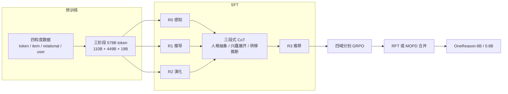

# OneReason Technical Report

## Why

OneRec 证明了一件事：把推荐压成"生成物品 ID"的单阶段模型，能在工业规模上跑通，并且比级联系统更省算力。但它在结论里也承认了另一件事：推理阶段的 step scaling 不明显，模型没有强推理能力。于是下一个自然的问题是：能不能把 LLM 的"先想再答"搬进推荐，让模型在生成 ID 之前先写一段理由？

OneRec-Think 与 OpenOneRec 试过这条路。它们把物品 token 与文本数据混在一起训练，让模型在推荐任务上生成 CoT，也观察到了"想完再答"的格式可以被学会。但一个反直觉的现象出现了：在推荐基准上，思考模式并没有比非思考模式更好。模型会写理由，理由读起来也通顺，但最终推荐没有变准，有时还更差。

这个负结果值得拆开看，因为 LLM 领域的经验是 CoT 普遍有效。推荐与数学、代码的差别有三点。第一，推荐没有唯一正确答案：同一个用户可能对多个物品感兴趣，理由指向 A、最终推荐 B，未必是错的。第二，用户意图不可直接观察：它只能从一长串行为里推断，行为里混着随手滑过、重复曝光、多人共用账号。第三，物品是用 itemic token 表示的离散符号，token 本身没有语义；如果模型没有学会 token 与自然语言的对应，它写的理由就是符号的游戏，不是对内容的推理。

把这三条差别落到机制上，可以得到两个前提。第一个是感知（perception）：itemic token 必须能被"读出来"，即模型知道 `<a_5028><b_6733><c_2559>` 对应什么内容、什么品类、什么风格。第二个是认知（cognition）：模型必须能把用户的行为序列重新组织成若干条潜在兴趣线，并判断这些兴趣如何随时间演化。感知不牢，理由会建立在错误的内容理解上；认知不牢，理由会把行为罗列一遍，得不出下一步。

现有方法在这两个前提上都做得不够。OneRec-Think 的对齐主要是"整段 token 对整段 caption"，没有教模型 token 之间的组合关系；它的 CoT 是自由文本，没有强制的粗到细结构；它的 RL 在混合域上做，不同域的奖励分布互相干扰。OpenOneRec 把推荐做成指令跟随，但推理评估仍然粗粒度，无法定位是感知错了还是认知错了。更麻烦的是，这三类失败在端到端指标上看起来一样：推荐没中。

于是问题可以写成：如果把感知与认知分开做深，先用四层粒度的数据把 token 与文本对齐，再用强制的三段式 CoT 把行为组织成兴趣演化，最后按业务域分别做 RL、再合并成一个模型，思考模式能不能稳定赢过非思考模式？如果可以，推理的收益够不够付它的延迟与算力？

## What

先交代任务。OneReason 要同时做两件事：一是给出一个可诊断的评测装置 OneReason-Bench，二是训练一个能在这个装置上"先想再答"的推荐基座模型。评测的输入是用户画像、跨域行为历史与任务指令，输出可以是物品描述、选项、兴趣演化链，或下一批物品的 itemic token。模型侧的输出是一段 `<think>` 理由加最终答案；边界是单轮生成，不做工具调用，不接外部检索。

论文给出的答案是：推荐推理的瓶颈不在"有没有 CoT"，而在"感知是否对齐、认知是否有结构"。围绕这两点，作者做了三件事：预训练用四种粒度的数据把 itemic token 与文本深度对齐（共 578B token）；SFT 用"人格抽象 → 兴趣展开 → 转移推断"的三段式 CoT 教模型组织行为；RL 用"先专精再统一"的策略，先在四个业务域分别做 GRPO，再用拒绝采样微调（RFT）或多教师在线蒸馏（MOPD）合并。`[宣称，Abstract、§1、§4–§6]`

作者报告的结果是：OneReason-8B 在四个跨域推荐任务上全第一，作者称思考模式稳定优于非思考模式（这个说法只在 RFT 合并后的 R3 高 K 上成立，R0 与低 K 有反例，见 Ideas）；在 R0–R2 的推理任务上，部分指标超过更大的通用 LLM；通用能力（MMLU-Pro、GPQA、MATH-500、GSM8K）在思考模式下基本保住；线上本地生活广告场景 10 天 A/B 中，组合部署带来曝光 +10.332%、收入 +8.234%，ROI 大于 5。`[已验证，Table 14–18；线上口径见 Ideas]`

### 新认识：思考模式不赢，是感知与认知没做够

第一个认识是，"会写 CoT"与"推理有用"是两件事。作者在 §6.4 给了一组关键对照：SFT 之后，思考模式在四个域的 R@64 上都低于非思考模式（Cross-Video 0.06 对 0.11、Cross-Product 1.65 对 2.96、Cross-Ad 3.41 对 6.49、Cross-Live 14.32 对 15.52）；只做单域 RL 之后，思考仍在四个域中的三个落后（0.15 对 0.16、3.87 对 4.25、18.62 对 18.80）；做完 RFT 之后，思考模式才在 R@64 上反超（0.24 对 0.19、4.19 对 3.96、7.50 对 7.26、18.35 对 18.17）。这个反转说明：CoT 本身不是增益来源，只有当模型真的能从理由里提取出对预测有用的证据时，思考才划算。`[已验证，Table 9]`

第二个认识是，思考的收益与"怎么合并专家"有关。RFT 把域专精教师生成的正确轨迹当作监督，思考模式在四个域的 R@64 上都赢过非思考，但低 K 不一定：Cross-Video 的 R@8 是 0.05 对 0.06，非思考仍高 0.01 个点；MOPD 在学生的自生成轨迹上做反向 KL 蒸馏，思考与非思考同步提升，非思考提升得更多，两者差距缩小，Cross-Product 的 R@64 甚至出现非思考反超（4.34 对 4.11）。作者的解释是：RFT 只蒸馏"理由与答案都对"的黄金轨迹，思考信号纯；MOPD 对所有轨迹做蒸馏，把噪声也带进参数，非思考的"直觉"被强化得更多。`[已验证，Table 9、§6.4；解释是作者的]`

第三个认识是，CoT 监督的好处可以迁移到非思考推理。作者做了 token 对齐的对照：同样 0.25B token 预算，100K 条 unCoT 数据对 40K 条 CoT + 50K 条 unCoT；在非思考解码下，混合数据的 Cross-Video Pass@64 从 1.64% 升到 1.95%，Cross-Product 从 4.38% 升到 4.86%，Cross-Live 从 18.12% 升到 20.32%，Cross-Ad 从 16.08% 降到 15.84%。作者把这种现象解释为压缩信号与推理信号的混合，并明确说这只是行为证据，不能区分压缩与推理各自的贡献。`[已验证，Table 17；机制未识别，作者自己承认]`

### 新方法：四粒度对齐、三段式 CoT、专精后统一

第一件可复用的东西是四粒度的预训练数据。此前的做法按任务组织数据（物品描述、用户行为序列、画像文本），作者改成按语义粒度组织：token 粒度（子 token 的含义、前缀组合的含义、从部分到整体的解释）、item 粒度（整段 token 与粗粒度描述、多视角 QA）、relational 粒度（物品之间的转移及自然语言解释）、user 粒度（按域分组的行为序列、按时间交错的行为序列）。四层从微观到宏观，逐层把"符号"与"语义"绑在一起。`[已验证，§4.2、Fig. 5]`

第二件是三段式 CoT。作者把推荐推理拆成三个可检查的步骤：人格抽象（把稀疏行为压成一个带类型的用户状态）、兴趣展开（从近期轨迹里识别若干条有证据的兴趣假设）、转移推断（比较假设，选最可能的下一兴趣方向）。每一步都有约束：人格只是软先验，最终判断必须落在行为证据上；兴趣展开要保留多个方向，但不能无限发散（实验显示 1、3、5 条最好，10、20 条变差）；转移推断要说明"从哪条证据推到哪个需求"，并且不能泄漏目标。`[已验证，§5.4、Fig. 8、Table 8]`

第三件是"先专精再统一"的 RL。作者先在短视频、商品、广告、直播四个域分别做 GRPO，得到四个域专家；再用两种方式合并：RFT 从专家那里筛出"理由与答案都对"的轨迹做 SFT，MOPD 让学生在自生成轨迹上向对应域的教师做反向 KL 蒸馏。MOPD 还加了一个信息增益过滤：按 token 级优势的绝对值排序，只保留覆盖 80% 信息增益的轨迹，把梯度预算集中在学生与教师分歧最大的样本上。`[已验证，§6.1–§6.3、Fig. 18–22]`

第四件是评测装置 OneReason-Bench。它把推理拆成四层：R0 感知（物品理解、token grounding、物品 QA）、R1 推导（物品到物品的关系）、R2 演化（兴趣动作选择、兴趣主题生成、兴趣直接生成）、R3 推荐（单域与跨域的下一物品预测）。这个分层的作用不是排名，而是定位：当端到端指标下降时，可以看到是哪一层先坏。`[已验证，§3、Table 1]`

### 新结论：推荐指标、推理指标与通用能力

推荐指标在 Table 14。OneReason RFT 思考模式在四个域上都是第一：Cross-Video Pass@64 2.41（对最强基线 LC-Rec-PT-SFT-8B 1.49）、Cross-Product 5.47（对 3.95）、Cross-Ad 17.78（对 15.85）、Cross-Live 21.10（对 19.32）。通用 LLM 在文本侧的表现明显更弱：GPT-5.4 的四个 Pass@64 是 0.24、1.43、1.64、7.20，Qwen3-32B 是 0.33、0.84、1.21、5.64。`[已验证，Table 14]`

推理指标在 Table 15。RFT 思考模式在 R1 与 R2 上大多最好：Item2Item 28.60（非思考 23.99、LC-Rec-PT 25.54）、兴趣动作选择 42.42（非思考 38.92）、兴趣主题生成 39.57（非思考 39.33）、兴趣直接生成 21.23（非思考 20.31）。感知层相反：token grounding 只有 1.35，非思考是 5.24；物品理解 36.78 与非思考 36.82 基本持平。作者把 grounding 的下降归因于"感知任务上的过度思考"。`[已验证，Table 15；归因是作者的]`

通用能力在 Table 16。RFT 思考模式的 MMLU-Pro 是 72.08（Qwen3-8B 思考模式 72.35）、GPQA-Diamond 54.04（56.06）、MATH-500 95.40（95.20）、GSM8K 94.69（95.68），基本保住；非思考模式则掉到 MMLU-Pro 59.57、GPQA 37.88，明显退化。`[已验证，Table 16；"保住"只在思考模式下成立]`

非思考增益在 Table 17，前面已经列过。线上在 Table 18：单独用 OneReason 做检索，曝光 +0.940%、收入 +4.528%；用 OneReason 增强在线 OneRec，曝光 +6.831%、收入 +4.636%；两者组合，曝光 +10.332%、收入 +8.234%。按用户活跃度拆分，低活跃用户的收入提升最大（+13.323%），高活跃用户是 +2.419%（Table 20）。`[宣称，Table 18–20；口径见 Ideas]`

## How

这篇论文以系统与算法类为主，附实证与基准类。系统与算法类：tokenizer、四粒度数据、三阶段预训练、R0–R3 的 SFT 数据、GRPO/RFT/MOPD、Fast-Slow 部署。实证与基准类：OneReason-Bench 的构造与统计、四个域的推荐对比、R0–R2 诊断、通用能力对照、10 天线上 A/B。判型依据是它的主体是"训练配方 + 评测装置"，不是新的学习理论；它没有定理，也没有公开数据上的独立复现。下面按"tokenizer—预训练—SFT—RL—指标—基准—实验—部署—成本"展开。



### 一、tokenizer：内容理解任务，而不是对比学习

OneReason 的物品 token 来自一个多模态编码器加一个解码器 LLM 的联合训练。编码器由 ViT、Qwen3-VL 初始化的大模型、以及音频编码器组成，把封面、视频帧、文本、音频压成一个稠密向量；这个向量作为软前缀（soft prefix）接到一个独立的解码器 LLM 前面，后面接物品的文本描述。训练目标是"给定软前缀，生成描述"，也就是一个内容理解任务，而不是 OneRec 用的对比学习。`[已验证，§4.1；与 OneRec 的差别是我的对照]`

量化用 RQ-KMeans，三层、每层 8192 个码。每个物品最终表示成一个"域起始 token + 三个子 token"的模式：

```text
<|video_begin|><a_5028><b_6733><c_2559>
```

域可以是 video、prod、ad、living，通用多模态数据用 sid。与 OpenOneRec 相比，OneReason 去掉了结尾 token，目的是省上下文，把位置留给推理链。这个改动很小，但反映了整篇论文的取舍：推理链要占 token，符号部分要尽量短。`[已验证，§4.1]`

### 二、预训练：四种粒度，三层训练

四粒度数据的设计逻辑是"从符号到语义，再到关系，最后到用户"。

- Token 粒度：不只对齐单个子 token，还对齐前缀组合的含义（用 LLM 总结共享该前缀的物品语义），以及"从部分到整体"的两步解释（先解释每个子 token，再合成整段描述）。这一层解决的是"token 之间怎么组合"。
- Item 粒度：整段 token 对粗粒度描述，外加多视角 QA（目标人群、核心卖点、视觉风格、负反馈理由）。描述要先粗化，去掉三个子 token 装不下的细节（OCR、歌词、日期、型号），否则模型会被迫 hallucinate。
- Relational 粒度：物品之间的转移，用"物品 token → 文本解释 → 物品 token"的交错序列表示。来源包括搜索后购买表、TagNext 协同过滤、时间窗共现；解释由 LLM 生成，生成时给中间节点的描述，保证解释落在真实路径上。
- User 粒度：按域分组的行为序列与按时间交错的行为序列。按域分组的序列用多轮 QA 让文本成为控制信号；按时间交错的序列按时间戳重建，并随机把部分物品 token 换成描述，强制模型在同一序列里处理两种模态。

`[已验证，§4.2.1；数据比例在 §C.2，本次未逐项核对]`

预训练分三阶段（Table 4）：Stage 1 只训新增的 token embedding 与 LM head，110B token，学习率 $2\times10^{-4}\to1\times10^{-4}$；Stage 2 全参数训练，449B token，学习率 $1\times10^{-4}\to1\times10^{-5}$，Stage 1 与 Stage 2 都把单样本限制在 4K；Stage 3 放开到 32K，19B token，学习率 $1\times10^{-5}\to1\times10^{-6}$。三段合计 578B token，所有阶段都用 48K 的 packed sequence。Stage 3 的目的很明确：让模型在完整用户历史上学长程依赖，而不是只学短片段。`[已验证，§4.4、Table 4]`

四粒度数据的效果在 0.8B 模型上做消融（固定 30B token，Table 2）。Exp1 是 OpenOneRec 的基线数据；Exp2 加 token 粒度；Exp3 用 item 粒度替换基线描述；Exp4 加 relational；Exp5 用 user 粒度替换基线用户数据。几个代表性变化：Item2Item 从 0.00 升到 20.57、20.73、25.65、29.72；Cross-Live 从 2.29 升到 2.32、3.49、3.25、8.56；Item Understanding（ad）从 16.37 升到 37.86、31.65、29.69、32.56；Itemic Pattern Grounding（prod）从 2.42 升到 5.81、5.33、2.91、5.33。`[已验证，Table 2]`

这组消融同时暴露了能力权衡：加入 relational 后，静态检索反而下降（prod grounding 5.33→2.91），作者的解释是"关系推理与静态检索争容量"；加入 user 后，R3 跨域推荐大幅提升（Cross-Live 3.25→8.56、Cross-Ad 8.58→10.84），说明用户粒度的时序结构才是跨域迁移的关键。`[已验证，Table 2；解释是作者的]`

### 三、SFT：R0–R3 的数据与三段式 CoT

SFT 的数据按 R0–R3 组织，规模如下：R0 约 941K（682K 描述 + 259K QA）；R1 约 400K（从 358K TagNext CF 对与 388K 搜索后购买对里筛出）；R2 约 130K；itemic 指令数据约 103K；通用数据约 1.5M（来自 Step-3.5-Flash-SFT，去掉工具调用、只保留三角色对话）。`[已验证，§5.1–§5.6]`

R0 的关键不是"再讲一遍 token 是什么"，而是把预训练的直接映射变成"先解释再给描述"。同一个视频 token，预训练的输出是描述；SFT 的输出是先逐层解释 `<a>`、`<b>`、`<c>` 各自指向什么，再合成描述。这个改动把"感知"从隐式能力变成可监督的推理步骤。`[已验证，§5.1、Table 5]`

R1 的关键是"只从源侧证据写桥"。构造时先筛出显式相关的物品对，再让教师提取桥变量（源侧需求、桥类型、抽象桥、延续方向、理由种子、置信度）；生成解释时只看源侧证据与桥变量，目标物品只用于一致性检查。这样做的目的是防止模型学会"抄目标描述当理由"。`[已验证，§5.2、Table 6]`

R2 的关键是"时间结构 + 质量过滤"。作者从全域时间线里让强 LLM 找兴趣演化的关键节点，再用第二个 LLM 按十一项标准做二次评估（顺序敏感性、认知增量、触发证据、因果排他、证据闭合、不读心等），过滤掉伪逻辑链、随机消费链、同类别漂移。`[已验证，§5.3；十一项标准的完整提示在 §D.2.4]`

R3 的关键是三段式 CoT 与泄漏控制。每个样本由用户画像 $P_u$、时间线 $H_u$、真实的下一次交互 $y_u^+$ 组成；$y_u^+$ 只作为监督答案，不能出现在理由里。构造时教师先在自然语言证据上写理由，并标出引用的历史物品 ID；后处理把 ID 换成 itemic token，删掉匹配不上的引用，最后拼成 `<think>` 理由加目标 token。形式化地：

$$
C_u=\operatorname{Abstract}(P_u,H_u),\qquad
Z_u=\operatorname{Expand}(C_u,H_u),\qquad
z_u^\star=\arg\max_{z\in Z_u}s(z\mid C_u,H_u,d),
$$

其中 $C_u$ 是压缩后的用户状态，$Z_u$ 是展开出的候选兴趣假设，$d$ 是目标域，$s(\cdot)$ 是概念上的打分函数（证据强度、近因、时间连续性、人格兼容、域兼容）。最后把 $z_u^\star$ 写成一段交错着 token 与文本的理由。`[已验证，§5.4.1、式 2–3]`

理由质量用五个维度评估：安全（不泄漏目标）、一致（结论与目标一致）、逻辑（可迁移而非拼接）、事实（不编造历史）、信息量（给出可操作的推荐指导）。Fig. 9 的平均分是安全 4.94、一致 3.53、逻辑 3.51、事实 4.09、信息量 3.66（满分 5）。换句话说，安全和事实过得去，逻辑与一致只有中等偏上；这些理由被直接用作监督，是后面 Ideas 要讨论的问题。`[已验证，§5.4.2、Fig. 9]`

### 四、RL：两阶段 rollout、混合奖励、稳定化、专精后统一

RL 的起点是 SFT 模型，目标是把"模仿教师的理由"变成"自己探索出更好的理由"。基础算法是 GRPO：对每个用户采样一组 rollout，用组内标准化算优势：

$$
\hat{A}_{u,i}=\frac{R_{u,i}-\operatorname{mean}(\{R_{u,k}\}_{k=1}^{G})}{\operatorname{std}(\{R_{u,k}\}_{k=1}^{G})+\delta}.
$$

推荐场景的困难是命中率极低：候选空间是百万级物品，采样几十条理由，可能一条都不中。作者的做法是两阶段 rollout：先采样 $N$ 条理由，每条理由下再并行生成 $K$ 条 itemic token 序列，得到 $N\times K$ 个有效推荐，但只生成 $N$ 条理由。这样把推理成本摊到多条推荐上，奖励覆盖变密。`[已验证，§6.1、Fig. 11；$N$ 与 $K$ 的具体值未给]`

奖励是"规则命中 × 多样性"：

$$
R_{u,i,j}=R_{\text{rule}}(c_{u,i,j})\cdot R_{\text{div}}(\operatorname{CoT}_{u,i}),\qquad
R_{\text{rule}}(c)=\mathbb{I}(c\in C_u^+),
$$

$$
R_{\text{div}}(\operatorname{CoT}_i)=\frac{\max(0,m_i^{(1)}-1)}{K-1},
$$

其中 $m_i^{(1)}$ 是同一条理由下 $K$ 个候选的第一个子 token 的不同取值数。第一项保证准确，第二项鼓励一条理由覆盖多个品类。多样性只算第一个子 token，是因为第一个子 token 大致决定粗粒度品类；这个设计有明确的偏向，Ideas 第六条展开。`[已验证，§6.1、式 7–9]`

优化上有两个稳定化改动。第一是分阶段裁剪：理由 token 用较宽的裁剪范围，itemic token 用较窄的范围，因为理由长、主要承担探索，ID 短、直接决定奖励。第二是负样本降权：命中样本权重 1.0，未命中样本权重 $\beta<1$，避免大量零奖励样本把梯度推向保守。`[已验证，§6.1、式 10–13、Fig. 12]`

专精阶段结束后，作者比较两条统一路线。RFT 从四个域专家那里采样轨迹，只保留"预测命中 ground truth 且理由质量合格"的样本，合成一个数据集做 SFT；MOPD 则让学生在自己的轨迹上向对应域教师做反向 KL 蒸馏，并用信息增益过滤（按 token 级优势绝对值排序，保留覆盖 $\rho=0.8$ 信息增益的轨迹）。`[已验证，§6.2、§6.3、式 14–20]`

### 五、CoT 指标：四个诊断，两个便宜两个贵

作者设计了四个指标，按"符号/概率"与"局部/全局"两个轴排成 2×2：

- C1 $\Delta LL$：带理由时目标 token 的对数似然减去不带理由时的对数似然，衡量理由是否真的提高了正确目标的概率。SFT 模型在四个域都是负的（−5.19、−5.22、−4.94、−2.69），RFT 模型转正（0.63、1.27、0.57、1.10）。这个指标直接说明了"SFT 的理由在帮倒忙，RFT 的理由才帮上忙"。`[已验证，Fig. 23]`
- C2 $\ell_t$ 进展：把理由切成段，逐段加入后看目标似然是否上升。SFT 与 RFT 都上升，但 RFT 更早饱和，说明预测证据集中在前几段，提示可以做理由压缩或提前停止。`[已验证，Fig. 24]`
- C3 合法性 $\gamma_{\text{legal}}$：理由里引用的 token 是否都在物品库里。SFT 与 RFT 都是 1.00，说明这个失败模式在当前模型上不存在。`[已验证，Table 11]`
- C4 历史引用合法性 $\gamma_{\text{hist|legal}}$：在合法引用的前提下，引用的物品是否真的出现在用户历史里。这个指标抓的是"理由编造用户没看过的行为"。`[已验证，§7；具体数值在 Table 11，本次未逐项摘录]`

这四个指标的价值在于把"理由好不好"拆成可计算的部分。C3/C4 是符号检查，不需要前向；C1/C2 需要前向与 ground truth，成本高但直接测预测效果。`[已验证，§7、Table 10]`

### 六、基准：R0–R3 的构造与统计

R0 的物品描述由多模态 LLM 从原始封面、帧、文本生成，再经 LLM 与人工抽检；QA 从描述与元数据构造，按可答性、难度、人工抽检过滤。R1 从内容知识图谱抽物品对，用 LLM 做难度过滤，保留需要语义推导而非表面匹配的样本。R2 从全域时间线挖兴趣演化链，用规则、LLM、人工三层过滤伪逻辑链。R3 用真实行为日志构造跨域历史，目标是后续高价值交互（商品是点击、视频是同时长桶内 75 分位以上完播、广告是激活或付费、直播是首次赠送）。`[已验证，§B.1]`

R3 的规模在 Table 21：短视频 10,285 个用户、69.5 万域内物品、41.9 万域外物品、平均域内历史 74.89 条、平均目标 13.92 个；商品 9,859 个用户、平均目标 1.62 个；广告 9,081 个用户、平均目标 4.24 个；直播 8,083 个用户、平均目标 1.58 个。目标数差异很大，所以 R@64 在不同域之间不可直接比。`[已验证，Table 21；这个差异是我加的提醒]`

泄漏与记忆在 Table 22：33.69% 的目标原始 ID 在训练中没见过，但只有 11.55% 的目标 itemic token 没见过，说明语义 ID 让模型能用"见过的码"覆盖"没见过的物品"。转移层面，短视频 95.3% 的目标转移是泛化的，商品 72.2%，广告 75.9% 是记忆的，直播 73.0% 是记忆的。换句话说，广告与直播的评测更偏向"记住历史转移"，短视频与商品更偏向"泛化到新转移"。`[已验证，Table 22]`

### 七、实验：四域推荐、R0–R2、通用能力、非思考增益

推荐实验（Table 14）的基线分三类：ID-based（SASRec、HSTU）、text-based（Qwen3-8B/32B/235B、DeepSeek-V3.2、Claude-Opus-4.6、Gemini-3-Preview、GPT-4o-mini、GPT-5.4）、itemic token-based（TIGER、LC-Rec 三个变体）。text-based 的做法是让 LLM 生成相关物品描述，再用 Qwen3-Embedding-8B 编码描述与候选描述，做 ANN 检索；这个管线多了一步检索，误差会叠加，Ideas 第八条展开。`[已验证，§8.1]`

R0–R2 实验（Table 15）只用 text-based 与 itemic token-based 两组，因为 ID-based 模型无法处理文本任务。RFT 思考模式在 R1/R2 上领先，但在 R0 的 grounding 上明显低于非思考（1.35 对 5.24）。作者的解释是"感知任务上的过度思考"：模型把简单的内容识别也写成推理链，反而引入噪声。`[已验证，Table 15]`

通用能力（Table 16）用 MMLU-Pro、GPQA-Diamond、MATH-500、GSM8K 四个基准。OneReason 思考模式基本追平 Qwen3-8B 思考模式，非思考模式在 MMLU-Pro 与 GPQA 上明显下降。作者据此说"推荐训练没有灾难性遗忘"，但这个结论只在思考模式下成立。`[已验证，Table 16]`

非思考增益（Table 17）是 token 对齐的对照，前面已列。作者还做了样本数对齐的混合比例扫描（固定 100K 样本，变 CoT 比例），发现最优比例随域变化：Cross-Video 接近均衡，Cross-Product 偏 CoT，Cross-Live 均衡或略偏 CoT，Cross-Ad 偏 unCoT 且曲线平。作者用"压缩信号 + 推理信号 − 噪声成本 − 格式错配"的概念分解解释，并明确说这不是可识别的加性估计。`[已验证，Fig. 25、式 28–29]`

### 八、部署：Fast-Slow 与 OneReason for OneRec

线上场景是快手本地生活广告。这个场景不在 OneReason 的训练数据里，所以先做场景适配：用 R0 的方法对齐新物品，用用户画像文本做持续预训练，再用"从高活跃到低活跃"的课程做 SFT。`[已验证，§9.1、§A.1]`

在线架构叫 Fast-Slow Thinking。Slow 是近线：每天或每小时聚合用户行为、画像、物品内容，加载最新 OneReason 检查点离线预测下一物品的 token，解码成物品 ID 写入 Redis，形成候选池。Fast 是在线：把近线结果与实时 OneRec 的召回一起送进排序模型融合；近线结果不可用时回退到原 OneRec 管线。另有一个"OneReason for OneRec"的变体：把 OneReason 预测的物品 token 解码成 embedding，作为监督信号，通过一个 Thinking Token 与对齐网络蒸馏进在线 OneRec。`[已验证，§9.2、§A.2、Fig. 26–27]`

线上 A/B 跑 10 天，实验组与对照组各 5% 流量（Table 18）。单独用 OneReason 做 Slow 检索，曝光 +0.940%、收入 +4.528%；OneReason for OneRec 的 Fast 增强，曝光 +6.831%、收入 +4.636%；组合最好，曝光 +10.332%、收入 +8.234%。按流量效率拆（Table 19），组合的转化数 +12.643%、点击数 +1.709%、CVR +1.865%、CTR +0.519%，检索占比 27.2%。按用户活跃度拆（Table 20），低活跃用户收入 +13.323%，高活跃 +2.419%，作者认为这说明推理能补足稀疏行为。`[宣称，Table 18–20]`

### 九、成本与边界

成本方面，论文给了两个数：全量服务 4 亿用户每天约 600 张旗舰 GPU，ROI 大于 5。没有给美元金额、每千次请求的推理 token 数、Fast-Slow 的缓存存储与更新成本、OneReason for OneRec 的蒸馏训练成本。`[宣称，§A.4.4；缺口见 Ideas]`

边界方面，作者在 §A.4 承认四条：在线增量训练会损伤通用能力与指令跟随；当前解码策略没有考虑业务价值与资源约束；Fast-Slow 是工程折中，不能完全替代实时检索；模型参数越大越难实时，未来要探索 0.8B 级模型。结论还提到未来要做 agentic recommendation（规划 + 工具调用），但当前模型只做单轮生成。`[已验证，§A.4、§11]`

## Ideas

### 不足

**基准是团队自建、自用、自评。** OneReason-Bench 由作者构造，且明确说它"played a central role in guiding and validating our model development"（§1）。这意味着模型的设计与评测共享同一套假设：R0–R3 的分层方式、题目构造、指标定义都出自同一团队，模型可能对这套评测过拟合。归因：评估问题。要证明结论成立，需要一个未参与构造的 held-out 集，或第三方复现。`[§1、§3]`

**"思考稳定优于非思考"与表格冲突。** 结论说思考模式在多个基准上稳定优于非思考，但 Table 9 里 RFT 的 Cross-Video R@8 是 0.05 对 0.06（非思考更高）；Table 15 的 token grounding 是 1.35 对 5.24；Table 16 的非思考 MMLU-Pro 是 59.57 对 66.32。准确的说法应该是"在 R3 推荐的高 K 上、在 RFT 合并后，思考优于非思考；在 R0 感知与低 K 上不成立"。归因：写作与口径问题。`[Table 9、15、16 vs §11]`

**绝对数字极小，且没有置信区间。** Cross-Video 的 R@64 只有 0.06 到 0.24，Cross-Product 的 R@1 只有 0.21 到 0.67；相邻配置之间的差距常常是 0.01 到 0.05 个点。论文没有给随机种子、重复运行、置信区间，也没有说明这些差异是否超过噪声。归因：评估问题。`[Table 9、14]`

**R@64 与 Pass@64 混用，跨域不可比。** Table 14 的表头是 Pass@64 与 Recall@64，Table 9 是 Recall@K；不同域的平均目标数差异很大（视频 13.92、商品 1.62、广告 4.24、直播 1.58），所以同一个 K 在不同域的难度不同。作者在 Table 14 的脚注里承认视频的 Recall@64 低是因为目标集大，但没有在正文里提醒跨域比较的限制。归因：评估问题。`[Table 14 脚注、Table 21]`

**预训练消融与主实验不同规模。** Table 2 的消融在 0.8B 模型、30B token 上做，主结果在 8B 模型上做（预训练共 578B token）。四粒度数据的收益是否随规模保持，论文没有验证；表 2 里还有能力权衡（relational 让 grounding 从 5.33 掉到 2.91），最终模型却宣称全面提升。归因：方法问题。`[§4.3、Table 2、Table 14]`

**RL 超参缺失。** 两阶段 rollout 的 $N$、$K$、组大小、批大小、$\beta$、分阶段裁剪的具体范围都没有给；Table 9 只给最终指标，没有给训练曲线上的方差。读者无法复现，也无法判断这些稳定化改动各自的贡献。归因：方法问题。`[§6.1、§6.4]`

**奖励只认"命中"，多样性只认第一个子 token。** $R_{\text{rule}}$ 是 0/1 命中，$R_{\text{div}}$ 只看第一个子 token 的不同取值数。0/1 命中对"差一位"的候选没有区分，第一个子 token 的多样性鼓励品类宽度但不鼓励物品级多样；两项相乘还可能让"命中但多样性低"的轨迹吃亏。作者没有做奖励消融的数值表（只有曲线），也没有分析 reward hacking。归因：方法问题。`[§6.1、式 7–9]`

**教师理由的质量只有中等。** Fig. 9 的逻辑均值 3.51/5、一致 3.53/5、信息量 3.66/5；分布图上每个维度都有相当比例的 1–2 分样本，但正文没有给逐维度的低分比例表，只能从柱状图读。这些理由被直接用作 SFT 监督，低质量样本会进入模型。归因：数据问题。`[Fig. 9；逐维度低分比例需按原图核对]`

**合并方法改变结论，但没有解释清楚。** RFT 让思考全面赢，MOPD 让非思考追上来，Cross-Product 甚至反超。作者的"黄金轨迹 vs 全轨迹蒸馏"解释是合理的，但没有做控制实验：比如给 MOPD 也加正确性过滤，或给 RFT 也加信息增益过滤。归因：方法问题。`[Table 9、§6.4]`

**通用能力只在思考模式下保住。** 非思考模式的 MMLU-Pro 掉 6.75 个点（66.32→59.57）、GPQA 掉 2.02 个点（39.90→37.88）。如果线上为了延迟用非思考模式，通用能力与指令跟随会退化；论文没有报非思考模式的线上占比。归因：评估问题。`[Table 16、§A.4.1]`

**线上收益不能全部归给"思考"。** Fast-Slow 架构里，OneReason 是近线检索，在线由 OneRec 融合；组合的 +8.234% 收入来自"新增候选池 + 蒸馏增强"两件事，不是"每次请求都思考"。论文没有给思考模式的请求占比、推理 token 数、延迟分位。归因：系统问题。`[§9.2、Table 18]`

**ROI > 5 的口径不完整。** 600 张 GPU/天是"全量服务 4 亿用户"的成本，但没有给 GPU 型号、租用价格、电力、缓存存储、蒸馏训练的成本；收入是广告收入，受季节性、竞价环境、流量结构影响，10 天 A/B 不足以排除这些因素。归因：评估问题。`[§A.4.4、Table 18]`

### 创新点

下面六条依次对应上面的六个缺口：第一条对应"感知/认知没有分开验证"，第二条对应 CoT 监督迁移的机制未识别，第三条对应合并方法缺因子设计，第四条对应理由质量与指标不可复现，第五条对应基准自建，第六条对应延迟与成本账本。

**一、把"感知/认知"做成可分开训练、可分开测量的两层。**

- 主张：推荐推理的失败可以定位到感知（token 是否可指称）或认知（行为是否被组织成兴趣演化）；分开训练后，可以用 R0 与 R2 的分数预测 R3 的表现，从而在端到端指标下降前定位问题。
- 与原文关系：扩展。原文提出了这两层，也用 R0–R3 测了，但没有验证"R0/R2 分数能否预测 R3"，也没有做"只训感知"与"只训认知"的对照。
- 最小验证：固定 8B 基座与 578B token 预算，训练三组：只做 R0 数据、只做 R2 数据、两者都做；在 R0–R3 上测，计算 R0/R2 分数与 R3 Pass@64 的相关性。预期是两者都做最好，且 R2 与 R3 的相关高于 R0 与 R3。
- 失败条件：三组在 R3 上无显著差异，或 R0/R2 分数与 R3 不相关；这说明两层划分没有诊断价值。

**二、把"CoT 监督迁移到非思考"做成可识别实验，分离压缩与推理。**

- 主张：CoT 数据里至少有两种信号：压缩（把长历史压成用户状态）与推理（从状态推到决策）。现有实验只证明混合数据有用，没有分离两者。分离后可以按域选择数据配方，而不是盲目加 CoT。
- 与原文关系：扩展/反驳。原文的式 28 只是概念分解，作者自己说"not an identifiable additive estimate"。
- 最小验证：构造三种 CoT 数据：只含人格抽象、只含转移推断、完整三段；在相同 token 预算下分别与 unCoT 混合，测非思考 Pass@64 与 R2 的 Action–Logic 分数。预期是"只含压缩"在长历史域（视频、直播）更好，"只含推理"在商品域更好。
- 失败条件：三种数据在四个域上的排序一致，说明压缩与推理不可分离，或者两者本来就是同一信号。

**三、给"专精后统一"做 2×2 的合并方法对照。**

- 主张：域专精的收益来自避免跨域干扰，合并方法的收益来自保留专精知识；两者是正交的。现有实验把"单域 RL"与"混合 RL"比了一次，又把 RFT 与 MOPD 比了一次，但没有把两个维度交叉。
- 与原文关系：增量。原文的 Table 9 是五列并列，不是因子设计。
- 最小验证：四个域 × 两种合并方法（RFT/MOPD）× 两种初始化（SFT/Mix-RL），共 16 组，报告每域的 R@K、思考/非思考差距、训练成本。预期是 RFT 在低命中域更好，MOPD 在高命中域更好。
- 失败条件：合并方法的主效应大于域专精的主效应，或 16 组的排序与成本无关；这说明"先专精"不是必要的。

**四、给推荐 CoT 建公开的忠实度基准。**

- 主张：理由的"好看"与"有用"是两件事；需要一组可自动检查的指标（目标似然增益、逐段进展、引用合法性、历史引用合法性），并且要在公开数据上可复现。
- 与原文关系：正交/扩展。原文的四个指标只在内部数据上算，没有公开。
- 最小验证：在 Amazon 或 KuaiSAR 上构造 1,000 条推荐理由，人工标注"是否支持最终推荐"，再算 ΔLL、γ_legal、γ_hist|legal 与人工标注的相关性；如果相关，就可以用自动指标筛数据。
- 失败条件：自动指标与人工判断的相关系数低于 0.3，说明这些指标测的不是忠实度。

**五、把基准从"团队自建"变成"对抗性 held-out"。**

- 主张：现有 R0–R3 由作者构造并用于指导设计，模型可能过拟合这套评测；用时间切分（训练用 2025 年之前，测试用之后）与跨平台数据（如 KuaiSAR、Amazon）做 held-out，才能检验结论。
- 与原文关系：反驳。原文的基准是内部数据，没有独立测试集。
- 最小验证：在 KuaiSAR 上按时间切分，选 2026 年之后的交互做测试；用 OneReason-8B 与 LC-Rec、Qwen3-8B 对比，看排序是否与 Table 14 一致。预期是相对排序保持，绝对分数下降。
- 失败条件：held-out 上 OneReason 不再领先，或领先幅度小于 1 个点；这说明内部基准的结论不能外推。

**六、给推理建"延迟—收益"账本。**

- 主张：思考的收益必须除以推理 token 成本；在相同 QPS 与延迟约束下，应该比较 thinking、non-thinking、RFT、MOPD 四种部署的每千次请求成本与收入。
- 与原文关系：正交。原文给了 ROI > 5 与 600 GPU/天，但没有给每请求的 token 数与延迟。
- 最小验证：在线上或模拟负载上，记录四种模式的输入/输出 token 数、P99 延迟、GPU 小时、缓存命中率；用 Table 18 的收入增量做分子，算每提升 1% 收入的成本。
- 失败条件：思考模式的成本是 non-thinking 的 10 倍以上，而收入增量不到 1%；这时应该默认用非思考，只对困难人群开启思考。

## 相关工作

与 [zhou2025-onerec](zhou2025-onerec.md) 是同一系列的两步。OneRec 解决"怎么把推荐压成一次生成"，OneReason 解决"生成之前要不要想、怎么想才有效"。OneRec 的结论是推理 scaling 不明显，OneReason 正是对这条结论的回应。

与 [liu2025-onerec-think](liu2025-onerec-think.md) 是问题与答案的关系。OneRec-Think 首先把 CoT 接进生成式推荐，观察到思考模式没有优势；OneReason 把这个负结果归因到感知与认知，并用四粒度预训练、三段式 CoT、专精后 RL 来修复。两篇的工业 A/B 幅度差很多（0.159% 与 8.234% 收入），口径也不同：OneRec-Think 报的是停留时长，OneReason 报的是广告收入。

与 [hu2026-sage](hu2026-sage.md) 的对照在基准方法论。SAGE 用固定语料、统一 baseline、可复现的评测脚本重设参照系；OneReason-Bench 用团队自建的分层任务指导模型迭代，诊断更细，但独立性更弱。两者合起来是一个完整的评测观：先有可复现的固定测试台，再有可分层的诊断。

与 [kumar2026-stair](kumar2026-stair.md) 都用"受限词表生成"：STAIR 把输出限制在合法叶标题上，OneReason 把输出限制在 itemic token 上。区别是 STAIR 的候选集是目录，OneReason 的候选集是整个物品库；STAIR 的约束来自结构，OneReason 的约束来自量化。

与 [wan2026-decision-rag](wan2026-decision-rag.md) 都是"先判断再选"，判断的形态不同：DecisionRAG 用决策模型给每个候选打分，OneReason 用 CoT 给兴趣方向排序。决策模型适合候选集固定的场景，CoT 适合候选集开放、需要解释的场景。

与 [ho2026-declarative-attention](ho2026-declarative-attention.md) 都把隐式过程外化：DA 外化注意力的范围，OneReason 外化推荐的理由。两者都面临同一个问题：外化出来的中间产物是否真的被下游使用；DA 用 attended tokens 验证，OneReason 用 ΔLL 与逐段进展验证。

与 [he2026-memory-tax](he2026-memory-tax.md) 的方法论关系在成本账。Memory Tax 要求把收益与税成对测量；OneReason 报了 ROI 与 GPU 数，但没有把推理 token、缓存、蒸馏训练计入税。把 Memory Tax 的账本套到 OneReason 上，是 Ideas 第六条的具体做法。

与 [li2026-oo-harness](li2026-oo-harness.md)、[wang2026-rsi-hub](wang2026-rsi-hub.md) 的结构相似：三者都是"先专精、再统一"——OO-Harness 先训练专家 harness 再路由，RSIHub 先定义配方再组合，OneReason 先做域专家再蒸馏。区别是前两者的"专精"发生在代码/策略层，OneReason 发生在模型参数层。

## 可复现

论文承诺开源 OneReason-8B 与 OneReason-0.8B 模型及"其他微调相关材料"（Abstract、§1），但截至本次阅读没有核对到发布地址与许可证。可复现性按以下顺序评估：

- 模型：承诺开源 8B 与 0.8B；训练细节给了三阶段 token 预算（110B/449B/19B）、学习率、packed 长度、LoRA 设置。基座是 Qwen3 系列，这一点明确。
- 数据：预训练与 SFT 数据全部来自快手内部（用户行为、物品库、搜索后购买表、TagNext 协同过滤），外部无法重建；R0–R3 的评测数据也是内部的，只有构造方法，没有原始样本。
- 超参：RL 的 $N$、$K$、组大小、$\beta$、分阶段裁剪范围缺失；SFT 的 batch size、warmup、总步数缺失；预训练的具体数据配比在 §C.2，本次未逐项核对。
- 算力：预训练 578B token 的 GPU 小时没有给；线上 600 张 GPU/天是部署成本，不是训练成本。
- 评测：OneReason-Bench 的题目、答案、评测脚本没有公开；Table 14 的基线分数来自各自论文或内部重跑，未说明。
- 代码：本次未找到官方仓库链接。

最小可复现路径：用 Qwen3-8B 做基座，按 §4.2 的四粒度思路构造公开数据（Amazon 物品描述 + KuaiSAR 行为序列），按 §5.4 的三段式模板生成 CoT，按 §6.1 的两阶段 rollout 做 GRPO，在 Amazon 三个子集上复现 Table 14 的相对排序。这条路径能验证"感知 + 认知"的方向，但不能验证 578B token 的规模效应与线上收入。
