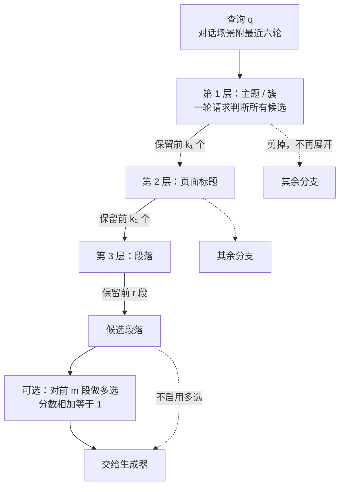

# Retriever-Free Retrieval: Navigating Documents with Decision Models

## Why

先看一个具体场景。用户问："Christopher Nolan 在 2000 年拍的那部电影，主角是谁？"检索增强生成（RAG）系统会先从资料库里挑几段文字，再把这几段和问题一起交给大模型。大模型只能看到被挑出来的那几段。如果真正写着答案的那一段没被挑中，它再聪明也答不出来。

挑段落的工作由检索器完成，常见的有两种做法。第一种是 BM25：它数问题里的词在段落里出现了几次，再按词的稀有程度加权。问题是它只认字面，问题里的 "2000" 和 "film" 会把 Gladiator (2000 film) 这类页面顶上来，而真正的 Memento (film) 因为标题里没有这些词，反而排在后面。第二种是稠密检索：把问题和段落都压成一串数字，再算两串数字有多接近。它能处理换一种说法的情况，但仍然是"先各自压成数字，再比距离"，问题和段落之间没有真正的推理。

这两种检索器有一个共同弱点：它们和生成器已经不是一个量级。生成器这几年在推理、长上下文、指令遵循上进步很快，检索器多数还在做词频统计或向量相似度。作者把这种落差叫"能力不对等"（capability asymmetry）。后果很直接：检索器漏掉的证据，生成器补不回来。

有人试过把语言模型拉进检索环节，主要有两条路，但都卡在机制上。第一条是"智能体式导航"：让大模型像人翻目录一样，先读当前这一层的候选，写出"下一步看第 3 节"，再读第 3 节，再写下一步。ReAct、Search-R1、MemWalker、PageIndex、LATTICE 都属于这一类。问题是每写一次"看第 3 节"，模型都要一个字一个字地生成；走五层就要生成五次，延迟和费用按"层数 × 每次生成的字数"增长。第二条是重排：第一阶段先粗筛出 100 段，再让交叉编码器（把问题和段落拼在一起过一次模型，输出一个相关性分数）或大模型在这 100 段里重新排序。重排确实比 BM25 准，但它只能改这 100 段的顺序；第 101 段之后的证据，它根本看不到。所以重排的上限由第一阶段的召回决定，而第一阶段用的还是那个"没跟上"的检索器。

最近有两件事让这个问题值得重新问一遍。第一，很多语料本身就有层级：帮助中心分主题，主题下有页面，页面下有章节，章节下有段落。人找资料时是顺着这棵树往下走的，不会把整个库从头扫到尾。第二，出现了一类"决策模型"（decision model）：它不写文章，只做选择题。你给它一段材料和一组是非题，它一次算完，给每道题一个"是"的概率；你给它一道多选题，它给每个选项一个分数。整个过程不生成文字。论文主实验用的 Jev 1.13 和 OpenAI 的 GPT-6 Luna 都属于这一类。把"语料有树"和"模型会做选择题"放在一起，就出现一个待验证的想法：让一个和生成器同级的模型来判断"这一支值不值得展开"，查询时既不需要第一阶段检索器，也不需要针对任务微调。

但这个想法要成立，得先回答三个很具体的问题。第一，分数能不能比？假设三个候选，模型分别给出"相关"的概率 0.9、0.8、0.7；这三个数加起来是 2.4，不是 1，它们不是"谁最相关"的份额，只是各自"像不像"的把握。如果模型是一个一个看的，这三个数就没有共同参照；如果模型是一次看完三个再回答，它们才可能放在一起比较。第二，剪枝能不能回头？第一层如果把"体育"这一簇剪掉，后面即使发现用户其实在问体育，也回不去了；省下的计算和丢掉的召回怎么换，需要实测。第三，延迟真的不随语料变大吗？这要求树长得比较均匀，而且服务端能同时处理一层的所有请求；真实系统未必能做到。

所以问题可以写成：不训练、查询时不做向量检索、不用第一阶段检索器，只让一个决策模型在语料树上逐层做判断题，能不能超过"稠密检索 + 80 亿参数的重排模型"？如果能，赢的是"导航"还是"换了一个更强的判断器"？代价又落在召回、延迟，还是建库和维护上？

## What

论文的答案是：能。任务可以一句话说清：输入是一个查询和一棵已经建好的层级树，输出是排好序的前 k 个段落；它不生成答案。做法可以拆成三步，每一步都只用"选择题"，不写一个字。

第一步，把语料整理成一棵树。根是全部资料，下一层是主题或产品，再下一层是页面，叶子是段落。每个节点配一句短描述：段落用原文，页面用标题，主题用一句摘要。第二步，查询时从根开始。把这一层的所有候选和问题放在同一段材料里，逐个问"这个候选值不值得展开"，留下得分最高的几个，把它们的子节点拿出来，进入下一层；没被留下的分支整枝扔掉，不再看。第三步，到了段落层再问一遍"这一段是否包含回答所需的信息"，留下前几段；最后可选地做一次多选，把前 20 段放在一起问"哪一段最相关"，按选项概率重排。

这套流程不生成 token（token 是模型处理文本的最小单位，可以粗略理解为一个词或半个词），查询时不需要第一阶段检索器，主结果也不做任务微调（直接用现成的 Jev 1.13）。

先把后面反复出现的三个指标和一个术语说清楚，否则数字没有意义。R@k 是召回率：前 k 段里找回了多少比例的 gold 段落，gold 指标注者认定包含答案的段落。Hit@k 是命中率：前 k 段里有没有至少一段 gold；一道题有多段证据时，命中一段就算。nDCG@k 同时看"有没有命中"和"命中排第几"，越靠前分越高。MultiDoc2Dial 每题只有一段 gold，所以它的 R@1 就是"第一段是不是 gold"。

有了这几个定义，再看结果。在四个公开基准上，它都高于"用 Qwen3-Embedding-8B 召回前 100 段，再用 Qwen3-Reranker-8B 重排"这条基线：MultiDoc2Dial 的 R@1 高 13.8 个百分点，Natural Questions（NQ）的 Hit@1 高 17.4 个百分点，ConditionalQA 的 Hit@1 高 5.1 点，MTRAG 的 R@5 高 1.7 点。单次查询耗时 0.68 到 1.76 秒，API 费用 0.22 到 2.33 美分。

### 新认识：五条关于检索、比较与代价的结论

第一条，检索器是可以单独升级的零件，不必等生成器变强。作者把生成器固定成 Qwen3.5-27B，只换检索，然后看答案质量：MTRAG 上判对率从 39.4% 升到 44.1%，加稠密候选后到 47.3%；ConditionalQA 的 exact match 从 45.4% 升到 46.9%，加稠密候选后到 47.6%（Table 3）。换成"每 100 道题多答对几道"更好理解：MTRAG 多对约 5 道，ConditionalQA 多对约 1.5 道。这说明在这几个基准上，卡住答案的是"证据有没有送到"，不是"送到了会不会用"。`[已验证，但主表没有置信区间]`

第二条，把候选放在一起看，分数才有共同参照。可以用评委打比方：一位评委单独看一份简历，可能给 80 分；把十份简历放在一起看，他会发现这份其实只排第五。分数只有在一组人里才有意义。作者的做法是让模型一次看完所有候选，再逐个回答"是/否"。二分类的 $P(\text{Yes})$ 只在"是"与"否"之间归一，不同候选的分数加起来不等于 1，所以这种可比性不是数学保证，而是模型行为的经验现象。实验上，NQ 固定 200 个候选、每 50 个一个请求时，Hit@1 从逐个判断的 47.8% 升到 54.3%；MultiDoc2Dial 把选中页的段落放进同一上下文，R@1 从 36.7% 升到 44.4%（95% 区间 [3.3, 12.2]）。反过来，跨请求拼起来的分数只适合"筛"（把明显不相关的扔掉），不适合"排"（在剩下的里面定第一名）：拆小请求会掉 Hit@1，但 R@10 基本不变。`[已验证，单模型单基准]`

第三条，增益来自"导航 + 联合判断"这个组合，不是"换了个更强的判断器"。作者做了同判断器、同稠密索引的对照：让 Jev 直接重排稠密检索的前 100 段，和让它翻目录相比，ConditionalQA 的 Hit@1 从 65.7 升到 73.4，NQ 从 59.4 升到 66.4；MultiDoc2Dial 是 49.9 到 51.2，MTRAG 基本持平（38.3 到 38.7，nDCG@5 反而从 36.8 降到 35.7，Table 8）。有意思的是，稠密前 100 段里含 gold 的比例反而更高：NQ 是 98.4% 对 94.0%，ConditionalQA 是 98.5% 对 91.1%。也就是说，导航漏得更多，但它一旦看到 gold，更常把 gold 排到第一：两边都含 gold 时，导航排第一的比例是 70.1% 对 61.9%（NQ），76.7% 对 67.3%（ConditionalQA）。作者的解释是导航把整页按阅读顺序呈现，判断器能看到上下文；这个解释没有被单独验证，见 Ideas 第二条。`[已验证的对比；解释只是宣称]`

第四条，时间花在层数上，不花在库的大小上。前提是树长得比较均匀、每层最多 $b$ 个子节点、服务端能同时处理一层的所有请求。满足这三条时，$N$ 个段落只需要 $\lceil\log_b N\rceil$ 层，每层等一次请求，总延迟约为

$$
T(N)\approx t_{\text{req}}\lceil\log_b N\rceil,
$$

其中 $t_{\text{req}}\approx0.2$ 秒是一次请求的时间。$b=100$ 时，语料每多 100 倍才多一层；$10^9$ 个段落也只要 5 层、约 1 秒（Fig. 4）。这个模型解释了一个反直觉的实测：NQ 的段落数是 MTRAG 的三十多倍，单次查询延迟却几乎一样（1.73 对 1.76 秒）。`[分析模型加单点实测；三个前提没有逐一验证]`

第五条，判断器可以换成开源小模型，但要喂目标领域的数据。作者把 Qwen3-Base 的 17 亿、40 亿、80 亿参数版本（1.7B、4B、8B）的语言模型头换成一个"打分头"，先用公开的多选题和分类数据做通用训练。在 MultiDoc2Dial 上，8B 通用版三页配置只有 40.4 R@1；用 MultiDoc2Dial 的训练数据再训，能到 63.1；再在 MultiDoc2Dial 加 ConditionalQA 上做 LoRA（在冻结的原模型旁边挂一小块可训练参数），得到 60.7（Table 17）。ConditionalQA 上差距更明显：通用版 35.4 Hit@1，LoRA 版 75.3。这说明框架不绑死在 Jev 上，也说明"会做一般选择题"和"会判断检索候选"是两回事。`[已验证，但训练数据来自目标基准]`

### 新方法：五样可以拆开复用的东西

第一样是"树导航"这个控制器。树本身不新，DocQN、dense hierarchical retrieval、RAPTOR、MemWalker、PageIndex、LATTICE 都做过层级检索。这篇的差别是把每一层"该展开哪一支"的判断从生成式大模型换成决策模型：同一层可以在一轮请求里问完，而且不产生文字。换句话说，被换掉的是打分单位，从"一段文字和问题有多像"换成"这一支值不值得打开"。

第二样是两种题型的分工。是非题没有选项数量上限，分数不跨候选归一，适合在中间层做"筛"，宁可多留；多选题有选项上限（Jev 是 255 个），但选项之间真正竞争、概率加起来等于 1，适合在最后一层对少量候选做"排"。这个分工不是实现细节，而是全文论证的核心：筛的时候怕漏，排的时候怕排错，两种题型各管一头。

第三样是建树的两条路。语料本来有结构（帮助中心、产品文档、政府指南）就直接用，节点描述取标题、章节路径或人工写的一句话；没有结构就离线聚类，再用一个小模型给每个簇写一句话摘要。NQ 的 108,626 个 Wikipedia 页面就是这样被压成 1,000 个簇的。

第四样是与稠密检索互补的合并办法。DecisionRAG 查询时不需要稠密检索器，但可以把稠密检索的前 20 段直接加进最后的候选集合（也就是最后一层可能被选中的那些段落，下面叫候选池）；作者报告两边的证据有互补，R@10 在 MultiDoc2Dial 上从 83.6 升到 84.7，ConditionalQA 从 71.9 升到 76.3，NQ 从 86.7 升到 88.9（Table 2）。这一步也说明：所谓 retriever-free（无检索器），指的是"不依赖它也能工作"，不是"拒绝用它"。

第五样是可以自己训的判断器。作者把 Qwen3-Base 改造成"每个候选一道二选一题"的打分模型，用导航自己产生的页面级和段落级样本训练，得到一个不依赖 Jev 的开源版本。它既是可复现性的补丁，也是"判断器会随底座变强而变强"这个主张的证据。

### 新结论：数字、成立条件与失效处

主结果按基准分开看。MultiDoc2Dial 上 R@1 是 47.4，稠密加 8B 重排是 33.6，差 13.8 点；加稠密候选后到 48.5。NQ 上 Hit@1 是 65.4，基线是 48.0，差 17.4 点；加稠密候选后到 66.4。ConditionalQA 上 Hit@1 是 69.7，高于 Qwen3-Reranker 的 64.6，但低于 GPT-5 列表式重排的 73.4。MTRAG 上 R@5 是 34.2，最好的基线是 32.5，加稠密候选后到 36.6（Table 2）。`[已验证；主表没有逐格置信区间]`

下游答案质量的方向一致，但幅度更小。MTRAG 上判对率 44.1%（加稠密候选 47.3%），Qwen3-Reranker 是 39.4%，GPT-5 重排是 34.0%。ConditionalQA 的 exact match 是 46.9% 和 47.6%，gold 段落能到 49.4%。NQ 是 54.2% 和 54.8%，gold 段落能到 65.3%（Table 3）。`[已验证]` 这三组数字说明，检索变好没有等比例变成答案变好；NQ 上离天花板还有十多点，瓶颈已经转到生成器和答案判定。

任务训练的判断器把 MultiDoc2Dial 推到 60.7 R@1，比已发表的最好任务训练检索器 SFRe2g（55.0）高 5.7 分（Table 4）。`[已验证，但对比的是别人论文里的分数，不是同环境重跑]`

延迟和成本是这篇最醒目的数字。DecisionRAG 单次查询 0.68 到 1.76 秒、0.22 到 2.33 美分；同一张表里，稠密前 100 段加 Qwen3-Reranker-8B 在单张 A6000 上要 3.3 到 14.3 秒，GPT-5 重排要 11.8 到 15.0 秒、1.2 到 1.9 美分（Table 5）。和"让 GPT-5 逐字写导航决策"相比，DecisionRAG 在 ConditionalQA 上低 4.1 个 Hit@1 点、在 NQ 上高 6.0 点，但快 34 到 145 倍、便宜 21 到 25 倍（Table 6）。`[已验证，但硬件和样本不同；作者自己注明这不是受控加速比]`

预算的边际收益递减。NQ 上把保留的簇从 1% 加到 15%，R@10 从 63.7% 升到 86.2%，和"给全部 108,626 个页面标题打分"的 84.5% 持平，成本只有后者的五分之一（2.3 对 12.1 美分），延迟只有三分之一（1.7 对 4.5 秒）；再往上加几乎没有收益（Fig. 7）。MultiDoc2Dial 上把保留页从 3 增到 10，R@10 从 81.0 升到 83.6，R@1 只从 46.9 到 47.4，成本涨 83%、延迟涨 28%（Table 9）。`[已验证]` 这两组数字说的是同一件事：多探索主要买"不漏"，不买"第一名更准"。

## How

### 〇、先走一遍：Nolan 那道题

查询是 "Who is the main character in Christopher Nolan's film from the year 2000?"（Equation 1）。用 NQ 的三层树走一遍，比看公式直观。

第一层有 1,000 条簇描述。系统把查询和这 1,000 条描述放进请求，逐个问"这一簇里是否可能有回答问题的页面"，留下 150 簇。第二层把这 150 簇展开成约 17,500 个页面标题，按每个请求不超过 20k token 拆成多个并行请求，每个标题问一次"这个页面是否包含所需信息"，按分数留 30 页。第三层展开这 30 页的约 230 个段落，问每段"是否包含回答所需的信息"，每段分数再乘它所在页面的分数，留下前几段。

在这个例子里，Memento (film) 的页面会被保留，Gladiator (2000 film) 会在第一层或第二层被剪掉，尽管后者的标题和查询共享 "2000" 和 "film"。Memento 页面里描述主角 Leonard Shelby 的那一段会在段落层拿到高分。Fig. 3 画出的 0.96、0.81、0.07 是图上的示例值，论文没有说明它们来自哪次运行；这张图能说明的只是机制形状：被剪掉的分支不会重新打分，所以前两层的判断质量决定了召回上限。

### 一、把语料变成一棵树

语料记为 $D=\{D_1,\dots,D_N\}$，每篇文档 $D_i$ 由段落 $d_{i1},\dots,d_{iM_i}$ 组成。这个写法只是把"有 $N$ 篇文档，第 $i$ 篇有 $M_i$ 段"压缩成符号，没有别的意思。

DecisionRAG 不把语料当平面的一堆段落，而是当一棵树。叶子是段落，中间节点按粒度分组，可以是帮助中心、主题簇、文档、章节。每个节点带一句短描述：段落用原文，文档用标题，簇用一句话摘要。树的一层叫 level（层）；对决策模型的一轮请求叫 stage（轮）。多数层对应一个 stage，最后的精排单独算一个 stage。

为什么要树？因为一次请求能放的文字有限。如果只有一层，2.68M 个段落根本放不下；如果有树，每层只放"这一层的候选"，上一层筛掉的分支不会进入下一层的上下文。代价是剪枝不可逆：某个分支在第一层没被选中，它的所有子节点都不会再被看到。

### 二、一次请求里到底问什么

先看是非题。给定一段共享材料 $s$（查询加所有候选描述）和 $n$ 道是非题 $Q_1,\dots,Q_n$，模型一次算完，给每道题一个"是"的概率：

$$
p_i^{\text{bin}} = P(\text{Yes}\mid s, Q_i).
$$

这里的关键是"每道题只看 $s$，但 $s$ 里有所有候选"。所以模型回答"第 3 段相关吗"时，其实已经看过第 1、2、4 段。Fig. 3 的三个候选就是 0.96、0.81、0.07，加起来 1.84，不是 1；它们不是"谁最相关"的份额，而是各自"像不像"的把握。好处是没有选项数量上限，候选多到几百个也能一次问；坏处是分数不能当分布用，跨请求的分数尤其不能直接比。

再看多选题。给定材料 $s$、一个问题 $Q$、一组选项 $A=\{a_1,\dots,a_m\}$，模型给每个选项一个分数：

$$
p_i^{\text{mul}} = P(a_i\mid s,Q,A),\qquad \sum_{i=1}^{m}p_i^{\text{mul}}=1.
$$

选项之间真正竞争，分数加起来等于 1，更能在前几名之间分出高下。但 Jev 的选项上限是 255 个（Equation 3），所以只能用在候选已经很少的最后一层。这也解释了 NQ 为什么只在最后 5 段上做多选，而不是把 230 段一起比较。

"共享材料让分数可比"这句话要说准确。它保证的是同一次请求里的候选互相看见：一个单独看还不错的候选，如果旁边放着一个明显更好的，它的"是"概率会被压低。作者用两组实验支持这一点（§6.1、§6.2），但这不是数学保证，而是模型行为的经验现象。反过来，不同请求里的分数没有共同参照，作者自己在 §3.4 也承认：跨请求拼分数只够"筛"，要在最后定第一名，得把候选重新放进一个请求里打分。MTRAG 对前 50 页做了这一步，NQ 没有。

### 三、每一层实际问什么，记什么

每个 stage 都新建一段材料：查询、编号后的候选描述、每个候选一道是非题。候选按文档顺序排列，属于同一父页面的段落排在一起。上一层的概率不带入下一层，避免旧排序影响新判断。对话场景的查询包含最近六轮对话，另外维护一个 notepad：按最近检索顺序列出页面编号，每轮结束后把第一名段落所在页移到最前。notepad 只用系统自己的检索结果，不用 gold，也不标记或排除已经检索过的段落（Appendix B.2）。可以把它想成浏览器的标签页，记住刚才看过哪些页面。

问题模板按场景分两套。对话检索问的是 "Is the information the agent needs for its next reply on Page n?"（智能体下一句回复需要的信息是否在第 n 页）和 "Should the agent's next reply be based on Passage n?"（下一句回复是否应基于第 n 段）；单轮问答问的是 "Is the information needed to answer the user's question on Page n?"（回答用户问题所需的信息是否在第 n 页）和 "Does Paragraph n contain information needed to answer the user's question?"（第 n 段是否包含回答所需的信息，Appendix B.1）。模板本身不复杂，重要的是每一层都在问"这一支要不要打开"，而不是"这段文字和问题有多像"。

### 四、四个基准各自怎么配

四个语料的规模和树形差别很大，先把数字放成一张表，再逐个说配置。表里的"段落"是检索的最小单位，"gold"是标注者认定含答案的段落。

| 基准 | 语料 | 评测集 | 每题 gold |
| --- | --- | --- | --- |
| MultiDoc2Dial | 4 个帮助中心 / 413 页 / 4,110 段 | 4,201 轮对话 | 1 段 |
| ConditionalQA | 652 篇指南 / 58,483 段 | 285 题（271 题有标注） | 1 到 22 段 |
| MTRAG（IBM Cloud） | 172 个产品 / 8,578 页 / 72,442 段 | 205 轮（188 轮有标注） | 1 到 7 段 |
| Natural Questions（DAPR） | 1,000 簇 / 108,626 页 / 2,682,017 段 | 500 题 | 1 到 3 段 |

MultiDoc2Dial 的树是"帮助中心 → 页面 → 段落"，保留 10 个页面；页面的全部段落加上 notepad 里最近两页一起判，最后在 20 段上做多选。ConditionalQA 的树是"页面 → 段落"，一次请求判完 652 个页面标题、留 3 页；这 3 页的段落一起判，最后在 20 段上做多选。

MTRAG 的树是"产品 → 页面 → 章节 → 段落"。它先并行判完 8,578 个页面标题，按分数留 50 个；因为这 50 个分数来自不同请求，不可直接比，所以再把 50 个放在一个请求里、带着产品名和标题重打一次分，留 10 个。超过 60 段的页面多一个章节层，留 8 个标题、最多 60 段进入段落层；最后在 20 段上做多选，但只把最高概率的那一段提到第一，其余保持是非题的顺序。

NQ 的树是"簇 → 页面 → 段落"。1,000 条簇描述分 8 个请求判，留 150 簇；约 17,500 个页面标题按每请求不超过 20k token 拆分并行判，留 30 页；段落层只判前 3 页的全部段落、第 4 到 10 页的前 10 段、第 11 到 30 页的前 3 段，约 230 段，每段概率再乘它所在页面的概率；最后在 5 段上做多选。这些数字不是装饰，它们决定了每层要发多少请求、上下文会不会超限。

### 五、树怎么建，请求怎么拆，时间怎么算

有现成结构时，建树几乎不花模型调用。MultiDoc2Dial 用 domain 字段分帮助中心，按去掉 #1/#2 后缀的标题合并页面；ConditionalQA 从网页的 h1/h2 标题恢复层级，从 p、li、tr 标签抽段落；MTRAG 按 URL 里 /docs/ 后的第一段分产品，章节标题从版式里恢复（短行、空行分隔）。这些结构是作者自己写的清洗规则，不是模型生成的；也就是说，结构质量会直接变成检索质量，而论文没有单独评估清洗规则的影响。

没有结构时，NQ 的树是离线造的。先用 e5-base-v2 把"页面标题加第一句"变成向量，再用 k-means（一种按距离把数据分组的聚类方法）把相似的页面分到一堆，聚成 1,000 个簇（每簇 15 到 350 页，中位数 106）。然后让 Qwen3-8B 读每簇最多 300 个页面标题，写一句不超过 30 词、要点出"不太典型"主题的描述（Appendix A.4、B.5）。这一步很关键，因为簇描述是第一层判断唯一能看到的文字；描述写得泛，模型就不知道该不该打开。

一层放不下时，作者把它拆成多个并行请求，每个请求有自己的共享材料。NQ 与 MTRAG 都出现了这种情况：NQ 的 17,500 个页面标题按 20k token 拆分；MTRAG 的首页请求从 150k token 改成 10k token，变成约 40 个并行请求，R@5 和 nDCG@5 不变，延迟从 3.09 秒降到 1.76 秒（Appendix F）。这里有一个方法上的让步：同一层不同请求的分数被直接拼在一起排序，而拼起来的分数严格来说不可比。作者的处理是"筛"可以拼，"排"要重新打分，只在 MTRAG 上补了一次前 50 页的联合重打分。

前面说过，这个时间模型有三个前提：树长得均匀、每层最多 $b$ 个子节点、服务端能并行处理一层。若 $N$ 是段落数，层数是 $\lceil\log_b N\rceil$，单次查询延迟约为

$$
T(N)\approx t_{\text{req}}\lceil\log_b N\rceil,
$$

其中 $t_{\text{req}}\approx0.2$ 秒是一次请求的时间（Equation 4）。$b=100$ 时，语料每多 100 倍才多一层，$10^9$ 段也只要约 1 秒。要注意这个式子只算"串行等了几次"，不算总算力：每层要判 $k\cdot b$ 个候选，$k$ 是保留数，所以成本随 $k$ 和 $b$ 增长。论文的实测成本从 0.22 到 2.33 美分，也是随语料和保留预算变化的。

与稠密检索合并时，做法是把稠密检索的前 20 段（ConditionalQA 是前 10 段）直接加进最后的候选池，去重后按页面和章节分组，仍按阅读顺序排列。这一步不改变前面的导航，只改最后一层的候选集合，所以它衡量的是"两种召回是否互补"，不是"导航本身有多强"。也正因如此，Table 2 里加稠密候选的提升不能算作导航的收益。

### 六、实验怎么设，数字怎么读

基线分三组。第一阶段检索有 BM25、SPLADE++、Qwen3-Embedding-8B；重排有 bge-reranker-v2-m3、Qwen3-Reranker-8B、GPT-5 的低推理强度列表式重排（把一组候选一起看，直接给出顺序）；已发表的任务训练结果有 MultiDoc2Dial 的 DPR（任务训练过的稠密检索器）和 DPR 加交叉编码器、MTRAG 的 ELSER（该基准自带的稀疏检索器）。前两组在本文环境里重跑，第三组按原论文分数引用，不重跑。

指标按各基准的惯例选。MultiDoc2Dial 和 NQ 看 R@1、R@10、Hit@1；ConditionalQA 看段落级 Hit@1、R@10 和页面级 Hit@1/3/10；MTRAG 看 R@5 和 nDCG@5。下游问答统一用 Qwen3.5-27B，取每个系统的前 5 段，ConditionalQA 和 NQ 报 exact match（答案与标准答案完全一致），MTRAG 用同一个模型判断"回答是否可接受"。

置信区间用配对 bootstrap：把整段对话、整轮对话或整道题当成一个样本，反复重采样 10,000 次，看分数的波动范围。主表没有逐格给区间，区间出现在消融（去掉某个组件再测，看它贡献多少）和几个关键对比的正文里。读主表时要把这一点记在心里：13.8 和 17.4 这种大差距可信，1 到 2 点的小差距需要区间才能判断。

MTRAG 的标签要单独说明。它的 gold 段落是从标注者的 ELSER 检索结果里选的，ELSER 没召回的段落不可能是 gold。作者因此把 18 个系统各自前 5 段汇成一个池，连 gold 一起交给 GPT-5，按"回答需要（2 分）/相关但不够（1 分）/无关（0 分）"打分，把 2 分加进相关集，原有 gold 全保留，同一文本只算一次；GPT-5 把 87.9% 的原 gold 判为 2 分（Appendix A.3）。这是标准的池化扩标做法（把多个系统检索到的结果汇成一个池子，再统一判断哪些相关），但每个系统贡献的池深（前 5 段）正好等于主指标 R@5 的深度，这一点在 Ideas 第五条还会提。

配置选择在独立的设计集上做：MultiDoc2Dial 用训练集样本，ConditionalQA 用 300 道训练题，MTRAG 用 50 段合成对话加 131 轮 MTRAG-UN（Appendix A.5）。选择过程不更新 Jev 的参数，只选候选表示、路由规则和保留预算。NQ 的设计题来自哪个划分，正文只写 "design questions"，没有给出处，这是一个复现缺口。

### 七、这些证据能证明什么

端到端证据（从查询到最终答案整条链路的对比）是四个基准的主表（Table 2）和下游答案表（Table 3），加上任务训练判断器（Table 4）与延迟成本表（Table 5）。分析性证据有六组：共享上下文对照（§6.1、D.1）、请求大小扫描（§6.2）、判断与生成的同层次对照（§6.3）、多选精排消融（去掉多选这一步再测，§6.4、Table 7）、导航与重排的同判断器对照（§6.5、Table 8）、预算与层级扫描（§6.6、Fig. 7）。

这些证据能支撑三件事。第一，在四个公开基准上，这套流程的检索质量高于同环境的稠密加 8B 重排。第二，共享上下文和导航各自贡献了一部分增益。第三，延迟和成本在作者的部署下确实低一个量级（大约十分之一）。不能支撑的事也很清楚：主表没有置信区间，MTRAG 的 +0.4（Table 8，原始 gold 标签）和 +1.7（Table 2，扩标后标签）、ConditionalQA 对 GPT-5 的 -3.7 点都需要区间才能判断；"阅读顺序让 gold 更容易排第一"只是解释，没有单独消融；建树成本没有进入任何一张成本表。

还有一处容易误读。Table 6 的 NQ 数字（65.0 Hit@1、86.5 R@10）和 Table 2（65.4、86.7）不同，因为 Table 6 只用了前 100 道测试题，不是矛盾，论文在表注里写了。Table 8 的 MTRAG 用的是原始 gold，Table 2 用的是扩标后的相关性，同一系统在两张表里是 38.3/38.7 对 34.2/36.6，这两组不能横向比较，论文没有提醒。

### 八、钱和时间花在哪，什么情况下会失效

单次查询的时间可以拆开看。NQ 的 1.73 秒里，1,000 条簇描述分 8 个请求，约 17,500 个页面标题按 20k token 拆成多个请求，约 230 个段落一个请求，最后一次多选请求；所有 stage 串行，stage 内最多 8 个请求并行（Appendix F）。按每层判断次数推断，2.33 美分主要花在页面标题那一层；MultiDoc2Dial 只有 413 个页面，判断次数少，所以只要 0.22 美分。论文没有逐层拆分成本，这是按结构做的推断。

这些数字的边界要一起读。DecisionRAG 是实时 API、单次查询、不回放缓存；Qwen3-Reranker 是在一张 A6000 上本地服务；GPT-5 是 API 但只算重排、不算稠密检索。"加稠密候选"那几行（Table 15 的 H）用的是已经保存好的稠密候选，不含编码和检索，所以 0.70 秒不是端到端。作者在 Appendix F 末尾自己写了：硬件和样本不同，延迟比不是受控加速比。

离线成本单列。用 Qwen3-Embedding-8B 编码语料，在 RTX 3090 上要 180 秒（MultiDoc2Dial）、781 秒（ConditionalQA）、9,215 秒（MTRAG）；SPLADE++ 和 SPLADE-v3 在 MTRAG 上要 317 和 243 秒。DecisionRAG 不编码段落，但 NQ 要编码页面标题和第一句做聚类，还要让 Qwen3-8B 写 1,000 条簇描述；这两步没有折算成每次查询的成本，也没有算语料更新后的重建。

失效条件在论文里写了三条。语料结构差、节点描述没有信息量时，第一层就会剪错；剪枝不可逆，祖先被丢掉的段落再也回不来；加大预算和加稠密候选只能缓解，不能消除。我要补两条：层级超过上下文时必须拆请求，而跨请求分数不可比，拼起来只适合筛；整套流程依赖一个专有判断器的可用性和价格，换开源模型需要目标领域的训练数据。

### 九、训练一个自己的判断器

开源判断器以 Qwen3-Base 为底座，把语言模型头换成一个打分头。每个候选被写成一道独立的问题，选项是 "no" 和 "yes"，接在共享材料之后；所有问题都从材料结束的位置开始，彼此不能互相注意，所以每个判断只依赖共享材料，和 Equation 2 的设定一致（Appendix G）。唯一的例外是通用版和 MultiDoc2Dial 专用版允许同一问题的两个选项末端互相注意，LoRA 版不允许。

打分头的做法是：取问题末尾和每个选项末尾的隐状态（模型内部表示这个位置的向量），把它们投影到同一空间，算余弦相似度（两个向量方向有多接近），乘一个学出来的缩放系数（论文叫逆温度，上限 100），在该问题的选项上做 softmax（把一组分数按比例缩放到 0 到 1，并且加起来等于 1），取 "yes" 的概率；训练目标是交叉熵（让正确选项的概率尽量高）。这个头很小，训练主要在适配底座。这也解释了 1.7B 和 8B 通用版为什么差那么多：限制不在打分头，而在底座能不能理解候选和查询的关系。

训练数据分两类。通用数据是公开的多选题和分类集，包括阅读理解（RACE、QuALITY）、科学常识（SciQ、ARC、CommonsenseQA、HellaSwag）、自然语言推理（MNLI）、意图和主题分类，以及对话、工具调用、网页导航决策（MultiWOZ、xLAM、Mind2Web）；标签取数据集的正确选项，干扰项取自带选项或随机类名，混合数据里没有 MultiDoc2Dial 和 ConditionalQA。检索数据由导航流程自己生成：MultiDoc2Dial 用训练集跑路由、页面、段落三层，按 3% 留出监控，生成时以 0.65 的概率给 gold 页做 notepad、以 0.85 的概率把 gold 页放进三个候选、以 0.17 的概率加第二个帮助中心负例（不该被选中的候选）；ConditionalQA 用页面层和段落层生成，页面层列出全部 652 页、gold 页标 yes，段落层列出五个候选页的全部段落、证据段标 yes，gold 页在五页中的名次按 Jev 在 300 道设计题上的实际名次抽，其余候选取 BM25 的前几页。

优化配置按两种设置分开。全量微调用 AdamW（$\beta_1=0.9$、$\beta_2=0.95$，无权重衰减）、梯度裁剪 1.0、50 步 warm-up、余弦衰减到峰值学习率的 10%；MultiDoc2Dial 专用版先只训头 200 步（$10^{-3}$），再全量训一个 epoch（把训练数据完整过一遍）；通用到 MultiDoc2Dial 的版本从通用 8B 继续训一个 epoch；两者主干学习率 $10^{-5}$、头 $10^{-4}$，最大上下文 32,768 token，训练时把短样本拼成 40,960 token 一行，超长样本（5.5%）直接丢弃而不是截断。Table 4 的 LoRA 版则从通用 8B 继续，LoRA rank 64、$\alpha=128$，加在每一层的注意力和全连接层上，头全量训练，学习率都是 $10^{-4}$，用 30% 的 MultiDoc2Dial 训练对话加全部 ConditionalQA 训练样本训一个 epoch，每行 65,536 token。

## Ideas

### 不足

1. **主表的对手不是最强基线，而且没有置信区间**（评估问题）。摘要和 §5.1 的对比对象是"稠密召回 + 8B 重排"（ConditionalQA 64.6、NQ 48.0），但 Table 2 里 GPT-5 列表式重排在 ConditionalQA 上是 73.4，高于 DecisionRAG 的 69.7。作者在正文里承认了这一点，但摘要仍选较弱的那一行；NQ 上 DecisionRAG 的 65.4 确实高于 GPT-5 的 60.8，所以"选弱对手"的批评只适用于 ConditionalQA 和摘要措辞。主表又没有逐格置信区间，MTRAG 的 +1.7 与 ConditionalQA 的 -3.7 都无法判断是否超过重跑噪声。

2. **§6.5 的"导航 vs 重排"对照混淆了候选生成和候选呈现**（评估问题）。重排器看到的是稠密前 100 段的孤立段落，导航看到的是按页分组、带页标题和章节路径的整页文字；两者不只差"要不要导航"，还差"候选长什么样"。作者自己也只写到 "plausibly because it presents whole pages in reading order"（可能因为整页按阅读顺序呈现），没有把呈现形式单独拿掉。更麻烦的是，稠密前 100 段的 gold 覆盖率更高（NQ 98.4% 对 94.0%），所以这个对照在覆盖率上对导航不利、在呈现形式上对导航有利，两个偏差方向相反，净效应无法归因。

3. **延迟和成本不是受控比较，建树成本缺席**（系统问题）。DecisionRAG 走实时 API，Qwen3-Reranker 走单张 A6000，GPT-5 只算重排；"加稠密候选"的行用保存好的候选，不含编码和检索；样本量从 24 到 1,000 不等。作者在 Appendix F 明确说不是受控加速比，但摘要里的 "0.7–1.8 秒" 仍容易被读成跨系统可比。另一件没进账本的是建树：NQ 要编码 108,626 个页面标题和第一句、聚类、再生成 1,000 条描述；语料更新后如何增量维护也没有讨论。

4. **整套结果依赖一个专有判断器**（系统问题）。主实验用 Jev 1.13，只能通过 OpenRouter 调用，权重、规模、训练数据都不公开，价格和行为随服务端变化；论文没有给 Jev 的延迟和成本随负载变化的曲线。开源替代在未做目标域训练时差很多（8B 通用版 40.4 对 Jev 47.4 R@1），做了训练才能接近，而训练数据又来自目标基准的导航流程；这让"零任务训练"的主张只在 Jev 上成立。

5. **层级和相关性标签都由 LLM 生成，而且池化深度等于指标深度**（数据与评估问题）。NQ 的簇描述由 Qwen3-8B 写，描述质量直接决定第一层剪枝；MTRAG 的相关性由 GPT-5 扩标，池子是 18 个系统各自前 5 段，池深正好等于 R@5，进入池子的系统天然多一次被判定为相关的机会。作者做了"同一文本只算一次"和"保留原 gold"的处理，但没有报告扩标前后各系统排序是否变化，也没有做人工复核的一致性统计。还有一处口径要读者自己对齐：Table 8 的 MTRAG 用原始 gold，Table 2 用扩标后的相关性，同一系统在两张表里是 38.3/38.7 对 34.2/36.6。

6. **语料覆盖面窄，而且三个都有干净的结构**（数据问题）。MultiDoc2Dial、ConditionalQA、MTRAG 的结构来自元数据、HTML 标题或 URL 路径，NQ 的结构是人为聚出来的；四者都属于"文档型"语料，没有异构网页、没有多语言、没有表格和图片为主的内容。论文的 Limitations 只写了"结构差会掉点"，没有测结构噪声到什么程度会失效，也没有测频繁更新的语料。

7. **剪枝不可逆，但误差主要不在剪枝**（方法问题）。NQ 上只保留 1% 的簇时 R@10 掉到 63.7%，说明顶层剪枝确实会丢证据；但 ConditionalQA 的错误分析显示，三页配置下 8.5% 的题三页里根本没有 gold 页，9.6% 的题把别的页面的段落排第一，13.7% 的题把 gold 页的另一个段落排第一（Appendix D.2）。后两项加起来说明，即使页面被保留，段落层排序仍是更大的误差源，而论文的预算扫描主要集中在簇和页面两级，没有给段落层的预算曲线。

8. **多选精排的收益不稳定，而且被 255 个选项卡住**（方法问题）。这里的精排指在少量候选里定最终顺序。设计集上 MultiDoc2Dial 只涨 1.2 点（50.1 到 51.3），ConditionalQA 涨 4.6 点（71.9 到 76.5），MTRAG-UN 上加入多选后 R@5 反而从 57.8 降到 57.5，区间跨零（Table 14）；成本增加 4% 到 33%。由于选项上限，精排只能在 20 段（NQ 是 5 段）里做，所谓"联合比较"实际只覆盖一个短名单，短名单之外的候选仍按是非题分数排序。

9. **端到端提升被生成器和裁判封顶**（评估问题）。gold 段落的天花板本身就不高：NQ 的 exact match 只有 65.3%，MTRAG 的判对率只有 60.1%，所以 DecisionRAG 的 54.8% 和 47.3% 离天花板还有 10 到 13 点，但这 10 点里有多少是检索、多少是生成器和裁判，论文没有拆。MTRAG 的判对率又由同一个 Qwen3.5-27B 判定，200 条双跑的一致性 96.5%，只能说明稳定，不能说明判得对。

### 创新点

**一、同样一批候选，换呈现方式再测**

- 主张：如果 §6.5 的增益真来自"整页、阅读顺序、带标题"的呈现，那么在候选集合完全相同的条件下，只改呈现形式也应该复现大部分增益；如果复现不了，就说明增益来自导航得到的候选集合，作者的解释需要改写。
- 与原文关系：反驳（针对 §6.5 的归因）。
- 最小验证：固定候选集为稠密前 100 段（gold 覆盖率完全相同），用同一个 Jev 做三种呈现：(a) 孤立段落逐个编号；(b) 按页分组，带页标题、章节路径、阅读顺序；(c) 只给页标题加段落首句。三种都用同样的前 20 段多选收尾，在 NQ 和 ConditionalQA 上比 Hit@1，样本分别是 500 题和 271 题。
- 失败条件：三种呈现的 Hit@1 差都小于 1 点且区间含零，说明呈现形式不是解释变量，作者的 "plausibly" 不成立；若 (b) 明显更好而 (c) 与 (b) 持平，则增益来自"分组"而不是"阅读顺序"，解释要再改。

**二、跨请求分数的可比性校准**

- 主张：论文一边论证"共享材料才让分数可比"，一边在 NQ 上把 1,000 条簇描述拆成 8 个请求、把 17,500 个标题拆成几十个请求后直接拼起来排序；这两个做法在机制上冲突。可以把"同一请求内可比、跨请求不可比"变成一个可测的偏差，并给出校准方法。
- 与原文关系：扩展（补 §3.4 和 §6.2 之间的缝）。
- 最小验证：在 NQ 设计题上比较三种打分：(a) 全部候选放进一个请求（放得下的规模，如 200）；(b) 拆成 50 个一请求后直接拼起来排序；(c) 拆成 50 个一请求、再对拼出来的前 50 个做一次联合重打分。指标是两种排序的 Kendall $\tau$（一种衡量两种排序有多一致的指标，1 表示完全一致）以及 Hit@1 差；同时在每个请求里随机打乱候选顺序，看位置是否影响"是"的概率。
- 失败条件：$\tau>0.95$ 且 Hit@1 差小于 1 点，说明拼起来没有实质偏差，"共享材料可比"只在最终排序重要，论文的机制主张要收窄；若打乱顺序就掉很多，则说明分数还受位置偏置影响（候选排在前面还是后面会改变它的得分），需要先做去偏。

**三、可回退的剪枝**

- 主张：既然顶层剪枝是召回损失的一个主要来源（1% 簇时 R@10 只有 63.7%），就应该允许一次有预算的回退：当最终第一名的置信度低时，重新打开被剪掉的次优簇，而不是把错误固化。
- 与原文关系：扩展（直接针对 Limitations 里的 "pruning is irreversible"）。
- 最小验证：在 NQ 上保持 150 簇的主配置不变，当最终第一名段落的 $P(\text{Yes})$ 低于阈值 $\tau$（如 0.5）时，回退展开排名 151 到 200 的簇，再判一次段落；扫 $\tau$ 和回退簇数，画 R@10 恢复量对额外请求数/美分的曲线，并在 1% 簇的极端配置上重复。
- 失败条件：回退带来的 R@10 增益小于 1 点，或成本翻倍仍补不回；这说明顶层剪枝不是主要误差源，和 Appendix D.2 的"段落排序误差更大"一致，那么应该把预算花在段落层而不是回退。

**四、把建树与维护纳入全生命周期账本**

- 主张：论文的"便宜"只算了查询侧；一旦把离线建树、簇描述生成、语料更新后的重建算进去，优势可能只在"语料稳定、查询量大"的场景成立。把这个边界画出来，比再刷一个基准更有用。
- 与原文关系：正交（补成本口径）。
- 最小验证：选一个会更新的语料（MTRAG 的文档季度更新或 NQ 的年度 dump），比较三种方案在同准确率下的累计成本：(a) DecisionRAG 的树加定期重建；(b) 稠密索引加交叉编码器重排；(c) 两者混合。计入编码、聚类、描述生成、增量更新和查询，横轴是每月查询量 $Q$，找交叉点。
- 失败条件：在真实部署的 $Q$ 范围内 (a) 始终更贵，说明 retriever-free 省的是查询延迟而不是总成本，摘要里的成本结论需要加限定；若交叉点落在很低的 $Q$，则结论反而更强，可以写成部署建议。

## 相关工作

与 [Jev-Mem](jiang2026-jev-mem.md) 的关系最直接：两篇用的是同一类判断器（Jev），做的却是相反方向的控制。Jev-Mem 管的是模型自己写入并维护的记忆，把分型、连边、路由、预算、停止这些判断换成"只返回分数的问题"；DecisionRAG 管的是外部静态语料，把检索里"这一支要不要打开"换成同一类问题。两者的论证结构也像：都主张"不生成文字也能做判断"，都用延迟和成本做主卖点，主结果都依赖一个不透明的 Jev 服务。差别在对比表：Jev-Mem 的对比表里没有 RAG，这正是 [RAW-RAG](bao2026-raw-rag.md) 批评的写法；DecisionRAG 的对比表里就有稠密检索加重排。一个可以互相借的地方是：Jev-Mem 的候选打分是逐条做的，如果把 DecisionRAG 的"共享材料联合判断"搬过去，也许能让它的多路信号更可比，但这只是推测，两篇都没有测。

与 [RAW-RAG](bao2026-raw-rag.md) 的关系是同一问题的两端。RAW-RAG 的结论是"复杂记忆不如配置正常的原始检索"，它把差距归到证据覆盖和利用率；DecisionRAG 的结论是"检索器本身可以换成一个更强的判断器"，它把差距归到排序分辨力。两篇都同意瓶颈在证据侧，但给的解法不同：一个把检索做朴素、把证据给全，一个把检索做复杂、把判断做准。值得注意的是，RAW-RAG 用来当强基线的"稠密召回加交叉编码器重排"，正是 DecisionRAG 在 MultiDoc2Dial 和 NQ 上拉开 13.8 与 17.4 点的那条线；如果 DecisionRAG 的结果成立，RAW-RAG 的"朴素 RAG 已经够强"就需要加一个前提：检索器得换成这台判断器，而不是一个 8B 嵌入加 8B 重排。

与 [Memory Tax](he2026-memory-tax.md) 的关系在成本口径上。Memory Tax 把记忆系统的收益和税分开算，指出多数系统相对 RAG 是净亏；DecisionRAG 则说明"RAG 基线"本身不是固定天花板，换掉检索环节还能再抬一截。两篇合起来看，Memory Tax 的账本可以再加一项"检索器升级的收益与建树成本"，而 DecisionRAG 缺的正是这一项。

按论文自身的定位，它站在三条线的交叉口。生成式层级导航（MemWalker、PageIndex、LATTICE）用 LLM 逐层写决策，本文换成非生成判断；非生成排序（FIRST、ICR、BlockRank）从输出分数或注意力里取排序信号，本文用决策模型的选项概率；训练式层级检索（DocQN、dense hierarchical retrieval、RAPTOR）需要任务训练或摘要树，本文主结果零训练。它和 LATTICE 最接近，差别是"每一层由谁做决策、要不要解码文字"。换句话说，它的新颖性主要不在"层级"，而在"每一层用什么做决策"。

## 可复现

- 代码：论文未给出代码或模型权重链接，也未说明是否放出（`TODO:` 需向作者确认；没有链接就无法核对实现细节）。
- 数据：MultiDoc2Dial、ConditionalQA、MTRAG（IBM Cloud 子集）、Natural Questions（DAPR 版本）均为公开基准；语料清洗和层级构建规则在 Appendix A，但脚本未提供。
- 判断器：主结果用 Jev 1.13（`typesafe/jev-1.13`，通过 OpenRouter）；开源版本是 Qwen3-Base 1.7B/4B/8B 加打分头，训练细节在 Appendix G，权重未说明是否放出。
- 生成器与裁判：Qwen3.5-27B（FP8，关闭 thinking，贪心解码，vLLM 本地服务），MTRAG 的答案判定也用它；MTRAG 的相关性扩标用 GPT-5。
- 关键超参：MultiDoc2Dial 保留 10 页、notepad 2 页、多选前 20 段；ConditionalQA 保留 3 页、多选前 20 段；MTRAG 首页保留 50 页再重打分留 10 页、长页章节层留 8 个标题与最多 60 段、多选只提升第一名；NQ 保留 150 簇、30 页、约 230 段、多选前 5 段；对话查询带最近六轮。
- 统计：配对 bootstrap 95% 区间，10,000 次重采样，按整段对话、整轮或整题重采样。
- 硬件：计时客户端是 AMD EPYC 9745；本地基线在 RTX 3090 上（Qwen3-Reranker 在 A6000 上）；Jev 与 GPT-5 走 API。
- 无法复现的部分：Jev 的权重、规模和训练数据；OpenRouter 的价格和模型快照会变；NQ 设计题来自哪个划分未写明；MTRAG 的 GPT-5 扩标结果和原始判定未放出；建树与簇描述的生成脚本未提供；主表多数基线是本文重跑，但任务训练那两行引用原论文分数，环境不同。
