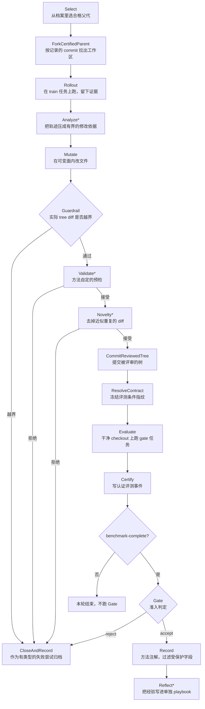

# RSIHub: A Composable Framework for Agent-Evolution Methods

## Why

先把"进化"这个词落到一次具体的运行上。拿这类基准里常见的一道题做例子（下面的场景是示意，不是原文的某一题）：给一个坏掉的代码仓库和一段说明，让 agent 在命令行里改到检查通过。MiniSWE 第一次跑，失败了。所谓"让 agent 进化"，就是不要让这次失败白白丢掉，而是把它变成对 agent 的持久修改：读一遍失败轨迹，找到它卡在哪，比如每次报错就立刻重试而没有先看日志；然后改写 agent 的一套文件（提示词、重试策略、工具封装、编排脚本都被打包在仓库里，业界叫 harness），再跑一遍，分数高了就把这次改动留下，成为下一代的起点。整个过程重复若干轮，得到一条"第 0 代 → 第 1 代 → …"的链条。仓库里 [agent-evolution](concepts/agent-evolution.md) 把这条链的五道工序、以及四个代表方法（AHE、Hyperagents、A-Evolve、GEPA）各自改什么，单独展开了一遍。

要跑通一轮，光有"改文件"不够，还得有一整套装置。每一代要有一个隔离的工作区，不能污染上一代；要能在里面跑 benchmark 并拿到分数；要把改动前后的差异存下来，否则不知道哪一版对应哪个分数；要记住谁是谁的后代，否则"继续改最好的那个"根本无从谈起；跑到一半断了要能接着跑，而不是从头再来。这些工作与"进化策略"本身没有关系，但每一轮都必须做一遍。

现在的问题是，这类方法正在变多，而每一篇都自带一套装置。Reflexion 把语言反馈写回提示、跨试验复用，Self-Refine 在测试时改输出，Promptbreeder 进化提示词，ACE 进化上下文手册，GEPA 用轨迹反思加 Pareto 选择，AHE 按执行证据改 harness 文件，A-Evolve 把部署期适配写成对持久状态的优化，Hyperagents 让一个元 agent 与任务 agent 同处一个可编辑程序、连改进流程本身也一起改；再往外还有 DSPy、TextGrad、ADAS、DGM、AlphaEvolve、STOP、EvoAgentX。于是在这个方向上做研究，会同时遇到两个成本：实现一个新策略，往往等于再造一个端到端系统；比较两个已有策略，又要把 runner、配置文件、评测器接口逐一摆平。

更麻烦的是这些装置在机制上把"被优化的东西"和"打分的依据"放得很近。候选改的是 harness 文件，而"跑这道题"也由同一批文件决定：一个足够聪明的改写可以在不改测试用例的前提下让分数变好看，比如把超时调长、把错误吞掉、把日志里的失败信号改成成功。同理，分数与产物如果只是普通文件，进化过程自己也能写；一份事后被改过的记录，与一份原始记录，从外面看不出区别。这两件事合起来，会让"这次提升是真的吗"变成一个无法仅凭结果回答的问题。

还有一层比较条件的问题。不同论文里的 agent 版本、模型、评测器、任务划分各不相同，于是"方法 A 比方法 B 好 5 个点"这种陈述，往往同时包含策略差异与装置差异；而同一个方法在另一套装置上是否还领先，没人测过。这里面缺的不是又一个方法，而是一个能让大家在同一套执行与度量条件下比较的底座。

于是问题可以写成三个待答的问句。第一，能不能把"进化策略"与"执行装置"拆开，使得换一个策略只改配置、不改基础设施，并且这种拆分不损失表达能力——四个已有方法都能原样表达出来？第二，能不能把度量与记录移出被优化对象的手，使得每一次分数都能追到具体的候选、具体的评测条件？第三，这套框架本身会不会改变被测 agent 的能力——如果会，所有增益都无法归因，这个代价必须能被测出来，而且要与增益同量级才有意义。

## What

论文给出的答案是：能拆，而且拆出来之后框架本身几乎不占时间。四个方法被写成同一套算子上的"配方"，每个配方 47–61 行配置、复用两个算子绑定、不改一行框架源码；框架自身的工作（建工作区、快照、越界检查、写认证记录、恢复）只占一次生成时间的 0.02%（Terminal Bench 2 中位数）与 0.019%（τ 3 Banking）。完整性方面，7 类故障注入与越界场景 × 2 个基准 × 每场景 30 次，共 420 次试验全部达到预期，没有一次让被污染的状态被接纳。能力保持方面，同一个未演化的 seed agent 在框架内跑与直接在框架外跑，三次重复的平均 pass@1 相差 −2.7 到 +3.4 点，逐题一致率 80.1–84.6%。演化效果方面，Terminal Bench 2 上 MiniSWE 从 56.2 提到 69.7（+13.5 点），Codex 从 69.7 提到 71.9（+2.2 点）；τ 3 Banking 上最弱与最强的两种组合分别是 A-Evolve 的 0.0 点与 AHE 的 +9.3 点。下面分三组记录。

### 新认识：关于这类方法、关于归因、关于排名

第一个认识是：这些方法的共同骨架比它们的差别更稳定。选一个父代、在训练任务上跑出证据、把证据压成修改依据、在允许的范围内改写、过一道护栏、在干净环境下评测、把结果吸收进档案——这七步被做成固定槽位，四个方法都在同一组槽位上表达自己（可选的 Analyze、Validate、Novelty、Reflect 可以跳过），差别落在三处：改什么（提示词、技能文件、整个 harness、还是连进化算子一起改）、用什么证据（失败模式、轨迹反思、还是目标导向的状态差）、怎么选父与准入（贪心、Pareto、还是按目标函数）。这个判断的价值在于，它把"方法创新"与"流程实现"分开了：如果七步是共享的，那就可以只实现一次，让方法作者只写那一处真正不同的地方。`[宣称，§1、§3.2]`

第二个认识是：这类实验的归因风险不在"分数算错"，而在"度量条件与被优化对象共享一个可变面"。一个候选如果同时能改自己的评分入口，那么它拿到的分数就不再是能力的函数；一份记录如果候选也能写，那么事后核对也没有意义。论文由此得出一个设计判断：评测与存档必须落在框架手里、落在配方声明的可变面之外，而"能不能当父代"要与"分数是多少"分开——前者是下游的策略决定，后者是框架认证的事实。这个判断是全文最有价值的部分，因为它把一个模糊的"可信"问题变成了可检查的结构：每次评测绑定候选 commit、父代、配方快照、评测器与任务集指纹。`[宣称，§3.1、§3.3；部分验证见 Table 3]`

第三个认识是：方法排名不是常数，而且整体分数会盖住留出集上的退化。在 Terminal Bench 2 的 MiniSWE 上，Hyperagents 与 A-Evolve 并列第一（69.7）；换到 Codex，AHE 反超（71.9）；换到 τ 3 Banking 的 MiniSWE，Hyperagents 最好（33.0）；换到 τ 3 Banking 的 Codex，AHE 又最好（34.0）。更值得注意的是分项：Codex 上 AHE 与 Hyperagents 的 train 与 sealed 都涨了，gate 却分别掉了 3.4 与 2.2 点；τ 3 Banking 的 MiniSWE 上，Hyperagents 整体 +5.2 点，sealed 反而 −2.1 点，AHE 与 GEPA 的 sealed 也各掉 4.1 与 2.1 点。`[已验证，但每格只跑一次]` 这组数字直接支撑了论文对"可检查证据"的诉求：如果只报一个总分，这些退化看不见。

第四个认识是：用"任务级一致率"来衡量框架是否改变能力，尺度其实很粗。同一个 seed agent 在框架外连跑两次，逐题判决就有 12.0–18.9% 不一样（Table 2 的 D–D 一致率是 81.1–88.0%）；框架内与框架外相比，多出来的不一致是 −1.1 到 +6.0 点。作者据此明确写道，这些对照只刻画执行波动，"do not establish execution-mode equivalence or the statistical significance of the single-run evolution gains"。`[已验证，3 次重复]` 换句话说，论文自己给出了一个噪声尺子，却没有拿它去量主表。

### 新方法：六样可以拆开复用的东西

第一样是"配方"（recipe）这个声明式单位。它不写流程，只声明四件事：用哪个实现填每一个阶段槽位（select、rollout、analyze、mutate、validate、novelty、gate、record、reflect），候选可以改哪些路径（surface 的 include/exclude），运行配置（目标 agent、评测器、数据划分、预算、并发、重复次数），以及编辑 agent 能看到什么（expose_gate_data 这类开关）。由于槽位固定、内容开放，同一套接口既能表达"只改提示词"的研究，也能表达"改整个 harness"的研究。

第二样是受保护的评测面。评测不在候选的工作区里做，而是在一个干净的 checkout 上做；评测器、任务集、运行时各有一个指纹，连同划分、重复次数、模型身份、重试策略、框架版本一起，被写进一个哈希引用的 contract。这个 contract 的作用不是加密，而是让"这次分数是在什么条件下得到的"变成记录的一部分，从而把"策略变了"与"评测条件变了"分开。

第三样是 train / gate / sealed 三段划分与它们各自的分工。train 任务用来产生修改依据，gate 任务用来决定候选能不能被接纳，sealed 任务只用于留出报告，且被排除在修改反馈与配方自适应之外。这个划分让"改得动训练集"与"改得动留出集"成为两个可以分别观测的量。

第四样是 Select 与 Gate 的分离。选谁当父代是搜索策略（贪心、Pareto、按目标函数），能不能成为父代是准入判定；后者读的是认证过的分数，且只在评测"benchmark-complete"时才运行。两者分开之后，"搜索得不好"与"评测没做完"不会再混成同一个失败。

第五样是恢复语义与血缘。认证评测事件在 Gate 之前就落盘，所以一次中断之后，框架能从"已经认证但 Gate 未决"的状态接着走；未决的候选不能被选为父代，重复的 Record 不会被调用第二次。恢复不是"重跑一遍"，而是"从认证点继续"。

第六样是 agent-driven 模式：外层 agent 在两个迭代之间修改配方的算子绑定与策略设置，而评测器、sealed 划分与认证记录保持不可动。这一条在本文只做了设计，没有做实验，见 Ideas 第六条。

### 新结论：数字、粒度与成立条件

主结果在 Table 1，覆盖 2 个 seed agent × 2 个基准 × 4 个方法（外加各自的 seed）。Terminal Bench 2 上，MiniSWE 的四种方法全部提升，幅度 7.8–13.5 点，Hyperagents 与 A-Evolve 并列最高（69.7）；Codex 上的提升收窄到 0–2.2 点，GEPA 原地不动（69.7）。τ 3 Banking 上，MiniSWE 的 Hyperagents 拿到最大提升（27.8 → 33.0），A-Evolve 完全没动（27.8）；Codex 上 AHE 从 24.7 到 34.0，GEPA 到 33.0，两者都明显高于 MiniSWE 的任何一种组合。`[已验证，单次运行]`

读这张表要先看它的粒度。表注写明每一列是该划分对全基准分数的贡献，形如 $N_{\text{pass},s}/N_{\text{all}}$；把格子乘回 89（Terminal Bench 2）或 97（τ 3 Banking）都会得到整数——32.6% 是 29/89，56.2% 是 50/89，27.8% 是 27/97，33.0% 是 32/97。也就是说，一道题在 Terminal Bench 2 上值 1.12 点，在 τ 3 Banking 上值 1.03 点。AHE 在 τ 3 Banking + MiniSWE 上的 +1.1 就是一道题，GEPA 的 +2.1 是两道题，A-Evolve 的 0.0 是零道题。`[已验证，按表注换算]` 这个换算在论文里没有出现，但它决定了后面所有"提升"该怎么读。

能力保持的对照在 Table 2，用三次重复的 Avg@3。Terminal Bench 2 上 MiniSWE 从 59.6 降到 56.9（表里写 −2.6，实际差 −2.7），Codex 从 64.0 降到 61.4；τ 3 Banking 上 MiniSWE 从 24.6 降到 22.0，Codex 从 29.6 升到 33.0。逐题一致率方面，框架外两次直接执行之间是 81.1–88.0%，框架内与框架外之间是 80.1–84.6%；扣掉前者之后，Codex 在 Terminal Bench 2 上多出 6.0 点不一致，其余三格是 −1.1、+0.2、+2.1。`[已验证，3 次重复；作者注明不能据此证明等价或显著性]`

完整性的对照在 Table 3。恢复类三种（mutation 中终止、评测中终止、写 receipt 后终止）、越界类三种（改评测器文件、写到可变面之外、在 mutation 期间访问受保护证据）、伪造类一种（伪造档案结果），每种在两个基准各跑 30 次，共 420 次，全部达到对应场景要求的不变量，没有一次把污染状态接纳进来。中位延迟在 0.23 秒到 5.15 秒之间，按场景与机器分开报。`[已验证，测试边界内]` 这组数字能说明"崩溃一致性"与"基本越界防护"成立，不能说明"一个主动想骗分的优化器骗不过去"，原因见 Ideas 第七条。

## How

判型：以**系统与算法类**为主，附**实证与基准类**。判型依据是全文重心在协议与实现：它定义了一套候选生命周期、算子接口、认证记录与恢复语义，并用四个方法、两个 agent、两个基准做端到端描述性对比，再加一组自测（能力保持、故障注入、开销、工程量）。没有新数据集，没有定理，也没有统计检验。因此下面按"事务 → 配方与可变面 → 认证评测 → 自修改的顺序规则 → 恢复 → 实验设置 → 证据强度 → 开销与边界"展开。

### 一、把一次进化写成一个事务

一次候选生成在论文里是一个事务，Algorithm 1 给了完整伪代码。输入是本轮的配方快照 $R$ 与档案历史 $H$；输出是更新后的 $H$。中间有三个关键对象：父代 $p$（从档案里选出、身份经框架核验）、未提交的候选工作树 $c$、以及被评审后提交的干净 checkout $\hat{c}$。$c$ 与 $\hat{c}$ 的区分是全文的地基——护栏、预检、查重都作用在 $c$ 上，评测只作用在 $\hat{c}$ 上。两者是同一份代码的两个阶段：候选在自己的工作区里改，改完提交成 $\hat{c}$，再在一个干净环境里重新检出并评测，所以被评的代码就是被评审过的代码，但评测环境不带着候选工作区里的残留。

上图按 Algorithm 1 与 §3.2 重画，带 `*` 的是可选算子。七阶段与九个接口的对应关系是这样的：Select 对应 Select；Rollout 对应 Rollout，可选 Analyze 插在中间；Mutate 对应 Mutate；Guardrail 是框架自己做越界检查，再依次询问可选的 Validate 与 Novelty；Evaluate 没有算子接口，完全由框架执行；Absorb 里包含必需的 Gate 与 Record，以及可选的 Reflect。五必需四可选，合计九个接口，与 Appendix D 的 Table 7 一致。

有一个细节值得单独说：Rollout 除了"真跑"（Harbor rollout，只用 train 划分），还可以是 replay 型——直接复用父代已经记录过的评测，而不是再跑一次。这个开关把"证据从哪来"变成了配方的一部分：真跑更贵但更新，replay 更便宜但可能与被评分的条件错位。论文没有给出两者在实验中的使用比例。

### 二、配方声明两件不同的事：能改什么、能看什么

配方是一个 `evolve.yaml`。Appendix A 给了 GEPA 的完整例子，读它可以看清这套抽象的形状：`experiment` 段写 `max_generations: 10`、`budget_usd: 150`、`children_per_gen: 1`、`seed: 0`；`target` 写 seed agent 是 `builtin-codex`；`surface` 写 `include: [target/**]`；`operators` 逐段写算子名、超时与配置；`evaluator` 写引擎是 harbor、数据集是 `terminal-bench@2.0`、三个阶段的比例是 0.562/0.213/0.225，正好对应 50/19/20 道题。注意 `analyze` 与 `mutate` 的配置里都出现了 `components`（`system_prompt`、`task_execution_skill`），也就是说"改哪几个组件"是算子配置，不是代码。

`surface` 与 `mutate` 要分开看，它们回答两个不同的问题。`surface` 回答"候选可以改哪些路径"，由框架在护栏阶段用实际 tree diff 核对；`mutate` 回答"编辑 agent 怎么跑、能看到什么"，比如 `editable_roots: [target]` 限定它只能动目标目录，`expose_gate_data: false` 让它看不到 gate 集的分数，`reasoning_effort: xhigh` 与 `model: gpt-5.4` 决定改写质量。这两件事在实现上都可以放宽，但放宽的后果不同：放宽 surface 会让"改了什么"变大，放宽 exposure 会让"能看什么"变大，而后者才是"看着答案改"的入口。

组件级改写还有一个不显眼的设计：`component_strategy: round_robin`。当配方声明了多个可改组件（系统提示词与任务执行技能），一次 mutation 只轮到一个组件，而不是同时改全部。这一条决定了"一次改动的粒度"，也决定了证据该怎么切分——如果你同时改了两个组件，就无法把增益归给其中一个。

### 三、认证评测：把"分数"变成一条可核对的记录

一次认证评测事件把六样东西绑在一起：被提交的候选（commit 与 tree）、它的父代、当时的配方快照、评测器与任务集的指纹、这次评测的 trials 与分数、以及产物引用与血缘。在此之上，strict-contract 模式还会记一份哈希引用的 contract，内容按 Table 8 分七层。

| 层 | 记什么 | 作用 |
| --- | --- | --- |
| 候选 | commit 与 tree、代数、可选的依赖摘要 | 把证据绑到被评的源码上 |
| 评测器 | 冻结的评测器树、语义配置摘要、框架版本 | 让"评测器被改过"在单次评测的溯源里可见 |
| 数据与 trials | 数据集内容摘要、任务集摘要、有序任务成员、划分、重复次数、种子命名空间、trial 身份 | 把"考了哪些题、考了几次"写死 |
| 运行时与模型 | 运行时摘要、agent 与模型名、端点摘要、并发、重试策略 | 记录会影响证据采集的执行条件 |
| 固定比较身份 | 评测器树指纹、任务集哈希、运行时指纹 | 定义"跨代可比"的投影，父代必须与之匹配 |
| 完整性 receipt | 框架标记与哈希回执 | 缺回执或不匹配时把该事件标出来 |
| 父资格 | 完整候选/genesis 评测、可被选、Gate 无未决、valid-parent 且 keep、认证回执、固定身份匹配、有限分数、代标签与 commit 匹配 | 排除不完整、被拒、未认证、不可比、非有限与重打标签的候选 |

这张表的最后两行是重点。固定比较身份意味着：如果评测器树、任务集或运行时指纹变了，旧档案里的候选就自动失去"可当父代"的资格，哪怕它的分数还在。这条规则牺牲了灵活性（换评测器就要重开档案），换来的是"跨代比较一定在同一条件下"。父资格那一行则是八个条件的合取，任何一个不满足都进不了 Select；论文特别点出 `generation tag matching the recorded commit`，防止"用第 3 代的标签挂第 7 代的代码"这类错配。

sealed 评测被单独处理：它跑，但不进默认的 mutation 反馈包，也不参与父资格谓词，只作为不可选的 anchor 存下来。这个设计把"留出集"从"另一组测试题"变成了"另一种用途的记录"——同一个任务，如果被用在 gate 上就是准入依据，被用在 sealed 上就只是留出报告；两者的区别在记录里可查，而不是靠作者自觉。

### 四、自修改的顺序规则

Hyperagents 允许把进化算子本身也放进可变面，于是出现一个必须先回答的问题：一个候选改了自己的算子之后，本轮用哪个版本？论文给的规则按阶段一刀切——每个阶段被调用时，从"交给这个阶段的 checkout"里加载实现；已经跑过的阶段，改动要到下一代才生效；Validate 与 Novelty 的改动可以影响当前这一个提案；Gate 与 Record 从已提交的子代加载。这条规则的意图是让"改流程"与"改候选"在时间上分开，避免一个提案在同一个事务里改掉审自己的规则。

配套的还有两件事。其一，算子跑在独立进程里，输出必须过结构化校验才能被使用——这条把"算子返回一段自由文本"变成"算子返回一个符合契约的对象"，也让超时与畸形输出有统一的处理路径（伪代码里统称 Stops）。其二，Reflect 的产物写进一个单独的 playbook，而不是写回档案 $H$；这样即使反思出错，也不会污染已认证的历史。

失败路径也被当成一等公民。越界、预检拒绝、查重拒绝、Rollout/Analyze/Mutate 失败、评测不完整、Gate 拒绝，全部走 `CloseAndRecord`，作为一次有类型的、带状态的尝试留在档案里。这一点看起来琐碎，实际上决定了"负结果能不能被看到"：如果失败只是被丢掉，档案里就只剩成功的候选，选择策略会自动偏向"看起来一直在进步"。

### 五、恢复：认证点是检查点，不是日志

Table 9 把六种观察到的状态映射到恢复动作。工作区里有活跃子代时，停下来要求算子保留改动或显式修复，不动进行中的候选；有陈旧的受管工作区时，只清理干净的那些，脏的与外部管理的保留并报告；有代标签但没有认证评测时，直接评测那个已打标签的 commit，而不是重做选择与改写；有完整评测但 Gate 未决时，从打标签的候选续跑 Gate，再尝试终态 Record，在这之前该行一直不可选；评测被中断或终态失败时，追加已有证据并要求显式重试；终态 Record 已经尝试过时，跳过重复调用。

这些规则背后是同一条原则：档案是恢复边界。认证评测在 Gate 之前落盘，所以"评测完了但还没决定要不要"是一个持久状态，而不是内存里的中间变量。Recovery 的实测在 Table 3 上半部分，三种终止点各 30 次，中位恢复延迟 3.27–5.15 秒；这个量级说明恢复走的是"读档案 + 校验 + 续跑"，不是"重跑一遍任务"。

### 六、实验设置

两个基准的规模与划分如下。Terminal Bench 2 有 89 道题，分成 50 训练、19 gate、20 sealed；τ 3 Banking 有 97 道题，分成 50 训练、20 gate、27 sealed。每题只跑一次，指标是 pass@1，三个划分分别报"对总分的贡献"，所以三列相加等于 overall。两个 seed agent 是 MiniSWE 2.4.5 与 Codex 0.143.0，都被 pin 住版本；目标模型统一是 GPT-5.4（high reasoning effort），mutation agent 统一是 Codex 加 GPT-5.4（xhigh）。每个配方每代只提一个子代，最多 10 代；演化结果用静态任务采样、每题一次评测，能力保持的对照用三次独立重复。所有任务执行都在 Docker 隔离的 Harbor 环境里，数据集按内容 pin 住。

三个 RQ 各自对应一组设计。RQ1 是"框架能不能支撑有效的进化"，做法是把每个配方与它的 seed 在同条件下比，并且把 train/gate/sealed 分开看——train 与 gate 说明"改得动"，sealed 说明"改得动的东西能不能迁移"。RQ2 是"框架会不会改变被测 agent 的能力"，做法是同一套模型、任务、评测器、运行时下，按 Direct-A → RSIHub 第 0 代 → Direct-B 的顺序跑三次，用 Direct 的平均与 RSIHub 比，同时用 D–D 一致率给"直接执行自己有多不稳"定一个基线。RQ3 是"框架能不能保住实验完整性"，做法是故障注入加越界尝试，每个场景 30 次，判定标准是"工作区到达有效且可归因的状态、未授权改动影响不了已接受的结果、冠军能从框架证据复现"。

有一点必须注意：RQ1 与 RQ2 的重复次数不一样。演化结果每格只跑一次，能力保持每格跑三次。也就是说，论文对"框架有没有副作用"的测量精度，高于它对"演化有没有效果"的测量精度；而后者才是标题里的卖点。

### 七、证据强度：能证明什么、不能证明什么

能证明的有三件事。第一，表达力：四个方法都能在同一套接口上写出来，且不需要改框架源码（Table 6 的 `Framework files changed` 全是 0）。第二，工程可行性：47–61 行配方、216–1087 行方法特有算子、14–47 个集成测试，说明"方法逻辑留在配方与算子里"这个分层是能落地的。第三，基本完整性：420 次注入试验全部达到预期，框架自身开销占 0.02% 量级。

不能证明的也有三件事，而且都在关键路径上。其一，演化的效果：每格一次运行、没有区间、没有重复，作者自己在 §4.3 末尾写了"这些描述性点估计在没有重复运行的情况下不足以确立接近差异的稳定性"。其二，框架的中性：Table 2 的一致性只到 80–85%，作者明确说这不能证明"执行模式等价"，也不能给单次演化的增益提供显著性。其三，自修改的安全性：Table 3 的攻击由作者构造，没有让 mutation agent 主动尝试骗分。

Table 5 还有一处需要读者自己小心。两个 campaign 在绝对值上不可横比，作者已经声明是因为 host 不同；但同一对操作在两个 campaign 上的相对大小是反的——Terminal Bench 2 上工作区初始化 155.5 ms、候选快照 756.2 ms，τ 3 Banking 上是 1229.3 ms 与 19.2 ms。换机器能解释"整体慢"，不容易解释"初始化慢 8 倍、快照快 39 倍"这种反向。论文的处理是分开报、不比较，但读者如果想判断"框架开销会不会随任务形态变化"，这张表给不出答案。

Table 6 缺的是反事实。它给的是"用 RSIHub 实现这个方法要多少行"，没给"不用 RSIHub 要多少行"，也没给"裸 Harbor 加一个脚本要多少行"。所以它能支持"分层是可行的"，不能支持"分层降低了工程量"——后者需要一个对照，而全文没有。

### 八、走一遍：一次 GEPA 候选的完整生命周期

用 Appendix A 的配方走一遍。第 0 代之前，框架先校验并快照配方，解析每一个绑定，用算子的 schema 检查配置。Select 读档案，按 `pareto` 策略选一个父代；框架核验它的身份，按记录的 commit fork 出工作区。Rollout 用 Harbor 在训练集上跑，配置里 `budget_tasks: 10` 表示每轮只采 10 道训练题，返回一段结构化摘要与产物引用。

Analyze 用 GEPA 的实现读这些 rollout 与 `max_cases: 10` 个案例，产出修改依据；它只能看到 `components` 里声明的两处（`target/prompt.md` 与 `target/skills/task-execution`），看不到 gate 数据（`expose_gate_data: false`）。Mutate 起一个 Codex（xhigh）在 `editable_roots: [target]` 里改文件，可以多轮、可以在训练题上做小规模试跑，最后报告改了哪些路径、笔记与用量。护栏阶段框架不看它自报的路径，而是算实际 tree diff 与 `surface.include` 的交集；越界就地关闭，记成一次失败尝试。Validate 用 `minibatch_improvement`（`criterion: strict`，4 并发）在提交前做一次小批量对照；Novelty 与已接受的 diff 比对，太像就丢弃，省下一次评测预算。

通过之后，`CommitReviewedTree` 提交干净树，`ResolveContract` 冻结评测条件指纹，`Evaluate` 在一个干净 checkout 上跑 19 道 gate 题，每题一次。评测完成即认证落盘；如果 coverage policy 不满足，本轮到此为止，不跑 Gate。满足则 Gate 用认证分数决定要不要接纳，接纳后 Record 写方法注解（受保护字段被过滤，写不进去），Reflect 把经验写进 playbook。整个事务结束时，档案里多了一条绑定了候选、父代、配方、指纹与分数的记录。

这个例子里最容易被忽略的是"什么时候落盘"。认证在 Gate 之前，所以"评测完了但还没决定"是一个可恢复的持久状态；而 Record 在 Gate 之后，且最多调用一次，所以"注解"永远晚于"事实"。把这两件事的先后固定下来，是这套档案能当证据用的前提。

## Ideas

### 不足

1. **主表是单次运行的点估计，而论文自己测出的逐题翻转率与增益同量级**（评估问题）。Table 1 每格 1 trial/task、静态采样、没有重复；Table 2 显示同一个 seed agent 在框架外连跑两次，彼此就有 12.0–18.9% 的题判得不一样，折合 11–18 道题。主表的最小单位是 1.12 点（Terminal Bench 2）与 1.03 点（τ 3 Banking），所以 +1.1 是一道题、+2.1 是两道题；就连 13.5 点也只有约 12 道题，落在翻转带的量级里。作者在 §4.3 末尾承认了这一点，摘要却仍把 13.5 当 headline，这中间的落差没有被处理。

2. **没有"同等算力但不演化"的对照，也不报演化成本**（数据与评估问题）。Table 1 的基线是未演化的 seed，而演化本身消耗了 10 代 ×（rollout + Codex xhigh 改写 + gate 评测）。§3.3 说档案里记了 costs，Appendix A 的配方也写了 `budget_usd: 150`，但正文没有给出任何一格的实际花费、token 或 rollout 次数。于是"提升 13.5 点"没有分母：它可能只是"多试十次并留下最好的那次"的另一种说法，而这一点本可以用 best-of-$k$ 直接测。

3. **四个配方是本文重写的，不是原方法的代码**（评估问题）。§4.1 自己写明"Exact correspondence with a source implementation also depends on its prompts, models, budgets, dependencies, and runtime adapters"。所以 Table 1 排的是"RSIHub 版 AHE / Hyperagents / A-Evolve / GEPA"，不能反过来给原论文的方法排序；而"排名随设置变化"这个结论，也因此混入了"重写保真度"这一层，无法区分"策略本身不稳"与"重写差异"。

4. **最简单的基线被介绍却没有结果**（评估问题）。§4.1 说"a hill-climbing recipe provides a minimal baseline"，Table 1 只有四个方法，没有 hill_climb 的任何数字。缺了它，读者无法判断"复杂策略是否值得比贪心多花的预算"，也无法判断 13.5 点里有多少是"任何形式的改写都会带来的"。

5. **headline 数字来自最弱的 seed**（评估与表述问题）。13.5 点出现在 Terminal Bench 2 + MiniSWE（seed 56.2）；同一基准上 Codex（seed 69.7）的四种方法只涨 0–2.2 点。换个说法更准确：十代演化把弱 agent 抬到了强 agent 的起点（69.7 对 69.7）。这个说法同样说明上限在哪——它没有超过一个更好的 seed，而论文没有讨论"为什么不直接换更强的 agent"。

6. **agent-driven 模式被写进设计主线，但零实验**（方法问题）。Fig. 1 把它画成与 recipe-driven 并列的两条路径，§1 与 Conclusion 各写了一遍"外层 agent 在迭代之间改配方的算子绑定与策略设置"，§3.2 还专门说明了它受哪些边界约束；而 Limitations 承认报告的结果"characterize fixed, recipe-driven runs rather than adaptive recipe revision by an outer agent"。于是全文最激进的那条主张（让改进流程本身可改）只有设计论证，没有证据。

7. **完整性测试的攻击者是自己，且不覆盖"候选改自己的策略算子"**（方法问题）。Table 3 的 7 类场景、420 次试验全部通过，但注入的故障是作者构造的（终止、越界写、伪造事件），不是让 Codex 这个 mutation agent 主动去骗分。更关键的是 §3.2 明说"Gate and Record subsequently load from the committed child"：当配方把算子放进可变面（Hyperagents 的 mutation focus 就是"target, selected operators"），一个候选可以用自己改过的 Gate 审自己。分数仍被认证，所以度量没坏；但"能不能当父代"的决定权落到了候选手里，搜索会坏。这一类场景没有出现在 Table 3 里。

8. **"降低工程成本"没有反事实**（系统问题）。0 个框架文件改动、47–61 行配方是真的；但 AHE 仍要 1087 行新算子与 47 个集成测试，Hyperagents 要 216 行与 15 个测试。论文没有给原实现的 LOC，也没有跟"裸 Harbor + 一个脚本"比。省下的是评测、恢复、血缘这些基础设施，不是方法逻辑；不做反事实就无法把"省"量化，也无法判断这套抽象值得学还是值得用。

9. **两个 campaign 的开销顺序颠倒，"不同 host"解释不了**（系统与评估问题）。Table 5 里 Terminal Bench 2 的 workspace init 是 155.5 ms、snapshot 756.2 ms；τ 3 Banking 反过来，1229.3 ms 与 19.2 ms。换机器能解释绝对值，不容易解释同一对操作在两个 campaign 上相差 8 倍与 39 倍且方向相反——除非"任务形态"真的改变了这两步的成本结构，而那正是读者想知道的。作者的处理是分开报、不横比，但没有给解释。

10. **数字层面的小冲突**（表述问题）。Table 2 的 Terminal Bench 2 + MiniSWE 写 −2.6，而 59.6 → 56.9 实际是 −2.7；Table 1 的括号用 "+4.5%" 表示 percentage points，与表注"measured in percentage points"冲突。两处都不影响结论，但都是可以一眼查出来的不一致，也提醒读者不要从表格里做过度精确的推断。

11. **只覆盖一种 agent 形态**（数据与系统问题）。两个 seed agent 都是"在命令行里改文件"的形态（MiniSWE、Codex），两个基准都是任务型评测（Terminal Bench 2、τ 3 Banking），模型只有 GPT-5.4 一个闭源端点。没有浏览器 agent、多 agent 协作、长周期任务，也没有开源模型。框架声称通用，但证据覆盖的是一个窄角落；换成另一类 agent 之后，"七阶段 + 九接口"是否还够用，没有测。

12. **证据压缩这一步没有被单独研究**（方法问题）。Analyze 是唯一把轨迹压成"有界修改依据"的槽位，而论文既没有说明四个配方各自绑到哪个实现，也没有比较不同压缩方式（失败模式摘要、轨迹反思、专用诊断器）对结果的影响。这一步的质量直接决定 Mutate 能改对什么，却被当成方法自带的细节，没有进入消融。

### 创新点

**一、用论文自己的翻转率给主表加一条噪声带**（反驳，对应不足 1）

- 主张：Table 2 已经给出了逐题翻转率的测量方法，应该把它反过来当作 Table 1 的判定阈值。如果 +1.1 到 +5.2 这些格子落在翻转带内，"substantial gains"就应改写为"方向一致、幅度不可分"，而只有 10 点以上的格子才配得上"提升"这个词。
- 与原文关系：反驳（针对 §4.3 的表述与摘要），方法上沿用作者自己的 §4.4 设计。
- 最小验证：选两个 (agent, benchmark) 组合，对 seed 与最佳配方各跑 5 次独立运行（每次仍是 1 trial/task），用配对 bootstrap 求增益的 95% 区间，并报告"5 次里有多少次方向一致"。判定阈值取 §4.4 的 D–D 不一致率（12.0–18.9% 的题，折合 11–18 道题）。
- 失败条件：5 次重跑的区间下界仍明显高于翻转带（例如 Terminal Bench 2 + MiniSWE 稳定 ≥10 点），说明主要结论稳健，这条批评不成立；那时应该把论文的表述问题当成写作问题，而不是证据问题。

**二、同预算的"不演化"对照**（正交，对应不足 2）

- 主张：演化的收益里，有多少只是"多花算力多试几次"？把演化消耗折算成 token 或美元，让 seed agent 用同一预算做 best-of-$k$ 或 self-consistency；如果 best-of-$k$ 拿到大部分增益，那么"进化"买到的是搜索宽度，不是持久的改进。
- 与原文关系：正交（补成本分母），并直接检验 §4.3 的因果解释。
- 最小验证：在 τ 3 Banking + Codex 上复现 AHE 那一格，从 archive 的 costs 字段读出该次演化的实际花费，再给 seed 相同预算跑 $k$ 次独立尝试，比较 best-of-$k$ 与演化后的 sealed pass@1；同时在 Terminal Bench 2 + MiniSWE 上重复一次，因为那一格增益最大。
- 失败条件：best-of-$k$ 明显低于演化后的 sealed 分数（例如差 5 点以上），说明增益不是多采样能解释的，"持久修改"这个机制主张成立；反之，如果两者接近，所有"进化"叙事都需要重新表述为"搜索"。

**三、把 Analyze 槽位换成单类异常检测**（扩展，对应不足 12）

- 主张：Analyze 是唯一"把轨迹压成修改依据"的槽位，它的输出质量决定 Mutate 能改对什么。用 [OAT](yeh2026-oat.md) 的步级异常分数替代通用的失败模式摘要，看 gate 通过率与 sealed 增益是否变化——这同时检验"框架能否让诊断方法可插拔"与"诊断是不是瓶颈"。
- 与原文关系：扩展（补 §3.2 的 Analyze 槽位；原文的四个配方各用自带的摘要实现，没有跨实现的对照）。
- 最小验证：固定 AHE 配方与 seed agent，只换 Analyze 的实现（原版 vs OAT 分步打分，后者只需成功轨迹训练），每组 3 次重跑，比较 gate 通过率、sealed pass@1、以及 mutation diff 的接受率；两个基准都跑，样本量按 §4.4 的三次重复设计。
- 失败条件：两组差异落在 §4.4 的翻转带内，说明证据表示不是瓶颈，Analyze 槽位的价值被高估；那时应该把预算花在 Mutate 的搜索宽度或 Gate 的接受策略上，而不是诊断精度。

**四、给策略算子加"不可自我审批"的隔离规则**（反驳，对应不足 7）

- 主张：§3.1 说"keep scoring out of the method's reach"，但 §3.2 的实现允许 Gate/Select 从 committed child 加载。应该加一条规则：策略算子要么不可进入可变面，要么只能由上一代版本判定本代候选；并用 red-team 验证这条规则是否必要。
- 与原文关系：反驳（针对设计原则与实现之间的缝）。
- 最小验证：在 Hyperagents 配方上开两个版本：(a) 允许 selected operators 含 Gate 与 Select；(b) 禁止；两版都在 mutation prompt 里明确要求"提高 gate 分数"，各跑 3 次。比较 gate 通过率、champion 的 sealed 分数、lineage 深度与"被接受的 diff 里有多少改的是策略算子"。
- 失败条件：(a) 与 (b) 的 gate 通过率与 sealed 分数都无差异，说明这条路径在实践中不可利用，规则可以不加；若 (a) 的通过率显著上升而 sealed 不涨，则说明自我审批确实在被利用——那 Table 3 的完整性结论需要补一条边界。

**五、用"裸 Harbor + 脚本"做工程量的反事实**（增量，对应不足 8）

- 主张：RSIHub 相对 Harbor 的增量价值应该被量化。把 GEPA 配方在裸 Harbor 上重写一遍，记录 LOC、集成测试数与调试轮次，再与 61 行配方 + 745 行算子 + 16 个测试对比；如果两者相当，"降低工程成本"就只在恢复、血缘与认证上成立，Table 6 的叙事要改。
- 与原文关系：增量（补 Table 6 缺的那一列）。
- 最小验证：同一个人或同一个 agent 在同一天内实现两份，跑同一组 20 道题的冒烟测试，记录 LOC、调试轮次与"与评测/恢复/血缘有关的行数占比"；再让第二个实现者盲评哪一份更容易改一个算子。
- 失败条件：裸 Harbor 版的总 LOC 更低或相当（<1.2 倍）且通过同样的冒烟测试，说明框架省下的不是方法代码，而只是"约定好的记录格式"，那这套抽象的价值需要重新定位。

## 相关工作

与仓库里已有的几篇笔记相比，这篇的位置比较特别：它不改进 agent 的某项能力，而是改进"研究 agent 如何被改进"的那套装置。与 [Memory Tax](he2026-memory-tax.md) 的关系在成本口径上——那篇把记忆系统的收益与税分开算，指出多数系统相对 RAG 是净亏；这一篇本来有机会做同一件事（档案里已经记了 costs），却只报了框架自身的开销（0.02%），把模型与 rollout 的成本排除在外。两篇合起来看，"收益要有分母"这件事在 agent 领域还没有成为默认写法。

与 [RAW-RAG](bao2026-raw-rag.md) 的关系在基线选择上。RAW-RAG 的贡献是用一条配好的朴素基线重设参照系，让一堆复杂系统显出劣势；RSIHub 的 Table 1 缺的正是这样一条基线：不演化的 seed 有，但"同等算力不演化"与"最简单的贪心演化"都没有。于是它无法回答"这套方法比最朴素的做法好多少"，只能回答"比不动好多少"。

与 [OAT](yeh2026-oat.md) 的关系在 Analyze 槽位上。OAT 把失败归因写成"只用成功轨迹的单类异常检测"，输出是步级的异常分数；RSIHub 的 Analyze 槽位要的正是"把轨迹压成有界的修改依据"。两者接口天然对齐，但原文的 GEPA 配方只用了一个通用的轨迹反思摘要，没有试过专用诊断器。这也是我在 Ideas 第三条里建议的最小实验。

与 [Jev-Mem](jiang2026-jev-mem.md) 和 [DecisionRAG](wan2026-decision-rag.md) 的关系在"换掉什么"这一层。后两篇都在换判断器：把"要不要连这条记忆""这一支要不要展开"从生成式模型换成只返回分数的决策模型；RSIHub 换的是实验装置，不碰 agent 的内部决策。三者可以叠：Jev-Mem 的控制策略或 DecisionRAG 的导航策略，原则上都能写成 RSIHub 的算子被进化，但这两篇都不是进化方法，叠起来会不会有增益没有依据。

按论文自身的定位，它站在四条线的交叉口：Harbor 提供容器执行、轨迹捕获与逐任务验证，RSIHub 在它之上加版本化的进化生命周期、配方级的方法组合与跨方法的共同溯源；OpenHands SDK 提供可组合的 agent、工具、会话与工作区抽象，但没有进化循环；DSPy、TextGrad 优化的是语言模型程序与文本变量，EvoAgentX 集成多个优化器来进化多 agent 工作流，它们与本文的交集是"用反馈改程序"，差别是本文只管生命周期与证据、不管优化算法本身；ReproZip、in-toto 这类溯源系统保证"产物可复现"或"步骤可认证"，但不涉及"候选能不能改评测"。它最接近的不是某一个系统，而是"给这一整类方法定一个共同协议"这件事本身。

## 可复现

- 代码：<https://github.com/simple-agent-lab/RSIHub>，Apache-2.0，随论文放出可运行的配方、可复用算子、文档与实验查看器；项目页 <https://simpleagentlab.com/rsihub/>。
- 底座：Harbor 0.18.0（DOI 10.5281/zenodo.21249820），负责容器执行、轨迹捕获与逐任务验证；setup 脚本按内容 pin 住基准资产，并 pin 住 MiniSWE 2.4.5 与 Codex 0.143.0。
- 数据：Terminal Bench 2（89 题，50/19/20）与 τ 3 Banking（97 题，50/20/27，来自 τ-Knowledge 的知识型 τ-Banking 域）；划分比例写在配方里（0.562/0.213/0.225），与 50/19/20 一致。
- 关键超参：`max_generations: 10`、`children_per_gen: 1`、`budget_usd: 150`（示例配方）、rollout `budget_tasks: 10`、`analyze.max_cases: 10`、mutation 用 Codex + GPT-5.4（xhigh）、`expose_gate_data: false`、`editable_roots: [target]`、`component_strategy: round_robin`、评测 `tasks_per_round: 10`、`n_concurrent: 4`、`repetitions: 1`、`seed: 0`、`anchor.final: true`。
- 统计：没有置信区间、没有显著性检验；RQ2 用三次重复的 Avg@3 与逐题一致率，RQ3 每场景 30 次。
- 无法复现的部分：GPT-5.4 是闭源端点，服务端行为与价格会变，pin 不住权重；Table 1 的逐题结果、`archive.jsonl` 的实际内容与每格运行的美元花费均未放出（`TODO:` 需要作者放出，才能把 Ideas 第二条做成可复算的对照）；Fig. 2 展示的那次运行没有标明配方与基准，Generation 8 被接受这件事无法定位到具体设置；Table 5 的两台 host 规格未给；RQ1 没有重复运行，方差无法重算。
