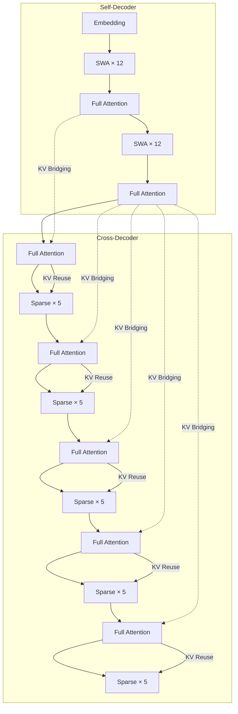

# HySparse2: Hybrid Sparse Attention with Two-Level KV Sharing

## Why

长程 agent 的推理负载有一个很具体的形状：模型每次只生成很短的行动或工具调用，但工具返回的搜索结果、执行日志、文档可能很长。多轮下来，上下文里大部分 token 是"观察"，不是"行动"。这些观察必须被 prefill 进模型，必须存进 KV-Cache，而且在后续轮次里必须能被准确检索。prefill 是把整段输入一次算完的阶段，decode 是逐 token 生成的阶段；KV-Cache 是 prefill 时为每个 token 存下的键值状态，decode 时直接复用，不必重算整段上下文。于是三个成本同时上升：prefill 算力、KV-Cache 显存、长上下文检索的难度。`[§1]`

已有的 HySparse 用"全注意力层 + 稀疏注意力层"交替的结构来省算力：每个全注意力层把自己的 KV-Cache 和 top-$k$ 选择索引传给后面的稀疏层，稀疏层只读被选中的 KV。这样不需要额外的索引器，也不需要蒸馏，注意力和 KV 存储都能降。但它有两个上限。第一，prefill 仍然要跑完所有层，因为每一层都要参与前向；第二，block-level 稀疏在多轮 agent 任务上不够细，选中一个 64-token 块只为保留其中一个关键 token，会把预算浪费在邻居上。`[§2.1, §2.3]`

YOCO 提供了另一条思路：把模型分成 self-decoder 和 cross-decoder，cross-decoder 的 KV-Cache 从 self-decoder 的隐藏状态构造，prefill 可以在 self-decoder 结束后直接退出。但 YOCO 的 cross-decoder 仍然是全注意力，没有和稀疏注意力结合；而且如果 cross-decoder 里保留一个独立的滑动窗口注意力（sliding-window attention, SWA）分支，这个分支需要从自己的隐藏状态构造一段后缀 KV，prefill 就无法真正跳过 cross-decoder。`[§2.1, §3.3]`

把两条线接起来，问题就变成：能不能在 HySparse 的稀疏结构上再加一层 YOCO 式的跨层 KV 共享，让 prefill 只跑一半的模型？加了之后，长上下文检索的质量会不会掉？token-level 稀疏能不能在同样的注意力预算下比 block-level 更准？能不能用一个"强制最近窗口"替代独立的 SWA 分支，从而让 early exit 成立？这些改动在 80B-A3B 这种规模上，算力和 KV 存储到底能省多少，质量代价是什么？`[§1, §3]`

## What

先交代任务。输入是一段长上下文（多轮 agent 轨迹、工具返回、文档），输出是下一个 token 的分布；模型是一个 80B-A3B 的混合专家（mixture-of-experts, MoE），49 层，hidden size 2048。HySparse2 要改的是注意力的组织方式：哪些层做全注意力、哪些层做稀疏注意力、KV-Cache 怎么在层间共享、prefill 能不能提前退出。边界是：只做语言模型预训练与后训练，不做端到端 serving 延迟测量，不训练视觉或多模态，不改变 MoE 结构。`[§3, §4.1]`

论文的答案是：可以。HySparse2 在两层上做 KV 共享。外层叫 **KV Bridging**：self-decoder 和 cross-decoder 只在全注意力层之间建立连接，cross-decoder 的全注意力层用自己的 K/V 投影，从对应 self-decoder 全注意力层的隐藏状态构造 KV；这样 cross-decoder 的所有 KV 都可以从 self-decoder 的隐藏状态得到，prefill 可以在 self-decoder 结束后退出。内层叫 **KV Reuse**：每个混合块里的稀疏层复用全注意力层的 KV 和选择索引。两个细化是 token-level 稀疏和"强制最近窗口"：稀疏层不再保留独立的 SWA 分支，而是把最近的 128 个 token 强制塞进稀疏选择。`[§3.1–§3.3]`

在 80B-A3B 上，后训练之后 HySparse2 相对 HySparse 的平均 MRCR-v2 提高 11.30 个百分点、RULER-v2 提高 19.81 个百分点；256k 上下文的 RULER-v2 是 58.45，HySparse 是 32.61，Hybrid SWA 是 35.74。1M token 时，prefill 的浮点运算次数（FLOPs）相对 HySparse 降 2.92×、相对 Hybrid SWA 降 5.02×；KV-Cache 是 2.69 GB，HySparse 6.72 GB，Hybrid SWA 12.09 GB。`[已验证，§4.2, Fig. 3, Fig. 4]`

### 新认识：block 稀疏在 agent 轨迹上不够细，独立 SWA 分支堵住了 early exit

第一个认识是，block-level 稀疏在 32k 预训练里看不出明显劣势，但在多轮 agent 轨迹上会明显吃亏。原因是 agent 轨迹里真正有用的往往是一两个角色分隔符、工具名或关键数字，选中一个 64-token 块只为保留其中一个 token，其余 63 个 token 都在浪费预算。token-level 选择在同样 1,024 个全局 token 的预算下，RULER-v2 从 49.56 升到 56.13（+6.57），两针 MRCR-v2 从 12.94 升到 21.08（+8.14），GraphWalks 从 29.38 升到 34.92（+5.55）。代价是 BBH 从 61.93 降到 60.70、NoLiMa 从 40.27 降到 38.43。`[已验证，Table 3]`

第二个认识是，cross-decoder 里如果保留一个独立的 SWA 分支，prefill 就无法只跑 self-decoder。因为 SWA 分支需要从自己的隐藏状态构造一段后缀 KV，而这段后缀又依赖更早层的隐藏状态；依赖会随深度级联，最后还是要跑一段很长的 token 后缀。HySparse2 的做法是删掉这个分支，把"最近的 128 个 token"直接塞进稀疏层的选择集合：局部窗口和全局 token 都从同一份全注意力 KV 里读。这样 cross-decoder 在 prefill 阶段完全不需要计算。`[已验证，§3.3]`

第三个认识是，KV Bridging 比 KV Mirror 更适合作为跨层连接。KV Mirror 用 U 形连接，把第 1 层和第 $n$ 层、第 2 层和第 $n-1$ 层配对；KV Bridging 只连接 self-decoder 和 cross-decoder 的全注意力层。在同样的混合骨干和预训练配方下，KV Bridging 的 RULER 从 81.28 升到 87.65。论文的假设是：全注意力层的表示经过了整个可见上下文的注意力回传，保留了更多全局信息；SWA 层的感受野被限制在局部窗口，作为投影源不如全注意力层。`[已验证，Fig. 5；机制解释是作者的假设]`

### 新方法：两级 KV 共享 + token 级稀疏 + 强制局部窗口

HySparse2 的骨干分成两段。self-decoder 交替使用全注意力和 SWA，负责局部建模；cross-decoder 交替使用全注意力和稀疏注意力，负责全局检索。外层 KV Bridging 只连接两段里的全注意力层：对 self-decoder 的第 $i$ 层和 cross-decoder 的第 $j$ 层，

$$
K^{\text{cross}}_j = \mathrm{Proj}^K_j\left(H^{\text{self}}_i\right), \quad
V^{\text{cross}}_j = \mathrm{Proj}^V_j\left(H^{\text{self}}_i\right), \quad
Q^{\text{cross}}_j = \mathrm{Proj}^Q_j\left(H^{\text{cross}}_j\right).
$$

每个 cross-decoder 全注意力层有自己的 K/V 投影，所以共享同一个隐藏状态源的层仍然得到不同的 KV；每个层也保留独立的 Q 投影。一个 self-decoder 全注意力层可以供应多个 cross-decoder 全注意力层，因此两段的混合比例可以不同。`[已验证，Eq. 1, §3.2]`

内层 KV Reuse 让稀疏层直接复用同一个混合块里全注意力层的 KV 和 top-$k$ 索引。token-level 选择对全注意力层里的每个 token 打分，取 top-$k$；随后的稀疏层只读这些 token 的 KV。强制局部窗口是：最近的 128 个 token 永远被选中，剩下的预算给窗口外分数最高的 token。全局 token 预算是 1,024。`[已验证，§3.3]`

这个设计带来一个系统上的好处：prefill 节点只需要部署 self-decoder 和 KV Bridging 的投影，80B-A3B 的 49 层里只放前 25 层，显存需求接近减半。cross-decoder 的全注意力 KV 在 prefill 节点算好，再传给 decode 节点；因为投影后的 KV 比源隐藏状态小，传输量也更小。`[已验证，§3.5]`

### 新结论：长上下文检索涨，通用能力有升有降

预训练阶段的 Table 2 是一张混合表。HySparse2 相对 HySparse：MMLU 63.92 对 64.48（−0.56），MMLU-Redux 67.50 对 68.44（−0.94），C-Eval 67.90 对 67.09（+0.81），CMMLU 69.90 对 69.97（−0.07），TriviaQA 59.67 对 60.67（−1.00），BBH 64.29 对 61.93（+2.36），MMLU-Pro 37.56 对 35.74（+1.82），MATH 34.32 对 36.14（−1.82），DROP 58.99 对 63.78（−4.79），GSM8K 61.94 对 64.14（−2.20），ARC-C 77.82 对 79.18（−1.36），HellaSwag 79.54 对 79.19（+0.35），WinoGrande 71.82 对 74.19（−2.37），HumanEval+ 34.15 对 34.76（−0.61），MBPP+ 52.65 对 52.65（0），Repo Code PPL 1.1570 对 1.1588（略好）。长上下文是明确的强项：RULER 90.77 对 84.89（+5.88），NoLiMa 49.76 对 40.27（+9.49）。`[已验证，Table 2]`

后训练之后，长上下文检索的差距拉大。相对 HySparse，平均 MRCR-v2 提高 11.30，平均 RULER-v2 提高 19.81；相对 Hybrid SWA，分别提高 6.44 和 18.65。256k 的 RULER-v2 是 58.45，HySparse 32.61，Hybrid SWA 35.74。AgentPPL 和 LongPPL 在所有评测长度上都低于两个基线。`[已验证，Fig. 3, §4.2]`

效率方面，1M token 时 prefill FLOPs 相对 HySparse 降 2.92×、相对 Hybrid SWA 降 5.02×；KV-Cache 2.69 GB 对 6.72 GB 对 12.09 GB。这个 KV-Cache 数字之所以这么小，是因为只有 5 个全注意力层存全局 KV，稀疏层复用这些 KV；SWA 层只存局部窗口。`[已验证，Fig. 4, §4.2]`

## How

这篇论文以系统与算法类为主，附实证与基准类。系统与算法类：它定义了新的混合注意力架构、两级 KV 共享、token 级选择、强制局部窗口和 prefill/decode 分离的推理部署；实证与基准类：它在 80B-A3B 和 290B-A8B 上做预训练、后训练、长上下文检索、困惑度和消融。判型依据是它提出可复用的架构与训练/推理方案，并用多组基准验证；没有定理，没有新的训练目标，也不训练任务模型。

上图据原文 Fig. 2 重画。self-decoder 用全注意力 + SWA，cross-decoder 用全注意力 + 稀疏注意力；全注意力层通过 KV Bridging 从 self-decoder 的隐藏状态构造 KV，稀疏层通过 KV Reuse 复用同块全注意力层的 KV 和索引。prefill 在 self-decoder 结束后退出。

### 一、架构：49 层，5 个全注意力层

80B-A3B 模型有 49 层 Transformer，hidden size 2048，MoE 激活约 3B。三种对比配置只差注意力设计：Hybrid SWA 保留 9 个全注意力层，64 个 Q 头、4 个 KV 头（grouped-query attention, GQA），QK 头维 192、V 头维 128；HySparse 保留 5 个全注意力层，同样的 64/4 头和 192/128 维；HySparse2 保留 5 个全注意力层，但用 64 个 Q 头、1 个 KV 头（multi-query attention, MQA），QK 和 V 的头维都是 256。`[已验证，Table 1]`

HySparse2 的 self-decoder 里，SWA 层用部分 RoPE（64 个旋转维度，base 10000），全注意力和稀疏注意力用 NoPE；这样长上下文扩展时不需要调整 RoPE。三种配置的稀疏层和 SWA 层都用 sigmoid 输出门和可学习的 per-head sink bias。HySparse2 的选择是 token-level，强制 128 个局部 token + 1,024 个全局 token；HySparse 是 64-token block 里选 1,024 个全局 token，再加一个独立的 128-token SWA 分支；Hybrid SWA 用 128-token 滑动窗口。`[已验证，§4.1]`

### 二、KV Bridging：只连全注意力层

KV Bridging 的关键限制是"只连全注意力层"。原因有两层。第一，全注意力层的隐藏状态经过了整个可见上下文的注意力回传，含有更全局的信息，适合作为跨层 KV 的源；SWA 层的感受野被窗口限制，作为源会丢全局信息。第二，只连全注意力层可以让 cross-decoder 的全注意力 KV 全部从 self-decoder 的隐藏状态构造，prefill 才能只跑 self-decoder。`[已验证，§3.2, Fig. 5]`

每个 cross-decoder 全注意力层有自己的 K/V 投影，所以即使多个层共享同一个 self-decoder 隐藏状态，它们的 KV 也不同；每个层还保留独立的 Q 投影，Q 来自自己的当前隐藏状态。这个设计保留了层的表达能力，同时把 KV 的"源"统一到 self-decoder。`[已验证，Eq. 1]`

### 三、KV Reuse：稀疏层复用全注意力层的 KV 和索引

每个混合块由一个全注意力层和若干个稀疏层组成。全注意力层对当前上下文做精确注意力，得到每个 token 的分数，取 top-$k$；稀疏层不再自己算选择，而是直接复用这组 KV 和索引。这就是 HySparse 原来的 KV Reuse，HySparse2 保留了下来。`[已验证，§3.3]`

两个细化。第一，block-level 换成 token-level：HySparse 以 64-token 块为单位选，HySparse2 以单个 token 为单位选；在同样的 1,024 个全局 token 预算下，token-level 更精确。第二，删掉独立的 SWA 分支：HySparse 的稀疏层有一个单独的 128-token SWA 分支，通过门控融合；HySparse2 不让它单独存在，而是把最近 128 个 token 强制塞进稀疏选择，剩下的预算给窗口外分数最高的 token。这样局部和全局 token 都从同一份全注意力 KV 里读，cross-decoder 不需要自己的局部 KV。`[已验证，§3.3]`

### 四、Early exit：prefill 只跑一半

因为 cross-decoder 的所有 KV 都从 self-decoder 的隐藏状态构造，prefill 可以在 self-decoder 结束后退出。对 49 层的模型，prefill 节点只部署前 25 层（self-decoder + KV Bridging 投影），显存需求接近减半。cross-decoder 的全注意力 KV 在 prefill 节点算好，再传给 decode 节点；投影后的 KV 比源隐藏状态小，传输量也更小。`[已验证，§3.5]`

这个 early exit 是 HySparse2 相对 HySparse 的最大系统收益。HySparse 虽然也共享 KV，但 prefill 仍然要跑所有层，因为它没有把 cross-decoder 的 KV 源统一到 self-decoder；HySparse2 把源统一之后，cross-decoder 在 prefill 阶段可以完全不跑。`[已验证，§2.1, §3.5]`

### 五、训练：500B + 100B token

预训练用约 500B token，上下文长度 32k；后训练再加约 100B token，把上下文扩展到 256k，并在数据混合里加入 agentic 数据。三个模型共享同一套数据混合和训练日程。优化器是 Muon，学习率调度是 WSD，预训练峰值学习率 $10^{-3}$，后训练 $5 \times 10^{-5}$。消融只用预训练结果。`[已验证，§4.1]`

这个训练预算对 80B-A3B 来说不算大（激活只有 3B），但三个模型是同预算对比，所以架构之间的差异可以比较。KV Bridging 的规模消融用 290B-A8B、1.8T token，说明这个设计不只在 80B 上成立。`[已验证，§4.1, §4.5]`

### 六、评测：预训练看通用 + 长上下文，后训练看 agent 轨迹

预训练评测覆盖知识（MMLU、MMLU-Redux、MMLU-Pro、C-Eval、CMMLU、TriviaQA）、推理（BBH、MATH、DROP、GSM8K、ARC-C、HellaSwag、WinoGrande）、代码（HumanEval+、MBPP+、Repo Code PPL）和长上下文（RULER、NoLiMa）。后训练评测聚焦多轮检索和长上下文似然：MRCR-v2（2/4/8 针）、RULER-v2（12 个检索与问答子任务）、GraphWalks（多跳图遍历）、AgentPPL（1,000 条 agent 轨迹上的 byte perplexity）、LongPPL（349 个依赖长程上下文的 token）。`[已验证，§4.1, §4.2]`

这些指标里，MRCR-v2、RULER-v2、GraphWalks 是检索/问答，AgentPPL、LongPPL 是困惑度。它们能说明"模型能不能在长上下文里找到并利用证据"，但不能说明"agent 能不能完成任务"。论文的"agentic tasks"说法，实际上指的是 agent 轨迹上的困惑度和检索，不是端到端任务成功率。`[评估问题，见 Ideas]`

### 七、结果：长上下文强，通用能力有代价

Table 2 的预训练结果在 What 里已经列过。这里补三个读法。第一，HySparse2 的 RULER 90.77 比 HySparse 84.89 高 5.88，但比 Hybrid SWA 88.71 只高 2.06；NoLiMa 的 +9.49 是对 HySparse 的，对 Hybrid SWA 是 +19.63。第二，通用能力的下降不是均匀的：DROP −4.79、GSM8K −2.20、WinoGrande −2.37、MATH −1.82，这些都不是小数；论文用"broadly comparable"概括，读者容易忽略。第三，Repo Code PPL 的改善只有 0.0018，基本可以忽略。`[已验证，Table 2]`

后训练的长上下文结果更强。相对 HySparse，平均 MRCR-v2 +11.30、RULER-v2 +19.81；相对 Hybrid SWA，+6.44、+18.65。256k 的 RULER-v2 是 58.45，两个基线是 32.61 和 35.74；这个差距很大，说明 token-level 选择在超长上下文里确实更稳。AgentPPL 和 LongPPL 也都更低。`[已验证，Fig. 3, §4.2]`

### 八、消融一：token vs block

Table 3 的消融是受控的：两个变体用同一个骨干布局，都选 1,024 个全局 token，都保留 128-token 局部窗口，只差选择粒度（64-token 块 vs 单 token）。结果是 token-level 在长上下文检索和图推理上全面更好：RULER-v2 +6.57、两针 MRCR-v2 +8.14、GraphWalks +5.55；代价是 BBH −1.23、NoLiMa −1.84。`[已验证，Table 3]`

这个消融支撑了论文的核心叙事：agent 轨迹里的关键信息是稀疏的、位置不规则的，block-level 会把预算浪费在邻居上。但 NoLiMa 的下降也说明 token-level 不是无条件更好；在某些需要"整块上下文"的任务上，块级选择可能更稳。论文没有解释 NoLiMa 为什么下降。`[已验证，Table 3；NoLiMa 下降未解释]`

### 九、消融二：局部窗口

Table 4 比较三种处理局部上下文的方式：独立的门控 SWA 分支（Gated SWA）、删掉 SWA 分支（No SWA）、把最近 128 个 token 强制塞进稀疏选择（Forced SWA）。三个变体共享同一个骨干、KV Bridging 和 hybrid SWA self-decoder，只差 cross-decoder 稀疏层怎么处理局部上下文。`[已验证，Table 4]`

结果是：删掉局部分支（No SWA）整体最差，说明局部信息是必要的；Forced SWA 在 RULER（89.84）、RULER-v2（55.98）、GraphWalks（37.13）上最好，但在 GSM8K（59.44 对 64.52，−5.08）和 MRCR-v2（22.67 对 27.66，−4.99）上明显差于 Gated SWA，LongPPL 高 1.50%。论文认为这个代价可以接受，因为 Forced SWA 省掉了额外的投影参数和局部 KV，使 early exit 成为可能。`[已验证，Table 4]`

这个"可接受"是整篇论文最需要算账的地方：省下的 prefill 算力和 KV 存储，值不值 5 分的 GSM8K 和 5 分的 MRCR-v2？论文没有把两边折成同一个单位（例如端到端延迟或任务成功率），只给了基准分数。`[方法问题，见 Ideas]`

### 十、消融三：KV Bridging 与 KV Mirror

KV Bridging 的规模消融在 290B-A8B、1.8T token 上做，比较"有 bridging"和"没有 bridging"。结果是 MMLU 72.68→72.80、TriviaQA 73.32→74.10、BBH 70.65→69.57、DROP 71.37→68.17、GSM8K 77.63→76.65、Repo Code PPL 1.1351→1.1353、RULER 96.32→96.01、LongPPL 3.6053→3.4202。整体是"质量基本可比，长上下文略好"，但 DROP 掉了 3.2 分、BBH/GSM8K 各掉约 1 分。`[已验证，Table 5]`

KV Bridging 与 KV Mirror 的对比在 80B-A3B 上做：KV Mirror 用 U 形连接，第 1 层对第 $n$ 层、第 2 层对第 $n-1$ 层；KV Bridging 只连全注意力层。训练曲线结束时，KV Bridging 的 RULER 是 87.65，KV Mirror 是 81.28。论文的假设是全注意力层的表示含有更多全局信息，适合作为投影源。`[已验证，Fig. 5；假设未直接检验]`

### 十一、成本：FLOPs 和 KV 不是延迟

论文报的 prefill 成本是 GFLOPs/token，KV 成本是 GB；这两个都是静态计数，不是实测延迟。1M token 时 2.92×/5.02× 的 FLOPs 降幅很漂亮，但真正的 serving 延迟还受内存带宽、KV 传输、kernel 效率、批大小影响。论文没有报 prefill 延迟、decode 吞吐、KV 传输时间或端到端 agent 任务延迟。`[系统问题，见 Ideas]`

## Ideas

### 不足

**方法与被试**

1. 主对比不是单变量。HySparse2 用 MQA（64 个 Q 头、1 个 KV 头、QK/V 头维 256/256），HySparse 用 GQA（64 个 Q 头、4 个 KV 头、192/128）。KV-Cache 从 6.72 GB 降到 2.69 GB，有一部分来自 MQA，而不是两级 KV 共享；token-level 稀疏的 kernel 效率也受头维影响。论文说"模型只差注意力设计"，但头配置本身就是注意力设计的一部分，不能把收益全归给 KV 共享。`[方法问题]`
2. 通用能力的代价被"broadly comparable"盖住了。相对 HySparse，DROP −4.79、GSM8K −2.20、WinoGrande −2.37、MATH −1.82；这些不是噪声级别的小数。论文没有给置信区间，也没有说明这些下降是否在多次训练/评估中稳定。`[评估问题]`
3. "agentic tasks"的证据是困惑度和检索，不是端到端任务成功率。AgentPPL 是 1,000 条轨迹上的 byte perplexity，LongPPL 是 349 个关键 token 的困惑度，MRCR-v2/RULER-v2 是检索/问答；没有 SWE-bench、WebArena、Terminal-Bench 这类"agent 能不能完成任务"的指标。`[评估问题]`
4. prefill FLOPs 和 KV-Cache 是静态计数，不是实测延迟。论文没有报 prefill 延迟、decode 吞吐、KV 从 prefill 节点传到 decode 节点的带宽/时间、批处理效率。1M token 时 2.69 GB 的 KV 传输本身就不是零成本。`[系统问题]`
5. 没有和外部稀疏注意力/ KV 压缩方法比较。基线只有 HySparse 和 Hybrid SWA（都是内部/同族方法）；没有 NSA、MoBA、Quest、H2O、DSA、MLA 等。读者无法判断 HySparse2 在更广的方法空间里是否领先。`[评估问题]`
6. 80B-A3B 的预训练只有 500B token，后训练 100B token；对 80B 模型来说这个预算偏小。290B-A8B 的 KV Bridging 消融用了 1.8T token，但主结果没有在更大规模上重复。`[方法问题]`
7. 没有代码或模型权重链接。AgentPPL、Repo Code PPL 是内部基准，外部无法复现；训练数据、数据混合、评测脚本都没有公开。`[系统问题]`
8. 论文没有报多次训练/多种子的方差。架构对比是单次训练，1–5 分的差异可能落在训练噪声里；尤其是 DROP −4.79、GSM8K −2.20 这类下降，需要方差才能判断是否真实。`[评估问题]`

**消融与归因**

9. token-level vs block-level 的消融是受控的，但只在一个配置（1,024 全局 token、128 局部 token、64-token block）上做；没有扫全局 token 预算（512/1,024/2,048）或 block size（32/64/128）。token-level 的优势可能随预算变化。`[方法问题]`
10. 局部窗口消融里，Forced SWA 在 GSM8K 和 MRCR-v2 上各掉约 5 分，论文用"early exit 可行"来辩护，但没有把 early exit 的收益量化成同一单位（延迟、吞吐、成本）。这是一个没有算完的 trade-off。`[方法问题]`
11. KV Bridging vs KV Mirror 只有一条训练曲线，没有误差带；RULER 87.65 对 81.28 的差距可能随训练种子变化。论文的"全注意力源更好"假设也没有被直接检验（例如用 SWA 隐藏状态做投影源的对照）。`[方法问题]`
12. 5 个全注意力层的选择是固定的，没有扫 3/5/7/9 层；Hybrid SWA 用 9 层是因为"更少会显著掉点"，但 HySparse2 的 5 层是否最优，没有证据。全注意力层既是质量锚点也是索引器，层数越少越省，但检索质量可能下降。`[方法问题]`
13. 强制局部窗口的 128 个 token 是固定值，没有扫 64/128/256；局部窗口大小会影响 GSM8K、MRCR 和 LongPPL，论文只给了一个点。`[方法问题]`
14. 论文没有把 prefill FLOPs 按层类型拆开。5 个全注意力层在 1M token 上仍然要做全注意力，可能是新的瓶颈；如果全注意力层的 FLOPs 占比很高，进一步压缩稀疏层收益有限。`[方法问题]`
15. MQA 的使用让 KV 头数从 4 降到 1，这可能影响长上下文检索的质量；论文没有做"MQA vs GQA"的单独消融，也没有报头数对 RULER/MRCR 的影响。`[方法问题]`

**系统与部署**

16. prefill-decode 分离的部署假设是：prefill 节点只放 self-decoder（前 25 层），cross-decoder 的 KV 在 prefill 节点算好再传给 decode 节点。论文没有报传输 2.69 GB KV 的带宽需求、延迟和失败恢复；在大规模 serving 里，这笔传输可能抵消一部分 prefill 节省。`[系统问题]`
17. 没有端到端吞吐/延迟/成本。读者无法判断 2.92× 的 FLOPs 降幅在真实 serving 里对应多少 QPS、多少美元/token。`[系统问题]`
18. 没有讨论批处理下的 KV-Cache 碎片、PagedAttention 兼容性、kernel 实现细节；token-level 稀疏的 kernel 是否真的比 block-level 快，论文只给了 FLOPs，没有给 kernel 时间。`[系统问题]`

### 创新点

**一、头配置受控消融：把 MQA 的贡献单独拆出来**

- **主张**：HySparse2 相对 HySparse 的 KV-Cache 和效率收益，有一部分来自 MQA（1 个 KV 头），而不是两级 KV 共享；用同样的头配置重跑两个架构，才能把"共享"的净贡献分离出来。
- **与原文关系**：反驳/修正。原文把收益归给两级 KV 共享，但主对比同时改了头配置。
- **最小验证**：训练四个 80B-A3B 变体：HySparse+GQA、HySparse+MQA、HySparse2+GQA、HySparse2+MQA；在同样的 500B token 上预训练，比较 RULER、MRCR-v2、KV-Cache 大小、prefill FLOPs。预期 MQA 单独能解释 30–50% 的 KV-Cache 下降；两级共享的净贡献比原文小。
- **失败条件**：HySparse+MQA 的 KV-Cache 仍明显大于 HySparse2+MQA，且 RULER 更低；这说明两级共享的贡献是主要的，MQA 只是次要因素。

**二、端到端 agent 任务：从困惑度走到成功率**

- **主张**：长上下文检索分数的提升，应该能翻译成 agent 任务成功率的提升；如果翻译不过去，说明这些基准没有抓住 agent 真正需要的能力。
- **与原文关系**：扩展，补评估缺口。
- **最小验证**：选一个工具使用 agent 基准（例如 Terminal-Bench 2.1 或 WebArena 的子集），用 HySparse2、HySparse、Hybrid SWA 三个模型当策略，跑同样的 harness；比较任务成功率、平均步数、端到端延迟、每任务 token 成本。预期 HySparse2 的成功率高 3–8 分，延迟低 20% 以上。
- **失败条件**：成功率没有提升，或延迟没有下降；这说明检索分数的提升没有转化成 agent 能力，或者 serving 瓶颈不在 prefill。

**三、实测 serving：FLOPs 不等于延迟**

- **主张**：2.92×/5.02× 的 FLOPs 降幅是否真的变成延迟和吞吐，取决于内存带宽、KV 传输和 kernel 效率；需要端到端测量，而不是静态计数。
- **与原文关系**：正交，补系统账本。
- **最小验证**：在 8×H100 或同等集群上，用 vLLM/SGLang 部署三个模型，测 32k/128k/1M 上下文的 prefill 延迟、decode 吞吐、KV 传输时间、显存占用、每 token 成本；比较 FLOPs 预测与实际延迟的比例。预期 1M 上下文下延迟降幅小于 FLOPs 降幅，因为全注意力层和 KV 传输成为瓶颈。
- **失败条件**：延迟降幅与 FLOPs 降幅接近，且 KV 传输可忽略；这说明静态计数是可靠的代理指标。

**四、外部基线：和 NSA/MoBA/Quest/H2O 同预算比较**

- **主张**：HySparse2 的收益需要放在更广的稀疏注意力/ KV 压缩方法空间里看；只和同族的 HySparse、Hybrid SWA 比，无法判断它是否领先。
- **与原文关系**：扩展，补外部效度。
- **最小验证**：在同样的 80B-A3B 骨干、同样的 500B token 预算下，比较 HySparse2、NSA、MoBA、Quest、H2O、MLA（可选）；统一测 RULER、MRCR-v2、AgentPPL、prefill FLOPs、KV-Cache。预期 HySparse2 在长上下文检索上领先，但在通用能力或 kernel 效率上可能输给某个方法。
- **失败条件**：某个外部方法在同等预算下全面优于 HySparse2；这时论文的"more efficient successor"说法需要限定在 HySparse/Hybrid SWA 家族内。

**五、质量-成本 Pareto：扫全注意力层数与全局 token 预算**

- **主张**：5 个全注意力层、1,024 个全局 token、128 个局部 token 是拍的点；扫这些超参，可以画出 RULER/MRCR 与 prefill FLOPs 的 Pareto 前沿，找到更优的工作点。
- **与原文关系**：增量，补超参分析。
- **最小验证**：训练 3/5/7/9 个全注意力层 × 512/1,024/2,048 个全局 token 的网格（可先在小模型上做），测 RULER-v2、MRCR-v2、AgentPPL、prefill FLOPs、KV-Cache；画出 Pareto 前沿。预期 5 层/1,024 token 接近拐点，但 7 层可能在长上下文上更好。
- **失败条件**：Pareto 前沿被 3 层/512 token 支配，或 9 层/2,048 token 明显更好；这说明默认点不是最优，论文的选择需要修正。

**六、KV 传输的代价：prefill-decode 分离是否划算**

- **主张**：prefill 节点只跑 self-decoder 省了算力，但要把 cross-decoder 的 KV 传给 decode 节点；在 1M token、2.69 GB KV 的情况下，传输可能成为新瓶颈。需要把传输成本算进端到端收益。
- **与原文关系**：正交，补系统账本。
- **最小验证**：在 prefill-decode 分离的部署里，测 KV 传输的带宽占用、延迟、对 decode 吞吐的影响；比较"传输 KV"与"在 decode 节点重算 cross-decoder"两种策略。预期在高速互联（NVLink/InfiniBand）下传输更划算，在跨机房/低带宽下重算更划算。
- **失败条件**：传输成本始终可忽略，或始终高于重算；这说明部署策略有明确的适用边界。

## 相关工作

仓库内与本文最接近的是 [ho2026-declarative-attention](ho2026-declarative-attention.md)：两篇都在推理时压缩注意力，但机制不同。Declarative Attention 让模型在思维链里用标签声明"这一轮只看哪些块"，引擎按标签改 KV 块表；它是训练无关的推理协议，模型权重不变。HySparse2 改的是模型架构和预训练，token-level 稀疏和 KV 共享是训练出来的。两篇可以组合：DA 决定"这一轮看哪里"，HySparse2 决定"底层怎么存、怎么算"。

[fu2025-c2c](fu2025-c2c.md) 也在操作 KV-Cache，但目的相反：C2C 把另一个模型的缓存投影进来，增加 Receiver 能看到的信息；HySparse2 把同一模型跨层的缓存共享出去，减少存储和计算。一个是通信，一个是效率；两者都说明 KV-Cache 不只是推理的副产品，而是可以设计的数据结构。

[hu2026-sage](hu2026-sage.md) 研究长上下文检索的质量，HySparse2 研究长上下文检索的底层注意力；SAGE 的结论是"检索器和查询形式决定 agent 能找到什么"，HySparse2 的结论是"选择粒度和 KV 共享决定模型能多快、多准地读到什么"。两者可以接在一起：SAGE 评测检索质量，HySparse2 提供更便宜的检索底座。

[he2026-memory-tax](he2026-memory-tax.md) 的收益/税账本可以套到 HySparse2 上：论文报了 FLOPs 和 KV-Cache 的节省，但没有报延迟、吞吐、美元和 agent 任务成功率；用 Memory Tax 的口径，2.92× 的 FLOPs 节省要减去 KV 传输和 kernel 效率的税。

[kumar2026-stair](kumar2026-stair.md) 用目录结构做检索单位，HySparse2 用 token 做注意力选择单位；两者都在回答"检索/注意力的粒度应该多细"。STAIR 的粒度是文档结构，HySparse2 的粒度是 token；粒度越细，预算越精确，但 kernel 和存储的开销也越高。

## 可复现

- 代码与模型：论文没有给公开链接；模型是小米 LLM-Core 内部训练，权重未说明是否放出。
- 模型配置：80B-A3B MoE，49 层，hidden 2048；Hybrid SWA 9 个全注意力层、GQA 64/4、192/128；HySparse 5 个全注意力层、GQA 64/4、192/128；HySparse2 5 个全注意力层、MQA 64/1、256/256。
- 训练：预训练约 500B token、32k 上下文；后训练约 100B token、256k；Muon + WSD，峰值学习率 $10^{-3}$ / $5 \times 10^{-5}$；三个模型共享数据混合与日程。
- 消融：80B-A3B 预训练消融（token vs block、局部窗口）；290B-A8B、1.8T token 的 KV Bridging 消融；80B-A3B 的 KV Bridging vs KV Mirror。
- 评测：RULER、NoLiMa、MRCR-v2、RULER-v2、GraphWalks、AgentPPL、LongPPL、MMLU/MMLU-Redux/MMLU-Pro、C-Eval/CMMLU、BBH/MATH/DROP/GSM8K/ARC-C/HellaSwag/WinoGrande、HumanEval+/MBPP+/Repo Code PPL。
- 无法复现的部分：模型权重与代码、训练数据混合、AgentPPL/Repo Code PPL 的构造、评测脚本、硬件与 kernel 实现、prefill 延迟/吞吐/KV 传输时间、多次训练方差、美元成本。论文没有给这些，需要作者放出代码或模型。
