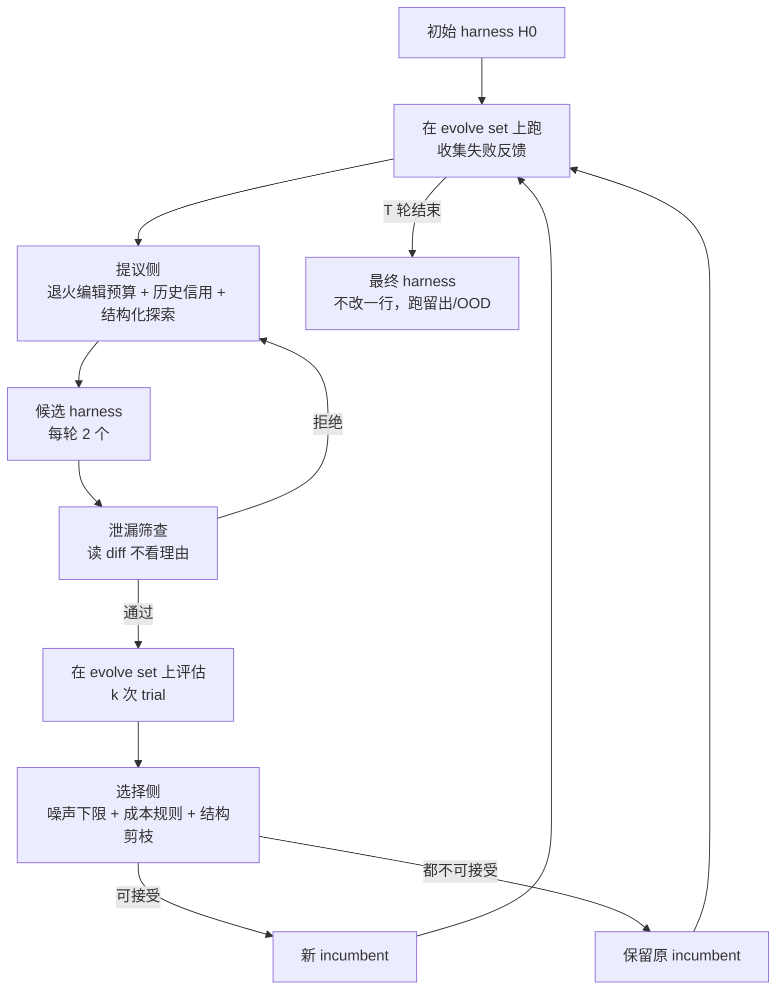

# RRSI: Regularized Recursive Self-Improvement of Agent Harnesses

## Why

一个 LLM agent 的能力，不只由底座模型决定。同一个模型，外面套的提示词、控制流、工具接口、记忆文件、上下文管理不同，完成长任务的成功率可以差很多。论文把这些底座模型之外的所有东西统称为 harness（装置）。一个 coding agent 会不会先读文件再改、命令失败后会不会重试、上下文快满时会不会压缩、最后会不会把结果写进交付文件，都是 harness 决定的。过去两年 agent 产品的进步，很大一部分来自 harness 工程，而不是新的模型权重。

但 harness 工程目前主要靠人。工程师读失败轨迹，找到问题，改提示词或控制流，再跑一遍。这个过程受限于"工程师能读多少条轨迹"：读得越多，改得越准；读不过来，就只能凭经验猜。于是出现了一类自动化方法：让一个 LLM 读失败反馈，提出 harness 的修改，再在任务集上评估，保留分数更高的版本。论文把这种"用当前系统的反馈改进塑造当前系统行为的 harness"的过程，叫 agent 系统层面的递归自我改进（recursive self-improvement, RSI）。

这套循环有一个结构性问题：它反复在同一个有限的 evolve set（进化集）上提出、评估、选择候选，而 evolve set 的分数是带噪声的。候选改得越多，越容易拟合这批任务的特定模式；选得越多，越容易把噪声当成信号；堆的提示词和工具越多，越容易用测试时计算换分数。三种行为叠加，结果是 evolve set 上的分数涨了，换一个基准就掉回去。论文在 Fig. 1(a) 里画了这件事：Meta-Harness 在 evolve set 上最高，到了分布外只比初始 harness 高 0.9 分；AHE 和 TTHE 在分布外甚至低于初始 harness，TTHE 低 1.7 分。

为什么现在必须解决？因为 harness 进化方法正在快速增加，而评测集都很小：Terminal-Bench 2.1 只有 89 题，Harvey LAB 的 evolve set 是 120 题，EngDesign 只有 61 题。在这么小的集合上反复自适应地评估，过拟合几乎是必然的；而且 harness 的搜索空间是开放的程序空间，比调超参更容易记住任务。论文引用的 concurrent work 也观察到，很多"进化收益"其实来自任务特定拟合、评估噪声或测试时计算，而不是可复用的机制。

现有方法的共同点是：只用 evolve set 的分数驱动搜索，没有项约束"什么样的改进才允许变成永久状态"。有的方法改变编辑空间（例如把 harness 表示成模块化原语），有的方法用多样性档案保留候选，但都没有直接约束"反馈如何变成持久修改"。于是问题可以写成：能不能保持 harness 的编辑空间完全开放，只约束搜索过程——让每轮只改少量可归因的东西，让历史证据参与信用分配，让明显泄漏任务信息的候选进不来，让分数提升必须超过噪声，让额外的 token 成本必须由性能提升来支付，让长期没有贡献的组件被删掉？这些约束能不能把 evolve set 的收益转成分布外收益，代价是多少？

## What

先交代任务。输入是一个初始 harness $H_0$、一个冻结的底座策略 $\pi$、一个 evolve set $\mathcal{D}_{\text{evolve}}$ 和一个候选预算；输出是一个最终的 harness $H_T$（一段可执行的代码与配置）。进化只在 evolve set 上跑；跑完之后，$H_T$ 不改一行，直接在分布内留出集和分布外基准上评测。边界是：底座模型权重全程冻结；每个领域（coding、agentic workspace、engineering design）单独进化一套 harness；不研究权重更新，也不研究跨领域的单一 harness。

论文的答案是：把 harness 进化当成一个自适应的经验优化问题，在提议侧和选择侧同时加正则化，可以在保持编辑空间开放的前提下，把 evolve set 的收益转成分布外收益。RRSI 在八个基准、三个领域上，evolve set 最高涨 6.0 分，分布外最高涨 4.3 分（但 JobBench 实际涨 4.7 分，见 Ideas），六个留出切分全部不降；相对未正则化的进化，最终 harness 每次 trial 少用约 36% 的 policy token（摘要写 30%）。`[已验证，Fig. 3, Table 2]`

### 新认识：harness 进化的过拟合是三种行为耦合，不是单一原因

第一种行为是基准特定拟合。进化搜索会把 evolve set 的评分规则、文档体裁、任务命名写进 harness。论文在 Table 9 里给了两个具体例子：Meta-Harness 的最终 harness 是一段 730 词的强制工作方法，按"引用、控制规则、playbook 条款、严重性、后果、建议修复"的维度组织成覆盖矩阵；这段文字没有点名任何任务，但它复述了 evolve set 的评分方式，开头就写"交付物按严格的逐项 rubric 评分，只读文件"。TTHE 的最终 harness 是十个命名协议块、约 8,500 词，其中约 1,000 词只在"交付物是 redline / markup / tracked-changes 版本"时生效；这个交付物体裁是 evolve set 的，不是 agentic 工作的普遍属性。两个 harness 都能通过"检查任务名"的泄漏测试，但都把评分器和体裁拟合进去了。`[已验证，Table 9]`

第二种行为是噪声追逐。evolve set 小、rollout 随机，同一个 harness 重复评估的分数会波动。如果每一轮都选"当前测出来最高的"，多轮之后就会把一次幸运的波动固化成永久状态。论文在进化前先重复评估 $H_0$，估计一个经验噪声带 $\delta$；在 Harvey LAB 上 $\delta = 0.004$，约等于 60 条 criterion verdict；在 Terminal-Bench 2.1 上 $\delta = 0.017$，约等于 3 道题；在 EngDesign 上 $\delta = 0.020$，约等于 5 道题（§5, Table 5）。`[已验证，§5, Table 5]`

第三种行为是复杂度累积。每个候选都可以加提示词、加工具、加记忆、加子 agent；这些改动在 evolve set 上可能带来一点分数，但会让最终 harness 每次 trial 消耗更多 token、跑更多步。论文的基线里，AHE 的最终 harness 每次 trial 3.82M token，RRSI 是 2.42M；未正则化的进化是 3.80M（Table 2, Fig. 4）。也就是说，不加约束的搜索会把"测试时计算"当成"能力提升"卖出去。`[已验证，Table 2, Fig. 4]`

### 新方法：提议侧三条约束 + 选择侧四条约束

RRSI 不限制 harness 能改什么。它把 harness 的编辑空间 $\Omega(H)$ 全部保留，只约束"搜索怎么在空间里走"。提议侧有三条：退火的编辑预算、证据感知的信用分配、结构化探索。选择侧有四条：泄漏筛查、噪声调整的接受下限、成本感知的接受、结构剪枝。`[已验证，§3.2, §3.3]`

编辑预算按余弦退火：

$$
b_t = \left\lceil b_{\min} + (b_{\max} - b_{\min}) \cdot \frac{1}{2}\left(1 + \cos(\pi t / T)\right) \right\rceil,
$$

其中 $t$ 是当前轮，$T$ 是总轮数，$b_{\max}$ 是初始预算，$b_{\min}$ 是最终预算（Eq. 4）。前期允许一个候选捆绑几个协同改动，后期只允许一个，目的是让"哪个改动带来了分数"变得可归因。三个领域的参数是 $T = 20/20/40$、$b_{\max} = 4/3/4$、$b_{\min} = 1$（Table 5）。`[已验证，Eq. 4, Table 5]`

信用分配维护一份完整的编辑历史：每个候选改了哪个组件、测试了什么假设、diff 是什么、分数和成本变化多少、是否被接受。后续提议要读这份历史：被否掉的机制作为负证据，成功的机制保留信用。组件词汇表有九类：prompt、control_flow、config、output_plumbing、context_mgmt、client_tool、skill、memory、subagent（Eq. 12）。结构化探索在"连续 $w$ 轮没有超过噪声带"时触发，把一部分候选槽留给从未被编辑过的组件。`[已验证，§3.2]`

选择侧的第一道是泄漏筛查。一个 critic 在完整评估之前读候选的 diff，拒绝三类东西：显式写入任务名、实体名、任务特定取值或答案的逻辑；只为 evolve set 服务的逻辑；不产生作用的惰性机制。筛查读的是 diff，不是提议者的解释，所以一个候选可以在理由里点名它想修的任务，但不能把任务名写进最终代码（§3.3, §F）。`[已验证，§3.3]`

第二道是噪声调整的接受下限。设 $S^{\star}$ 是目前见过的最好分数，候选必须满足

$$
\hat{S}(H') \geq S^{\star} - \delta.
$$

这条规则防止搜索沿着"每一步都小到像噪声"的连续降分走下去（Eq. 5）。第三道是成本感知的接受。对 $\Delta S > \delta$ 的候选，要求

$$
\Delta C \leq \beta_0 + \beta_1 \Delta S,
$$

其中 $\Delta C$ 是相对 policy token 成本的变化，$\beta_0$ 是没有性能提升时允许的成本增长，$\beta_1$ 是每多一分性能允许的成本增长（Eq. 7）。三个领域的 $\beta_0 = 0.10/0.10/0.15$，$\beta_1 = 44.5/35.4/24.4$（Table 5）。对 $\Delta S \leq \delta$ 的候选，改用一条加权的可接受性规则 $w_s \Delta S - w_c \Delta C + w_n \nu > 0$，其中 $\nu$ 是候选触及的、从未进入过获胜路径的结构性组件数量（Eq. 17）。第四道是结构剪枝：在最近 $n_{\text{prune}}$ 轮里没有产生严格正收益的组件，被标记为删除目标，下一轮提议要把它删掉（Eq. 14）。`[已验证，Eq. 5, Eq. 7, Eq. 14, Eq. 17]`

### 新结论：evolve set 上最弱，分布外最强

主结果在 Fig. 3。三个领域的 evolve set 增益是：Terminal-Bench 2.1 从 74.2 到 80.2（+6.0），Harvey LAB 从 89.4 到 90.5（+1.1），EngDesign 从 50.0 到 54.9（+4.9）。留出切分全部不降：SWE-bench Verified 82.0→83.8（+1.8），Harvey LAB 分布内留出 86.9→89.2（+2.3），JobBench 36.0→40.7（+4.7），GDPval 48.8→52.3（+3.5），APEX-Agents 34.2→37.9（+3.7），Frontier-Eng 17.7→22.0（+4.3，相对 +24.3%）。agentic workspace 的三个分布外基准平均从 39.7 升到 43.6（+3.9）。`[已验证，Fig. 3, Table 6]`

Table 1 把四个基线放在同一套 $H_0$、同一个策略、同一个 evolve set、同一个候选预算下比较。evolve set 上，Meta-Harness 最高（93.0），RRSI 最低（90.5）；分布内留出上，Meta-Harness 与 RRSI 都是 89.2；分布外平均上，RRSI 43.6 对 Meta-Harness 40.6、AHE 39.2、TTHE 38.0、HarnessX 39.7。论文的判断是：evolve set 的排名在分布外翻转，RRSI 用 evolve set 上的一点分数换了分布外的稳定性。`[已验证，Table 1]`

消融在 Table 2。去掉提议侧约束：evolve 90.7、分布外平均 41.9、2.69M token；去掉选择侧约束：evolve 91.5、分布外 41.0、3.59M token；两组都去掉：evolve 92.8（所有臂里最高）、分布外 40.3（和未进化的 39.7 只差 0.6）、3.80M token；完整 RRSI：evolve 90.5、分布外 43.6、2.42M token。两组约束缺一不可：只留提议侧，分布外掉 1.7 分；只留选择侧，分布外掉 2.6 分；都去掉，分布外几乎回到起点。`[已验证，Table 2]`

成本和稳定性在 Fig. 4 与 Table 7。最终 harness 的每次 trial 步数：$H_0$ 21.2，RRSI 26.3，四个基线 27.3–34.6。RRSI 比基线轻，但比 $H_0$ 重，说明进化仍然用了一部分测试时计算。两次独立进化的结果：Terminal-Bench 2.1 是 80.2 与 82.0，差 1.8；其余八个切分差 0.6 分以内；分布外平均 43.6 与 43.7。论文的结论是，搜索轨迹的随机性带来的波动小于评测任务选择的波动（§E.2, Table 7）。`[已验证，Fig. 4, Table 7]`

## How

这篇论文以系统与算法类为主，附实证与基准类。系统与算法类：它定义了 harness 进化的形式化、提议与选择两侧的约束、七条规则和一套可执行算法；实证与基准类：它在八个基准、三个领域、两种策略上做端到端对比、两组消融、两次独立重复和配对 bootstrap。判型依据是它既给出可复用的搜索机制，又用多组实验验证；没有定理，没有新的训练目标，也不训练底座模型。

上图据原文 Fig. 2 与 Algorithm 1/2 重画。左侧是提议，右侧是选择；两条路径共用同一份编辑历史，历史既用于信用分配，也用于剪枝。

### 一、形式化：为什么自适应复用同一个 evolve set 会过拟合

agent 写成 $A = (\pi, H)$，$\pi$ 是冻结的策略，$H$ 是 harness。给定任务 $x$，agent 产生轨迹 $\tau \sim A(\cdot \mid x)$ 和交付物，验证器给分 $r(x, \tau) \in [0,1]$。任务集 $\mathcal{D}$ 上的性能和成本是：

$$
S(H; \mathcal{D}) = \mathbb{E}_{x \sim \mathcal{D}} \mathbb{E}_{\tau \sim A(\cdot \mid x)}[r(x, \tau)], \quad
C(H; \mathcal{D}) = \mathbb{E}_{x \sim \mathcal{D}} \mathbb{E}_{\tau \sim A(\cdot \mid x)}[c(\tau)],
$$

其中 $c(\tau)$ 是轨迹消耗的 policy token 数（Eq. 1）。harness 进化把 $H$ 当优化变量，$\pi$ 固定；第 $t$ 轮在 $\mathcal{D}_{\text{evolve}}$ 上评估当前 harness，得到反馈 $F_t$，提议器生成候选集 $\mathcal{H}_t$，选择器按经验分数 $\hat{S}$ 选下一个 incumbent（Eq. 2）。$\hat{S}$ 是在有限任务、$k$ 次随机 rollout 上的平均（Eq. 3）。

关键在于：第 $t$ 轮的候选依赖前几轮在同一批任务上的测量。这不是普通的"在测试集上评估"，而是"用测试集的反馈去生成下一个候选，再在同一测试集上评估"。这就是自适应数据分析里的过拟合：评估次数越多，测出来的最好分数越乐观。论文用 Dwork et al. (2015) 的视角解释这件事，并把"噪声带 $\delta$"作为可接受性的基准。`[已验证，§2, §3.3]`

### 二、提议侧：三条约束分别控制"改多少、信什么、往哪看"

**退火编辑预算**控制"一轮改多少"。一个候选可以捆绑多个原子编辑；如果捆绑太多，分数变化无法归因到某一个机制。RRSI 用余弦退火把 $b_t$ 从 $b_{\max}$ 降到 $b_{\min}$，前松后紧。这个约束对应 $L_0$ 式的基数约束：把候选里的原子编辑表示成 0/1 向量 $z_t$，要求 $\|z_t\|_0 \leq b_t$（Eq. 9）。论文强调这是"更新稀疏性"，不是对固定参数向量的 $L_0$ 惩罚；编辑池每轮重画，大小不固定。`[已验证，§3.2, §D.2]`

**证据感知的信用分配**控制"信什么"。历史记录 $L_t$ 里每条记录包含轮次、组件、假设、diff、$\Delta S$、$\Delta C$、是否被接受（Eq. 10）。提议器读这份历史：被否掉的机制不能反复提，成功的机制保留信用。论文还维护组件级的近期最好收益 $g_t(\ell)$，用于剪枝（Eq. 11）。这个设计针对的是"反复在同一批任务上试同一个假设"：每次评估都是一次自适应观察，重复试已经证伪的假设只是浪费搜索预算。`[已验证，§3.2, §D.2]`

**结构化探索**控制"往哪看"。当连续 $w$ 轮的进步没有超过噪声带 $\delta$，搜索被判定为停滞；这时保留 $m_{\text{draft}}$ 个候选槽，专门给从未被编辑过的组件（Eq. 13）。组件词汇表有九类（Eq. 12）。这个约束的作用是防止提议器坍缩到"反复改提示词"这一条路，而不去碰控制流、工具、记忆。`[已验证，§3.2, §D.2]`

### 三、选择侧：四道门，非补偿式

四道门是"与"的关系，不是加权求和：一个候选必须同时通过泄漏筛查、噪声下限、成本规则（或带内规则）和领域守卫，才有资格替换 incumbent。`[已验证，Algorithm 2]`

**泄漏筛查**在完整评估之前跑。critic 读候选 diff，拒绝显式任务名、实体名、任务特定取值、答案逻辑，以及只为 evolve set 服务的逻辑。筛查放在评估前，是因为一个泄漏的候选如果在 evolve set 上拿了高分，后面的轮次会被这个高分吸引，再想删就难了。论文在 §F 里给了一个细节：coding 运行的 38 个被筛查候选里，标准接受判决是"预测的任务名只出现在理由里，没有进代码"；唯一一次直接拒绝是第 10-B 轮，理由是"声明的组件和 diff 实际改的组件不一致"。`[已验证，§3.3, §F]`

**噪声下限**是 $S^{\star} - \delta$。$S^{\star}$ 是历史最好分数，$\delta$ 是 $H_0$ 重复评估的经验波动。这个下限允许候选在噪声范围内波动，但阻止"连续小降"变成永久状态。注意它不是单调约束：如果候选的分数是 $S^{\star} - 0.9\delta$，它仍然可以通过；下一轮的下限会跟着 $S^{\star}$ 走，不会跟着 incumbent 走。所以它防的是"累积降分"，不是"任何降分"。`[已验证，Eq. 5]`

**成本规则**分两段。$\Delta S > \delta$ 时，用 $\Delta C \leq \beta_0 + \beta_1 \Delta S$：性能提升越大，允许的成本增长越多；没有提升时，只允许 $\beta_0$ 的增长。$\Delta S \leq \delta$ 时，用 $w_s \Delta S - w_c \Delta C + w_n \nu > 0$：分数在噪声带内不算独立证据，候选必须靠"省 token"或"尝试从未赢过的结构性组件"来获得资格。coding 领域把 $w_s$ 设为 0，意思是"带内的小分数提升本身不能让你通过"（§D.3）。`[已验证，Eq. 7, Eq. 17, §D.3]`

**结构剪枝**是 $B_t = \{\ell \in T_t : g_t(\ell) \leq 0\}$：被编辑过、但在最近 $n_{\text{prune}}$ 轮里没有严格正收益的组件，进入删除目标集（Eq. 14）。这个规则针对"复杂度累积"：一个组件只要曾经有用，就可能一直留在 harness 里；剪枝要求它持续证明自己有用。`[已验证，Eq. 14]`

### 四、超参：噪声带是测出来的，其余是校准的

Table 5 给了三个领域的全部超参。$T = 20/20/40$，$k = 2/2/4$，$\delta = 0.017/0.004/0.020$，$b_{\min} = 1$，$b_{\max} = 4/3/4$，$w = 3$，$m_{\text{draft}} = 1$，$n_{\text{prune}} = 4/5$，$\beta_0 = 0.10/0.10/0.15$，$\beta_1 = 44.5/35.4/24.4$。论文强调这些值在跑之前固定，没有在留出集或分布外基准上扫过。`[已验证，Table 5]`

$\delta$ 是唯一"必须测、不能调"的值：它来自 $H_0$ 的重复评估。Terminal-Bench 2.1 上 $\delta = 0.017$ 对应 3 道题（89 题 × 2 trials = 178 次），Harvey LAB 上 $\delta = 0.004$ 对应约 60 条 criterion verdict（约 14,100 条），EngDesign 上 $\delta = 0.020$ 对应 5 道题（61 题 × 4 trials = 244 次）。$\beta_1$ 的口径是"每多一分性能允许多少相对 token 增长"：coding 是 25% / 分，agentic workspace 是 25% / 100 条 criterion，engineering design 是 10% / 分。论文给了一个校准例子：coding 上一个值 7 道题的候选被允许 10 + 7×25 = 185% 的增长，实测 130% 被接受；一个值 1 道题的候选只被允许 35%，同样的成本被拒绝（§E.1）。`[已验证，§E.1]`

### 五、实验设置：八个基准，三种角色

八个基准分三种角色。coding：Terminal-Bench 2.1 是 evolve set（89 个容器化终端任务，单元测试判分），SWE-bench Verified 是分布外（真实 GitHub issue，fail-to-pass 与 pass-to-pass 测试）。agentic workspace：Harvey LAB 是 evolve set（120 题）加分布内留出（40 题），JobBench、GDPval、APEX-Agents 是分布外；Harvey 的任务是法律工作，交付 Word/Excel/PDF 文件，按 20–100 条 criterion 的 rubric 判分，约 14,000 条 verdict/次；GDPval 是 185 个任务、三方评审团、双向呈现；APEX-Agents 是 480 个任务、MCP 工具面、pass@1。engineering design：EngDesign 是 evolve set（61 题，冻结模拟器判分），Frontier-Eng 是分布外（47 题，38 题能构建环境，Medal Score）。`[已验证，§B]`

策略是 Claude Opus 4.8，提议器、分析师、泄漏 critic 也都是 Claude Opus 4.8。基线是 $H_0$、Meta-Harness、AHE、TTHE、HarnessX；论文说所有基线从同一个 $H_0$ 出发，共享冻结策略、evolve set 和候选预算（§4.1）。这个"同预算"是论文最重要的可比性声明，但基线是论文自己重跑的，不是原作者代码；附录 C 只给了四段方法描述，没有给超参和提示词。`[已验证，§4.1, §C]`

### 六、结果：留出集全部不降，但幅度和口径要看清

Fig. 3 的主结果在 What 里已经列过，这里补三个细节。第一，Terminal-Bench 2.1 的 +6.0 是 evolve set 增益，SWE-bench Verified 的 +1.8 才是分布外；+6.0 不能直接读成"coding 能力涨了 6 分"。第二，Harvey LAB 的分布内留出 +2.3 比 evolve set 的 +1.1 还高，这在逻辑上可能（留出集题目不同），但也提示 evolve set 的 120 题和留出的 40 题难度分布不同，两个数字不能直接比较。第三，Frontier-Eng 的 +4.3 Medal 点是所有分布外里相对增益最大的（+24.3%），但绝对分只有 17.7→22.0，38 题里每题值 0.33–1 分，4.3 分大约对应 5–13 道题的评级变化，置信区间是 [+1.1, +12.1]，很宽。`[已验证，Fig. 3, Table 6]`

Table 6 给了配对 bootstrap 的 95% 置信区间：Terminal-Bench +6.0 [+4.3, +9.3]，SWE +1.8 [+1.1, +4.0]，Harvey evolve +1.1 [+0.8, +2.1]，Harvey 留出 +2.3 [+0.9, +3.8]，JobBench +4.7 [+2.9, +7.4]，GDPval +3.5 [+1.8, +6.9]，APEX +3.7 [+1.4, +7.5]，EngDesign +4.9 [+1.8, +9.8]，Frontier +4.3 [+1.1, +12.1]。所有区间都不跨 0，但 SWE、Harvey 留出、Frontier 的下界都贴着 0。`[已验证，Table 6]`

### 七、策略与模型迁移：换策略、换小模型都还有增益

Table 3 用 Gemini 3.5 Flash 独立跑一遍 coding 进化：Terminal-Bench 2.1 从 64.6 到 78.7（+14.1），SWE-bench Verified 从 76.8 到 79.0（+2.2）。Claude Opus 4.8 上的对应数字是 74.2→80.2 和 82.0→83.8。Table 4 把用 Gemini 3.5 Flash 进化出来的 harness 原样放到 Gemini 3.1 Flash Lite 上跑：Terminal-Bench 2.1 从 11.2 到 14.6（+3.4，相对 +30.4%）。这说明 harness 学到的东西不是只对搜索时用的那个策略有效；但跨模型实验只做了 coding 一个领域，没有做 workspace 和 engineering design。`[已验证，Table 3, Table 4]`

### 八、成本：省的是 policy token，不是搜索成本

Table 2 的成本列是"最终 harness 每次 trial 的 policy token"：$H_0$ 1.56M，未正则化 3.80M，去掉提议侧 2.69M，去掉选择侧 3.59M，RRSI 2.42M。RRSI 比未正则化少 36.3%，比去掉选择侧少 32.6%，比 $H_0$ 多 55.1%。论文摘要说"30% fewer policy tokens than the unregularized evolution"，按 2.42 对 3.80 算是 36.3%，30% 是一个保守说法。`[已验证，Table 2]`

但这个成本列只算最终 harness 的推理成本，不算搜索成本。搜索成本包括：20–40 轮、每轮 2 个候选、每个候选在 89–160 个任务上跑 $k$ 次、每次跑一个完整 agent 轨迹；再加上提议器、分析师、critic 的 LLM 调用。论文没有报这些调用的 token、美元或 wall-clock，也没有报每个候选的平均评估成本。所以"RRSI 更省"只对"最终 harness 的推理"成立；对整个搜索过程，读者无法判断。`[系统问题]`

### 九、案例：最终 harness 只改了四处

Table 9 把 RRSI 的最终 harness 和两个最强基线放在一起看。RRSI 在 Harvey LAB 上 20 轮、32 个候选里只接受了 4 个编辑，全部接在 base harness 已有的"pre-finalize bounce"上：一次覆盖与深度复查，三次标准库探针，把交付文件读回来，指出缺什么（例如算术简写没有展开、某个源值没有出现在任何写出的文件里）。这些探针报告的是文件的结构事实，不带 rubric 词汇，也不带领域词汇，所以在 JobBench、GDPval、APEX 上还能触发。Meta-Harness 的 730 词工作方法、TTHE 的 8,500 词协议块，都是把 evolve set 的评分方式和交付体裁写进了 harness；RRSI 的四处编辑更像"通用的交付前检查"。`[已验证，Table 9]`

Table 8 给了四个具体决策。R0-A 加"完成前验证审计"和"长任务非阻塞轮询"，evolve +3.93，接受；R0-B 加类似的验证提醒，但只涨 1.69、成本涨 26.1%，被成本规则拒绝；R8-B 把原始任务指令钉进完成门，分数 −2.81、成本 −13.6%，被噪声下限拒绝；R2 加"工作目录必须存在"的恢复提示，122/244→128/244，成本 +1.6%，接受。这四个例子说明选择不是只看分数：成本、噪声、结构都会影响结果。`[已验证，Table 8]`

## Ideas

### 不足

**口径与内部矛盾**

1. 摘要说"up to 4.3 points on the five out-of-distribution benchmarks"，但 JobBench 的增益是 +4.7（Fig. 3, Table 6），比 4.3 高。五个分布外基准里最大的增益是 4.7，不是 4.3；如果 4.3 专指 Frontier-Eng，摘要应该写明。`[评估问题]`
2. 摘要说"runs on 30% fewer policy tokens than the unregularized evolution"，Table 2 是 2.42M 对 3.80M，少 36.3%；如果对比去掉选择侧的 3.59M，少 32.6%。30% 是一个偏保守的约数，但和 36.3% 差 6 个百分点，读者会以为是精确值。`[评估问题]`
3. "outperforming the average prior baseline by up to 12.5%" 的口径不清楚。按 Table 1 的四个基线在 JobBench/GDPval/APEX 上取平均，基线均值约 39.4，RRSI 43.6，相对 +10.7%；按 Meta-Harness 40.6 算是 +7.4%；按 TTHE 38.0 算是 +14.7%。论文没有给 12.5% 的分母。`[评估问题]`
4. "RRSI consistently outperforms baselines on all held-out datasets" 不完全成立：Harvey LAB 的分布内留出，RRSI 与 Meta-Harness 都是 89.2，是并列不是超越；evolve set 上 RRSI 90.5 低于所有四个基线（90.7–93.0）。`[评估问题]`

**评估与基线**

5. 基线是论文自己重跑的，不是原作者代码。论文说"same $H_0$, same policy, same evolve set, same candidate budget"，但附录 C 只给了四段方法描述，没有给基线的提示词、轮数、候选池大小、接受规则。Meta-Harness 在 evolve set 上 93.0，比 RRSI 高 2.5 分，说明基线并不弱；但读者无法判断它们的实现是否和原论文一致。`[评估问题]`
6. 主表的 LLM-as-judge 在不同基准上不是同一个 judge：Harvey 和 APEX 用 Gemini-3.5-Flash，JobBench 用 Gemini-3.5-Flash 与 Claude Opus 4.8 的平均，GDPval 用 Qwen3.6-35B-A3B、Claude Sonnet 4.6、Gemini-3.1 Pro 三方评审。judge 换了，分数尺度就换了；跨基准的绝对值不能直接比较，只有同一基准内的前后对比有意义。论文没有报 judge 之间的一致性。`[评估问题]`
7. 分布内留出只有 Harvey LAB 的 40 题，evolve set 是 120 题；40 题的置信区间很宽（+2.3 [+0.9, +3.8]）。论文把"分布内留出"和"分布外"分开报是好的，但 40 题的留出不足以支撑"in-distribution generalization"的强结论。`[评估问题]`
8. Terminal-Bench 2.1 的 89 题、EngDesign 的 61 题、Frontier-Eng 的 38 题都很小；+6.0、+4.9、+4.3 这些数字的置信区间下界分别只有 +4.3、+1.8、+1.1。论文给了区间，但摘要只写点估计，读者容易把 +6.0 当成确定值。`[评估问题]`

**方法与归因**

9. 七个约束没有逐个消融。Table 2 只分了"提议侧"和"选择侧"两组；组内哪一条在起作用，读者不知道。比如泄漏筛查在 coding 运行的 38 个候选里只直接拒绝了 1 个，它的贡献可能很小；噪声下限、成本规则、结构剪枝各自贡献多少，没有拆开。`[方法问题]`
10. 泄漏筛查只查"显式任务名、实体名、任务特定取值、答案逻辑"，查不出"复述评分规则"这种更隐蔽的拟合。论文自己在 Table 9 里说，Meta-Harness 的 730 词方法"没有点名任何任务，但复述了 evolve set 的评分方式"；这种候选能通过关键词检查，却仍然是把评分器拟合进 harness。RRSI 的 critic 是 LLM 读 diff，能不能识别这种"体裁拟合"没有单独测。`[方法问题]`
11. 成本规则里的 $\beta_1$ 很大：coding 44.5 意味着每多 1 分允许 44.5% 的 token 增长；一个 +6 分的候选可以拿到 10 + 6×44.5 = 277% 的增长空间。这个"Ridge/L2 式"约束在数值上很松，能不能真的阻止复杂度累积，取决于 $\beta_1$ 怎么校准。论文只给了一个校准例子，没有做 $\beta_1$ 的敏感性分析。`[方法问题]`
12. 噪声下限是 $S^{\star} - \delta$，$S^{\star}$ 是历史最好分数，不是当前 incumbent 的分数。这个设计允许 incumbent 在噪声带内下降，只要不跌破历史最好太多；它防的是"累积降分"，不是"任何降分"。论文把它描述成"prevents the search from walking downhill through a sequence of regressions"，这个说法比规则本身强。`[方法问题]`
13. 最终 harness 是领域特定的：coding、agentic workspace、engineering design 各跑一次，得到三套 harness。论文的"generalization"是同一领域内换基准（SWE、JobBench、GDPval、APEX、Frontier），不是一套 harness 跨三个领域。摘要说"transferring to unseen benchmarks with different task descriptions, tool interfaces, or verifiers"，这个定义是窄的；跨领域的单一 harness 没有测。`[方法问题]`
14. 最终 harness 只改了 4 处，而且都是"交付前检查"类的通用机制。一个自然的替代解释是：这些机制本来就应该手写进 $H_0$，RRSI 只是碰巧搜到了它们；如果是这样，RRSI 的价值在"搜索效率"，不在"正则化"。论文没有做"手工加这 4 处编辑"的对照。`[方法问题]`
15. 提议器、分析师、critic 都是 Claude Opus 4.8，policy 也是 Claude Opus 4.8。搜索和被搜索是同一个模型家族，可能存在" proposer 知道 policy 会怎么犯错"的耦合；Gemini 3.5 Flash 的 coding 实验只换 policy，没有换 proposer/critic。跨模型家族的完整搜索没有测。`[方法问题]`

**系统与成本**

16. 搜索成本没有账本。论文只报最终 harness 的 policy token，没有报提议器、分析师、critic 的 token，没有报候选评估的总 rollout 数，没有报 wall-clock 和美元。20 轮 × 2 候选 × 120 题 × 2 trials 的评估量，加上每次评估都是一条完整 agent 轨迹，搜索成本可能远高于最终 harness 的推理成本。没有这笔账，"RRSI 更省"只对推理成立。`[系统问题]`
17. 代码和项目网站给了，但论文没有给基线实现的代码、提议器/critic 的提示词全文、每轮的候选 diff（只在项目网站）、随机种子、judge 的提示词。复现者能跑 RRSI 的主流程，但很难复现四个基线的同预算对比。`[系统问题]`
18. 所有主实验都用 Claude Opus 4.8，这是专有模型；论文没有给 API 版本、温度、最大 token、调用成本。Gemini 3.5 Flash 的 coding 实验是一个补充，但没有开放权重模型的完整搜索。对学术界来说，复现门槛很高。`[系统问题]`

### 创新点

**一、手工编辑对照：验证"搜索"还是"这四处编辑"**

- **主张**：RRSI 在 Harvey LAB 上的大部分增益，来自最终那四处"交付前检查"编辑；把这四处编辑手工写进 $H_0$，不跑搜索，也能拿到大部分分布外增益。如果是这样，RRSI 的价值是"找到了这四处"，而不是"正则化搜索"。
- **与原文关系**：反驳/修正。原文把增益归因于正则化的搜索过程，但没有做手工编辑对照。
- **最小验证**：从 Table 9 的最终 harness 里抽出四处编辑，手工应用到 $H_0$，得到 $H_{\text{manual}}$；在 Harvey LAB、JobBench、GDPval、APEX 上比较 $H_0$、$H_{\text{manual}}$、RRSI。预期 $H_{\text{manual}}$ 能拿到 RRSI 分布外增益的 60% 以上。
- **失败条件**：$H_{\text{manual}}$ 只拿到 20% 以下，说明增益来自搜索过程中的其他机制（例如某些编辑的组合），不是这四处本身。

**二、逐条消融七个约束：找出真正起作用的那一条**

- **主张**：RRSI 的七条约束不是同等重要；泄漏筛查在 coding 运行里只直接拒绝了 1 个候选，可能贡献很小；噪声下限和成本规则可能是主要贡献者。逐条去掉，能看出哪条值得保留。
- **与原文关系**：增量，补原文只分两组的粗消融。
- **最小验证**：在 Harvey LAB + JobBench/GDPval/APEX 上做七个单约束消融（去掉退火预算、去掉信用分配、去掉结构化探索、去掉泄漏筛查、去掉噪声下限、去掉成本规则、去掉结构剪枝），每个变体跑两次，报 evolve、ID 留出、OOD 平均、token 成本。预期噪声下限和成本规则的贡献最大，泄漏筛查的贡献最小。
- **失败条件**：去掉任何单条约束都没有显著变化，说明约束之间有强交互，不能单独归因；这时需要做因子设计，而不是单变量消融。

**三、搜索成本账本：把 RSI 的搜索开销算进净收益**

- **主张**：harness 进化的真正成本在搜索，不在最终推理；把提议器、分析师、critic、候选评估的 token、美元、wall-clock 都算进去，RRSI 相对基线的"效率优势"会缩小，甚至反转。
- **与原文关系**：正交，补论文缺失的成本维度。
- **最小验证**：在 agentic workspace 领域记录一次完整进化的所有 LLM 调用：提议器、分析师、critic 的输入/输出 token，候选评估的 rollout 数、每题 token、judge 调用；按公开 API 价格折算美元；用"每美元 OOD 增益"比较 RRSI、Meta-Harness、AHE、TTHE、HarnessX。预期 RRSI 每美元增益最高，但绝对搜索成本是最终推理成本的 10 倍以上。
- **失败条件**：RRSI 的搜索成本高于基线，且每美元增益不占优；这时"更省"只对推理成立，不能作为方法优势。

**四、跨领域单一 harness：从 coding 进化，直接跑 workspace 和 engineering**

- **主张**：RRSI 学到的是通用的"交付前检查"机制，应该能跨领域迁移；如果一套在 coding 上进化的 harness 直接跑 Harvey LAB 和 EngDesign 还能涨分，说明正则化确实偏向可复用机制。
- **与原文关系**：扩展，直接补论文的领域特定缺口。
- **最小验证**：取 coding 运行（Terminal-Bench 2.1）的最终 harness，不改一行，直接跑 Harvey LAB 的 40 题留出、JobBench、EngDesign；比较 $H_0$ 和这套 harness。预期在 Harvey 留出上不降或小幅提升，在 EngDesign 上可能降，因为工具接口不同。
- **失败条件**：跨领域全部下降，说明 harness 的收益仍然绑定在领域和工具面上，"通用机制"的说法需要收窄。

**五、开放权重全流程：用 Qwen3-32B 同时当 policy 和 proposer**

- **主张**：RRSI 的增益不依赖 Claude Opus 4.8 的特定能力；用开放权重模型同时当 policy、proposer、critic，相对排序应该保持，绝对分下降。
- **与原文关系**：扩展，补可复现性。
- **最小验证**：用 Qwen3-32B（或同类开放模型）当 policy 和 proposer，在 Terminal-Bench 2.1 上跑完整 RRSI 与未正则化进化，评估 SWE-bench Verified。预期 RRSI 仍比未正则化高 2 分以上，但绝对分比 Claude 低 10–20 分。
- **失败条件**：开放权重模型的提议质量太差，RRSI 与未正则化没有差异；这说明正则化需要足够强的 proposer 才能起作用。

**六、体裁感知的泄漏筛查：查"复述评分规则"而不只是查任务名**

- **主张**：当前 critic 只查显式任务名和实体，查不出"复述 rubric 维度"这类体裁拟合；一个体裁感知的 critic 能识别"这段提示词只在某种评分方式下有用"，从而把 Meta-Harness 式的 730 词方法挡在门外。
- **与原文关系**：增量/反驳，直接针对 Table 9 里"没有点名任务但复述评分方式"的失败模式。
- **最小验证**：构造一组候选，其中一半是"点名任务"的显式泄漏，一半是"复述 rubric 维度但不点名"的隐性泄漏；让当前 critic 和体裁感知 critic 分别筛查，比较召回率、误杀率；再把筛查后的候选放进进化，比较 OOD 平均。预期体裁感知 critic 把隐性泄漏的召回率从 20% 以下提到 70% 以上，OOD 平均提高 1 分以上。
- **失败条件**：体裁感知 critic 误杀太多通用提示词，导致 evolve 和 OOD 都下降；这说明"体裁拟合"和"通用机制"在文本上难以区分，泄漏筛查只能做粗筛。

## 相关工作

仓库内与本文最接近的是 [li2026-oo-harness](li2026-oo-harness.md)：两篇都在做 harness 进化，但杠杆不同。OO-Harness 改的是 harness 的表示，把专家 harness 做成基座 harness 的子类，用继承和覆盖复用代码；RRSI 不改表示，改的是搜索 dynamics，用正则化约束"哪些改动能留下"。OO-Harness 的接受规则、路由依据和继承机制，可以作为 RRSI 的提议侧组件；RRSI 的噪声下限和成本规则，也可以加到 OO-Harness 的选择侧。

[wang2026-rsi-hub](wang2026-rsi-hub.md) 把进化策略与执行装置拆开，用配方、算子、档案和准入记录来组织进化；RRSI 是一个具体的进化策略（提议 + 选择），可以作为一个配方跑在 RSIHub 上。RSIHub 的档案记录（候选 commit、父代、配方快照、指纹）正好可以补 RRSI 缺失的搜索成本与 provenance；RRSI 的七条约束可以补 RSIHub 缺失的"选择纪律"。

[yeh2026-oat](yeh2026-oat.md) 做 agent 失败归因，RRSI 的分析师每轮写跨轮失败反馈；OAT 可以作为 RRSI 的 Analyze 算子，把"哪一步失败"变成更精确的反馈，而不是让一个 LLM 读完整轨迹写总结。两篇的粒度不同：OAT 是步级，RRSI 是轮级。

[he2026-memory-tax](he2026-memory-tax.md) 的收益/税账本可以直接套到 RRSI 上：RRSI 报了最终 harness 的 policy token，但没有报搜索成本；用 Memory Tax 的口径，RRSI 的净收益要减去提议器、critic、候选评估的税。

[bao2026-raw-rag](bao2026-raw-rag.md) 的"强基线重设参照系"与 RRSI 的"evolve set 排名在 OOD 翻转"是同一个方法论：不要只看优化目标的分数，要看换一个参照系之后还剩多少。RAW-RAG 用一条配好的原始检索基线打复杂记忆系统，RRSI 用四个同预算基线打"进化一定有效"的默认假设。

## 可复现

- 代码：<https://github.com/google-research/rrsi>；项目网站：<https://regularized-rsi.com>（逐轮提议、critic 判决、接受决定、harness diff）。
- 策略与提议模型：Claude Opus 4.8（policy、proposer、analyst、leakage critic）；Gemini 3.5 Flash（coding 的策略鲁棒性实验）；Gemini 3.1 Flash Lite（跨模型迁移实验）。
- 基准：Terminal-Bench 2.1（89 题）、SWE-bench Verified、Harvey LAB（120 evolve + 40 留出）、JobBench、GDPval（185 题）、APEX-Agents（480 题）、EngDesign（61 题）、Frontier-Eng（47 题，38 题计分）。
- 超参：$T = 20/20/40$，$k = 2/2/4$，$\delta = 0.017/0.004/0.020$，$b_{\min} = 1$，$b_{\max} = 4/3/4$，$w = 3$，$m_{\text{draft}} = 1$，$n_{\text{prune}} = 4/5$，$\beta_0 = 0.10/0.10/0.15$，$\beta_1 = 44.5/35.4/24.4$。
- 统计：配对 task-level bootstrap，10,000 次重采样，95% 百分位区间；主实验每个领域两次独立进化。
- 无法复现的部分：搜索过程的总 token/美元/wall-clock、提议器与 critic 的提示词全文、四个基线的实现细节与超参、judge 的提示词与一致性统计、随机种子、每轮候选的完整 diff（项目网站有，但论文没有给归档格式）、开放权重模型的完整搜索。论文没有给这些，需要从代码仓库和项目网站补。
