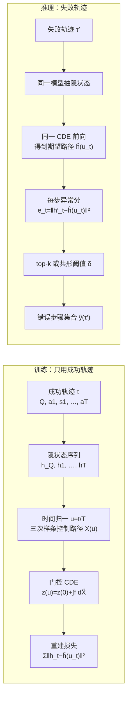

# Tracing Agentic Failure from the Flow of Success

## Why

一个长任务失败之后，团队真正想知道的是"哪一步把它带偏了"。对一条由多个 LLM agent 协作、调用几十个工具的轨迹，人工逐条读日志定位根因，需要专家花上几个小时；更麻烦的是错误会被后续步骤部分补偿，只看最后一步的错误答案，往往看不出最早的偏差发生在哪里。当 agent 进入写代码、做科研这类高风险场景，这个诊断瓶颈会直接卡住部署、调试与审计。

现在有三条现成的路，机制上的代价各不相同。提示式方法把整条轨迹塞给一个前沿模型，让它直接说出可疑步骤；它不需要训练，但每次诊断都要跑一次在线推理，token 消耗与延迟随轨迹长度增长，做不到对每次运行默认开启。监督式方法在带步级错误标注的失败轨迹上后训练一个模型，例如用 GRPO 在合成失败轨迹上做强化学习；问题在于标注本身又贵又歧义——判断"哪一步错"通常用反事实定义，即"把这一步换成正确动作，任务就能成功"，可标注者既拿不到那个 oracle 动作，也无法从改正点重放整条轨迹，多步错误叠加时这个定义直接失效。干预式方法更彻底，真的在每一步重放环境看能否救回任务，代价是需要可重放的环境和成倍的 rollout 成本。

还有一条来自机器人领域的思路：只用正常执行的轨迹训练单类模型，推理时把偏离正常的样本判为异常。但那里输出的是轨迹级的"这次执行不正常"，并不告诉你第几步出了问题；而 agent 场景需要的是步级定位，这是一个严格更难、信息量也更大的任务。

这里有一个被忽略的不对称：失败轨迹与步级标注都很贵，成功轨迹却是部署的副产品，正常跑一次就有一条。于是问题变成：能不能只从成功轨迹里学出"一次正常推进应该长什么样"，再在失败轨迹上按偏离程度标出出错步骤？如果可以，它的定位精度能否超过提示式方法，单条轨迹的诊断成本又能否低到可以默认开启？

## What

答案是能，而且代价比预期低得多。OAT 把每一步表示成生成该动作时的一个 LLM 隐状态向量，把这些向量看成一条连续潜路径上的采样点，用 Neural CDE 学成功轨迹在这条路径上的"流"；推理时把失败轨迹送进同一个模型，每一步的重建误差就是异常分，再按 top-k 或共形阈值取成错误步骤集合。它只用 103 条成功轨迹（训练实际用其中 80%），没有见过任何失败轨迹和步级标签；推理时不调用生成模型，输出 token 为 0。在 MCP-Atlas 上 F1 0.435，比 GPT-4o 的 0.212 高 22 个点；换到分布外的 Who&When，F1 0.225 对 GPT-5 的 0.152，高 7 个点；延迟 7–16 ms，对应基线是 4.2–39.6 s。

**新认识：失败归因可以从"监督分类"改写成"单类异常检测"。** 以往方法把失败轨迹当训练数据，需要逐条告诉模型哪一步错；本文把训练信号整个换成"正常长什么样"，把失败定义为对正常动力学的偏离。这一改写把标注需求从"失败轨迹 + 步级标签"降到"只要成功轨迹"，代价是模型永远见不到失败样本，也就不能从错误里直接学习。[宣称]（§3，Def. 3.2）

**新认识：轨迹可以当成连续时间过程，而不是离散的 token 序列。** 每一步的隐状态被视为一条潜在连续路径上的观测点，查询是起点，终止状态是终点；模型回答的是"走到这一步时，系统本来应该处在什么状态"。[宣称]（§4.1）

**新认识：步级异常信号存在于隐空间，而不在输出文本里。** 同一句"我没找到结果"在成功轨迹里可能完全正常，在失败轨迹里却是放弃的前兆；因此打分用隐状态的重建误差，而不是文本规则或另一个 LLM 的判断。[宣称]（§4，App. H）

**新方法：OAT（One-class Agent Tracing）。** 单类学习加 Neural CDE 加门控控制路径，把成功轨迹的潜动力学学成一个连续向量场，并给每一步一个异常分。这是本文可被复用的核心部件，具体怎么运作见 How。[已验证]（§4）

**新方法：两种从异常分到步骤集合的判定器。** 固定 top-k 简单，但需要预先知道错几步；共形预测用成功轨迹的分数分布定阈值 δ，把正常步的误报率控制在 α 附近，并让每条轨迹报出的步数随分布自适应。[已验证]（§4.2）

**新方法：一套只用成功轨迹训练、失败轨迹只用于测试的评测设置。** MCP-Atlas 上 103 条成功加 88 条人工标注失败，Who&When 的 184 条失败作为分布外测试；这让"无监督"这个词有了可检查的边界。[已验证]（App. D/E）

**新结论：域内（MCP-Atlas）领先提示式基线。** OAT（共形）Precision 0.443、Recall 0.484、F1 0.435、Hit 0.566、AUROC 0.629、AUPRC 0.324；top-k 版本 Recall 0.706、Hit 0.777，但 Precision 只有 0.321。对照 GPT-4o F1 0.212、GPT-5 0.181、随机选一步 0.255、Isolation Forest 0.411。[已验证]（Table 1）

**新结论：但相对经典单类基线的余量很小。** 比提示式基线高 22 个点，比 Isolation Forest 只高 2.4 个点 F1、2.9 个点 AUPRC；摘要强调前者，后者没有在正文讨论。[已验证]（Table 1）

**新结论：域外（Who&When）同样领先。** OAT（top-k）F1 0.225 对 GPT-5 的 0.152；共形版本 AUROC 0.758、AUPRC 0.128，对 GPT-5 的 0.584 与 0.078。[已验证]（Table 2）

**新结论：推理成本低两个数量级，但口径要看清。** 0 输出 token，7±4 ms（MCP-Atlas）与 16±22 ms（Who&When）；GPT-4o 为 4.2 s 与 4.5 s，GPT-5 为 39.6 s 与 37.8 s。摘要里的 200–5000× 不含隐状态提取；如果手上只有文本日志、需要重跑一遍 27B 模型取隐状态，约 1000 ms/条（2×H200），仍是 4–35×。[已验证]（Table 3，§5.2 脚注 1）

**新结论：消融支持连续建模与门控。** CDE 全面优于 Neural ODE 与 RNN（Fig. 3/5，正文未给具体数字）；门控在域外 +0.172 AUROC、域内 −0.028；mean pooling 优于 last token；越靠后的层越好；换成 Llama-4-Scout、Gemma-4、GPT-oss 抽表示只小幅下降；训练轨迹从 25 增到 90 条性能上升。[已验证]（§6，Fig. 3–12，App. G）

## How

判型：系统与算法类为主，评测部分属实证与基准类。前者回答"怎么把轨迹变成连续动力学并打分"，后者回答"只训练成功轨迹的归因任务怎么测量"。两类都要看，因为方法的新意集中在连续化与门控，结论的可信度集中在数据集与对照。

### 一、任务怎么定义

一条轨迹写成 $\tau = (Q, a_1, s_1, \dots, a_T)$，$Q$ 是用户查询，$a$ 是动作，$s$ 是环境返回的状态；$\tau_{<t}$ 是第 $t$ 步之前的前缀。评测函数 $Z(\tau) \in \{0,1\}$ 只看最终结果，成功为 1。给定一条 $Z=0$ 的失败轨迹，归因任务是输出一个步骤集合 $y(\tau') \subseteq \{1,\dots,T\}$。

本文对"错误步"的定义（Def. 3.1）有两个条件：这一步的动作在给定 $Q$ 和前缀时确实是错的（幻觉、错误工具调用、或没处理工具报错），并且这个错误之后没有被纠正、最终促成了失败。它刻意不采用 Who&When 的反事实定义，理由有两个：复杂任务常常是多步错误叠加，单点修复本来就不成立；标注者也拿不到 oracle 的正确动作，无法从改正点重放验证。

这个替换让标注变得可操作，但也把"促成失败"留在了直觉层面：什么算"没有被纠正"、什么算"促成了失败"，仍由标注者判断。App. E 给了三类错误——推理幻觉、工具参数错误、工具报错未被处理；对搜索类工具，重复同一查询（或语义等价查询）且结果不变时，第一次不算错，之后每次算错。规则写得很具体，但"语义等价"和"未处理"仍要人判断。

无监督设定（Def. 3.2）是：训练集 $D_{\text{succ}}$ 只含成功轨迹，不含任何步级标签；学到的预测器 $\psi_\theta$ 在推理时对失败轨迹输出步骤集合，$y(\tau')$ 只在评估时使用。

### 二、一步怎么变成一个向量

对第 $t$ 步，取当时活跃的 agent 模型 $M_t$ 在生成动作 $a_t$ 时的第 $\ell$ 层 token 表示，按步内 token 做平均，得到 $h_t \in \mathbb{R}^{d_h}$：

$$
h_t = M_t^{(\ell)}\left(a_t \mid Q, a_1, s_1, \dots, a_{t-1}, s_{t-1}\right)
$$

查询本身也过一次模型，得到 $h_Q$；整条轨迹就是一串向量 $H(\tau) = (h_1,\dots,h_T)$。关键选择是"用什么表示"：不是文本 embedding，而是生成动作时的中间层激活，因为错误常出现在推理内容或参数拼装过程里，最后一个输出 token 已经把信息压掉了。App. G.2 验证了这个选择——把 mean pooling 换成 last token，所有指标明显下降。

维度上，27B 模型的隐状态很大，先用 PCA 压到 $d_h = 64$ 再送进动力学模型；PCA 既降算力，也做了一点去噪。

### 三、离散步骤怎么连续化

轨迹长度不固定，步与步之间的间隔也不固定（这里用步数当时间）。作者把时间归一化到 $[0,1]$：$u(t) = t/T$，每一步对应一个连续时间点 $u_t$，查询对应 $u_0 = 0$。

最自然的连续模型是 Neural ODE（Eq. 4）：给初始状态 $z(0) = g_2(h_Q)$，用一个神经网络 $f$ 定义 $dz/du$，积分到 $u$ 得到重建表示 $\hat{h}(u) = g_1(z(u))$。它的局限是轨迹完全由初始条件决定，同一个起点只对应一条路径；可 agent 完成任务往往有多条合法动作序列，这个模型表达不了"殊途同归"。

Neural CDE（Eq. 6）补上了这一点。它先把离散的 $(h_t, u_t)$ 用自然三次样条插值成一条连续控制路径 $X(u)$，再让潜状态沿控制路径的导数演化：

$$
z(u) = z(0) + \int_0^u f(v, z(v); \theta_f)\, dX(v)
$$

这个积分按 Riemann–Stieltjes 理解，展开成普通 ODE 就是 $\int_0^u f(v,z(v))\,(dX/dv)\,dv$。与 ODE 的区别在于：$X$ 由观测决定、不可学习，每个积分步上 $f$ 都被 $dX/dv$ 调制，而 $dX/dv$ 编码了这一步观测"往哪个方向变、变多快"。因此潜状态对每一步的局部行为敏感，这正是步级归因需要的性质。$X$ 里额外带了时间维 $u_t$，所以控制路径是 $d_h+1$ 维。

### 四、门控：让控制路径在分布外别乱带节奏

CDE 的控制路径直接来自输入表示。训练时只见过某一类成功轨迹，测试时如果轨迹来自别的域（多 agent、别的生成模型），样条导数的大小和方向都可能偏离训练分布；这时控制路径会把错误的动力学灌进潜状态，而不是提供信息。

门控（Eq. 8）就是对导数逐维打一个 0 到 1 的权重：

$$
\frac{d\tilde{X}(u)}{du} = q\!\left(\frac{dX(u)}{du}; \theta_q\right) \odot \frac{dX(u)}{du}
$$

$q$ 是一个小 MLP（4 层、隐层 12 维），输出 $d_h+1$ 维的 gate。分布内时 $q$ 可以全开，保留 CDE 的表达力；分布外且导数异常时 $q$ 压低它，减少对潜状态的扰动。Eq. 9 就是把 $dX$ 换成 $d\tilde{X}$ 后的 CDE。消融显示这个设计在域外 +0.172 AUROC、域内 −0.028，是一个明显偏保守的交换。

### 五、训练与打分

训练目标就是重建（Eq. 5）：对每条成功轨迹，把模型预测的 $\hat{h}(u_t)$ 与真实 $h_t$ 的平方误差在轨迹内求和，再对数据分布取期望。

$$
L(\theta) = \mathbb{E}_{\tau \sim D_{\text{succ}}}\left[\sum_{t=1}^{T_\tau}\left\|h_t - \hat{h}(u_t)\right\|_2^2\right]
$$

因为训练集里只有"正常"，模型学到的是正常推进的期望轨迹，没有任何"失败应该长什么样"的监督。

推理时给一条失败轨迹，同样抽表示、同样过 CDE，得到每步的重建误差作为异常分（Eq. 10）：

$$
e_t = \left\|h'_t - \hat{h}(u_t)\right\|_2^2
$$

分数越高，说明这一步的状态越不像"正常走到这里应该有的样子"。

从分数到集合有两种做法。top-k 直接取分数最高的 $k$ 步（Eq. 11），实现最简单，$k=3$；缺点是每条轨迹固定报 $k$ 步，而实际错误步数在 1 到 12 之间变化，报多了精度必然掉。共形预测（Eq. 12–13）留出 20% 的成功轨迹做校准集，把校准集里所有步的异常分取 $(1-\alpha)$ 分位数作为阈值 $\delta$，$\alpha = 0.2$；推理时分数超过 $\delta$ 的步才算错。它的好处是每条轨迹报几步由分布决定，报出的正常步比例被控制在 $\alpha$ 附近；但 $\delta$ 是在成功轨迹的分数上定的，失败轨迹整体分布已经偏移，覆盖率保证在测试分布上并不成立，只能在"正常步与校准步可交换"的假设下解释。

### 六、实验怎么搭

MCP-Atlas 部分：从公开子集里选 203 个能免费访问所需 MCP server API 的任务，用 Qwen3.5-27B 采样轨迹（temperature 0.6、top-k 20、top-p 0.95），用同一个模型按 claim 级 rubric 判分并人工复核，得到 103 条成功、100 条失败；失败里剔除 12 条由基础设施问题（某搜索 API 固定超时）或空日志导致的，剩 88 条由作者人工标步级错误。摘要写的是"100 条成功轨迹"，正文与附录 D 都是 103 条，差 3 条没有说明。平均 7.18 步（成功）与 7.32 步（失败），平均 1.56 个错误步，最多 12 个。

Who&When 部分：184 条失败轨迹，来自 GAIA 与 AssistantBench，由 CaptainAgent 与 Magentic-One 用 GPT-4o 生成（正文写作 Magnetic-One，参考文献 [59] 为 Magentic-One），平均 20.28 步、最长 129 步，标签是"第一个决定性错误"的单个下标。这个标签语义与 MCP-Atlas 的"错误步集合"不同，所以域内用集合指标，域外更依赖 hit 与排序指标。

OOD 还要处理表示分布差异：GPT-4o 生成的轨迹用 Qwen3.5-27B 重新抽表示，两者风格不同。作者用 CORAL 把域外表示的二阶统计对齐到域内，再送进 CDE；CORAL 只用 Who&When 的表示，不看标签与结果。

指标有六个：集合层面的 Precision、Recall、F1、Hit（报出的集合与标注有交集即命中），以及不看阈值的 AUROC 与 AUPRC。注意表里的 P/R/F1 是逐条轨迹平均后再平均，不是由平均 P 和平均 R 反算，所以用平均 P/R 手算 F1 会对不上。所有 OAT 结果跑 5 个随机种子取均值与标准差；基线的表格里没有方差，看不出运行的随机性。基线是 GPT-4o 与 GPT-5 的 all-at-once 提示（在原版基础上改成输出集合）、随机选一步、固定选第一步；域内另加 OC-SVM 与 Isolation Forest 两个经典单类方法，逐步独立打分。

### 七、证据能证明什么，不能证明什么

能证明的部分：在"只给成功轨迹"这个设定下，一个很小的模型（3 层 MLP、64 维）确实能在两个数据集上超过一次性提示的前沿模型，成本低两个数量级；消融说明连续建模（CDE 对 ODE、对 RNN）与门控各自有贡献，表示层的选择（mean pooling、后层）也符合预期。App. G.3 还给了一个有意思的信号：OAT 报出的最早一步有 68.13% 落在标注的首个决定性错误之前、31.87% 落在之后，说明它更常指向失败的前兆而不是下游症状；只看分数最高的那一步时是 50%/50%。

不能证明的部分，按重要性排：

第一，超过经典单类方法的幅度很小。域内 F1 0.435 对 Isolation Forest 0.411，AUPRC 0.324 对 0.295；而消融只和自家变体比，没有做"同一套表示、同一个共形阈值、换成线性 OC-SVM 或 kNN"的公平对照，域外也没跑这两个基线。因此"连续动力学带来主要增益"这个归因并不牢靠，至少有一部分增益可能来自阈值策略与表示。

第二，提示式基线可能偏弱。域内 GPT-5 的 F1 0.181 低于随机选一步的 0.255，GPT-4o 的 0.212 也低于随机；这不像"强到无法超越"，更像"没有被调到能代表提示式方法上限"——只用一个 all-at-once 提示，没有自一致性、多次投票或先写分析再给结论，附录 I 也只给了一个模板。摘要里 +20 点的结论因此有高估风险。

第三，没有监督式对照。AgentRacer、GraphTracer 这类方法以 Who&When 为主要评测集，而 Who&When 本身带标签与划分；论文只把它当测试集，没有回答"无监督版本比监督版本差多少、换来多少标注成本"这个最实际的问题。

第四，域外主数字带 transductive 成分。CORAL 用整个 Who&When 的表示拟合二阶统计，包括被评测的那条轨迹；App. G.5 做了五折版本，但只给图不给数字，正文仍以全量 CORAL 的结果作为 +7 点的主证据。

第五，标签由作者自己标注，没有报告标注者一致性。定义 3.1 的第二条"未被纠正且促成失败"没有操作化，规则里的"语义等价查询""未处理工具报错"也要判断；域内标签和方法的作者是同一组人，虽然训练不用标签，评估仍可能受标注偏好影响。

第六，轨迹太短。训练与域内测试的平均长度只有 7 步，而动机讲的是"几十到几百步"的长任务；唯一的长轨迹证据是域外测试集（平均 20 步、最长 129 步），没有按长度分层报告性能。

第七，重建任务本身有捷径风险。控制路径由被重建的 $h_t$ 插值而成，理论上模型可以学成"沿控制路径原样搬运"，在成功轨迹上误差很小、在失败轨迹上误差很大——效果看起来对，但机制不是"学到了动力学"。论文没有做控制路径置换或截断的对照来排除这种可能。

### 八、开销与失效条件

OAT 模型本身很小：不到 1 GB 显存，推理 7–16 ms，0 输出 token。真正的成本在表示提取——要跑一遍 27B 生成模型拿隐状态；作者说这部分在生成时是副产品、不额外花时间，但如果手上只有文本日志（实际调试最常见的情况），就要重跑，约 1000 ms/条（2×H200）。训练成本可以忽略：约 82 条轨迹、300 epoch、3 层 MLP。

失效条件在案例里写得很清楚。其一，规划层面"局部正常、整体低效"的错误，比如按页翻完 11 页 PR 才下结论，每一步都不算错，分数只是逐渐升高，没有明显尖峰。其二，早期隐式推理错误（"我没有合适的工具"）在成功轨迹里也会出现，模型不敢打高分，往往要等到失败被明确说出来才报警。其三，共形阈值是全局的，一条轨迹里同时有强错误与弱错误时，弱的那个可能刚好卡在 $\delta$ 下面而被漏掉（App. H.2 Case 3）。其四，训练与测试的轨迹结构差异很大时（单 agent 7 步到多 agent 20–129 步），门控与 CORAL 只能缓解，没有根治。

还有一个结构性的精度上限值得算一下：$\alpha = 0.2$ 意味着正常步里约有 20% 会被报出来；一条 7.3 步的轨迹平均 5.8 个正常步，按此会有约 1.2 个误报，而真实错误步只有 1.56 个，所以即使排序完美，精度上限也只有约 $1.56/(1.56+1.2) \approx 0.57$。实测 0.443，说明模型还有提升空间，但也说明"精度低"有一部分是阈值策略的算术结果，不是模型单独的锅。

## Ideas

### 不足

作者承认的：异常不等于因果，分数高只说明"不像正常轨迹"，不能保证这一步是失败的原因，反过来也不是每个因果错误都会表现为异常（§A）；需要一小批成功轨迹，成功样本稀少或"成功"难以定义的场景不适用（§A）；早期隐式推理错误容易漏，共形阈值会压掉刚低于 $\delta$ 的因果步（App. H.2）。

我发现的不足，按归因分类：

- **与经典单类基线的差距过小，归因不清**（评估问题）。域内 F1 只高 2.4 点、AUPRC 高 2.9 点，而 CDE 与门控的消融没有和"同表示、同阈值、简单单类模型"对照，域外也没跑 OC-SVM/IF。现在无法判断增益来自连续动力学、表示，还是阈值。
- **提示式基线偏弱，+20 点被高估**（评估问题）。GPT-5 的域内 F1 低于随机基线，说明提示没有调到有代表性的强度；缺少多次采样、自一致性、先分析后结论等常见增强。
- **缺监督式对照**（评估问题）。Who&When 有标签与划分，AgentRacer 等方法有公开数字，不比就无法回答"省下的标注值多少精度"。
- **域外主结果用了全测试集的 CORAL**（评估问题）。五折结果只在图里，没有数字，+7 点的可信度因此偏乐观。
- **标签自产、无一致性统计、定义第二条不可操作**（数据与评估问题）。"未被纠正且促成失败"没有可执行判据，不同标注者可能给出不同集合。
- **轨迹长度与动机不匹配**（数据问题）。训练与域内测试平均 7 步，动机却是"几十到几百步"；长轨迹只在域外出现，且没有按长度分层报告。
- **控制路径可能被当成"抄答案"的通道**（方法问题）。$X$ 由待重建的 $h_t$ 插值而成，缺少置换或截断对照来排除捷径。
- **成本口径**（系统问题）。200–5000× 不含隐状态提取；对只有文本日志的部署，1000 ms 才是真实开销。
- **只定位步，不定位 agent**（任务覆盖）。Who&When 带 agent 标签，多 agent 场景下"哪个 agent 的哪一步"才是可执行的诊断结论。

### 创新点

**一、给异常分加一层反事实校验**

- **主张**：把 top-m 异常步当作候选，做定点重放——从该步回滚，用同一模型重新采样若干动作，用任务恢复率给候选排序，输出"有因果证据的归因"，而不只是"最不像正常的一步"。
- **与原文关系**：扩展。异常检测负责召回候选，干预负责确认因果，两者互补。
- **最小验证**：在 MCP-Atlas 的 88 条失败轨迹上，对 top-1 步做 8 次重采样，比较恢复率与随机步重采样的恢复率；若候选步恢复率显著更高，说明异常分确实指向可修复的位置。成本按每条轨迹 8 次 rollout 计，与直接调用 GPT-5 诊断对比。
- **失败条件**：候选步恢复率与随机步无显著差异，或 rollout 成本超过提示式基线。

**二、轨迹内自适应阈值，替代全局 δ**

- **主张**：把每条轨迹的异常分序列做分段（动态规划或 HMM），对"进入异常段"收一次固定代价、对分数做拟合，输出段而不是点；这样弱因果步不会因为差一点 $\delta$ 被漏掉。
- **与原文关系**：增量，直接修 App. H.2 Case 3 的失效模式。
- **最小验证**：同一套 OAT 分数，比较全局共形阈值与分段解码在 MCP-Atlas、Who&When 上的 F1 与集合级召回，重点看"标注错误步不少于 2 个"的子集。
- **失败条件**：分段后 F1 不升，或报出的段数随轨迹长度失控（平均段数远大于真实错误数）。

**三、同口径消融加控制路径捷径检验**

- **主张**：用受控实验拆开"表示、阈值、动力学"三者各自的贡献——同一批 $h_t$、同一套共形阈值，分别接线性 OC-SVM、kNN、单层自编码器、CDE；再把控制路径做随机置换与截断，看 CDE 的优势是否还在。
- **与原文关系**：反驳或校正。它检验的是原文最核心的归因主张。
- **最小验证**：在 MCP-Atlas 与 Who&When 上跑上述四组，报告 F1 与 AUROC；若 CDE 只比简单基线高 1–2 点，则"连续动力学是关键"不成立。
- **失败条件**：简单基线追平 CDE，或置换控制路径后性能不降（说明模型没在用动力学）。

**四、用公开嵌入替掉 27B 隐状态**

- **主张**：部署方往往只有文本日志，隐状态提取就是那 1000 ms 的主要成本；用公开文本嵌入（如 bge、e5）或小模型隐状态替代，若能保住大部分精度，"实时、零 token"才真正成立。
- **与原文关系**：扩展，沿 App. G.2 的 proxy LLM 实验往"完全不需要生成模型"推一步。
- **最小验证**：固定 CDE 结构与阈值，只换表示来源，在 MCP-Atlas 上比较 F1、AUROC 与单条轨迹耗时，画"精度–提取成本"曲线。
- **失败条件**：F1 掉超过 5 点，或 AUROC 掉到 0.6 以下（接近域内经典单类基线）。

**五、长轨迹与 agent 级归因**

- **主张**：把评测按轨迹长度分层（不超过 10 步、11–30 步、超过 30 步），并在打分时加入 agent 身份，输出"哪个 agent 的哪一步"，让结论对多 agent 长任务可用。
- **与原文关系**：扩展，补上动机与实验之间的落差。
- **最小验证**：Who&When 按长度分层报告 AUROC 与 F1；用 agent 标签评估 agent 级 top-1 准确率。
- **失败条件**：AUROC 随长度显著下降且无补救，或 agent 级准确率接近随机。

## 相关工作

仓库内暂无同主题笔记，这是该方向在本仓库的第一篇笔记。与已有三篇记忆笔记的关系只在"如何度量 agent 系统是否可靠"这一层：[jiang2026-jev-mem](jiang2026-jev-mem.md) 关心记忆系统内部怎么用轻量控制器分配检索预算，[he2026-memory-tax](he2026-memory-tax.md) 用收益与税的账本评估记忆系统整体值不值，而本文评估单条轨迹里哪一步出错；[bao2026-raw-rag](bao2026-raw-rag.md) 用简单基线重设参照系，本文 Table 1 里也出现"经典单类基线几乎追平复杂方法"的类似信号（Isolation Forest 0.411 对 OAT 0.435），只是原文没有展开。若把记忆系统看作 agent 的一个组件，OAT 这类方法可以直接用来诊断记忆读写在哪一步把上下文带偏。

论文自身的定位是：把机器人领域"只用正常执行学单类模型"的思路搬进 LLM agent，并把轨迹级检测推进到步级归因；相对提示式方法省掉在线前沿模型，相对监督式方法省掉步级标注。

## 可复现

- 代码与数据：<https://github.com/deeplearning-wisc/OAT>（App. C）。
- 数据：MCP-Atlas 公开子集中 203 个可免费访问 MCP server API 的任务，103 条成功、100 条失败（剔除 12 条基础设施故障后剩 88 条）；Who&When 184 条失败轨迹。
- 关键超参（Table 6）：表示取最后一层、mean pooling、PCA 64 维；CDE 隐层 64、3 层 MLP；控制路径为自然三次样条；gate 隐层 12、4 层；Euler 求解器；top-k 的 $k=3$；共形 $\alpha=0.2$；学习率 4e-5、batch 32、300 epoch、weight decay 1e-5；5 个随机种子。
- 算力：表示提取用 Qwen3.5-27B，2×H200；OAT 本身不到 1 GB 显存。
- 无法完全复现的部分：MCP-Atlas 各 MCP server 的 API 可用性会变，203 个任务的子集依赖当时的免费额度；步级标签是作者人工标注，论文未给标注者一致性；CORAL 主结果用了整个测试集的表示，五折版本的数值只在图里，没有表。
