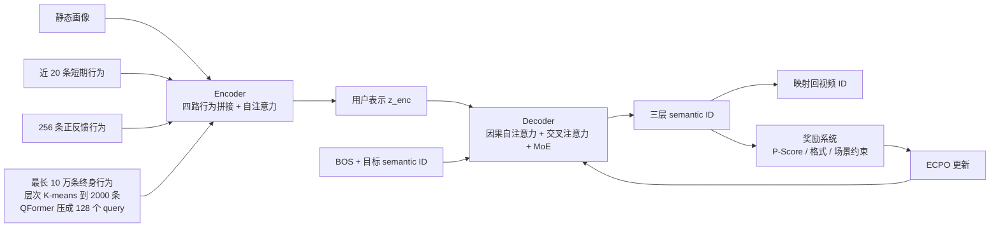

# OneRec Technical Report

## Why

快手的短视频推荐要在每天 4 亿日活、峰值超过 40 万 QPS、单次请求 500 毫秒以内的条件下决定给每个用户看什么。现行做法是级联：召回从亿级视频里粗筛出几千条，粗排压到几百条，精排再逐条打分，最后叠加规则与策略。每一级都有自己的模型、特征和目标，前一级的输出是后一级的输入。这套结构在工业界稳定运行了十年，但它的代价不在某一个模型上，而在结构本身。

第一笔代价是算力碎片化。论文统计快手线上服务的资源分布，超过 50% 花在通信和存储上，真正用于高精度计算的部分很少；最吃算力的精排模型，训练 MFU 只有 4.6%，推理 MFU 只有 11.2%。作为对照，LLM 在 H100 上的 MFU 约为 40%。MFU（Model FLOPs Utilization）指模型实际用掉的浮点运算占硬件峰值算力的比例，4.6% 意味着买来的算力有 95% 没有用在矩阵乘法上。这不是模型不够大，而是级联结构把算力切碎在多次数据搬运、多次打分和多次进程间通信里。

第二笔代价是目标冲突。推荐要同时优化点击、时长、点赞、关注、评论、生态、商业化等几百个目标，这些目标分散在不同阶段，由不同结构、不同规模的模型预测，再靠人工调权融合。上游召回受下游精排的能力限制，下游又拿不到上游丢掉的候选。作者把这种现象叫 cross-stage modeling conflicts：即使优化的是同一个目标，级联也会让不同阶段的模型互相牵制。

第三笔代价是无法吸收 AI 社区的进展。scaling law 的前提是有一个可端到端放大的目标函数；RL 的前提是有一个可定义的动作空间和奖励。级联结构下，最终结果由多级模型和规则共同决定，既不能把最终指标直接反传到召回，也不能把"生成一条视频"当作一个动作去采样。于是 LLM 侧的规模律、偏好对齐、推理能力，到了推荐系统门口都只能用一小部分。

把这三笔代价放在一起，问题就变成一个结构问题：能不能把召回、粗排、精排压成一个自回归模型，让它在一次前向里直接生成目标视频的语义 ID，从而把算力集中到矩阵乘法上，并让 RL 直接优化最终目标？如果可行，延迟、算力、生成合法性各要付多少代价，线上又能换来多少时长？

## What

先交代任务。输入是用户侧的四类信号：静态画像（uid、年龄、性别等）、最近 20 条短期行为、256 条正反馈行为，以及最长 10 万条的终身行为序列；输出是目标视频的 3 个 semantic ID token。边界是点式生成：模型一次只生成一个目标视频的 ID，不直接输出整页排序。线上展示的列表由 Pass@K 采样得到候选，再由奖励模型选择；K 在生产环境取 512。模型本身不包含对话能力，也不直接输出整页多目标排序；对话能力留给后续的 OneRec-Think，整页结果由 Pass@K 采样与奖励模型选择承担。

论文给出的答案是：把推荐做成一个 encoder-decoder 的生成问题，用语义 ID 当词表，用强化学习对齐用户偏好，再用工程优化把 MFU 拉到接近 LLM 的水平。作者报告的结果是训练 MFU 23.7%、推理 MFU 28.8%，OPEX 只有传统链路的 10.6%；在快手主站与极速版接管约 25% 的 QPS，叠加奖励模型选择后 App Stay Time 分别提升 0.54% 与 1.24%，LT7 提升 0.05% 与 0.08%；本地生活场景全量接管后 GMV 提升 21.01%。`[宣称，Abstract、§4.5、Table 12；A/B 口径见 Ideas]`

### 新认识：推荐的瓶颈在架构，不在单模型容量

第一个认识是，级联推荐的低效是结构性的。论文没有把问题归因于"精排模型太小"，而是指出资源分布本身错了：一半以上的服务资源用于通信与存储，计算资源被切分到多个阶段，每个阶段的 MFU 都低。这个判断解释了为什么单纯把精排模型做大收益有限：模型变大，通信和存储同步变大，端到端 MFU 仍然上不去。`[宣称，§1；依据是快手内部的资源统计，论文未给统计口径]`

第二个认识是，推荐系统也能吃 scaling law。作者把参数量从 0.015B 拉到 2.633B，训练样本从 100 亿拉到 1000 亿，观察到 loss 随参数和数据单调下降；在 0.935B 模型上又验证了特征、码本、推理采样三个维度各自有收益，但饱和点不同。这个结论的重要性不在于"大模型更好"，而在于它说明推荐的表征容量此前被级联结构压住了。`[已验证，Fig. 9、Table 2、Table 3、Table 4；只有 loss 与内部指标，没有公开基准]`

第三个认识是，RL 在推荐上难，是因为动作空间不可定义。传统推荐的动作是"给某个候选打分"，候选集由召回决定，策略无法跳出候选集；生成式推荐把动作变成"生成一串 token"，动作空间是整个语义 ID 组合空间，奖励可以直接定义在最终结果上。作者据此把偏好对齐从"调融合权重"换成"用奖励模型做 on-policy 优化"。`[宣称，§1、§2.4；机制解释是我的]`

### 新方法：单阶段生成、语义 ID、偏好对齐

第一件可复用的东西是单阶段 encoder-decoder。encoder 把四路行为压成一个用户表示，decoder 以 BOS 加目标 ID 为输入，逐 token 预测下一个语义 ID。decoder 的 FFN 换成 MoE，用 top-$k$ 路由在保持计算量不变的前提下放大参数量。这个结构把召回与排序合成一次生成，算力集中到 self-attention、cross-attention 与 MoE 上。具体层数、维度与专家数见 How。`[已验证，§2.2、§2.3、Table 1]`

第二件是语义 ID 的构造。直接把十亿级视频 ID 当词表不可行，作者用 RQ-Kmeans 把每个视频量化成 3 层、每层 8192 个码的粗到细 ID。与 RQ-VAE 的区别在于码本由 K-means 在残差上直接聚类得到，不用训练编码器-解码器；与只用内容特征的方案的区别在于，量化前的视频表示同时对齐了多模态内容与协同信号。`[已验证，§2.1、§4.4、Table 11]`

第三件是偏好对齐的三件套：P-Score 把几百个目标的加权融合换成一个学出来的个性化分数；ECPO 在 GRPO 上加了提前裁剪，约束负优势样本的策略比；format reward 与 SIR 分别处理生成合法性和工业场景约束。这三件东西解决的是同一个问题的三个面：奖励怎么定义、优化怎么稳定、生成怎么可用。`[已验证，§2.4、§4.3；P-Score 的验证只有内部指标]`

### 新结论：收益、代价与边界

先看效率。训练 MFU 从 4.6% 升到 23.7%（5.2 倍），推理 MFU 从 11.2% 升到 28.8%（2.6 倍），OPEX 降到传统链路的 10.6%。作者的解释是端到端结构省掉了级联的通信与存储，同时用 TensorRT 自定义算子、批处理与 MPS 把推理吞吐提高 5 倍。`[宣称，Abstract、§3.1、§4.5；MFU 与 OPEX 都是内部测量，口径未完全公开]`

再看线上。纯生成模型（不加奖励模型选择）在主站的 App Stay Time 只提升 0.01%，Watch Time 提升 0.07%，但 Like、Follow、Comment 分别下降 2.00%、2.88%、1.56%；叠加奖励模型选择后，App Stay Time 提升 0.54%，Watch Time 提升 1.98%，Like、Follow、Comment 分别提升 2.43%、3.24%、5.27%（Table 12）。极速版的对应数字是 0.06% 与 1.24%，交互指标同样从负转正。`[已验证，Table 12；这是本文最重要的口径，Ideas 第一条展开]`

最后看生成质量与稳定性。RQ-Kmeans 的重建损失是 0.0410，RQ-VAE 是 0.0548，相对降低 25.18%；三层码本利用率都是 1.0000，RQ-VAE 的第二、三层分别是 0.9963 与 0.9958（Table 11）。RL 会让合法率掉到 50% 以下，加入 format reward 后随机采样策略回到 95%，top-$k$ 选择策略在被选中的 5 条样本上达到 100%，但全体 128 条样本的合法率会先升后降（Fig. 12）。`[已验证，Table 11、Fig. 12；合法率只有图，没有表]`

## How

这篇论文以系统与算法类为主，附实证与基准类。系统与算法类：它给出 tokenizer、encoder、decoder、奖励系统与训练基础设施的完整设计。实证与基准类：它用四个规模的模型做 scaling 实验，用线上 A/B 验证收益。判型依据是它的主要贡献是架构与工程，而不是新的学习理论；它没有定理，也没有公开数据集上的对比。下面按"语义 ID—编码器—解码器—奖励与 RL—训练配方—效率—证据强度—开销"展开。

### 一、语义 ID：先对齐多模态与协同信号，再在残差上聚类

tokenizer 要解决的问题是：十亿级视频不能直接当词表，必须压成有限码本里的短序列，同时让相邻码字在语义上接近，这样模型才能从一个视频泛化到相似视频。

第一步是把视频表示做得既懂内容又懂协同。内容侧用 miniCPM-V-8B 编码封面与 5 帧画面，加上标题、标签、OCR、ASR 文本，经 QFormer 与 LLaMA3 得到一个多模态向量；协同侧从用户行为里取"经常一起被看"的视频对，构成集合 $\mathcal{D}_{\text{pair}}$。训练时对同一个视频的两个视角做对比对齐，同时对内容做 caption 生成：

$$
\mathcal{L}_{\text{align}}=-\log\frac{\exp(\operatorname{sim}(z_i,z_i^+)/\tau)}{\sum_{j}\exp(\operatorname{sim}(z_i,z_j)/\tau)},\qquad
\mathcal{L}_{\text{caption}}=-\sum_k \log P(t_{k+1}\mid t_1,\dots,t_k).
$$

第一项让协同相似的两个视频在向量空间靠近，第二项保证向量仍然能还原内容。两项相加后，每个视频得到一个融合了"内容是什么"与"谁会看"的向量 $\tilde{M}_i$。`[已验证，§2.1.1、Fig. 3 左；论文未给两项的权重]`

第二步是量化。设第 $l$ 层的残差为 $R^{(l)}$，初始残差就是视频向量本身：

$$
R^{(1)}=\tilde{M}_i,\qquad
C^{(l)}=\operatorname{K\text{-}means}\big(R^{(l)},N_t\big),\qquad
s_i^l=\arg\min_k \big\|R_i^{(l)}-c_k^{(l)}\big\|,\qquad
R_i^{(l+1)}=R_i^{(l)}-c_{s_i^l}^{(l)}.
$$

$N_t=8192$ 是每层码本大小，$L_t=3$ 是层数。每一层在上一层的残差上聚类，取最近的质心编号作为该层码字，再把质心减掉，把剩下的部分交给下一层。三层合起来就是 $(s_i^1,s_i^2,s_i^3)$，第一层最粗、第三层最细。这个过程的直觉是：第一层决定"大类"，第二层补"子类"，第三层补"细节"，三层叠加才能逼近原始向量。`[已验证，§2.1.2、式 5–8]`

与 RQ-VAE 相比，RQ-Kmeans 不训练编码器与解码器，码本直接来自数据分布的聚类，因此重建损失更低、码本利用率更高；代价是码本对数据分布敏感，新视频要靠增量聚类或重新聚类才能进码本，论文没有讨论这一点。`[已验证，Table 11；增量更新是我的推测，论文未写]`

### 二、编码器：四路行为，按时间尺度分工

编码器要把不同时间尺度的用户行为压成一个定长表示。四路分别是：

- 静态路：uid、年龄、性别等，拼接后过两层 MLP，得到 $h_u\in\mathbb{R}^{1\times d_{\text{model}}}$。
- 短期路：最近 $L_s=20$ 条交互，特征包括视频 ID、作者 ID、标签、时间戳、播放时长、视频时长、交互标签，拼接后过 MLP，得到 $h_s\in\mathbb{R}^{L_s\times d_{\text{model}}}$。
- 正反馈路：$L_p=256$ 条高互动行为，特征同上，得到 $h_p\in\mathbb{R}^{L_p\times d_{\text{model}}}$。
- 终身路：最长 10 万条历史。直接做注意力不可行，所以先对每个用户的行为序列做层次 K-means，每次聚类的簇数取 $\lfloor 3\sqrt{|D|}\rfloor$，簇内视频数不超过阈值 $M$ 就停止；每个簇用离质心最近的视频当代表，离散特征（vid、aid、label）继承代表视频，连续特征（tag、ts、playtime、dur）取簇内平均。压缩后的序列长度 $L_l=2000$，再经 QFormer 的 $N_q=128$ 个可学习 query 做 cross-attention 压缩，得到 $h_l\in\mathbb{R}^{N_q\times d_{\text{model}}}$。

四路拼接后加位置编码，送入 $L_{\text{enc}}$ 层全可见自注意力：

$$
z^{(1)}=[h_u;h_s;h_p;h_l]+e_{\text{pos}},\qquad
z^{(i+1)}=z^{(i)}+\operatorname{SelfAttn}(\operatorname{RMSNorm}(z^{(i)})),\qquad
z^{(i+1)}=z^{(i+1)}+\operatorname{FFN}(\operatorname{RMSNorm}(z^{(i+1)})).
$$

输出 $z_{\text{enc}}$ 是用户的多尺度表示，供 decoder 做 cross-attention。这里的设计取舍是：短期路保留精确的最近行为，正反馈路保留高价值行为，终身路只保留聚类后的"行为轮廓"。代价是终身路的细节被平均掉了，论文没有做逐路消融，无法判断哪一路贡献最大。`[已验证，§2.2、式 9–21；无逐路消融]`

### 三、解码器：点式生成，MoE 放大容量

decoder 的输入是 BOS 加目标视频的语义 ID：

$$
S_m=\big[s^{\text{BOS}},s_m^1,s_m^2,\dots,s_m^{L_t}\big],\qquad d_m^{(0)}=\operatorname{Emb}(S_m).
$$

每一层依次做因果自注意力、对编码器输出的 cross-attention、以及 MoE 前馈：

$$
d_m^{(i+1)}=d_m^{(i)}+\operatorname{CausalSelfAttn}(d_m^{(i)}),\qquad
d_m^{(i+1)}=d_m^{(i+1)}+\operatorname{CrossAttn}(d_m^{(i+1)},z_{\text{enc}},z_{\text{enc}}),\qquad
d_m^{(i+1)}=d_m^{(i+1)}+\operatorname{MoE}(\operatorname{RMSNorm}(d_m^{(i+1)})).
$$

MoE 用 top-$k$ 路由，$\operatorname{MoE}(x)=\sum_{j=1}^{k}\operatorname{Gate}_j(x)\cdot\operatorname{Expert}_j(x)$，并用无辅助损失的负载均衡策略（DeepSeek 的做法）避免专家塌缩。训练目标是标准的下一 token 预测：

$$
\mathcal{L}_{\text{NTP}}=-\sum_{j=0}^{L_t-1}\log P\big(s_m^{j+1}\mid [s^{\text{BOS}},s_m^1,\dots,s_m^j]\big).
$$

四个模型的配置见 Table 1：0.015B（4 层、128 维）、0.121B（8 层、1024 维）、0.935B（8 层、1024 维、24 专家选 2）、2.633B（24 层、1024 维、24 专家选 4，编码器与解码器都带 MoE）。`[已验证，§2.3、Table 1、式 22–28]`

### 四、奖励系统：P-Score、ECPO、格式奖励与场景约束

预训练只拟合曝光分布，而曝光分布由旧系统决定，模型无法跳出旧系统的天花板。所以后训练要用奖励把模型推向"用户真正喜欢"的区域，而不是"旧系统愿意曝光"的区域。

P-Score 是一个多塔模型。每个目标（ctr、lvtr、ltr、vtr 等）有一个塔，用 BCE 训练；所有塔的隐状态与用户、物品表示拼起来，再过一层 MLP 输出一个 0 到 1 的偏好分。训练损失是各目标 BCE 的加权和：

$$
\mathcal{L}_{\text{P-Score}}=\sum_{x\in S_o} w_x \mathcal{L}^{x}_{\text{P-Score}},\qquad
\mathcal{L}^{x}_{\text{P-Score}}=-\big(y_x\log p+(1-y_x)\log(1-p)\big).
$$

$w_x$ 用来把 P-Score 偏向某个目标；论文称调整权重能让所有目标的 AUC 同时提升，但没有给逐目标 AUC。`[已验证，§2.4.1、式 29–31；AUC 结论无表]`

ECPO 是在 GRPO 上的改动。对用户 $u$ 采样 $G$ 条视频，每条得到奖励 $r_i$，组内标准化得到优势 $A_i$：

$$
A_i=\frac{r_i-\operatorname{mean}(\{r_1,\dots,r_G\})}{\operatorname{std}(\{r_1,\dots,r_G\})}.
$$

原始 GRPO 的目标是 $\min\big(\rho_i A_i,\operatorname{clip}(\rho_i,1-\epsilon,1+\epsilon)A_i\big)$，其中 $\rho_i=\pi_\theta(o_i\mid u)/\pi_{\theta_{\text{old}}}(o_i\mid u)$。问题出在负优势样本：当 $A_i<0$ 时，策略比可以涨到很大而不被裁，梯度容易爆炸。ECPO 把分母换成一个提前裁剪过的旧策略：

$$
\pi'_{\theta_{\text{old}}}(o_i\mid u)=\max\left(\frac{\operatorname{sg}(\pi_\theta(o_i\mid u))}{1+\epsilon+\delta},\ \pi_{\theta_{\text{old}}}(o_i\mid u)\right),\qquad \delta>0.
$$

$\operatorname{sg}$ 表示停止梯度，$\delta=0.1$ 表示允许负优势样本的策略比略微超过 $1+\epsilon$。这样做的效果是把负优势样本的最大策略比压住，同时保留其梯度。ECPO 还去掉了 KL 项，因为 RL 与 SFT 在 OneRec 里是一起训练的，SFT 损失负责稳定性。`[已验证，§2.4.1、式 32–34、Fig. 6]`

format reward 处理生成合法性。语义 ID 的组合空间是 $N_t^{L_t}=8192^3$，远大于视频数，所以模型可能生成没有对应视频的 ID。RL 的"挤压效应"会把合法 token 的概率压到与非法 token 相当，合法率掉到 50% 以下。做法是从 $G$ 条样本里随机选 $K$ 条计算合法性奖励：合法得 1，非法直接丢弃（优势为 0），不参与负优势更新：

$$
A_i=\begin{cases}1,& o_i\in I_{\text{legal}}\\0,& o_i\notin I_{\text{legal}}\end{cases}
$$

作者比较了"选概率最高的 5 条"与"随机选 5 条"两种采样：按概率选 5 条能让被选中的 5 条达到 100% 合法，但全体 128 条的合法率会先升后降；随机选 5 条学习更难，但全体合法率稳定升到 95%。`[已验证，§2.4.2、式 35、Fig. 12]`

SIR（Specific Industrial Reward）处理场景约束。以"营销号内容"为例：当某类内容的曝光比例超过阈值 $f$ 时，把它的奖励乘以抑制因子 $\alpha\in(0,1)$：

$$
r_i'=\begin{cases}r_i,& o_i\notin I_{\text{viral}}\\\alpha r_i,& o_i\in I_{\text{viral}}\end{cases}
$$

实验里营销号曝光下降 9.59%，Watch Time 与 App Stay Time 保持稳定。这个机制的意义在于：传统链路要在某一级加过滤规则，规则之间会互相打架；生成式框架里，约束变成奖励的一项，端到端优化。`[已验证，§2.4.3、式 36；只有单场景]`

### 五、训练配方：预训练、拒绝采样、在线 RL

预训练每天处理约 180 亿个样本，每个样本 3 个目标 token，折合每天 540 亿 token；0.935B 模型在约 1000 亿样本（3000 亿 token）后收敛。训练用 90 台服务器，每台 8 张旗舰 GPU，节点内 400Gbps NVLink，节点间 400Gbps RDMA；并行策略是数据并行 + ZeRO-1 + 梯度累积，因为稠密参数能装进单卡，ZeRO-1 的同步开销最小；MLP 用 BF16，注意力做编译优化。`[已验证，§3.1、§3.2]`

后训练是在线做的：实时数据流同时喂给 RSFT 与 RL。RSFT 按播放时长过滤掉曝光会话的底部 50%，用与预训练相同的 NTP 损失，稀疏参数学习率退火到 $1\times10^{-4}$、稠密参数到 $8\times10^{-5}$。RL 从 RSFT 数据里随机选 1% 用户，让外部推理服务为每个用户生成 512 条视频并请求奖励，训练任务每 1000 步通过消息队列把新参数推给推理服务。这个解耦让生成与训练可以跑在不同资源池上。`[已验证，§3.3、Fig. 8]`

### 六、效率：MFU 是怎么拉起来的

训练侧的关键词是"把参数搬运变成矩阵乘法"：embedding 用 GPU 参数服务器（SKAI）做跨卡统一表、GPU 缓存与预取；稠密参数用 ZeRO-1；MoE 用无辅助损失的负载均衡；注意力和 MLP 做算子融合与编译。结果是训练 MFU 23.7%。推理侧用 L20 GPU、每台 4 卡 2 CPU、PCIe 互联，TensorRT 编译计算图，自定义 cross-attention 与 MoE 插件，配合批处理与 MPS，吞吐提高 5 倍，MFU 28.8%。`[宣称，§3.1、§4.5；测量方法未公开]`

### 七、证据强度：离线看趋势，线上看 A/B

离线证据分四类。参数 scaling 是 loss 曲线（Fig. 9），没有拟合指数；特征 scaling 是 Table 2，加全部特征后 P-Score 从 0.0749 升到 0.0966（相对 +28.88%）；码本 scaling 是 Table 3，8192 扩到 32768 后 P-Score 从 0.2516 升到 0.2635（+4.75%）；推理 scaling 是 Table 4，Pass@8 到 Pass@1024 的 P-Score 从 0.0811 升到 0.3859（相对 +376.10%）。这些数字的共同问题是基数小、没有置信区间，且"Impr."列是 1024 对 8 的相对值，不是绝对点。`[已验证，Table 2–4；口径需注明]`

线上证据是 Table 12 与 Table 13。实验组是 5% 流量，但 OneRec 只替换该组内 25% 的降级（缓存）流量；也就是说，A/B 比较的是"缓存结果"与"OneRec 生成结果"，不是"全量实时推荐"与"OneRec"。作者另设 1% 的"关闭缓存"组做对照，OneRec 相对关闭缓存的 App Stay Time 提升 0.20%，LT7 提升 0.03%（Table 13）。这个设计是本文最需要读者注意的地方，Ideas 第一条展开。`[已验证，§4.5、Appendix B、Table 13]`

### 八、开销与边界

开销方面，论文给了 OPEX 10.6%、训练 MFU 23.7%、推理 MFU 28.8%，但没有给绝对金额、每用户成本、Pass@512 采样的成本、奖励模型推理的成本，也没有给非法生成的回退成本。OPEX 的口径是"传统复杂推荐链路的运行支出"，包不包含缓存、存储、运维，论文没有说明。`[缺口，§4.5；需作者补充]`

边界方面，作者在结论里承认三条：推理阶段的 step scaling 不明显，说明 OneRec 目前没有强推理能力；没有和 LLM/VLM 融合；奖励系统还很粗糙。这三条边界正好对应后续的 OneRec-Think 与 OneReason：把 CoT 加进来、把奖励做细。`[已验证，§5]`

## Ideas

### 不足

**评估口径：线上收益只在降级流量上成立。** A/B 的实验组是 5% 流量，OneRec 只接管该组内 25% 的降级（缓存）流量（Appendix B）。也就是说，对照组不是"全量实时推荐"，而是"高峰期用缓存结果兜底"的推荐。OneRec 相对缓存结果提升 0.54% 与 1.24%，这个数字不能直接读成"相对现有推荐系统"；Table 12 的标题写的是"current multi-stage system"，但正文与附录说明实际比较对象是缓存流量。归因：评估问题。要证明端到端优势，需要全量实时流量的对照，成本更高但口径才对。`[§4.5、Appendix B；与 Table 12 标题冲突]`

**方法—评估错配：无跷跷板的结论依赖奖励模型选择。** 纯 OneRec 在主站的 Like、Follow、Comment 分别是 −2.00%、−2.88%、−1.56%，只有叠加 Pass@512 采样与奖励模型选择后才变成 +2.43%、+3.24%、+5.27%（Table 12）。论文在正文里说 OneRec"converge multi-task systems to a more balanced equilibrium without seesaw effects"，但这句话对纯生成模型不成立。归因：评估问题。更准确的表述是"生成 + 选择"整体无跷跷板，而选择的成本没有进 OPEX。`[Table 12、§4.5]`

**内部矛盾：MFU 数字前后不一致。** 摘要写推理 MFU 28.8%，结论写 28.6%；§1 写 28.8%，§4.5 写 28.8%。差 0.2 个点不影响结论，但说明数字没有统一核对。归因：写作与核对问题。`[Abstract vs §5]`

**离线指标不可跨表比较。** 作者自己说 P-Score 与 xtr 指标跑在流式数据上，"identical metrics may show different absolute values across experiments due to temporal variations"（§4.1）。这意味着 Table 2、Table 3、Table 4、Table 6 之间的绝对值不能直接比，只能在同一张表内比。归因：评估问题。论文没有给同一时期的共同基线。`[§4.1]`

**scaling law 只有曲线，没有形式。** 论文说"identified the scaling laws"，但 Fig. 9 只有四条 loss 曲线，没有拟合 $L(N)=aN^{-b}+c$ 之类的形式，也没有给指数。严格说，这只能叫"观察到 loss 随规模下降"，不能叫"得到 scaling law"。归因：方法问题。`[Fig. 9、§4.2.1]`

**终身序列压缩没有逐路消融。** 四路行为（静态、短期、正反馈、终身）拼在一起，Table 2 只比较了"全部特征"与"只有 vid 嵌入"两组，没有逐路去掉。终身路把 10 万条压到 2000 条再压到 128 个 query，这个压缩的边际收益无法判断。归因：方法问题。`[§2.2.1、Table 2]`

**奖励存在循环定义。** P-Score 的训练标签来自现有系统的曝光与交互，等于用旧系统定义"好"，再用这个定义教新系统。模型能跳出旧系统的候选集，但跳不出旧系统的价值标准。作者承认 on-policy 参考模型会带来 reward hacking（Table 9 的线上提升不显著），但没有量化 P-Score 与真实用户效用的偏差。归因：方法问题。`[§2.4.1、§4.3.1、Table 9]`

**单一奖励会牺牲覆盖面。** 用 vtr 当奖励时，Pass@32 的 App Stay Time 提升 0.39%，但 Video View 下降 9.87%（Table 6）；换 P-Score 后 Video View 才转正（Table 10）。这说明奖励函数的选择直接决定模型牺牲哪一类指标，论文只给了"我们最终选了 P-Score"的结果，没有给选择过程的 Pareto 前沿。归因：评估问题。`[Table 6、Table 10]`

**生成合法性没有闭环。** RL 后合法率低于 50%，format reward 把它拉回 95%，仍有约 5% 的非法输出。论文没有写线上遇到非法 ID 时怎么回退、回退成本多少、是否影响延迟。归因：系统问题。`[§2.4.2、Fig. 12]`

**场景结论只有单例。** 本地生活的 GMV +21.01%、订单 +17.89%、买家 +18.58%、新买家 +23.02% 是全量接管后的数字，但只有一个业务场景、没有对照期、没有置信区间；营销号抑制也只有 9.59% 一个点。归因：评估问题。`[§4.5、§4.3.3]`

### 创新点

下面五条依次对应上面的五个缺口：第一条对应线上口径与预算（不足第一、四条），第二条对应生成合法性，第三条对应成本账本，第四条对应终身序列缺消融，第五条对应 P-Score 的循环定义。

**一、把"级联预算"换成"生成预算"，并画出同等算力下的 Pareto 前沿。**

- 主张：多级漏斗的本质是在每一级用不同模型分配算力；生成式推荐把算力集中到一次前向，理论上可以用同一个预算买到更高的端到端收益。但"更高"只在特定 K 下成立，需要一个可比较的预算-收益曲线。
- 与原文关系：扩展。原文给了 Pass@K 的离线曲线与线上单点，没有把 K、模型大小、级联深度放在同一张预算图上。
- 最小验证：固定总 FLOPs（例如 1×、2×、5× 现有精排），对比三种方案：三级漏斗、OneRec Pass@8/64/512、OneRec + 奖励模型；指标用同一时期的 P-Score 与线上代理指标（Stay Time、Video View）；报告 Pareto 前沿而不是单点。
- 失败条件：在任一预算点上，生成式方案的 Stay Time 与 Video View 同时低于级联，或收益不足以覆盖 Pass@K 的采样成本。

**二、把生成合法性做成一阶约束，而不是事后过滤。**

- 主张：语义 ID 的组合空间远大于视频空间，合法性是生成式推荐的特有税；把合法率作为训练目标的一等公民，比"生成后过滤"更省算力，也更可控。
- 与原文关系：增量。原文用 format reward 把合法率从 50% 拉到 95%，但仍是被动修补；约束解码、前缀树剪枝、非法回退都没有系统比较。
- 最小验证：固定 RL 步数与采样预算，比较四种方案：无约束、format reward、前缀树约束解码、非法回退；指标是合法率、P-Score、Pass@K 多样性三角，外加每次请求的额外延迟。
- 失败条件：约束解码在同等合法率下不损失多样性，且延迟低于 format reward 的训练成本；或 5% 非法输出在线上不产生可测的体验损失。

**三、给生成式推荐建一本"收益/税"账本。**

- 主张：OneRec 报的 OPEX 10.6% 只覆盖了链路运行成本，没有覆盖 Pass@512 采样、奖励模型推理、非法回退、缓存重建。把这些税计入后，生成式推荐的净收益可能低于宣传值。
- 与原文关系：正交。做法借用 [he2026-memory-tax](he2026-memory-tax.md) 的 benefit/tax 成对测量，对象从 agent 记忆换成推荐链路。
- 最小验证：在公开数据集或模拟负载上重放一次请求，分别计量三级漏斗与 OneRec 的 GPU 小时、通信量、存储、采样次数、奖励模型调用；用同一时期的线上指标做分母，算每提升 0.1% Stay Time 的成本。
- 失败条件：税后成本仍低于级联，且净收益随流量线性放大；或采样与奖励模型的成本占比低于 5%，可以忽略。

**四、逐路消融四尺度行为，找出长序列的真实边际收益。**

- 主张：终身行为压缩（10 万 → 2000 → 128 query）是 OneRec 最贵的特征工程之一，但论文没有证明它比"只用最近 256 条正反馈"更好。如果边际收益很小，工业界可以省掉这一路。
- 与原文关系：增量。原文只比了"全部特征 vs 只有 vid"，没有拆四路。
- 最小验证：固定模型参数与训练 token，做七组消融（四路各自去掉、两两组合、全量），在相同数据时期比较 P-Score 与 Stay Time 代理指标；同时报告每路的计算与存储开销。
- 失败条件：去掉终身路后 P-Score 下降超过 1 个点，或长序列用户的 Stay Time 显著变差；这说明压缩路不可省。

**五、把 P-Score 换成可审计的多目标奖励。**

- 主张：P-Score 用一个隐式 MLP 融合几百个目标，权重不可解释、不可审计；显式的多目标加权或 Pareto 优化能让"牺牲了谁"变得可见。
- 与原文关系：反驳。原文用 P-Score 替代人工加权，理由是人工权重不准且不个性化；但隐式融合同样有人为选择，只是藏在训练数据里。
- 最小验证：同一批 RL 数据上比较 P-Score 与显式多目标（如 CHEBYCHEF 或约束优化），报告每个目标的 AUC、线上 Stay Time、Video View、Like/Follow 的变化；用同一时期基线做对照。
- 失败条件：显式多目标在核心指标上全面劣于 P-Score，且无法通过调权修复；或 P-Score 的隐式权重可以被证明与显式权重等价。

## 相关工作

与 [kumar2026-stair](kumar2026-stair.md) 的关系是"把什么当作检索单位"。STAIR 把目录叶标题当作检索单位与文档标识符，模型直接输出叶标题；OneRec 把视频的语义 ID 当作生成单位，模型直接输出 ID。两者都用"受限词表 + 生成"替代"向量匹配"，区别是 STAIR 只做检索层，OneRec 把召回与排序一起吃掉。

与 [du2026-a-rag](du2026-a-rag.md)、[li2026-dci](li2026-dci.md) 的方向相反。A-RAG 与 DCI 把一条检索流水线拆成多个工具接口，让 agent 自己决定调用顺序；OneRec 把一条推荐流水线压成一个模型，让模型在一次前向里决定结果。A-RAG 与 DCI 用接口换灵活性，OneRec 用结构换算力效率。

与 [ho2026-declarative-attention](ho2026-declarative-attention.md) 共享"把算力集中到该用的地方"这个目标，但手段不同：DA 让模型在思维链里声明注意力的范围，引擎按声明裁剪 KV；OneRec 让模型只做一次生成，用 MoE 把参数量放大而计算量不变。两者都在报"省了多少比例"，都缺端到端成本的完整账本。

与 [he2026-memory-tax](he2026-memory-tax.md) 的方法论关系最直接。Memory Tax 要求把收益与税成对测量；OneRec 报了 OPEX 与 MFU，但没有把 Pass@K 采样、奖励模型、非法回退计入税。把 Memory Tax 的账本套到 OneRec 上，是一个具体可做的后续工作。

与 [wan2026-decision-rag](wan2026-decision-rag.md) 都是"在候选集里选一支"，但选择发生的位置不同：DecisionRAG 用决策模型对每个候选打分，选择发生在生成之前；OneRec 用自回归生成直接产出 ID，选择发生在生成之中。两者可以组合：先用 OneRec 生成候选，再用决策模型做重排。

与 [hu2026-sage](hu2026-sage.md) 的对照在评估口径。SAGE 用固定语料与统一 baseline 重设参照系；OneRec 没有公开数据集，所有对比都在内部流式指标上完成。SAGE 的结论能复现，OneRec 的结论能落地，两种证据各有缺口。

## 可复现

论文没有公开代码、数据与模型权重。可核对的只有架构表（Table 1）、超参（§3.2、§3.3）与线上数字（Table 12、Table 13）。无法复现的部分包括：

- 语义 ID 的码本：需要十亿级视频的多模态特征与协同对，外部无法重建。
- P-Score：多塔结构、各目标的权重 $w_x$、训练数据与标签都没有给。
- MFU 与 OPEX：依赖快手内部的 SKAI、UniPredict、TensorRT 插件与集群拓扑；论文只说"90 台服务器、8 卡、400Gbps"，没有给集群型号与测量脚本。
- 线上 A/B：5% 流量、25% 降级流量的划分方式、缓存策略、实验时长与置信区间都没有给全。
- 非法生成的回退策略：论文只报了合法率，没有写线上怎么处理非法 ID。

如果要复现核心机制，最小可做的是：用公开短视频数据集（如 KuaiSAR）训练一个 0.1B 级的 encoder-decoder，用 RQ-Kmeans 建三层码本，跑通 NTP 与 ECPO，比较 Pass@K 曲线。这个复现能验证"生成式推荐可行"，但不能验证论文的规模与线上结论。
